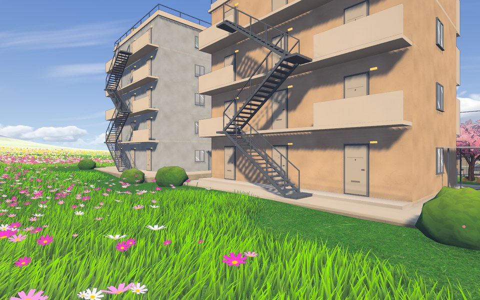
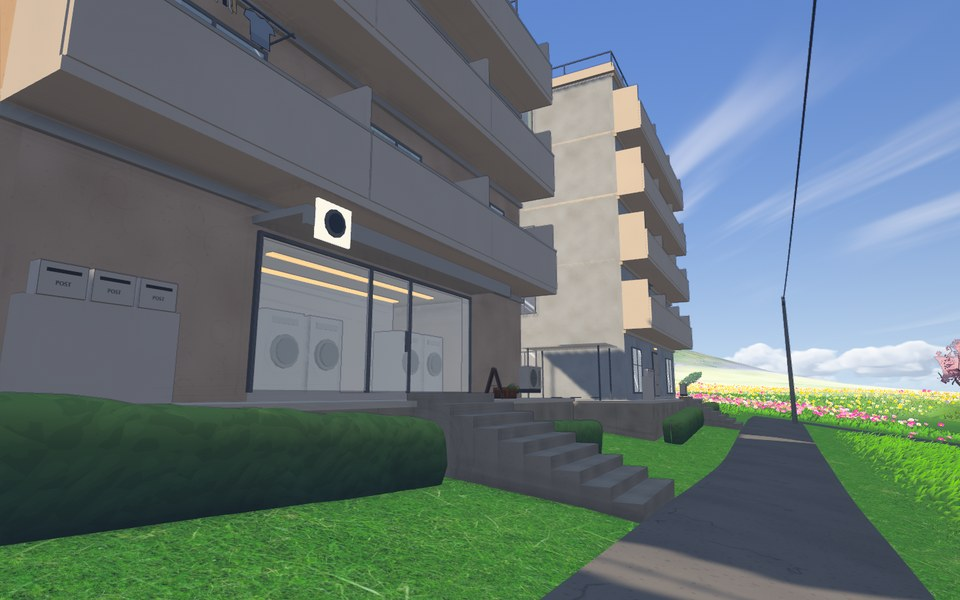
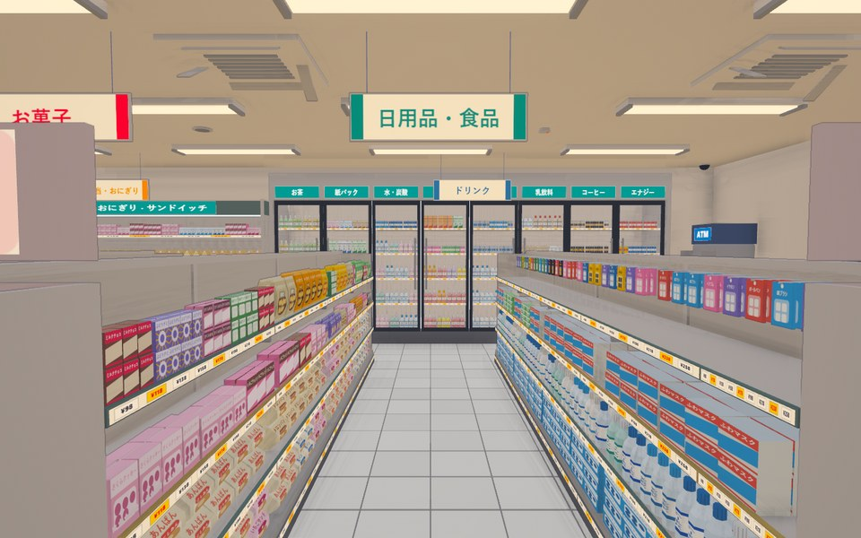
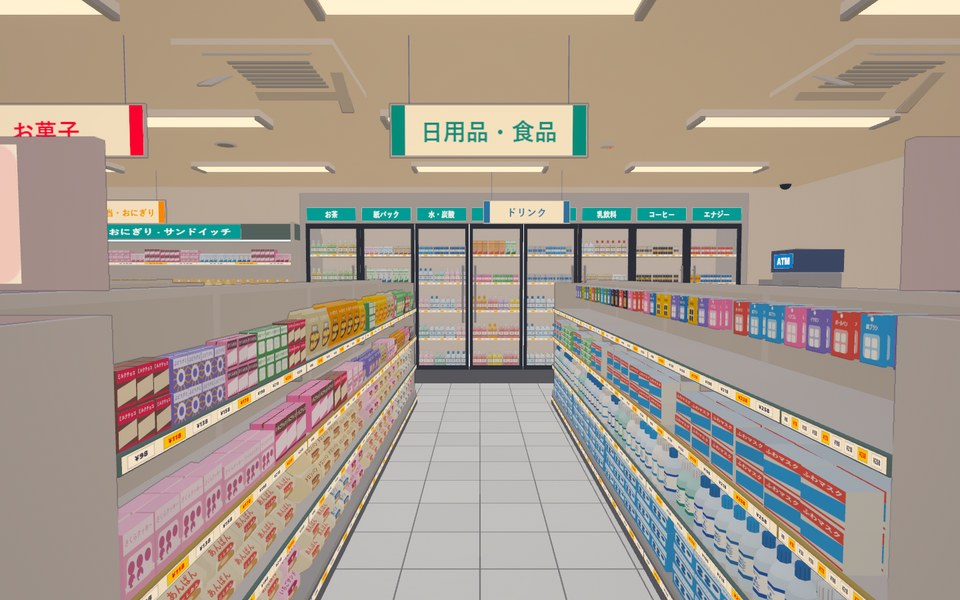

# C10 · 真实素材 AO 与局部自亮面回验

林离在 RTX 3060、1440×900 上复测 `53cb20a8c017eba04bc8dae1437a8179071a1b9d`。38 盏新增门灯与乳白灯箱已在真实素材中可见；店内后墙仍有小幅次峰，不能仅凭改了公式就称横带全部消失。本目录保留实拍、逐行像素、几何检查和所有失败，不代表 P2 或整体美术验收通过。

## 实拍与几何




运行时镇边共 28,857 三角形，比 C9 增加 456：36 个后廊门灯和 2 个正面门灯，每盒 12 三角形。现有 warm-lamp batch 共 40 盒，包含原先 2 个灯条；洗衣机图标灯箱保持 12 三角形，只换材质。没有新增纹理或 Three Light，灯面是 `MeshBasicMaterial` 自亮表面，不会照亮周围物件。独立白灯箱材质由 city 持有并释放，借用纹理顺序不变。

**投影勘误：** 原CPU审查把构建参数 `shadow:false` 当成最终状态；实际被 `src/city.js:189` 的统一遍历覆盖，warm-lamp和white-sign运行时均 `castShadow=true`，仍参与已有太阳阴影图。原审查报告保留，纠正依据见 `cpu/x51-c10-cast-shadow-erratum.md`。这不等于新增实时Light，也不同于全屏AO压暗灯面。

灯箱在 `21-front-eye` 的原 PNG ROI `(519,323,3,3)` 最终 RGB 均值约 `[252.22,247.78,233.56]`，呈略暖乳白，AO 开关差≤1。该点在 `laundry-details` 镜头的 y=-47、屏外，不能用那张近景声称测到了灯箱。

店内顶灯中心 `(710,250)` 实际命中 Basic + vertexColors；颜色已烘到顶点，不能用材质 color 与工厂原色不等就判灯缺失。该区域边缘 y250 暗约 1 级、核心 y252 差 0，没有在这处复现云端“整体暗约 15 级”。这仅覆盖被测灯面；当前全屏 AO 仍不区分自亮表面，不能外推所有灯都不受影响。

## 店内后墙




同 C9 的原 PNG ROI x270..429、y280..329，AO off−on 平均红通道差：y304=3.2125、y313=6.1375、y322≈0.225。依然存在先变浅、再变暗、再归零的走势；详见完整 50 行读数。固定 x350 的几何射线在 y273/277 命中顶棚，y281..326 命中同一后墙。这只确定接收面，不能单独确定每个 AO 采样遮挡物。

几何上要区分两类“牌”：后排悬挂分类牌距后墙约 1.278m，不是贴墙接触；便当冷柜顶部灯箱才与墙内皮有 0.005m 交叠。960×600 投影下，顶棚/墙折线约 y187.05、冷柜箱/墙接触约 y228.04，不能直接把 y192–202 的暗带称为悬牌接触阴影。

独立 GPU 采样已确认：y313 的主要非零采样仍是同一顶棚，**不是悬牌／冷柜制造第二处接触**。直接使用活动 shader 的原 `wbDepth/Pos/Normal/AO` 与同一深度纹理/uniform，在16×48 RGBA32F目标读6中心×16tap；GL error=0，分项求和与原 `wbAO` 最大误差2.421438694e-8，采样阶段PNG与v1同机位原PNG字节相同。

| 中心y | GPU原AO | 内圈贡献和 | 外圈贡献和 |
|---|---:|---:|---:|
| 285 | .683668 | 2.009123 | .521533 |
| 289 | .680174 | 2.007248 | .551358 |
| 295 | .788273 | .849753 | .844063 |
| 304 | .939604 | 0 | .483165 |
| 313 | .885748 | 0 | .914018 |
| 322 | .994971 | 0 | .040229 |

具体外圈 tap5 在 y304→313 时，L从1.061307m缩短到.626393m、距离权重从.183330升到.911798，盖过up从.829066降到.724850，贡献反而从.151993升到.660917。另一个主要外圈tap3贡献从.331173略降到.253101。接收墙GPU法线与几何最大差.01757°，关键顶棚采样最大差.05157°；这组不需假设严重法线错误即可解释次峰。

完整逐项表、活动 shader 和GPU读回见 `analysis/x51-c10-ao-samples-v1-analysis.md` 与 `diagnostic-samples/gpu-ao-samples.json.gz`。对齐Nearest纹素的几何射线支持同顶棚归属，但GPU与射线视深度仍有约.018–.023m残差，未隔离原因，不能称逐点完全一致。结论仅覆盖这6个点，未验证任何修法，也不宣称整个AO唯一根因。

旧服务角补充回归：两HDR ROI与C8/C9半浮点字完全相同，C10点(763,369) AO-on为[25,30,42]、off为[26,31,42]，点(762,459)仍[26,31,41]。上点因新AO有1级R/G差，未回到旧压黑状态；不外推全图HDR不变。

## 实际运行与性能

fixture 目录实际执行：

```bat
node scripts\baseline.cjs --scene=combined --electron=D:\codex\2026-11-16\world-implementation\runtime-path-probe\electron.exe --stills --output=artifacts/gpu-town-c10
```

| 采样 | FPS | p95 帧时 |
|---|---:|---:|
| 站区街道 | 65.0037 | 15.5ms |
| 站区港口 | 64.9998 | 15.5ms |
| 鸟瞰 | 64.6793 | 15.5ms |
| 店内 | 65.0019 | 15.5ms |
| 第三人称，9.3719m | 64.9977 | 15.5ms |
| 第一人称，9.3716m | 64.9998 | 15.5ms |

14/14 行为、look 与真实键盘 walking 通过。初始 982 帧没有 >20ms 帧，最长 15.7ms；**鸟瞰 202 帧仍有 1 帧 30.8ms**，其他五段没有 >20ms 帧。不能称全程零长帧，也没有以约 65 FPS 的结果证明 AO 零开销或旧波动根因消失。

正常基线实际 **exit 1**：`renderOk=true`、`transportClean=false`，保留 menhir、boulders、crate glTF 三次 `ERR_ABORTED`，无 JS 异常。固定机位 v1 同样实际 **exit 1**：menhir、crate glTF、crate BIN 三次取消，无 JS/HTTP 错误。未重试筛绿。

v1 外部命令：`node D:\codex\2026-11-16\world-implementation\handoff\x51-c10-look-diagnostic-gpu.cjs gpu-look-c10-v1`。7 机位×AO on/off×warmup/capture1/capture2，共 42 组，完整报告保留；预定的 14 张 capture2 JPG 与关键 PNG 归档，其余截图留在忽略的 artifacts。13/14 重复组 PNG 完全相同，laundry AO-on 有 2 像素/2 通道差 1 LSB；严格整轮位级一致性仍为 false。源码、驱动与 9 个真实资产前后未变，AO、contrast、相机、时间、RAF 和材质已恢复。定向图不用于帧率推断。

追加采样命令：`node D:\codex\2026-11-16\world-implementation\handoff\x51-c10-ao-samples-gpu.cjs`，只采店内一机位的warmup和两帧，再读96tap。实际exit1，`renderOk=true/transportClean=false`，保留boulders、menhir、crate glTF三次取消；无JS/HTTP错误，临时资源释放、renderer与场景恢复，源码/driver/9asset未变。没有重跑42图或性能测量。

## 来源与验证边界

- 两次主运行均使用原 9 个官方文件，共 3,579,256 字节，按本提交的 `prop-assets.json` 核 size/MD5/SHA256。源码逐项核对精确提交；资产原件、运行缓存不入 Git。C酱云端替身图不当作真实材质验收。
- [C10 Windows job](https://github.com/aa15119557034/agent-review-room/actions/runs/44051706687/job/133930863965) 实际 `node scripts/verify.mjs`：1615/1615 测试、9 类型检查、2 构建，20 步全 code 0，完成于 2026-11-17T09:05:14Z。后续证据头 CI 另查。
- 只读 CPU 检查**不是全通过**：继承断言 driver exit 1，解析斜面在最右 1 像素列出现 AO≈0.88025；诊断 probe exit 0。它是 Float32 深度＋JS 双精度的解析模型，未在实际 GPU 场景复现，不据此判整轮失败。报告同时保留候选根因和限制。
- 完整 JSON/日志无损 gzip，截图不加工；`provenance.json` 记录原字节。C9 只链接：[上一轮实拍与黑点修复证据](../look-c9-2026-11-17/README.md)，不将旧结果改写成 C10。

## 下一棒

请C酱按实际tap表继续检查固定屏幕半径/双圈分布与欧氏距离falloff的组合，并修正city末尾对“不投影”灯面标志的覆盖，保留暗部toe、当前门灯／灯箱和建筑投影。不要把已定位的顶棚次峰解释为另一块牌的贴墙阴影，也不以全局降强度或亮度阈值掩盖。太阳、天空、烘焙方向保持；P2未完成，Draft不合并。
