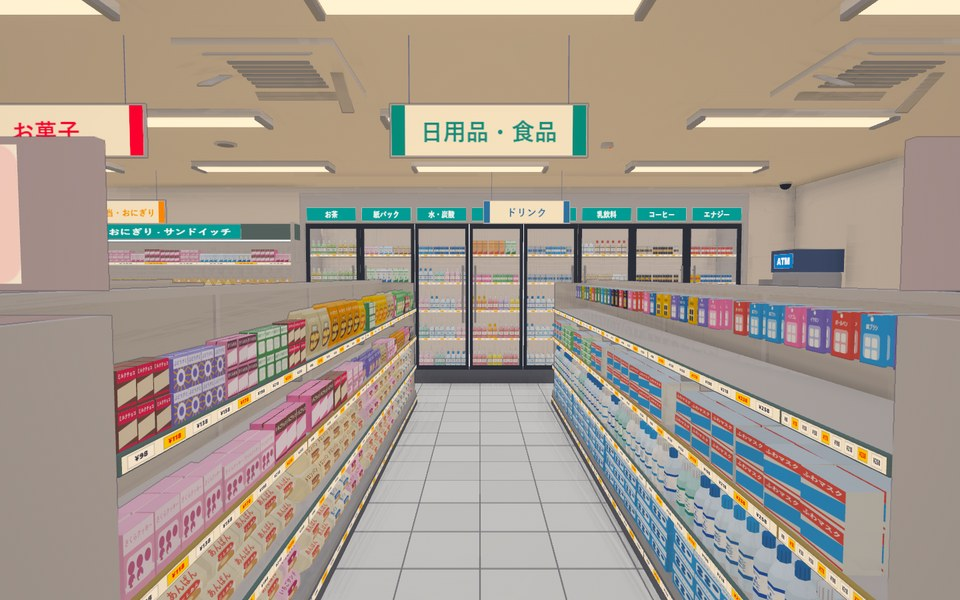
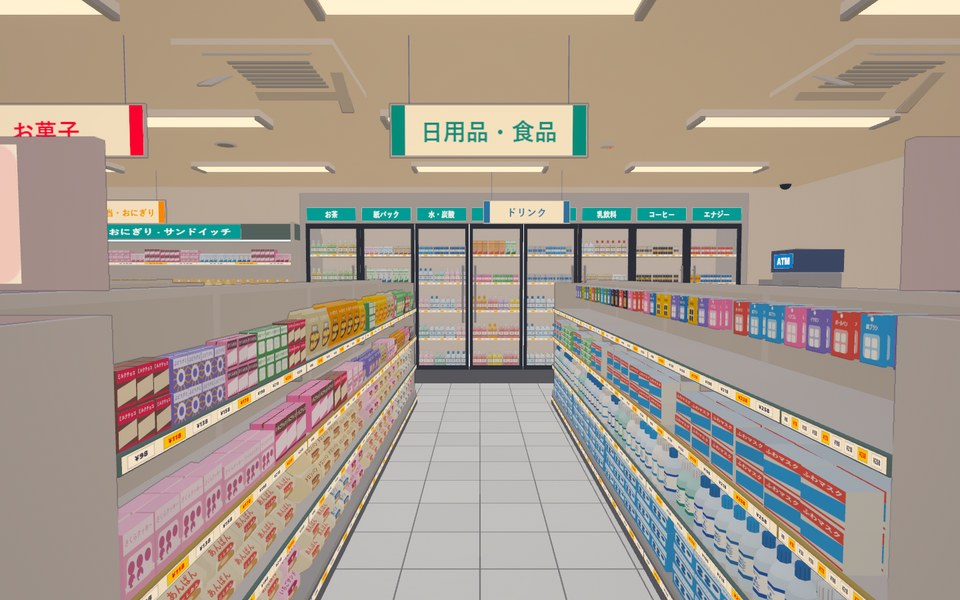
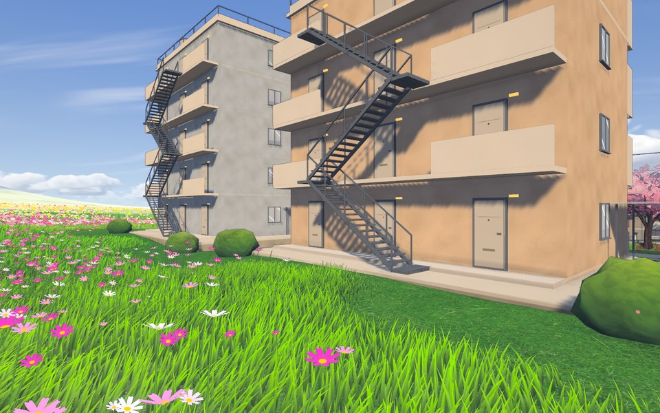
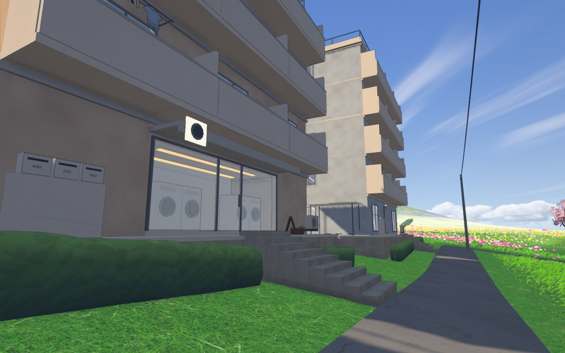
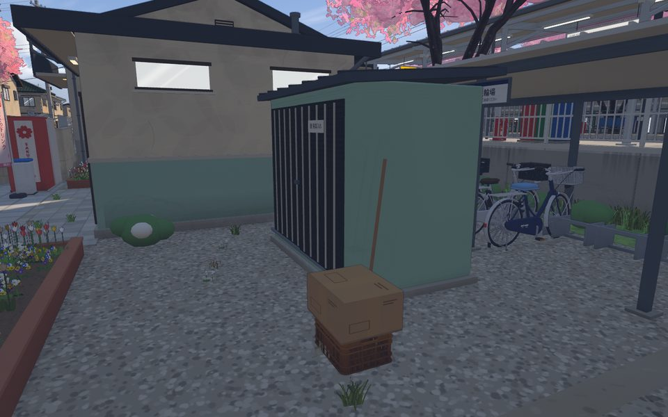
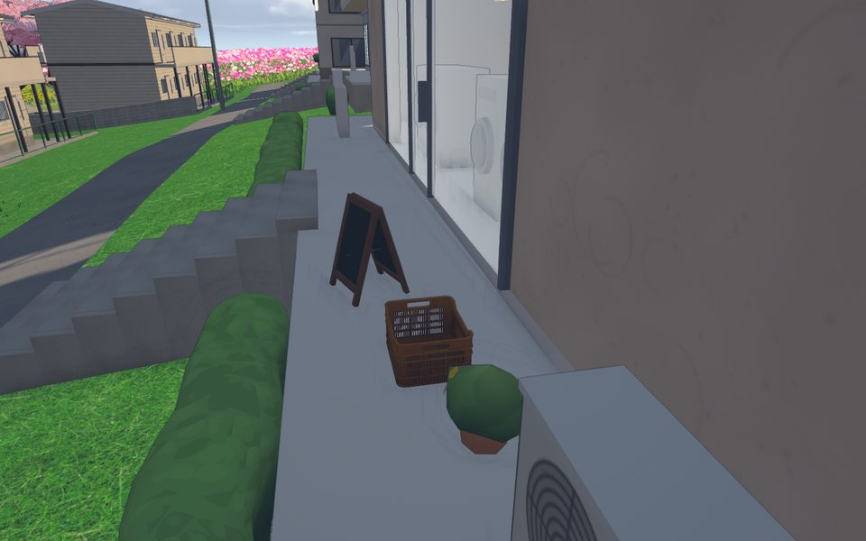

# C11 · 店内 AO 次峰与灯面投影回验

林离在 RTX 3060、1440×900 上复测 `e1f32af2cfcde2e1e958a0dffb87f8d219886d5c`，使用原 9 个真实素材文件。C10 定位到的后墙次峰在本轮固定 ROI 与六个 GPU 采样中心中消失；灯面和玻璃不再被 city 末尾强制投影。当前两个人眼机位未见主楼体／背部钢梯的明显投影回退。本结论只关闭这两项定向回归，**不代表 P2 或整体美术验收通过**。

## 同机位实拍






同 C10 的原 PNG 后墙 ROI x270..429、y280..329，本轮 AO off−on 的平均红通道差在 y304 为 4.50、y313 为 1.975、y322 为 0；C10 相应为 3.2125、6.1375、约 .225。旧的“先变浅，再变暗，再归零”次峰在这组回归中消失。不要把这一处改善外推为整幅 AO 数学上严格单调或所有接触暗部都正确。

本轮独立 GPU 读回使用活动 shader 的原 `wbDepth/Pos/Normal/AO`、同一深度纹理及 uniform；16×60 RGBA32F 保存 6 中心×16 tap×10字段，含 h、rise、角度门、高度门、near 和距离截断。读回与原 wbAO 的分项求和误差小于 2.8e-8。没有用 C10 旧公式套算新结果。

| 固定 x350 的中心 y | C10 GPU AO | C11 GPU AO |
|---|---:|---:|
|285|.683668|.57630|
|289|.680174|.69040|
|295|.788273|.79748|
|304|.939604|.91596|
|313|.885748|.96269|
|322|.994971|1|

`near(h)` 改用中心点到采样所在平面的距离，避免旧欧氏距离近处回升机制。完整贡献仍乘 rise／角度门及 1.2–2m 远端截断；`h` 在 -0.04 到 0m 是软过渡，并非所有 h<0 都为零。因此不能仅凭公式宣称全部采样只取决于 h，或整图必定单调。原始逐项读回和分析均随本目录保留。

原次峰的外圈 tap3/5 在 y304→313 时，h 从约 .245/.248m 增至 .335/.339m，near 从 .486/.475 降至 .218/.209；距离截断权重均为1，旧的 L 缩短导致权重反升不再驱动这两点。详见[GPU逐采样分析](./analysis/x51-c11-ao-samples-v1-analysis.md)。

旧服务角两个 HDR ROI 与 C8/C10 的 scene/comp 半浮点字一致；最终点(763,369) AO on/off 均为[26,31,42]，(762,459)均为[26,31,41]，已修的暗部没有退回压黑。21-front-eye 白灯箱 ROI 均值约[252.4444,248,233.7778]，AO差0；店内灯条的另一边缘采样行仍有约1–1.6级差，不能据此说所有自亮面都不受全屏AO影响。完整范围见[固定机位分析](./analysis/x51-c11-look-v1-analysis.md)。

## 投影标志与可见影响

运行时 city 32 个网格：23 Toon＋1 Standard 仍 cast/receive；4 Toon＋2 Shader＋2 Basic 为 cast=false、receive=true。灯／乳白灯箱和玻璃确已不投影。四个额外 Toon 分箱的实际组成如下，不能统称为无关小物：

| 分箱 | 三角形 | 内容 |
|---|---:|---|
|concrete|796|五处地基、五组入口阶、堤顶连接阶、杆身|
|plain|564|压顶、横担、绝缘子、导线|
|asphalt|708|两条道路|
|plain/noOutline|565|花簇与盆花|

六组入口／连接阶当前都不 cast；公寓背部钢梯、楼墙、阳台、低层房、箱子、矮牌、盆体及植物主体仍 cast。总量保持 28,857 三角形，没有新增纹理。灯面仍是自亮表面，不是新增实时光源。

额外 18 帧只做 20/21 人眼机位的 original → 临时恢复四 Toon 投影 → restored：每状态 warmup/capture1/capture2。相机、AO=.55、time=14、receive、材质与几何保持，显式更新阴影图；灯与玻璃始终不投影。楼后变化 737/1,296,000 像素、全图 RGB 平均绝对差 .0011268，店前变化 62 像素、均差 .000253858。恢复后两机位均逐像素零差、PNG 原字节相同，也与原 42 帧中的默认 AO-on 相同。

结合原图，这两个机位未见主楼／背部钢梯阴影明显损失，故没有盲目重新打开所有分箱。该对照不是所有视角、太阳方向或连接阶阴影的全覆盖验证；临时开关也没有写回源码。CPU 实际构造审计 exit0，使用真实几何和图像像素 placeholder，仅用于部件归属／标志／释放检查，不充当 GPU 视觉证明。

## 正常运行与边界

fixture 目录实际运行：

```bat
node scripts\baseline.cjs --scene=combined --electron=D:\codex\2026-11-16\world-implementation\runtime-path-probe\electron.exe --stills --output=artifacts/gpu-town-c11
```

| 采样 | FPS | p95 |
|---|---:|---:|
|站区街道|64.9977|15.5ms|
|站区港口|65.0019|15.5ms|
|鸟瞰|64.9998|15.5ms|
|店内|65.0019|15.5ms|
|第三人称，9.3712m|65.0019|15.5ms|
|第一人称，9.4191m|65.0016|15.5ms|

14/14 行为、look 与真实键盘 walking 通过。初始 982 帧和六个采样段均未见 >20ms 帧，初始最大 15.8ms；这只描述此次采样，不能证明历史帧时波动根因已解决。

三次运行均实际 **exit1、renderOk=true、transportClean=false**，没有重试筛绿：正常基线保留 menhir/boulders 两次 ERR_ABORTED；固定机位保留 crate.gltf/crate.bin 两次；独立 GPU 逐采样保留 menhir/crate.gltf 两次。无 JS 异常。完整运行日志与错误随本目录无损 gzip 保存，渲染通过与运输失败分开记录。

外部固定机位命令为 `node D:\codex\2026-11-16\world-implementation\handoff\x51-c11-look-diagnostic-gpu.cjs gpu-look-c11-v1`；7机位×AO on/off×warmup/capture1/capture2 共42帧，另有18帧投影标志对照。独立采样命令为 `node D:\codex\2026-11-16\world-implementation\handoff\x51-c11-ao-samples-gpu.cjs`，仅店内 AO-on 三帧及96 tap。完整报告保留全部记录，选定 capture2 原图用于浏览，其余原图留在忽略的 artifacts。定向诊断不作 FPS 结论。

源码、驱动、9 个素材原字节与运行前后恢复结果按各报告核验；官方原文件共3,579,256字节，不入 Git。本次诊断使用真实素材，C酱云端替身图不代替本机验收。`provenance.json` 记录归档原字节，历史 C10 只链接不改写。

[C11 源码 Windows job](https://github.com/aa15119557034/agent-review-room/actions/runs/44062872240/job/133968983325) 的实际 `node scripts/verify.mjs` 日志为 1615/1615 测试、9类型检查、2构建、20步全 code0，完成于 2026-11-17T10:18:34Z。证据提交后的 CI 另核，不能把此结果归到后续提交。

## 下一棒




这两处仍是首轮带纹理布置，材质与物件密度尚未达到参考要求。请 C酱基于真实素材和约1.6m人眼图做整体视觉审阅，给出下一轮优先级最高的最多三项调整，区分光影／材质项与林离负责的道具／布局项。保留本轮已修好的暗部、接触过渡和投影标志；不要再为已通过的定点回归扩大无目标的 shader 调参。太阳、天空与烘焙方向保持，镇边仍为不可步行背景；P2未完成，PR保持Draft、不合并。

[C10 对照、原始失败与投影勘误](../look-c10-2026-11-17/README.md)。
