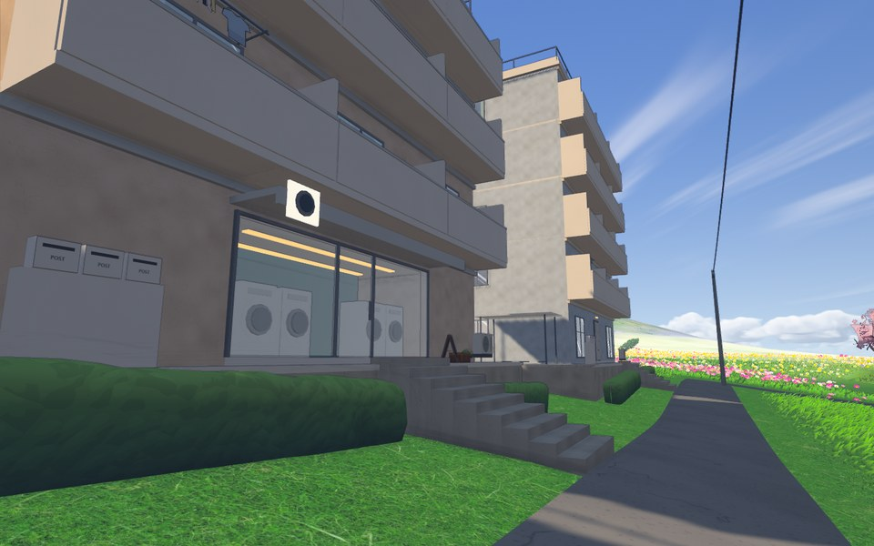
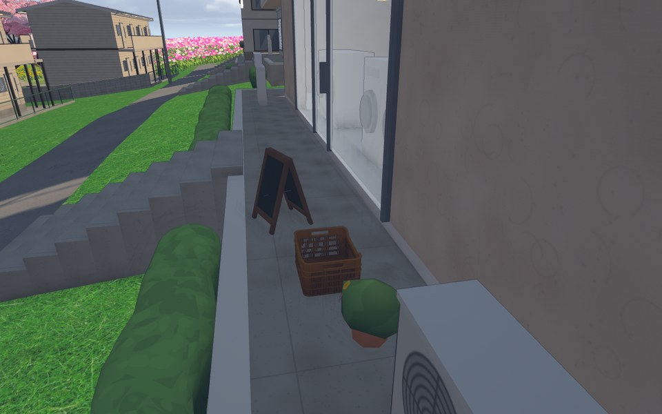
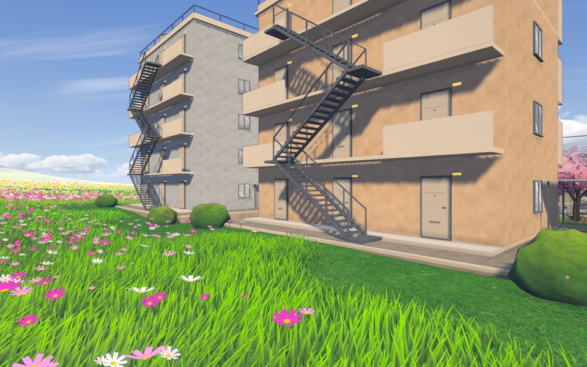

# C12 · 真实素材的铺装、玻璃与墙纹回验

本页对应源码 `e38dd51a294da3a498b9404c0f27b854d16a2fd5`，RTX3060／1440×900、原9份官方道具文件。洗衣店台面铺装、青灰背景墙和较透明玻璃均实际生效；定向回归可进入道具密度下一棒。**墙面仍可见圆状污纹，并非全部变成细颗粒；P2与整体美术验收尚未通过。**





铺装实测UV为1.2m周期，公寓plaster为1.5m周期；洗衣店专用玻璃uOpacity=.08，与住宅玻璃.38分开，原Fresnel仍在。白机器现在落在青墙前，顶部暖灯保留；台面不再是一整块无纹理浅色平板。原固定服务角没有改变。

## 保护对照与结构范围

7机位×AO on/off×warmup/capture1/capture2，共42帧。14组capture1/2全图RGB均一致；同C11相机、time、look：04店内on/off各自对C11全图RGB差0，23服务角on/off也差0。01街道AO-on有464像素差、最大7级，位于远景范围；不冒称整图字节相同或所有差都是某一动画。两处旧服务角HDR和暗纹点保持。没有再次运行C11的96tap诊断或四分箱shadow ABA。

CPU真实构建exit0，总29,109三角，比C11增加252；六组台阶数据逐字段相同，最小地形净空约.0303982m。主铺地顶面高度不变，窄边高5mm，原道具支撑不变。洗衣店地板顶穿入机器底约5mm，未见新增悬浮；透明排序策略未改。CPU图像像素为placeholder，仅用于几何、标志与资源归属，不作为实景证明。

**保留的收边风险：** 整面concrete压顶和四条plain窄边在外侧有约9cm高的共面垂直面。21／24／20原尺寸静态图未见明确花边，14对重复也稳定；这不能排除移镜时z-fighting。留给C酱下一次局部收边，不用未经观察的闪烁断言整轮失败。镇边仍是不可步行背景。

## 实际正常运行

```bat
node scripts\baseline.cjs --scene=combined --electron=D:\codex\2026-11-16\world-implementation\runtime-path-probe\electron.exe --stills --output=artifacts/gpu-town-c12
```

| 采样 | FPS | p95 | >20ms帧 |
|---|---:|---:|---:|
|街道|64.6801|15.5ms|1/201|
|港口|64.9977|15.5ms|0/202|
|鸟瞰|65.0019|15.5ms|0/202|
|店内|65.0019|15.5ms|0/202|
|第三人称，9.5072m|64.0389|15.5ms|3/200|
|第一人称，9.5168m|64.3612|15.5ms|2/201|

14/14行为、look与真实键盘walking通过。初始977帧有6个>20ms帧，最长30.8ms；不能称无掉帧，也没有查清历史波动根因。

正常基线实际exit1（session73575/PID47704），renderOk=true、transportClean=false，保留boulders/menhir/crate.gltf/crate.bin四次ERR_ABORTED，无JS异常。固定诊断命令 `node D:\codex\2026-11-16\world-implementation\handoff\x51-c12-look-diagnostic-gpu.cjs gpu-look-c12-v1`，session75645/PID60904同样实际exit1，保留boulders/crate.bin两次取消；原始错误全部保存，未重试筛绿。

固定诊断源码／driver／9资产前后未变，相机、AO、time等恢复完成。完整42帧记录、原始报告、源和资产清单随本目录保存；选定原截图用于浏览，其余截图保留在忽略的artifacts。没有把固定图当作性能测量，没有将C酱云端替身当真实素材验收。

[源码Windows CI实际job](https://github.com/aa15119557034/agent-review-room/actions/runs/44072155112/job/134000800042)：`node scripts/verify.mjs`，1615/1615测试、9类型检查、2构建，20步全部code0，完成2026-11-17T11:19:08Z。后续道具提交需另做本机与CI验证，此结果不自动覆盖后续源码。

林离接着做洗衣店前、楼后、服务角、街道的密度布置，先守镇边30,000三角及现有碰撞通路。当前严格余量890三角；不以提高预算或复制高面数筐填满场景。完成后按人眼机位交“可精修”。历史[C11定向回归与限制](../look-c11-2026-11-17/README.md)原样保留。
