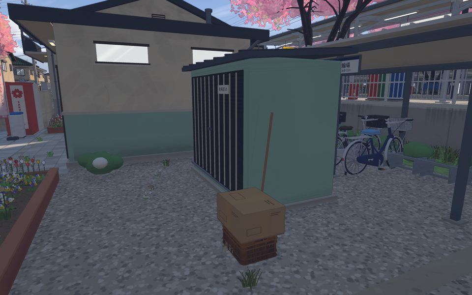
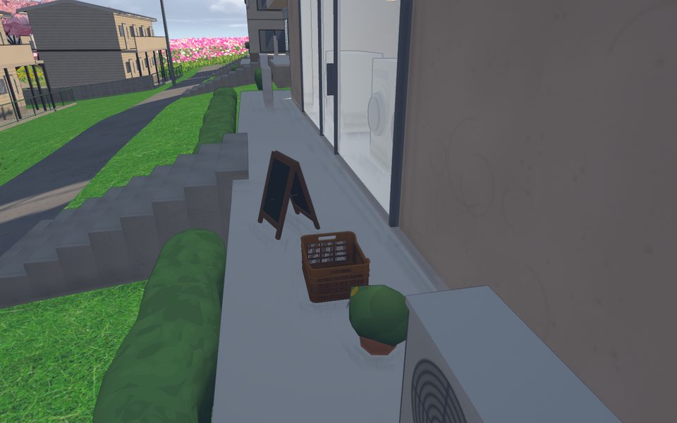
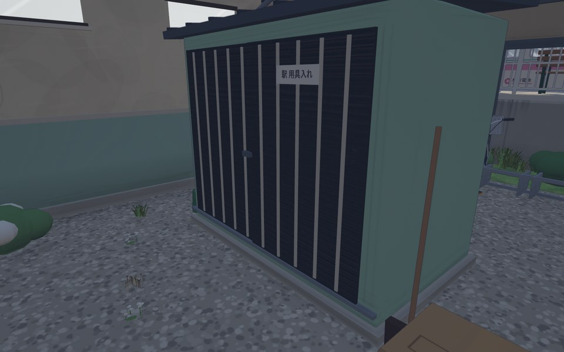
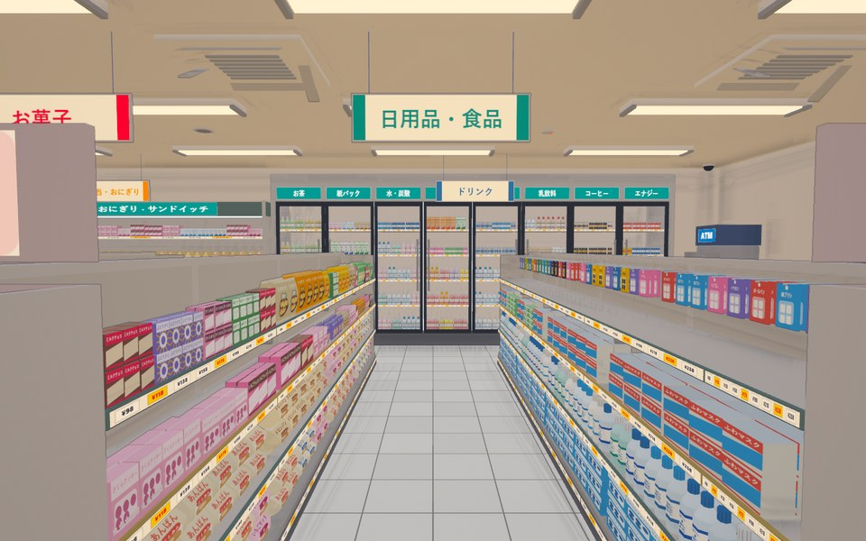
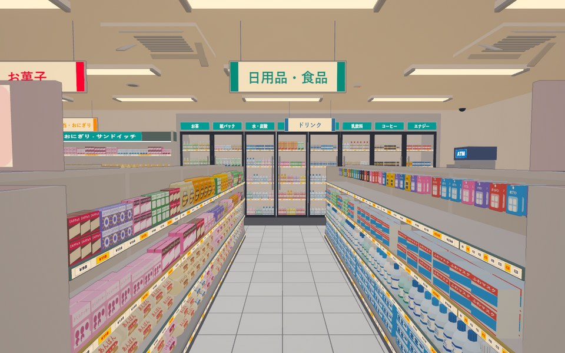

# C9 · 真实素材暗部与 AO 回验

林离在 RTX 3060、1440×900 上复测 C酱源码 `1b63536ef0dae7c9f28d92efda01b0740e9a005a`。**卷帘暗部修复成立；店前/楼后的明显 AO 光环减弱，但店内仍有可重复的浅横带，需要继续修。** 本目录是回验与失败记录，不代表 P2 或整体美术验收通过。

## 实拍与剩余问题




与 [C8 原机位/因果证据](../textured-props-2026-11-17/README.md) 对齐的旧服务角，两个 sceneRT/compRT ROI 的 HalfFloat 原值逐字相同，而最终像素发生如下变化（左上原点，1440×900）：

| 像素 | C8 默认 contrast=1.05 | C9 默认 contrast=1.05 |
|---|---|---|
| (763,369) | [0,0,5] | [26,31,42] |
| (762,459) | [0,0,3] | [26,31,41] |

这支持在后期 contrast 层修复吞暗部的结论，没有换成 Basic 材质、提高曝光或把 contrast 降至 1。这里只对实际读取的 ROI 声称 HDR 相同；标量 contrast 曲线在 x≥0.12 不变，不能推导后续跨通道 grade 后整幅图片或所有亮通道像素不变。



AO-on 默认强度 0.55 与 AO-off=0 使用相同机位、固定时间和冻结场景。店前窗/信箱的大台阶光环明显改善，楼后原有投影保留；店内后墙仍可见浅水平暗带。




原 PNG 的后墙 ROI 为 x270..429、y280..329：y295 的 off−on 平均 RGB 为 [12.1125,10.35625,8.2875]，局部最大通道差 13；y304 降到约 [1.77,1.51,1.21]，y313 又升至约 [9.31,7.96,6.39]，y322 后归零。两态的 capture1/2 各自完全相同，表明残余不是随机截图抖动。这里只确认 AO 开关导致额外条带，尚未证明算法内的唯一根因；下一棒应在 `src/look.js` 的视空间位置/法线/采样层定位，不以全局降强度掩盖。

## 实际运行

在 fixture 目录执行：

```bat
node scripts\baseline.cjs --scene=combined --electron=D:\codex\2026-11-16\world-implementation\runtime-path-probe\electron.exe --stills --output=artifacts/gpu-town-c9
```

| 采样 | FPS | p95 帧时 |
|---|---:|---:|
| 站区街道 | 64.9995 | 15.5ms |
| 站区港口 | 64.9977 | 15.5ms |
| 岛屿鸟瞰 | 64.9995 | 15.5ms |
| 店内 | 64.9977 | 15.5ms |
| 第三人称，9.3716m | 64.9998 | 15.5ms |
| 第一人称，9.4194m | 64.9995 | 15.5ms |

14/14 行为、look 与真实键盘 walking 检查通过。初始采样 970 帧中仍有 12 帧超过 20ms、最长 30.9ms；不能称全程无长帧，也不能据此证明旧步行波动根因已消失。镇边保持 28,401 三角形，本轮没有改几何和材质来源。

正常基线和独立 AO 诊断均 `renderOk=true`、`transportClean=false`，**实际进程退出 1**：每次均记录 crate glTF 的一次 `net::ERR_ABORTED`，无 JS 异常或 HTTP 错误。原报告和日志完整保留，没有重跑筛选成功结果。渲染可用不等于加载取消已修复。

独立诊断外部命令为 `node D:\codex\2026-11-16\world-implementation\handoff\x51-c9-look-diagnostic-gpu.cjs`。共 7 机位×AO on/off×warmup/capture1/capture2，即 42 组 PNG/JPG。归档预定的 14 张 capture2 JPG 和 8 张关键 PNG，完整 42 条读回数据保存在 `diagnostic/look-report.json.gz`；其余原截图留在忽略的 `artifacts/gpu-look-c9-v1`。14 组重复帧中 13 组 PNG 完全相同；laundry AO-on 有 1 像素的 1 通道差 1 LSB，因此没有声称整轮位级一致。默认 AO、contrast、FOV、材质、时间和 RAF 已恢复，源码/驱动/9 个真实资产前后未变。诊断不用于帧率推断，也没有新增 contrast ABA 测试。

## 源码与验证范围

- baseline 与 diagnostic 的来源清单分别核对精确提交。9 个忽略资产共 3,579,256 字节，按该提交 `prop-assets.json` 的 size/MD5/SHA256 核验；baseline 内嵌 receipt、diagnostic 独立 receipt 分开保留。真实原素材不入 Git，C酱云端替身图也不当作本机素材验收。
- CPU 只读检查：100001 个 toe 样本单调、零输入为零、0.12 处值/斜率连续，680 个解析深度探针无 NaN/零法线。CPU 双精度/Float32 深度计算不代替 GPU 图像判断。
- [C9 源码的 Windows job](https://github.com/aa15119557034/agent-review-room/actions/runs/44045578472/job/133910311870) 实际执行 `node scripts/verify.mjs`：1615/1615 测试、9 类型检查、2 构建，20 步全部 code 0，完成于 2026-11-17T08:22:15Z。`ci/` 保存原始 job 日志和解析结果。此 CI 只对应 `1b63536`，后续证据提交的 CI 另查。
- `analysis/` 为离线 HDR 和像素分析，`cpu/` 为 CPU 检查；`source-map/` 为固定资产核对；`provenance.json` 保存全部归档文件原字节哈希（不递归包含自身）。完整报告/日志采用无损 gzip，图片不加工；C8 原证据只链接，固定文件哈希见 `c8-references.json`。

## 交接范围

下一棒请 C酱先处理可复现的店内 AO 残余横带，保留卷帘暗部修复，再接正午场景可成立的局部自发光。此前仅调颜色的“暖光”试验未提交，不把正午天空/烘焙地形调紫当傍晚；真实傍晚涉及天空和烘焙方向，留待单独设计。保持 Draft、不合并，镇边仍不可步行，P2 未完成。
