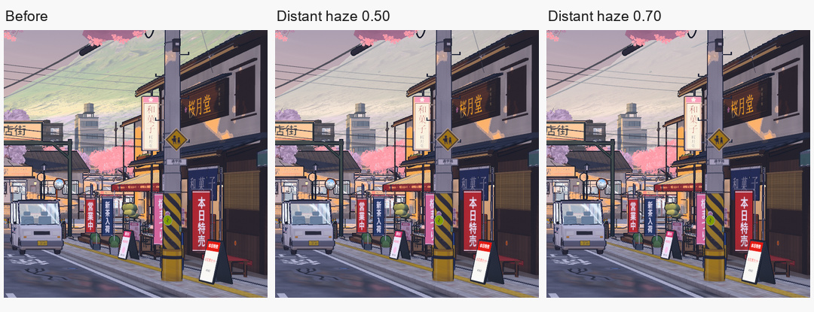
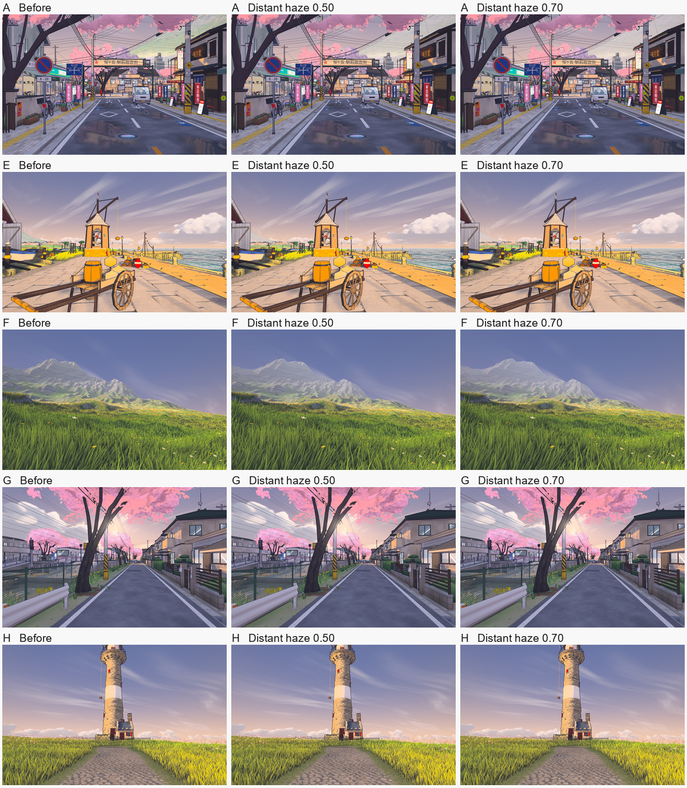

# 第四轮远山与最终广场樱花 · 地面 3060 验收

候选源提交 `e931ced959f91c39b9332ca2c3ed0f504b816971`。C酱交回 `841e797` 的 0.70，我在同一份最终 Blender 樱花上对拍后采用 0.50。原版为 `858e68285325786ee6f3b6f9f53a97044ef96601`，0.70 合入候选为 `ae996526926542a63708f6a436b362f98c4c3d96`。本轮画面和帧时都来自本机 RTX 3060 Laptop、D3D11、1440 × 900、DPR 1。



## 同机位与清晰度

A 主街远山原来与店招争视线；0.70 下坡面与天空接近，0.50 留下了山脊纹理。A 距离超过 530 米的 67,700 个同深度档像素中，平均水平亮度边差依次为 2.96、1.96、1.60 级。A 站前门楼文字框的最大 RGB 差为 1 / 1 / 1 级，B、D、H 完整最终原图与改前相同。[逐机位像素和深度分布](visual-metrics.json) · [固定招牌与路面区域](rois.json)



| 机位 | 1440 × 900 原图 | 最终画面变化像素 | 最大通道差超过 2 级的像素 |
|---|---|---:|---:|
| art-a-street | [改前](views/before/art-a-street.png) · [最终 0.50](views/haze050/art-a-street.png) | 111,181 | 69,701 |
| art-b-konbini | [改前](views/before/art-b-konbini.png) · [最终 0.50](views/haze050/art-b-konbini.png) | 0 | 0 |
| art-c-alley | [改前](views/before/art-c-alley.png) · [最终 0.50](views/haze050/art-c-alley.png) | 423 | 16 |
| art-d-laundry | [改前](views/before/art-d-laundry.png) · [最终 0.50](views/haze050/art-d-laundry.png) | 0 | 0 |
| sample-e-harbour | [改前](views/before/sample-e-harbour.png) · [最终 0.50](views/haze050/sample-e-harbour.png) | 24,160 | 14,646 |
| sample-f-hillside | [改前](views/before/sample-f-hillside.png) · [最终 0.50](views/haze050/sample-f-hillside.png) | 213,342 | 162,959 |
| sample-g-rail | [改前](views/before/sample-g-rail.png) · [最终 0.50](views/haze050/sample-g-rail.png) | 607 | 184 |
| sample-h-north | [改前](views/before/sample-h-north.png) · [最终 0.50](views/haze050/sample-h-north.png) | 0 | 0 |

固定原机位、四元数、FOV、傍晚灯光、模拟时刻 14、隐藏 HUD。每个机位连拍三次，再返回 A。深度分档取自主场景已解析深度，分开记录天空与 60、120、300、530、850 米距离。差异统计按原始 RGB，深度分区只统计三份图在同一个档的像素，镜头均保留完整后处理。海港水面与远近边缘的个别像素会随实景渲染变化。三份素材均有 272 个请求通过来源和传输字节核对，贴花 26 张，指纹 `1061:2667664:298285.6:949273.1`。[照片元数据](captures/haze050.json) · [0.70 主街原图](views/haze070/art-a-street.png) · [0.70 山坡原图](views/haze070/sample-f-hillside.png)

## 帧时

表内为平均 FPS / P95 毫秒。固定机位每段至少 10 秒，真实行走每段至少 3 秒，Chromium 将受信任的 W 按下和释放事件送入游戏控制器。每轮独立启动。验收线为 FPS ≥ 60 且 P95 ≤ 16.7 毫秒。

| 机位 | 改前 | 0.50 首轮 | 0.50 复测 |
|---|---:|---:|---:|
| A 主街 | 64.90 / 15.5 | 63.22 / 15.5 | 62.24 / 15.6 |
| B 便利店 | 65.00 / 15.5 | 65.00 / 15.5 | 65.00 / 15.5 |
| C 后巷 | 65.00 / 15.5 | 65.00 / 15.5 | 65.00 / 15.5 |
| D 洗衣店 | 65.00 / 15.5 | 65.00 / 15.5 | 65.00 / 15.5 |
| 第三人称步行 | 58.60 / 30.8 | 56.71 / 30.8 | 65.00 / 15.5 |
| 第一人称步行 | 60.22 / 30.7 | 60.52 / 30.7 | 64.68 / 15.5 |

四个固定艺术机位两轮达标。两段步行首轮 P95 约 30.7–30.8 毫秒，复测 15.5 毫秒，步行仍有间歇慢帧。三轮均通过站区行为、视觉开关和行走输入核对，原始 RAF 时间、遮挡前台情况、GPU、机位和传输回执在各自目录。[原版](timings/before/frame-times.json) · [最终首轮](timings/final-1/frame-times.json) · [最终复测](timings/final-2/frame-times.json)

## 历史地面机位补测

沿用 C28 留存的相机位置、旋转与 FOV。照片固定于傍晚第 14 秒，帧时来自恢复动画后的独立 6.5 秒以上采样。

| 机位 | 改前 FPS / P95 ms | 0.50 FPS / P95 ms | 同机位原图 |
|---|---:|---:|---|
| 01-station-street | 65.00 / 15.5 | 64.85 / 15.5 | [改前](legacy/before/01-station-street.png) · [最终](legacy/final/01-station-street.png) |
| 20-rear-eye | 64.85 / 15.5 | 65.00 / 15.5 | [改前](legacy/before/20-rear-eye.png) · [最终](legacy/final/20-rear-eye.png) |
| 21-front-eye | 65.00 / 15.5 | 65.00 / 15.5 | [改前](legacy/before/21-front-eye.png) · [最终](legacy/final/21-front-eye.png) |
| 23-service-corner | 65.00 / 15.5 | 64.85 / 15.5 | [改前](legacy/before/23-service-corner.png) · [最终](legacy/final/23-service-corner.png) |
| 24-laundry-details | 65.00 / 15.5 | 65.00 / 15.5 | [改前](legacy/before/24-laundry-details.png) · [最终](legacy/final/24-laundry-details.png) |

补测保留原始间隔、绘制量和逐请求回执。[改前](legacy/before/legacy.json) · [最终](legacy/final/legacy.json)

## 视野外几何

地形已按视锥选择四叉树节点，草地按视锥与距离选格。另有四批岛屿道具始终整批提交。固定主街实抓主颜色绘制 5,414,223 个三角形、阴影 2,275,177 个。真实按键第一人称走过 3.33 米后，主颜色绘制 5,889,587 个、阴影 2,275,049 个。

灯塔、立石、岩石、风树四批主颜色合计每次提交 1,398,157 个三角形。逐实例包围球按变换放大并外扩 3 米，主街约 571,830 个、第一人称约 364,553 个三角形属于球体已完全离开视锥的实例。这个估算没有计入遮挡，也没有把三角形换算成毫秒。每个相机单独测量，空间分块的实际收益还要看新增加的绘制调用、倒影和急转身。[逐绘制记录](visibility.json.gz)

## 复测入口

使用本仓锁定资产和已安装的 Electron。用 WORLD_FIXTURE 指定待测的工作树 fixture，AUDIT_FIXTURE 指向包含验收传输核查的 0db21d2 工作树 fixture，TESTED_SOURCE 指定待测提交。目录必须是新输出目录。

```text
node tools/capture-ground.cjs ELECTRON ABSOLUTE_PHOTO_OUTPUT
node tools/timing-ground.cjs ELECTRON NEW_ARTIFACT_NAME
node tools/legacy.cjs ELECTRON FIXTURE AUDIT_FIXTURE SOURCE ABSOLUTE_LEGACY_OUTPUT visibility
```

完整索引含机位、时长、逐机位判断和输入事件。[验收数据](summary.json)
