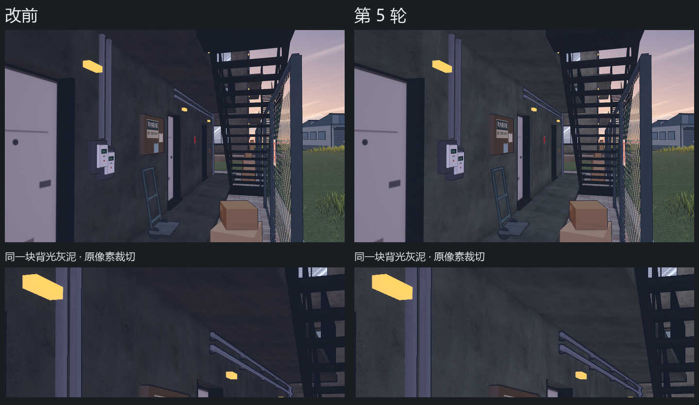

# 第 5 轮背光公寓 · RTX 3060 地面复验

C酱的 `4b365b1e` 只改公寓表面材质。它从共享初版 `14992699` 分出，林离把它与云端准备工具 `b477c381` 合在 `be0549d8`。两条历史都保留，受测版本和 C酱提交中的 `src/apartment-surfaces.js` 字节相同。

## 画面

C 后巷背光灰泥的起伏能看清，门灯仍是暖色焦点。A 主街只有远处少量公寓表面变化。B 便利店、F 山坡、G 铁道和 H 北岸的两份正式 PNG 分别字节相同。D 洗衣店的变化集中在招牌上方的公寓檐下。按 #252 的固定参考，C 的暗部可读性更接近目标，楼梯和铁丝网仍比参考更接近深灰。[固定参考与镜头目标](https://github.com/aa15119557034/agent-review-room/issues/252#issuecomment-6975321999)

四种实际编译的公寓材质都启用了这道背光，九张 1024 × 1024 贴图均已加载。打开全局 `?shadowtint=off` 时，四种材质均回到原来的 0.65 环境遮蔽强度，编译的片元程序不含新增背光代码。此时 C 和 D 的前后 PNG 均字节一致。正式画面中 26 张贴花的位置指纹为 `1061:2667664:298285.6:949273.1`。

以生产着色器实际得到的直射光比率绘制材质遮罩，去掉 2 像素边缘。在 C 后巷有 666,871 个完全背光的公寓像素，亮度中位数从 42.23 升到 52.58。两块裸灰泥局部从 45.30 到 56.80、47.08 到 59.44。D 檐下 258,232 个背光像素的平均亮度升了 9.43。D 另有 432 个完全受光的内侧样本，平均升 1.13，单通道最多差 2 级。全材质的环境遮蔽强度从 0.65 降到 0.40，受光面也有这个小变化。[明暗取样与统计](directional-light.json) · [局部坐标与纹理梯度](visual-summary.json) · [材质遮罩](masks)

每次正式复拍都重新启动场景。另一次在同一冻结世界中只撤去第五轮的片元代码、把环境遮蔽恢复到 0.65，再还原候选。表内记录改变的显示像素数与最大单通道色阶差，分辨率为 1440 × 900。独立启动之间的港口差异和同帧材质效果可分别查验。

| 机位 | 独立启动改变像素数 | 同一帧改前与改后，像素数 / 最大差 | 还原候选与初次候选，像素数 / 最大差 | 两份正式 PNG |
| --- | ---: | ---: | ---: | --- |
| A 主街 | 3,274 | 3,275 / 21 | 2 / 1 | [改前](photos/before/art-a-street.png) · [改后](photos/after/art-a-street.png) |
| B 便利店 | 0 | 0 / 0 | 0 / 0 | [改前](photos/before/art-b-konbini.png) · [改后](photos/after/art-b-konbini.png) |
| C 公寓后巷 | 723,794 | 723,794 / 28 | 0 / 0 | [改前](photos/before/art-c-alley.png) · [改后](photos/after/art-c-alley.png) |
| D 洗衣店 | 369,697 | 369,697 / 22 | 0 / 0 | [改前](photos/before/art-d-laundry.png) · [改后](photos/after/art-d-laundry.png) |
| E 港口 | 3,601 | 0 / 0 | 0 / 0 | [改前](photos/before/sample-e-harbour.png) · [改后](photos/after/sample-e-harbour.png) |
| F 山坡 | 0 | 0 / 0 | 0 / 0 | [改前](photos/before/sample-f-hillside.png) · [改后](photos/after/sample-f-hillside.png) |
| G 铁道 | 0 | 0 / 0 | 0 / 0 | [改前](photos/before/sample-g-rail.png) · [改后](photos/after/sample-g-rail.png) |
| H 北岸 | 0 | 0 / 0 | 0 / 0 | [改前](photos/before/sample-h-north.png) · [改后](photos/after/sample-h-north.png) |

[A–D 成对比较](ground-a-d.jpg) · [E–H 成对比较](ground-e-h.jpg) · [同帧原图](same-frame)

## 帧时

RTX 3060 Laptop，原生 Electron，1440 × 900，DPR 1。每个固定机位连续记录至少 10 秒，每次测完八镜再用 Chromium 的真实 W 键事件分别走第三、第一人称至少 3 秒。四轮按改前、改后、改后、改前交错，表内为平均 FPS / P95 毫秒。四轮八镜达标数依次为 7/8、8/8、8/8、6/8，共 22,414 个固定与步行帧间隔。验收线为平均至少 60 FPS、P95 至多 16.7 毫秒。

| 机位 | 改前 1 | 改后 1 | 改后 2 | 改前 2 |
| --- | ---: | ---: | ---: | ---: |
| A 主街 | 64.60 / 15.5 | 65.00 / 15.5 | 65.00 / 15.5 | 60.75 / 30.7 |
| B 便利店 | 64.80 / 15.5 | 65.00 / 15.5 | 65.00 / 15.5 | 65.00 / 15.5 |
| C 公寓后巷 | 65.00 / 15.5 | 65.00 / 15.5 | 65.00 / 15.5 | 65.00 / 15.5 |
| D 洗衣店 | 65.00 / 15.5 | 64.90 / 15.5 | 65.00 / 15.5 | 65.00 / 15.5 |
| E 港口 | 65.00 / 15.5 | 65.00 / 15.5 | 64.61 / 15.5 | 56.29 / 30.8 |
| F 山坡 | 65.00 / 15.5 | 65.00 / 15.5 | 65.00 / 15.5 | 65.00 / 15.5 |
| G 铁道 | 61.25 / 30.7 | 65.00 / 15.5 | 65.00 / 15.5 | 64.70 / 15.5 |
| H 北岸 | 65.00 / 15.5 | 65.00 / 15.5 | 65.00 / 15.5 | 65.00 / 15.5 |
| 第三人称步行 | 64.68 / 15.5 | 58.63 / 30.8 | 56.40 / 30.8 | 63.08 / 15.5 |
| 第一人称步行 | 64.68 / 15.5 | 65.00 / 15.5 | 60.51 / 30.8 | 65.00 / 15.5 |

后巷四轮均为约 65 FPS、P95 15.5 毫秒。改后两轮第三人称均出现 30.8 毫秒慢帧，第一人称复测也有 30.8 毫秒慢帧。两次改前的第三人称 P95 均为 15.5 毫秒。第五轮背光的画面改善已复现，步行性能仍未达到跨轮验收线。四轮整帧对比不能单独归因到片元着色器。[逐帧间隔、分段指标及请求回执](timing)

最初的计时工具带着原来“四个固定镜头”的结束条件，八个镜头实际采完后被该条件判为失败。修正成检验本次指定的八个镜头，重新从第一轮开始采样。上表均来自完整通过相机、传输、真实输入和帧间隔校验的四轮。

## 历史机位

沿用原 01、20、21、23、24 的眼位、四元数和 FOV。每个版本各视角连续采样至少 6.5 秒。表内为平均 FPS / P95 毫秒。

| 镜头 | 改前 | 改后 | 图像 |
| --- | ---: | ---: | --- |
| 01-station-street | 65.00 / 15.5 | 65.00 / 15.5 | [改前](legacy/before/01-station-street.png) · [改后](legacy/after/01-station-street.png) |
| 20-rear-eye | 64.39 / 15.5 | 65.00 / 15.5 | [改前](legacy/before/20-rear-eye.png) · [改后](legacy/after/20-rear-eye.png) |
| 21-front-eye | 64.85 / 15.5 | 65.00 / 15.5 | [改前](legacy/before/21-front-eye.png) · [改后](legacy/after/21-front-eye.png) |
| 23-service-corner | 65.00 / 15.5 | 64.85 / 15.5 | [改前](legacy/before/23-service-corner.png) · [改后](legacy/after/23-service-corner.png) |
| 24-laundry-details | 65.00 / 15.5 | 65.00 / 15.5 | [改前](legacy/before/24-laundry-details.png) · [改后](legacy/after/24-laundry-details.png) |

[历史原始帧间隔及相机](legacy) · [受测提交、相机、材质和分段汇总](summary.json) · [运行回执](receipts) · [复拍、像素和计时工具](tools)
