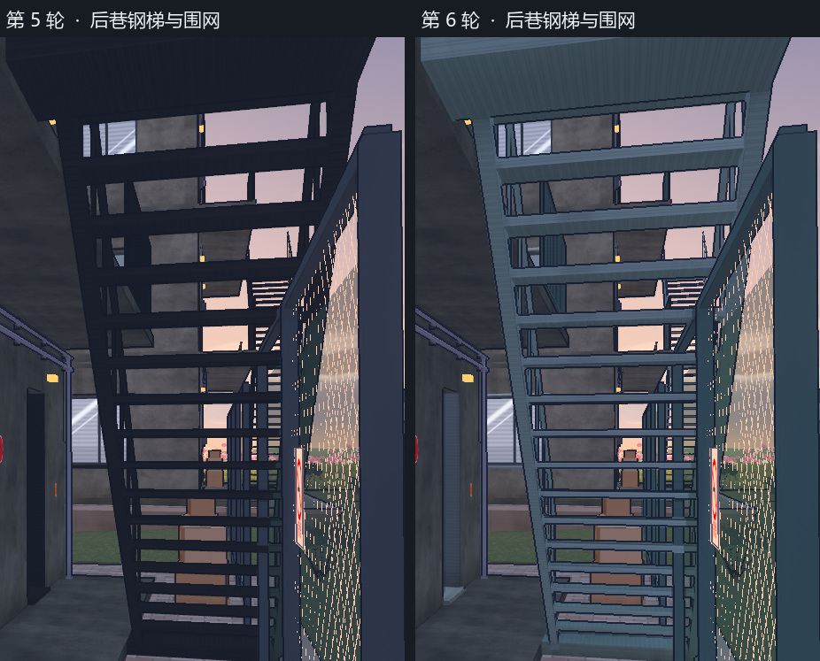
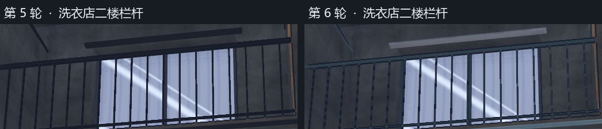

# 第 6 轮后巷钢梯与围网 · RTX 3060 实机复拍

改前为共享分支的 be0549d8，改后为 C酱直接推送的 9b0dadbd。共享美术分支已快进到同一提交。四个 Blender 运行模型、九张公寓 PBR 源图的 HTTP 返回字节均和改前相同，现有 26 枚贴花仍复用 1061:2667664:298285.6:949273.1。两台机器报告的傍晚光照 RGBA 指纹均为 7e12d6352d81917d39fb7ef0e28dc88c237795a31136c7ae0174d1d7a3bb4f93。

## 画面

三处踏板的显示亮度中位数分别由 28.9、30.7、30.6 升至 67.8、88.8、93.6。靠镜头的围网立柱由 53.7 升至 64.6，灰泥、门灯和门板的亮度中位数维持上轮读数。钢梯与背景现在能分开，冷青灰的踏板和暖色门灯仍有对比。铁丝菱形网格的材质没有改色，绿色主要来自遮阳网和立柱。遮挡关系、踏板间隙、原来的告示和纸箱层次都保留。[框选坐标和像素数据](visual-summary.json)

D 二楼两排细竖杆上取了 34 个像素，最近的城镇几何交点为 apartment-pbr-metal  Scene/station-city-background/town-edge-kit (34)。交点落在洗衣店 GLB 门翼上的有 0 个。保持同一帧，只隐藏门翼时这批采样中改变 2 个，最大单通道只差 1 级。隐藏公寓金属时 34 个全变，最大单通道差 202 级。栏杆采样灰阶亮度中位数从 32.3 到 60.0。只隐藏门翼时店面区域实际改变 162,898 个像素。楼上黑色细线仍明显，调整其配色可从公寓材质和栏杆顶点色入手。[几何交点与同帧隐藏结果](geometry-summary.json) · [两次启动的逐点回执和控制图](geometry)

改后的公寓漆钢使用顶点色，金属度 0.15，法线强度 0.5，仍使用卷帘的法线、粗糙度和 AO 贴图。屋顶仍使用卷帘颜色、金属图和 0.25 的金属度。B、F、G、H 的两次正式照片分别逐像素相同。E 两次独立启动相差 6,487 个像素。候选中冻结 E 的同一帧并隐藏整个车站后方城镇模型，变化 0 个像素。C、D、E 同帧记录的绘制次数 / 三角面数为 art-c-alley 982 / 8,640,066 → 982 / 8,640,066，art-d-laundry 914 / 8,368,257 → 914 / 8,368,257，sample-e-harbour 1532 / 8,237,370 → 1532 / 8,237,370。[A–D 对照](ground-a-d.jpg) · [E–H 对照](ground-e-h.jpg)

| 机位 | 改变的像素 | 最大单通道色差 | 两份原图 |
| --- | --- | --- | --- |
| A 站前主街 | 2,309 | 165 | [改前](photos/before/art-a-street.png) · [改后](photos/after/art-a-street.png) |
| B 便利店正面 | 0 | 0 | [改前](photos/before/art-b-konbini.png) · [改后](photos/after/art-b-konbini.png) |
| C 公寓后巷 | 478,232 | 118 | [改前](photos/before/art-c-alley.png) · [改后](photos/after/art-c-alley.png) |
| D 洗衣店 | 211,974 | 97 | [改前](photos/before/art-d-laundry.png) · [改后](photos/after/art-d-laundry.png) |
| E 港镇码头 | 6,487 | 227 | [改前](photos/before/sample-e-harbour.png) · [改后](photos/after/sample-e-harbour.png) |
| F 山坡 | 0 | 0 | [改前](photos/before/sample-f-hillside.png) · [改后](photos/after/sample-f-hillside.png) |
| G 铁路 | 0 | 0 | [改前](photos/before/sample-g-rail.png) · [改后](photos/after/sample-g-rail.png) |
| H 北村 | 0 | 0 | [改前](photos/before/sample-h-north.png) · [改后](photos/after/sample-h-north.png) |

## 当前傍晚倒影的高光

从实际入口接收六面 256 × 256 傍晚倒影，依照广场樱最终烘焙的 RGBA16F 原件逐像素回算。共 393,216 个像素，89 个原始像素超过线性 2，编码后逐像素匹配，当前解码峰值为 2。两版运行时接收的六个文件逐一同哈希。[六面查验](evening-reflections.json)

## 帧时

RTX 3060 Laptop，1440 × 900、DPR 1。四个独立进程依序测改前、改后、改后、改前，每个固定地面机位至少 10 秒，每种步行至少 3 秒，输入为实际可信 W 事件。本轮全套共有 22,025 个帧间隔。平均至少 60 FPS 且 P95 至多 16.7 ms 为达标。表内为平均 FPS / P95 毫秒。按这两项同时计算，四轮固定机位达标数依次为 7/8、6/8、6/8、7/8。

| 机位 | 改前 1 | 改后 1 | 改后 2 | 改前 2 |
| --- | --- | --- | --- | --- |
| A 站前主街 | 64.61 / 15.5 | 64.11 / 15.5 | 63.62 / 15.5 | 55.12 / 30.8 |
| B 便利店正面 | 65.00 / 15.5 | 65.00 / 15.5 | 64.90 / 15.5 | 64.80 / 15.5 |
| C 公寓后巷 | 64.11 / 15.5 | 60.85 / 30.7 | 65.00 / 15.5 | 65.00 / 15.5 |
| D 洗衣店 | 65.00 / 15.5 | 64.80 / 15.5 | 65.00 / 15.5 | 65.00 / 15.5 |
| E 港镇码头 | 65.00 / 15.5 | 64.11 / 15.5 | 55.62 / 30.8 | 64.70 / 15.5 |
| F 山坡 | 65.00 / 15.5 | 65.00 / 15.5 | 65.00 / 15.5 | 64.80 / 15.5 |
| G 铁路 | 61.55 / 30.7 | 60.26 / 30.7 | 60.55 / 30.7 | 62.53 / 15.5 |
| H 北村 | 65.00 / 15.5 | 65.00 / 15.5 | 65.00 / 15.5 | 65.00 / 15.5 |
| 第三人称实走 | 57.67 / 30.8 | 55.49 / 30.8 | 56.40 / 30.8 | 53.59 / 30.8 |
| 第一人称实走 | 64.68 / 15.5 | 40.15 / 30.9 | 64.04 / 15.5 | 63.08 / 15.5 |

同一后巷的 P95 依次为 15.5 / 30.7 / 15.5 / 15.5 毫秒。第三人称依次为 30.8 / 30.8 / 30.8 / 30.8，第一人称为 15.5 / 30.9 / 15.5 / 15.5 毫秒。保留全部慢帧，供与后续轮次比较。[逐帧记录与传输回执](timing)

## 历史眼位

01、20、21、23、24 沿用历史相机的位置、四元数和 FOV，各版本每个机位另取至少 6.5 秒连续帧间隔。21 沿用历史绿篱框的 38,025 个像素，前后最大单通道只差一个色阶。

| 历史机位 | 改前 | 改后 | 同机位原图 |
| --- | --- | --- | --- |
| 01-station-street | 64.69 / 15.5 | 64.85 / 15.5 | [改前](legacy/before/01-station-street.png) · [改后](legacy/after/01-station-street.png) |
| 20-rear-eye | 65.00 / 15.5 | 65.00 / 15.5 | [改前](legacy/before/20-rear-eye.png) · [改后](legacy/after/20-rear-eye.png) |
| 21-front-eye | 64.85 / 15.5 | 65.00 / 15.5 | [改前](legacy/before/21-front-eye.png) · [改后](legacy/after/21-front-eye.png) |
| 23-service-corner | 65.00 / 15.5 | 65.00 / 15.5 | [改前](legacy/before/23-service-corner.png) · [改后](legacy/after/23-service-corner.png) |
| 24-laundry-details | 65.00 / 15.5 | 65.00 / 15.5 | [改前](legacy/before/24-laundry-details.png) · [改后](legacy/after/24-laundry-details.png) |

[机位和受测提交](summary.json) · [实拍传输回执](receipts) · [采集与核验脚本](tools) · [#252 镜头参考]( https://github.com/aa15119557034/agent-review-room/issues/252#issuecomment-6975321999)
