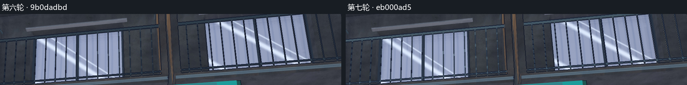
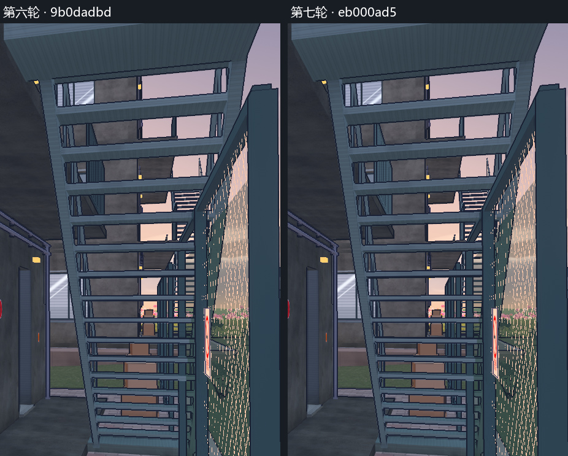
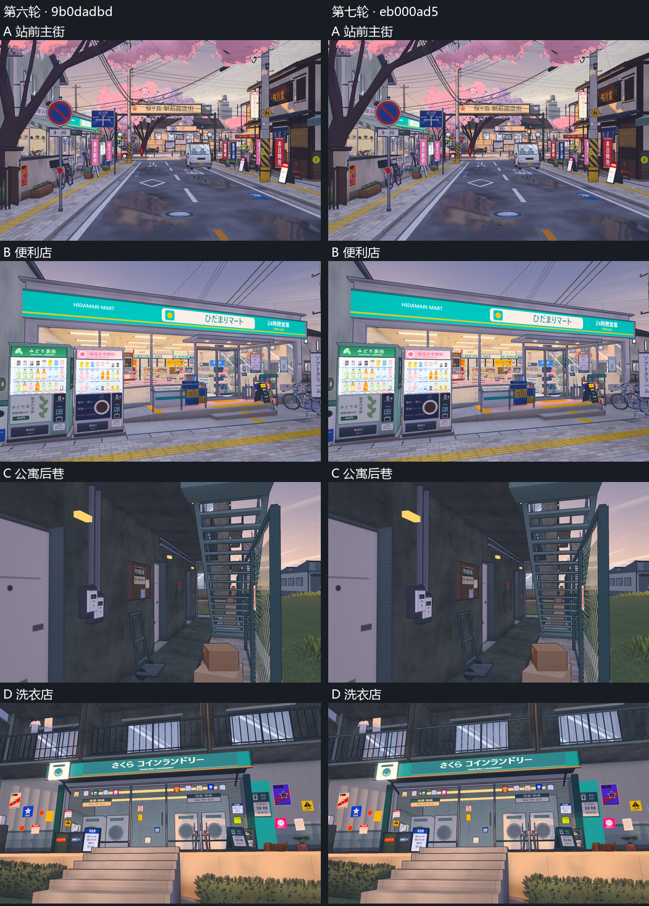
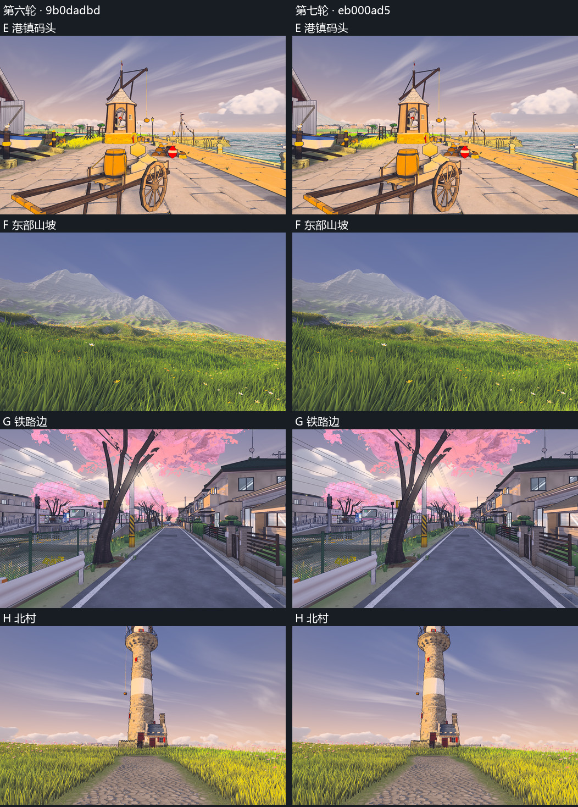
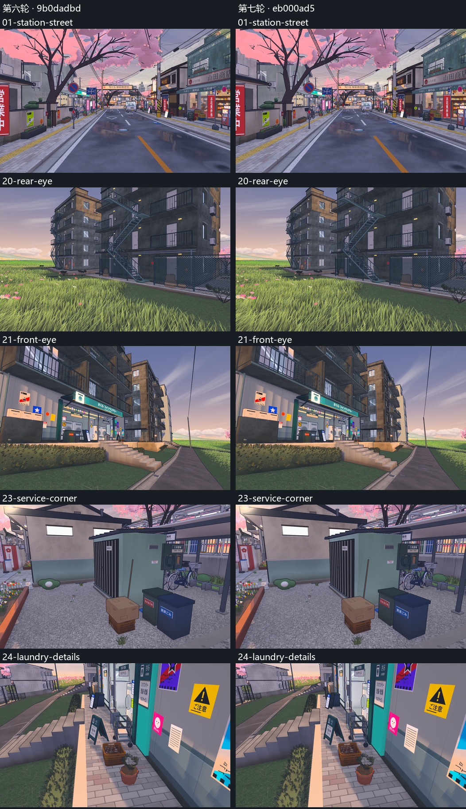

# 第七轮洗衣店二楼栏杆验收

基线 `9b0dadbd7fd3c117835465fe6ea8dd80c4215970`，C酱候选 `eb000ad5f3bd976cfbb485fe3606442c82309ab5`。实测使用 RTX 3060 Laptop、1440 × 900。所有对照均左改前、右改后。

两次运行接收的 4 个 GLB 和 9 张公寓纹理逐一同哈希，运行回执中 10 张海报、14 张贴纸、2 处涂鸦的布局指纹也一致。[资源哈希及运行材质](summary.json)

## D 洗衣店



复用第六轮同眼位下通过射线确认落在公寓漆钢上的 34 个采样位置，比较本轮两张独立截图。34/34 点发生变化。下表给出显示亮度的第 10、50、90 百分位（0–255）。每个点的局部对比取其亮度与同一行左右各 5 像素处平均亮度的绝对差。

| 项目 | 改前 P10 / P50 / P90 | 改后 P10 / P50 / P90 |
| --- | --- | --- |
| 栏杆位置 | 30.7 / 60.0 / 65.0 | 34.7 / 84.7 / 94.4 |
| 两侧邻域 | 105.8 / 160.2 / 208.8 | 105.8 / 160.3 / 208.8 |
| 局部对比 | 70.2 / 106.8 / 153.0 | 64.9 / 79.5 / 133.1 |

[逐点坐标与亮度](visual-summary.json) · [历史几何归属采样位置](tools/rail-reference.json)

两跨细杆靠近反光窗的位置仍能看清深色轮廓，亮度上升后与窗面的对比减弱。招牌字区、店门区两个对照框的单通道最大变化均为 1 级。

## C 后巷和地面八机位



三处踏板采样框的显示亮度中位数维持在 67.82、88.83、93.62，近处围网立柱维持在 64.62。图中踏板间隙、右侧菱形网和后方暖灯仍可辨认。





同一基线提交在第六轮和第七轮各复拍一次，A、B、C、D、F、G、H 的 RGB 完全一致，可直接使用 D 的历史采样坐标。E 港口同提交已有 3,930 个像素发生变化，两版 E 的 5,533 个差异像素包含独立启动间的波动。[同提交复拍对照](baseline-recapture.json)

以下计数按 8 位 RGB 最大单通道差值计算。

| 机位 | 改变像素 | 差值 > 2 的像素 | 最大差值 | 原始 PNG |
| --- | --- | --- | --- | --- |
| A 站前主街 | 447 | 268 | 25 | [改前](photos/before/art-a-street.png) · [改后](photos/after/art-a-street.png) |
| B 便利店 | 0 | 0 | 0 | [改前](photos/before/art-b-konbini.png) · [改后](photos/after/art-b-konbini.png) |
| C 公寓后巷 | 6,546 | 2,747 | 31 | [改前](photos/before/art-c-alley.png) · [改后](photos/after/art-c-alley.png) |
| D 洗衣店 | 109,272 | 45,293 | 38 | [改前](photos/before/art-d-laundry.png) · [改后](photos/after/art-d-laundry.png) |
| E 港镇码头 | 5,533 | 4,126 | 223 | [改前](photos/before/sample-e-harbour.png) · [改后](photos/after/sample-e-harbour.png) |
| F 东部山坡 | 0 | 0 | 0 | [改前](photos/before/sample-f-hillside.png) · [改后](photos/after/sample-f-hillside.png) |
| G 铁路边 | 0 | 0 | 0 | [改前](photos/before/sample-g-rail.png) · [改后](photos/after/sample-g-rail.png) |
| H 北村 | 0 | 0 | 0 | [改前](photos/before/sample-h-north.png) · [改后](photos/after/sample-h-north.png) |

## 帧时

四次独立启动顺序为改前、改后、改后、改前。每个固定机位至少 10 秒，两种实际 W 步行各至少 3 秒。表内为平均 FPS / P95 毫秒。均值至少 60 FPS 且 P95 至多 16.7 ms 同时满足才计为达标。P95 用最近秩计算。

| 机位 | 改前 1 | 改后 1 | 改后 2 | 改前 2 |
| --- | --- | --- | --- | --- |
| A 站前主街 | 51.41 / 30.8 | 55.14 / 30.8 | 46.65 / 30.9 | 51.59 / 30.8 |
| B 便利店 | 57.69 / 30.8 | 61.15 / 30.7 | 59.48 / 30.8 | 61.75 / 30.6 |
| C 公寓后巷 | 64.01 / 15.5 | 64.41 / 15.5 | 62.34 / 15.6 | 63.91 / 15.5 |
| D 洗衣店 | 64.70 / 15.5 | 64.80 / 15.5 | 64.01 / 15.5 | 64.90 / 15.5 |
| E 港镇码头 | 53.05 / 30.8 | 53.87 / 30.8 | 42.71 / 30.9 | 60.66 / 30.8 |
| F 东部山坡 | 65.00 / 15.5 | 65.00 / 15.5 | 63.82 / 15.6 | 65.00 / 15.5 |
| G 铁路边 | 44.29 / 30.9 | 51.63 / 30.8 | 36.05 / 46.2 | 56.01 / 30.8 |
| H 北村 | 65.00 / 15.5 | 65.00 / 15.5 | 64.90 / 15.5 | 65.00 / 15.5 |
| 第三人称步行 | 47.24 / 30.9 | 54.17 / 30.8 | 39.19 / 30.9 | 57.04 / 30.8 |
| 第一人称步行 | 55.76 / 30.8 | 59.90 / 30.8 | 36.15 / 31.1 | 59.58 / 30.7 |

固定机位达标数依次为 4/8、4/8、4/8、4/8。总计 20,271 个帧间隔。每个采样条目保留原始毫秒、绘制调用和三角面数。

四次达标的机位都是 C、D、F、H。D 的四个 P95 均为 15.5 毫秒；G 在第二次候选运行达到 46.2 毫秒，其余三次均在 30.8–30.9 毫秒。两种步行四轮均未达到帧时门槛。

[改前 1逐帧](timing/1-before/frames.json.gz) · [改后 1逐帧](timing/2-after/frames.json.gz) · [改后 2逐帧](timing/3-after/frames.json.gz) · [改前 2逐帧](timing/4-before/frames.json.gz)

共尝试五次帧时采集。第四次是末轮基线的首次尝试，B 开始出现约 1 秒的 RAF 间隔，C–H 每个机位都只有 10 个约 1 秒的间隔。两种步行各仅 3 帧，可信 W 已按下，位移均小于 1 米，实走验证失败，进程退出码为 1。表中末列取相同条件的第五次完整重试。失败进程的八个固定机位、两段实走、输入和位移回执单独保留。[失败轮次逐帧与运行回执](excluded/r7-native-1119-5-before)

## 五个历史机位



| 机位 | 改前 FPS / P95 | 改后 FPS / P95 | 改变像素 | 两份原图 |
| --- | --- | --- | --- | --- |
| 01-station-street | 61.38 / 30.7 | 62.70 / 15.5 | 282 | [改前](legacy/before/01-station-street.png) · [改后](legacy/after/01-station-street.png) |
| 20-rear-eye | 64.23 / 15.5 | 64.39 / 15.5 | 62,428 | [改前](legacy/before/20-rear-eye.png) · [改后](legacy/after/20-rear-eye.png) |
| 21-front-eye | 65.00 / 15.5 | 65.00 / 15.5 | 88,181 | [改前](legacy/before/21-front-eye.png) · [改后](legacy/after/21-front-eye.png) |
| 23-service-corner | 65.00 / 15.5 | 64.85 / 15.5 | 0 | [改前](legacy/before/23-service-corner.png) · [改后](legacy/after/23-service-corner.png) |
| 24-laundry-details | 65.00 / 15.5 | 65.00 / 15.5 | 155 | [改前](legacy/before/24-laundry-details.png) · [改后](legacy/after/24-laundry-details.png) |

每个历史机位每版至少 6.5 秒。[改前逐帧](legacy/before/legacy-frames.json.gz) · [改后逐帧](legacy/after/legacy-frames.json.gz)

## 核验与复算

[全结果 JSON](summary.json) · [图片差异与裁切坐标](visual-summary.json) · [采集脚本及机位](tools) · [照片运行回执](receipts)

重新采集时，分别检出首段两版提交，另检出网络审计工具提交 `0db21d2df3ed097d4f3414539b92e8eadcc12b75`。下面三个 fixture 参数均指向各检出的 `apps/desktop/e2e/fixtures/world-base`，使用 Electron 44.9.0 和 RTX 3060 Laptop。在空采集目录中复制 tools 内的 CJS、cameras.json 和 sources.json 后运行；采集器顺序启动八个进程。

```text
node measure-ground.cjs <基线fixture> <候选fixture> <审计fixture> <electron.exe> r7-native-repeat
```

归档单独下载后，在本目录执行 `python tools/verify.py` 可核验 28 张原始 PNG（含两张返回 A 检查图）与四轮逐帧数据。执行 `python tools/compare.py` 可从归档里的原图重建对照图和差异统计。

完整重新打包依赖 Python 3、NumPy、Pillow 和系统字体微软雅黑。在带有原始 photos-before/after、legacy-before/after、cameras.json 和 running-state.json 的采集目录上执行以下命令。帧时原件按 running-state.json 中的 fixture 与 id 定位。处理脚本输出到 tools 的上级目录。

```text
python tools/compare.py <采集目录>
python tools/archive.py <采集目录>
python tools/describe.py
```
