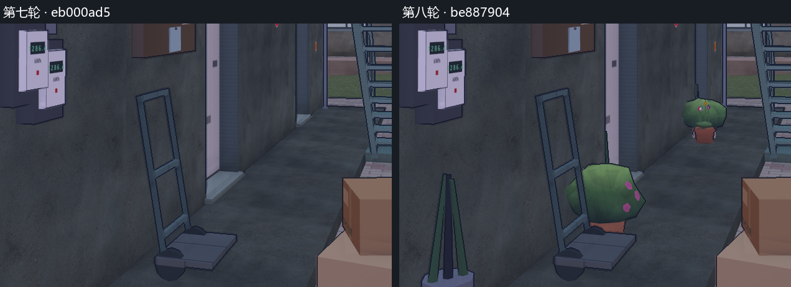
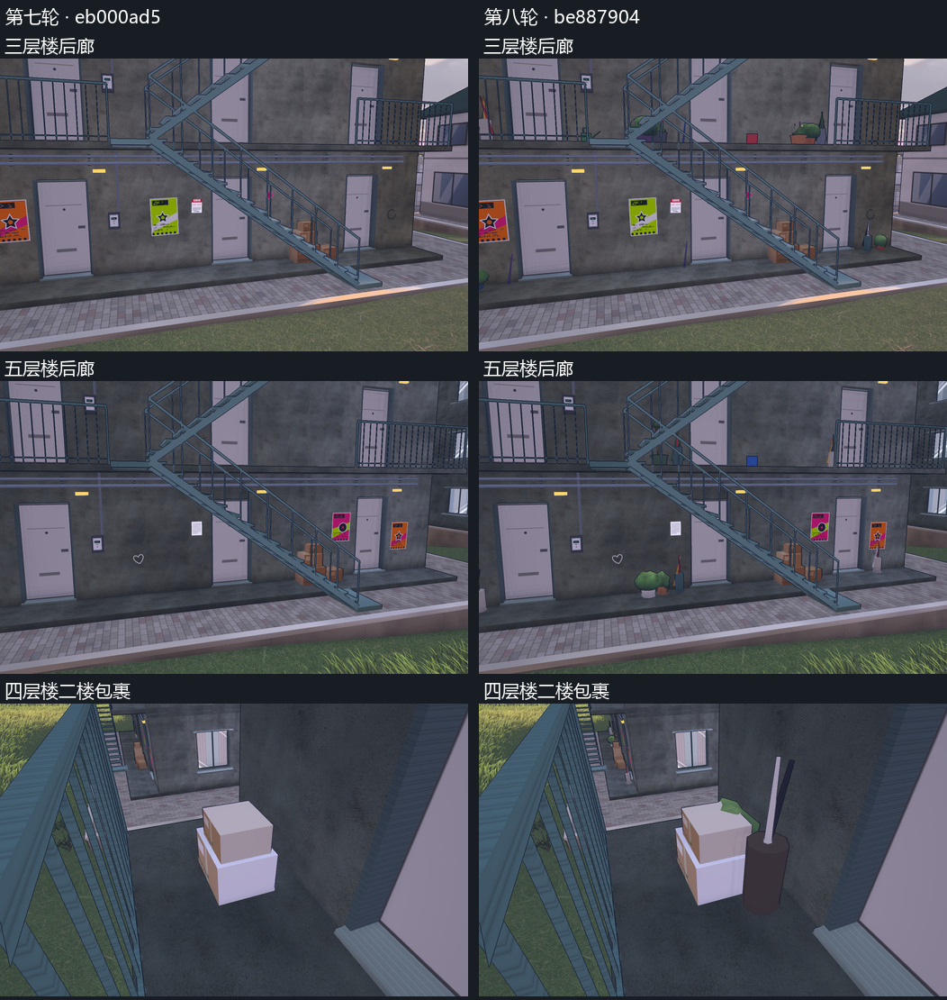
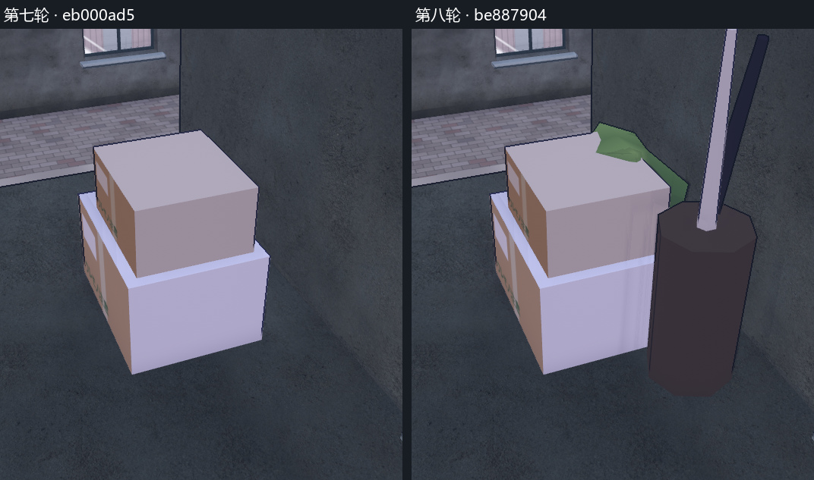
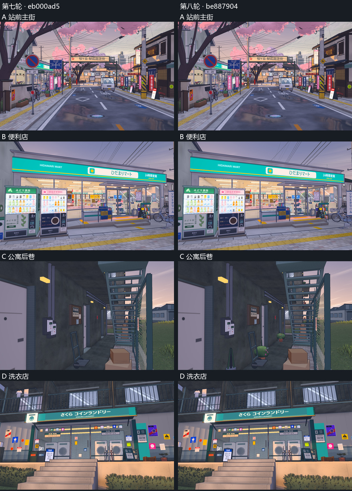
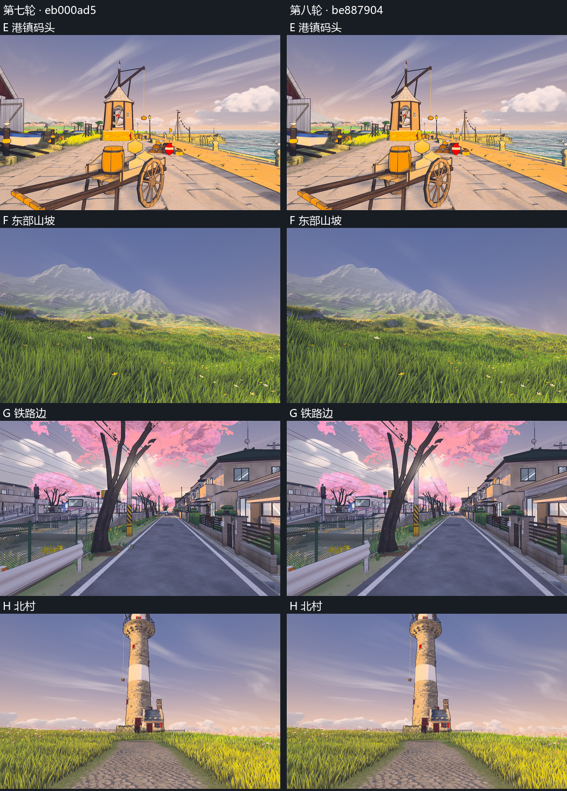
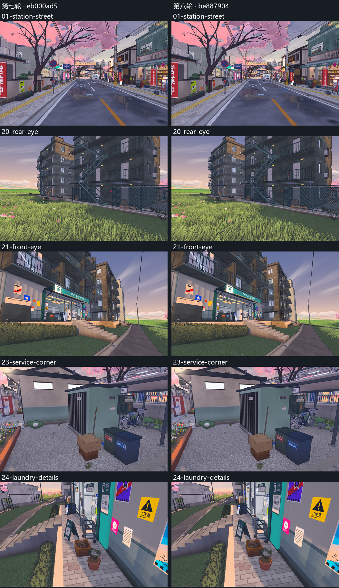

# 第八轮公寓后廊门前陈设

基线 `eb000ad5f3bd976cfbb485fe3606442c82309ab5`，候选 `be8879045b4908695fa62342afc1a0b9ec05bb96`。RTX 3060 Laptop、1440 × 900，同机位图均左改前、右改后。

## 地面 C 与三栋后廊



C 近处门边增加伞具，手推车旁可见一盆带花植株，向后可见另一盆绿植。楼梯仍遮住后方部分门廊。



三层楼一层门边可见单放的折伞、伞桶和小盆栽，二层栏杆后可见红色小桶及绿植；五层楼中门旁出现两盆并排植物，楼上有蓝色小桶。四层楼二层近照能看到绿叶从上箱顶面伸出。

| 机位 | 改变像素 | 最大单通道差值 | 原始 PNG |
| --- | --- | --- | --- |
| rear-3f | 62206 | 103 | [改前](rear/before/rear-3f.png) · [改后](rear/after/rear-3f.png) |
| rear-5f | 61851 | 128 | [改前](rear/before/rear-5f.png) · [改后](rear/after/rear-5f.png) |
| rear-4f-parcels | 98362 | 188 | [改前](rear/before/rear-4f-parcels.png) · [改后](rear/after/rear-4f-parcels.png) |

## 数量与模型净空

三栋楼共 12 段后廊、36 扇门。三次补拍的实际场景计数逐层一致，共 23 只伞桶、33 盆植物和 22 件小件。CPU 用提交中的种子、道具函数、Frame 和 GB 重新生成各层顶点，12 段分项与实际场景全部吻合。小件包含 13 把单放折伞、5 只水桶和 4 个洒水壶。道具合计 11,640 个三角形。作者提交说明写了 25 只伞桶。

| 楼栋与楼层 | 伞桶 | 盆栽 | 小件 | 新增三角面 |
| --- | --- | --- | --- | --- |
| 3f · 1 层 | 1 | 2 | 2 | 433 |
| 3f · 2 层 | 2 | 6 | 3 | 2146 |
| 3f · 3 层 | 2 | 2 | 2 | 689 |
| 4f · 1 层 | 1 | 3 | 2 | 767 |
| 4f · 2 层 | 3 | 2 | 1 | 661 |
| 4f · 3 层 | 3 | 4 | 1 | 1188 |
| 4f · 4 层 | 2 | 1 | 2 | 493 |
| 5f · 1 层 | 3 | 3 | 0 | 830 |
| 5f · 2 层 | 3 | 2 | 1 | 1123 |
| 5f · 3 层 | 2 | 3 | 1 | 1592 |
| 5f · 4 层 | 0 | 3 | 4 | 1141 |
| 5f · 5 层 | 1 | 2 | 3 | 577 |

| 运行时城市场景 | 改前 | 改后 |
| --- | --- | --- |
| geometries | 67 | 69 |
| materials | 50 | 51 |
| modelPrimitives | 232 | 234 |
| totalTriangles | 84616 | 96256 |
| ownedTextures | 12 | 12 |
| newTexturePixels | 10485760 | 10485760 |



**四层楼二层左门的新增盆栽和伞桶与原有包裹发生穿插。** 以该层后墙为原点轴面，盆栽中心 x = −5.22、z = 0.24 米，盆栽实际三角形与上下两个原有箱体都相交。伞桶 x = −4.82、z = 0.20 米，其筒体与下箱相交。上层将避让区传为空数组。两层箱体分别为 0.46 × 0.27 × 0.36 和 0.34 × 0.18 × 0.30 米。通过实际新道具三角形与原箱实体盒相交判定，同时保留前后实拍。 [四层楼改前原图](rear/before/rear-4f-parcels.png) · [改后原图](rear/after/rear-4f-parcels.png) · [几何逐件回执](geometry.json)

按楼层归一到后墙 z = 0，所有新增几何与 1.03 米宽的门洞水平投影至少间隔 0.071 米，与一层已声明的纸箱、扫帚预留 x 区间至少间隔 1.177 米。道具中心靠墙，14 盆植物的外缘超过 0.5 米，最远延至 z = 0.669 米。至 1.05 米廊板边沿的最小剩余横向宽度为 0.381 米，至外梯平台近边沿的保守 z 向间距为 0.256 米。本组为模型几何测量，角色实走段在另外的街道路线。

有 15 盆植株的实际顶点伸入后墙。最深处在四层楼三层，局部坐标 (−1.266, 0.371, −0.113) 米，墙体 z 范围为 −0.26 至 0 米，这盆植物的水平外缘与门洞间隔 0.401 米。绿叶也因此可能被墙面遮住一部分。

烘焙场景指纹 1061:2667664:298285.6:949273.1 → 1063:2679304:298845.6:951073.1。两版源码和两份真实运行回执均逐项核对了 26 枚贴花的完整记录，10 海报、14 贴纸和 2 涂鸦的坐标、朝向、大小均相同。4 个 GLB 和 9 个公寓纹理文件逐个哈希相同。 [运行材质与资源指纹](summary.json)

## A–H 与历史机位





用同一提交再启动的一次对照中，A、B、C、D、F、G、H 逐像素一致，E 港口已有 5,088 个像素变化。当轮两版 E 相差 4,581 像素，单凭这两张照片无法将这些变化归于后廊道具。[同提交复拍结果](baseline-recapture.json)

| 机位 | 改变像素 | 差值 > 2 | 最大差值 | 两张原图 |
| --- | --- | --- | --- | --- |
| A 站前主街 | 1 | 0 | 1 | [改前](photos/before/art-a-street.png) · [改后](photos/after/art-a-street.png) |
| B 便利店 | 0 | 0 | 0 | [改前](photos/before/art-b-konbini.png) · [改后](photos/after/art-b-konbini.png) |
| C 公寓后巷 | 56445 | 26670 | 230 | [改前](photos/before/art-c-alley.png) · [改后](photos/after/art-c-alley.png) |
| D 洗衣店 | 0 | 0 | 0 | [改前](photos/before/art-d-laundry.png) · [改后](photos/after/art-d-laundry.png) |
| E 港镇码头 | 4581 | 3582 | 226 | [改前](photos/before/sample-e-harbour.png) · [改后](photos/after/sample-e-harbour.png) |
| F 东部山坡 | 0 | 0 | 0 | [改前](photos/before/sample-f-hillside.png) · [改后](photos/after/sample-f-hillside.png) |
| G 铁路边 | 0 | 0 | 0 | [改前](photos/before/sample-g-rail.png) · [改后](photos/after/sample-g-rail.png) |
| H 北村 | 0 | 0 | 0 | [改前](photos/before/sample-h-north.png) · [改后](photos/after/sample-h-north.png) |



| 历史机位 | 改前 FPS / P95 | 改后 FPS / P95 | 改变像素 | 原图 |
| --- | --- | --- | --- | --- |
| 01-station-street | 58.50 / 30.8 | 64.08 / 15.5 | 0 | [改前](legacy/before/01-station-street.png) · [改后](legacy/after/01-station-street.png) |
| 20-rear-eye | 64.85 / 15.5 | 65.00 / 15.5 | 21046 | [改前](legacy/before/20-rear-eye.png) · [改后](legacy/after/20-rear-eye.png) |
| 21-front-eye | 65.00 / 15.5 | 65.00 / 15.5 | 0 | [改前](legacy/before/21-front-eye.png) · [改后](legacy/after/21-front-eye.png) |
| 23-service-corner | 64.70 / 15.5 | 63.64 / 15.5 | 0 | [改前](legacy/before/23-service-corner.png) · [改后](legacy/after/23-service-corner.png) |
| 24-laundry-details | 65.00 / 15.5 | 64.69 / 15.5 | 0 | [改前](legacy/before/24-laundry-details.png) · [改后](legacy/after/24-laundry-details.png) |

## 帧时与绘制次数

正式成绩共 21,508 个帧间隔。每个固定机位至少 10 秒，第三、第一人称各至少 3 秒，可信 W 输入。顺序为改前、改后、改后、改前。均值 ≥ 60 FPS 且 P95 ≤ 16.7 毫秒为达标。四轮固定机位达标数分别为 5/8、5/8、5/8、6/8。

| 机位 | 改前 1 FPS / P95 | 改后 1 | 改后 2 | 改前 2 |
| --- | --- | --- | --- | --- |
| A 站前主街 | 56.22 / 30.8 | 53.77 / 30.8 | 59.58 / 30.8 | 61.25 / 30.7 |
| B 便利店 | 64.11 / 15.5 | 64.90 / 15.5 | 64.60 / 15.5 | 65.00 / 15.5 |
| C 公寓后巷 | 64.70 / 15.5 | 64.41 / 15.5 | 64.90 / 15.5 | 65.00 / 15.5 |
| D 洗衣店 | 65.00 / 15.5 | 65.00 / 15.5 | 65.00 / 15.5 | 65.00 / 15.5 |
| E 港镇码头 | 56.92 / 30.8 | 60.46 / 30.7 | 58.29 / 30.8 | 62.24 / 15.6 |
| F 东部山坡 | 65.00 / 15.5 | 65.00 / 15.5 | 65.00 / 15.5 | 65.00 / 15.5 |
| G 铁路边 | 58.79 / 30.8 | 55.33 / 30.8 | 49.81 / 30.8 | 56.53 / 30.8 |
| H 北村 | 65.00 / 15.5 | 65.00 / 15.5 | 65.00 / 15.5 | 65.00 / 15.5 |
| 第三人称步行 | 51.05 / 30.8 | 47.79 / 30.9 | 51.05 / 30.8 | 51.62 / 30.8 |
| 第一人称步行 | 61.15 / 30.7 | 59.26 / 30.8 | 60.52 / 30.8 | 60.22 / 30.8 |

下表是同一固定机位所有有效帧的绘制调用范围。动态内容和渲染通道会影响实际调用；原始样本也保留各帧三角数量。

| 机位 | 改前 1 调用 | 改后 1 | 改后 2 | 改前 2 |
| --- | --- | --- | --- | --- |
| A 站前主街 | 1588–1604 | 1591–1607 | 1591–1607 | 1588–1604 |
| B 便利店 | 1037–1054 | 1038–1055 | 1038–1055 | 1037–1054 |
| C 公寓后巷 | 977–979 | 981–983 | 981–983 | 977–979 |
| D 洗衣店 | 914–916 | 917–919 | 917–919 | 914–916 |
| E 港镇码头 | 1531–1536 | 1532–1537 | 1532–1537 | 1531–1536 |
| F 东部山坡 | 774 | 775 | 775 | 774–776 |
| G 铁路边 | 1544–1547 | 1545–1548 | 1545–1548 | 1544 |
| H 北村 | 708–710 | 709–711 | 709–711 | 708–710 |

C 后巷两次基线各帧的调用范围均为 977–979、977–979，两次候选分别为 981–983、981–983。实测调用数随候选上升。固定机位门槛按每轮计分，两个候选运行中达标机位均是 B、C、D、F、H。

三栋后廊补拍时连续渲染了多次，回执里的 renderer.info 计数没有在每帧前明确复位。上表采用帧时工具逐帧记录的绘制调用。

[timing/1-before 逐帧](timing/1-before/frames.json.gz) · [timing/2-after 逐帧](timing/2-after/frames.json.gz) · [timing/3-after 逐帧](timing/3-after/frames.json.gz) · [timing/4-before 逐帧](timing/4-before/frames.json.gz)

## 复核与复现

[完整结果](summary.json) · [图像差异](visual-summary.json) · [模型空间数据](geometry.json) · [原始回执](receipts) · [采集脚本](tools)

下载归档后，在根目录运行以下命令可校验原图哈希、逐帧摘要，重建图片及表格。使用 Python 3、NumPy、Pillow 与微软雅黑。几何重放使用 Node 24 和两版原始 fixture。

采集恢复方法为分别检出两版提交，并用网络审计提交 `0db21d2df3ed097d4f3414539b92e8eadcc12b75` 的 world-base fixture。将 tools 的 CJS、cameras.json 和 sources.json 复制到空采集目录。对两个工作树的 world-base 运行 `node measure-ground.cjs <基线fixture> <候选fixture> <审计fixture> <electron.exe> r8-native-repeat`。专项目录及额外相机公式见 [rear-r8.cjs](tools/rear-r8.cjs)。归档再生成使用 `python tools/archive.py <采集目录>`。

```text
python tools/verify.py
python tools/compare.py
python tools/describe.py
node tools/geometry.mjs <改前-world-base> <改后-world-base> geometry.json
```
