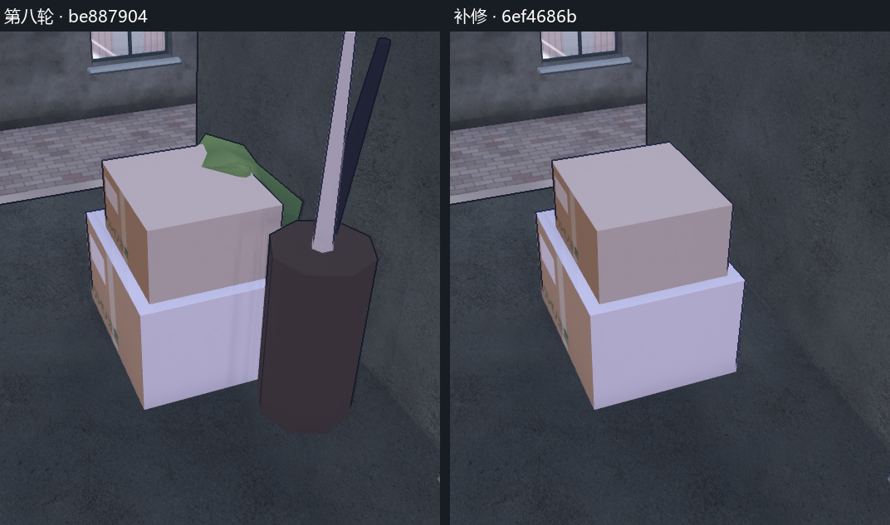
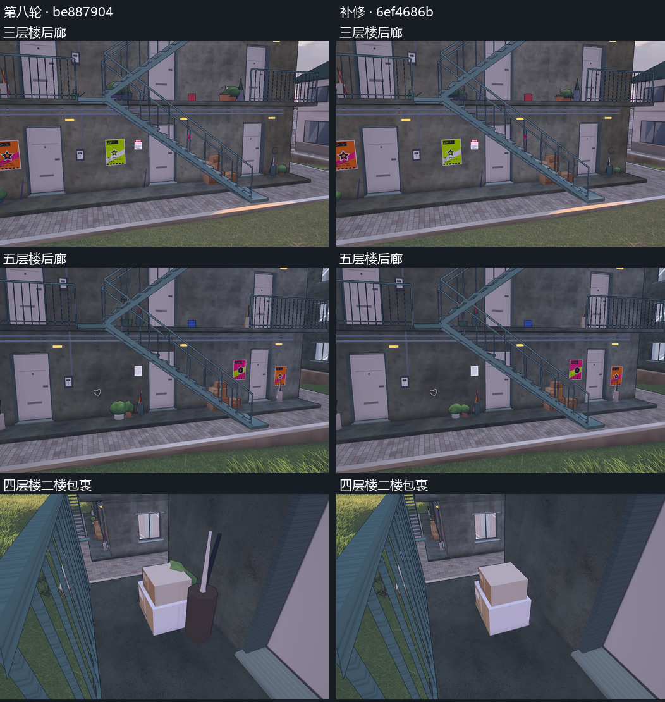
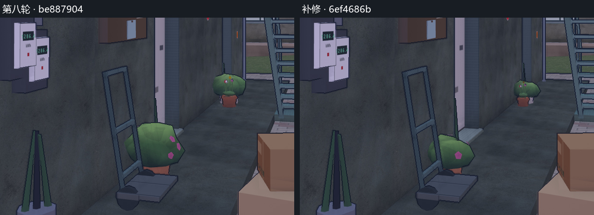
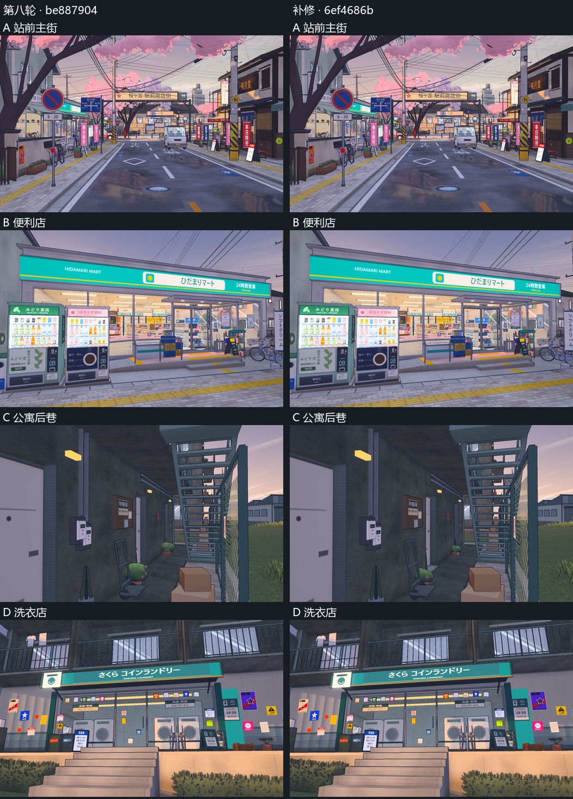
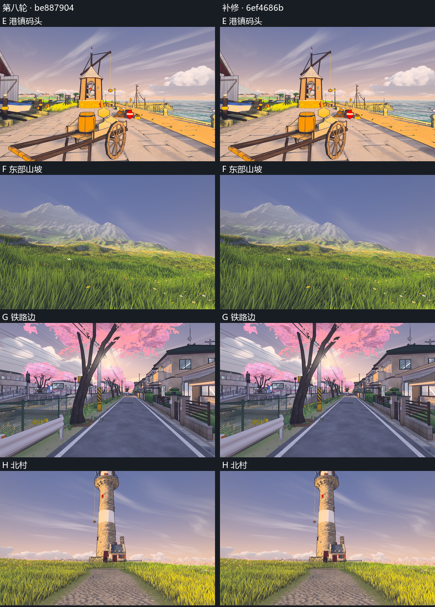

# 第八轮补修 · 洗衣店二层包裹和后廊净空

比较基线 `be8879045b4908695fa62342afc1a0b9ec05bb96` 与补修 `6ef4686b630dd14f36945fdcf650bde7e582afd7`。基线照片沿用第八轮同提交已核验的 RTX 3060 Laptop 原片；补修版重新拍摄 8 个地面机位、返回 A 及 3 个后廊机位。两版各自新测一轮帧时。所有图为左改前、右补修。

## 包裹与门口道具

四层楼二层原有两只包裹的盒体与新增门口道具已分开。两版分别执行生产 buildTownApartment，再捕获其传给 artDoorsteps 的 12 份实参，按对应版本实际 addDoorsteps、盆栽生成器、Frame 与 GB 重建顶点及三角形。窗口绘制在参数跟踪中省略，使用独立随机源；门前道具保持实际种子和生成函数。后廊局部 x 沿墙，z 向外，y 从该层完成地面起算。

同一层、同一 `art-r8-door-4-1` 种子和 y = 2.99 m，补修前传入空避让表，补修后为 x = [−5.5, −4.6] m。修前盆栽与两个旧箱都相交，伞桶及其中一把伞与下箱相交。补修后对两箱逐三角形重测，没有新增道具与箱体相交。

原来靠箱的伞桶中心 x 从 −4.82 移至 −3.18 米。补修版这一层所有新增几何最靠左到 x = −3.323 米，原箱最靠右到 −4.92 米，两者在墙面水平方向相隔至少 1.597 米。

| 后廊几何指标 | 改前 | 补修 |
| --- | --- | --- |
| 触及原包裹的网格部件 | 3 | 0 |
| 外缘超过 0.5 m 的盆数 | 14 | 0 |
| 距墙最远的外缘 (m) | 0.669 | 0.495 |
| 向内穿过后墙的盆数 | 15 | 16 |
| 最大入墙深度 (m) | 0.113 | 0.082 |
| 最小廊板边沿横向余量 (m) | 0.381 | 0.555 |
| 道具外缘至门洞最小水平距离 (m) | 0.071 | 0.071 |
| 道具三角形 | 11640 | 10884 |

全部 33 盆在朝廊外一侧满足 0.5 m 目标。靠墙一侧仍有 16 盆的叶片进入墙面，最深约 8.2 cm；这是实际网格相对实体墙的几何结果。廊板余量不等同于角色实走净空。三份后廊实拍各自回报的 12 层计数与 CPU 一致，两版均为 23 个伞桶、33 盆植物、22 件小物。两版源码与两份实际运行回执逐项核对，26 枚贴花完整记录相同。

残留入墙的具体位置可在四层楼三层复查。该盆栽中心位于 (−1.22, 0, 0.20)，实测顶点 (−1.141, 0.266, −0.082) 进入墙体，整个盆栽离最近门洞水平至少 0.461 米。原始墙体占 z = −0.26 至 0 米。

[改前顶点、避让实参与相交证据](geometry-before.json) · [补修顶点、避让实参与相交证据](geometry-after.json)

## 同机位实拍

| 机位 | 改变像素 | 差值大于 2 的像素 | 最大单通道差值 | 原始 PNG |
| --- | --- | --- | --- | --- |
| art-a-street | 0 | 0 | 0 | [改前](photos/before/art-a-street.png) · [补修](photos/after/art-a-street.png) |
| art-b-konbini | 0 | 0 | 0 | [改前](photos/before/art-b-konbini.png) · [补修](photos/after/art-b-konbini.png) |
| art-c-alley | 35765 | 16026 | 228 | [改前](photos/before/art-c-alley.png) · [补修](photos/after/art-c-alley.png) |
| art-d-laundry | 0 | 0 | 0 | [改前](photos/before/art-d-laundry.png) · [补修](photos/after/art-d-laundry.png) |
| sample-e-harbour | 4476 | 3459 | 219 | [改前](photos/before/sample-e-harbour.png) · [补修](photos/after/sample-e-harbour.png) |
| sample-f-hillside | 0 | 0 | 0 | [改前](photos/before/sample-f-hillside.png) · [补修](photos/after/sample-f-hillside.png) |
| sample-g-rail | 0 | 0 | 0 | [改前](photos/before/sample-g-rail.png) · [补修](photos/after/sample-g-rail.png) |
| sample-h-north | 0 | 0 | 0 | [改前](photos/before/sample-h-north.png) · [补修](photos/after/sample-h-north.png) |
| rear-3f | 29669 | 14806 | 120 | [改前](rear/before/rear-3f.png) · [补修](rear/after/rear-3f.png) |
| rear-5f | 22808 | 9187 | 99 | [改前](rear/before/rear-5f.png) · [补修](rear/after/rear-5f.png) |
| rear-4f-parcels | 92718 | 51472 | 188 | [改前](rear/before/rear-4f-parcels.png) · [补修](rear/after/rear-4f-parcels.png) |

## RTX 3060 Laptop 帧时

两次独立进程各采 8 个固定机位和两段实际行走，共 11,222 个 RAF 间隔。固定机位至少 10 秒，可信 W 步行至少 3 秒；平均 ≥60 FPS 且 P95 ≤16.7 ms 为达标。基线 7/8，补修 8/8。每版只有一轮测量。

| 机位 | 改前 FPS / P95 ms | 补修 FPS / P95 ms | 改前逐帧绘制次数 | 补修逐帧绘制次数 |
| --- | --- | --- | --- | --- |
| A 站前 | 61.35 / 30.7 | 65.00 / 15.5 | 1591–1610 | 1591–1610 |
| B 便利店 | 65.00 / 15.5 | 64.90 / 15.5 | 1053–1058 | 1053–1058 |
| C 后巷 | 65.00 / 15.5 | 65.00 / 15.5 | 981–998 | 981–998 |
| D 洗衣店 | 65.00 / 15.5 | 65.00 / 15.5 | 912–917 | 912–917 |
| E 港口 | 64.80 / 15.5 | 64.90 / 15.5 | 1532–1537 | 1532–1537 |
| F 山坡 | 65.00 / 15.5 | 65.00 / 15.5 | 775–777 | 775–777 |
| G 铁路 | 63.82 / 15.5 | 65.00 / 15.5 | 1545 | 1545 |
| H 北村 | 65.00 / 15.5 | 65.00 / 15.5 | 709–711 | 709–711 |
| 第三人称实走 | 57.99 / 30.8 | 60.19 / 30.7 | 1676–1703 | 1677–1702 |
| 第一人称实走 | 60.54 / 30.8 | 62.76 / 15.5 | 1462–1613 | 1467–1616 |

| 城市场景资源 | 改前 | 补修 |
| --- | --- | --- |
| geometries | 69 | 69 |
| materials | 51 | 51 |
| modelPrimitives | 234 | 234 |
| totalTriangles | 96256 | 95475 |
| ownedTextures | 12 | 12 |
| newTexturePixels | 10485760 | 10485760 |

CPU 单独重建的门前道具少 756 个三角面，整座城市的运行回执少 781 个。4F、5F 两栋分别减少 336、168 面，两种口径一致。3F 整楼少 277 面，独立重建少 252 面，相差 25 面，尚未逐件归因。

[改前逐帧](timing/1-before/frames.json.gz) · [补修逐帧](timing/2-after/frames.json.gz)

## 文件与复算

[逐段总表](summary.json) · [像素差与裁切坐标](visual-summary.json) · [原始回执](receipts) · [处理工具](tools)

下载后可运行 `python tools/verify.py` 校验 24 张 PNG 及逐帧重算结果。运行 `python tools/compare.py` 与 `python tools/describe.py` 重建对照和本文。几何复算分别运行 `node tools/geometry.mjs <对应版本的-world-base> geometry-before.json` 和 `node tools/geometry.mjs <补修版本的-world-base> geometry-after.json`。
