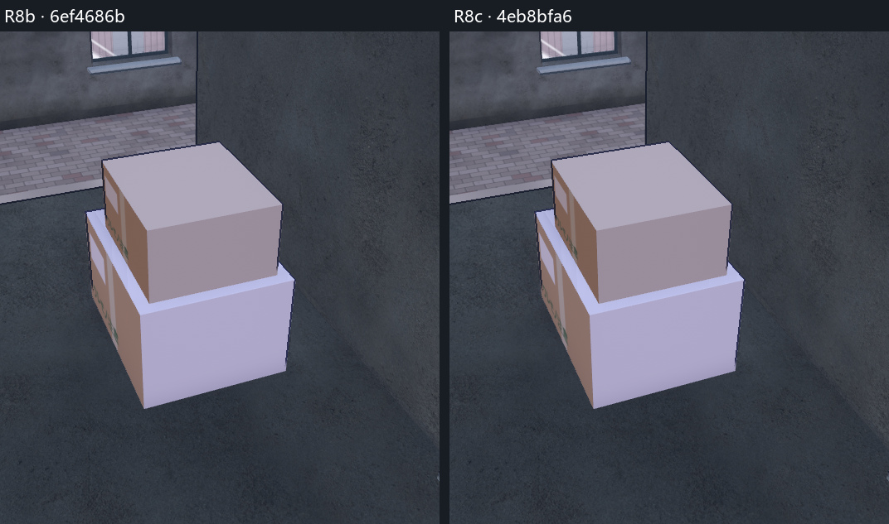
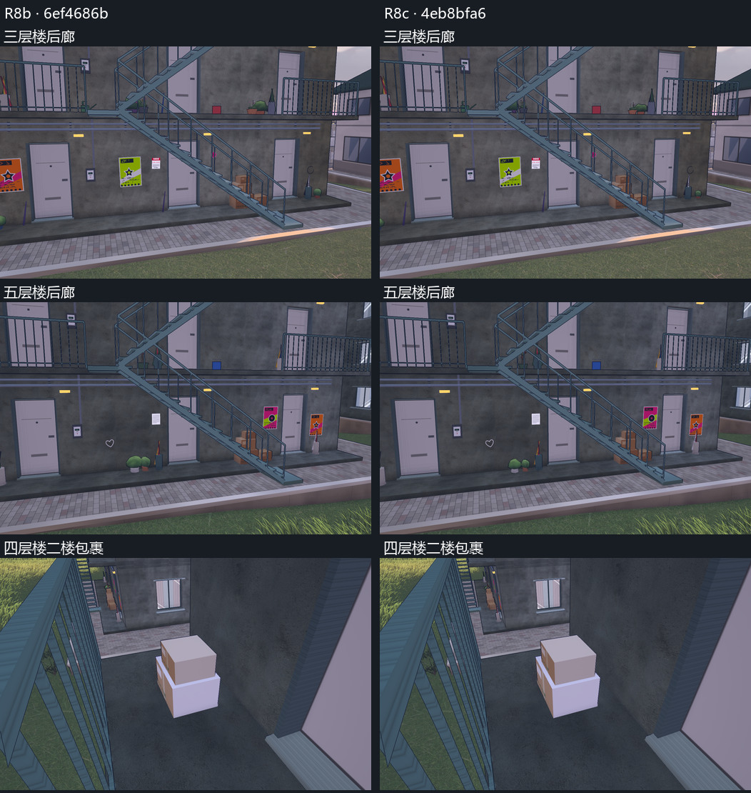
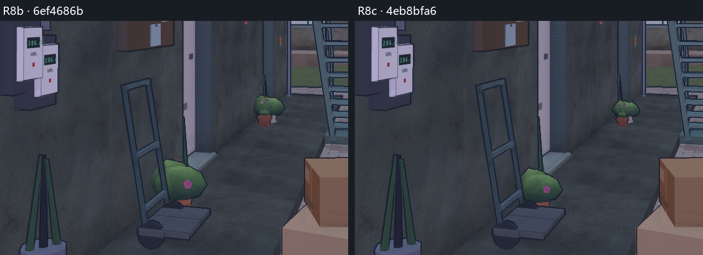
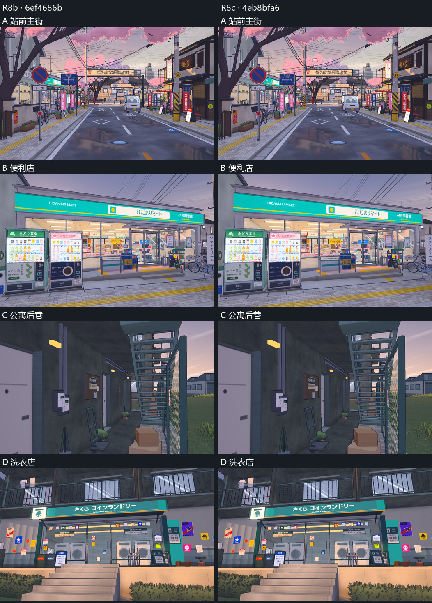
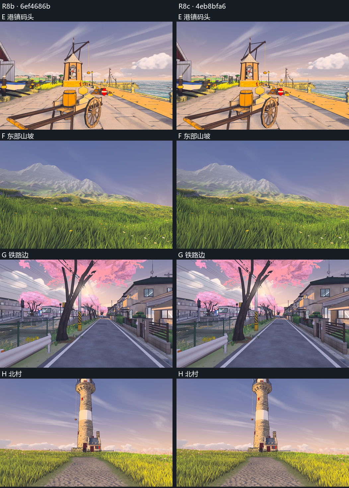

# 第八轮第二次补修 · 公寓盆栽叶片与后墙

比较 R8b `6ef4686b630dd14f36945fdcf650bde7e582afd7` 与 R8c `4eb8bfa622cea6a1ea70098838de3e7fffd1b5c1`。基线照片沿用 R8b 同提交已核验的 RTX 3060 Laptop 原片；R8c 重新拍摄 8 个地面机位、返回 A 及 3 个后廊机位。两版各自新测一轮帧时。所有图为左 R8b、右 R8c。

## 叶片净空

R8c 将盆栽缩放从 0.75 调到 0.62，中心 z 从 0.20 移至 0.245 米。以各层实际后墙外表面为 z = 0，向廊外为正；逐一重建 33 盆的所有几何顶点，内外极值均属于 foliage 材质。R8b 有 16 盆叶片进入墙体，R8c 为 0。R8c 最内侧距墙 10.397897340 毫米，最外侧距 0.50 米边界 2.230868327 毫米。

| 盆栽真实顶点 | R8b | R8c |
| --- | --- | --- |
| 最小 z（米） | -0.081914528206 | 0.010397897340 |
| 最大 z（米） | 0.494892129645 | 0.497769131673 |
| 最小值所在位置 | 4f 楼 · 第 3 层 | 3f 楼 · 第 2 层 |
| 最大值所在位置 | 3f 楼 · 第 2 层 | 3f 楼 · 第 2 层 |

R8c 两个极值来自三层公寓的二层盆栽。最近顶点局部坐标 (−1.481549137, 0.198282482, 0.010397897) 米，最远顶点为 (−1.561639526, 0.198282482, 0.497769132) 米。Y 从该层完成地面起算。这些是生产道具几何的 CPU 重放值，GPU 回执另行核对同眼位成片、场景资源和逐层道具数量。

## 包裹与门口道具

两版分别执行原始 buildTownApartment，捕获其传给 artDoorsteps 的 12 份实参，按对应版本的 addDoorsteps、盆栽生成器、Frame 与 GB 重建顶点及三角形。参数跟踪省略使用独立随机源的窗口绘制。

四层楼二层两版均传入 x = [−5.5, −4.6] 米避让区，楼层 y = 2.99 米、种子为 `art-r8-door-4-1`。两版逐三角形对照两只原包裹的实体盒，均无道具相交。

| 后廊几何指标 | 改前 | 补修 |
| --- | --- | --- |
| 触及原包裹的网格部件 | 0 | 0 |
| 外缘超过 0.5 m 的盆数 | 0 | 0 |
| 向内穿过后墙的盆数 | 16 | 0 |
| 最小廊板边沿横向余量 (m) | 0.555108 | 0.552231 |
| 道具外缘至门洞最小水平距离 (m) | 0.071451 | 0.071451 |
| 道具三角形 | 10884 | 10884 |

三份后廊实拍各自回报的 12 层计数与 CPU 一致，两版均为 23 个伞桶、33 盆植物、22 件小物。两版源码与两份实际运行回执逐项核对，26 枚贴花的完整记录相同。廊板余量为静态几何距离。

[改前顶点、避让实参与相交证据](geometry-before.json) · [补修顶点、避让实参与相交证据](geometry-after.json)

## 同机位实拍

| 机位 | 改变像素 | 差值大于 2 的像素 | 最大单通道差值 | 原始 PNG |
| --- | --- | --- | --- | --- |
| art-a-street | 0 | 0 | 0 | [改前](photos/before/art-a-street.png) · [补修](photos/after/art-a-street.png) |
| art-b-konbini | 0 | 0 | 0 | [改前](photos/before/art-b-konbini.png) · [补修](photos/after/art-b-konbini.png) |
| art-c-alley | 20287 | 9165 | 217 | [改前](photos/before/art-c-alley.png) · [补修](photos/after/art-c-alley.png) |
| art-d-laundry | 0 | 0 | 0 | [改前](photos/before/art-d-laundry.png) · [补修](photos/after/art-d-laundry.png) |
| sample-e-harbour | 4490 | 3486 | 227 | [改前](photos/before/sample-e-harbour.png) · [补修](photos/after/sample-e-harbour.png) |
| sample-f-hillside | 0 | 0 | 0 | [改前](photos/before/sample-f-hillside.png) · [补修](photos/after/sample-f-hillside.png) |
| sample-g-rail | 0 | 0 | 0 | [改前](photos/before/sample-g-rail.png) · [补修](photos/after/sample-g-rail.png) |
| sample-h-north | 0 | 0 | 0 | [改前](photos/before/sample-h-north.png) · [补修](photos/after/sample-h-north.png) |
| rear-3f | 21360 | 10263 | 100 | [改前](rear/before/rear-3f.png) · [补修](rear/after/rear-3f.png) |
| rear-5f | 16869 | 6071 | 104 | [改前](rear/before/rear-5f.png) · [补修](rear/after/rear-5f.png) |
| rear-4f-parcels | 835 | 340 | 87 | [改前](rear/before/rear-4f-parcels.png) · [补修](rear/after/rear-4f-parcels.png) |

## RTX 3060 Laptop 帧时

两次独立进程各采 8 个固定机位和两段实际行走，共 10,865 个 RAF 间隔。固定机位至少 10 秒，可信 W 步行至少 3 秒；平均 ≥60 FPS 且 P95 ≤16.7 ms 为达标。基线 7/8，补修 6/8。每版只有一轮测量。

| 机位 | 改前 FPS / P95 ms | 补修 FPS / P95 ms | 改前逐帧绘制次数 | 补修逐帧绘制次数 |
| --- | --- | --- | --- | --- |
| A 站前 | 63.52 / 15.5 | 61.35 / 30.7 | 1591–1608 | 1591–1608 |
| B 便利店 | 65.00 / 15.5 | 64.90 / 15.5 | 1053–1058 | 1053–1058 |
| C 后巷 | 65.00 / 15.5 | 65.00 / 15.5 | 981–983 | 981–983 |
| D 洗衣店 | 65.00 / 15.5 | 65.00 / 15.5 | 912–917 | 912–917 |
| E 港口 | 63.71 / 15.5 | 62.23 / 15.6 | 1532–1537 | 1532–1537 |
| F 山坡 | 65.00 / 15.5 | 65.00 / 15.5 | 775–777 | 775–777 |
| G 铁路 | 60.46 / 30.7 | 50.92 / 30.8 | 1545 | 1545 |
| H 北村 | 65.00 / 15.5 | 65.00 / 15.5 | 709–711 | 709–711 |
| 第三人称实走 | 59.24 / 30.8 | 43.55 / 30.9 | 1677–1703 | 1674–1703 |
| 第一人称实走 | 50.59 / 30.8 | 45.88 / 30.9 | 1463–1614 | 1458–1611 |

| 城市场景资源 | 改前 | 补修 |
| --- | --- | --- |
| geometries | 69 | 69 |
| materials | 51 | 51 |
| modelPrimitives | 234 | 234 |
| totalTriangles | 95475 | 95500 |
| ownedTextures | 12 | 12 |
| newTexturePixels | 10485760 | 10485760 |

门前道具 CPU 重放两版均为 10,884 个三角面。两版实机实际加载的公寓、门口道具、种子、网格与植株生成模块（共六个文件）与 CPU 重放使用的文件逐一同哈希。[源码哈希及场景回执汇总](summary.json)

全城运行回执为 95,475 → 95,500 面，25 面差异全部在三层楼整栋（12,221 → 12,246）。四层和五层楼的整楼面数持平。这 25 面未定位到具体几何部件。

[改前逐帧](timing/1-before/frames.json.gz) · [补修逐帧](timing/2-after/frames.json.gz)

## 文件与复算

[逐段总表](summary.json) · [像素差与裁切坐标](visual-summary.json) · [原始回执](receipts) · [处理工具](tools)

下载后可运行 `python tools/verify.py` 校验 24 张 PNG 及逐帧重算结果。运行 `python tools/compare.py` 与 `python tools/describe.py` 重建对照和本文。几何复算分别运行 `node tools/geometry.mjs <对应版本的-world-base> geometry-before.json` 和 `node tools/geometry.mjs <补修版本的-world-base> geometry-after.json`。
