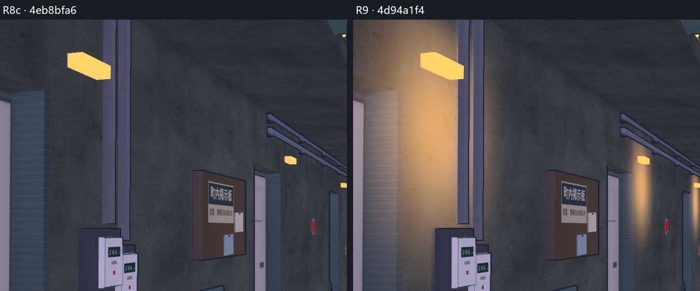
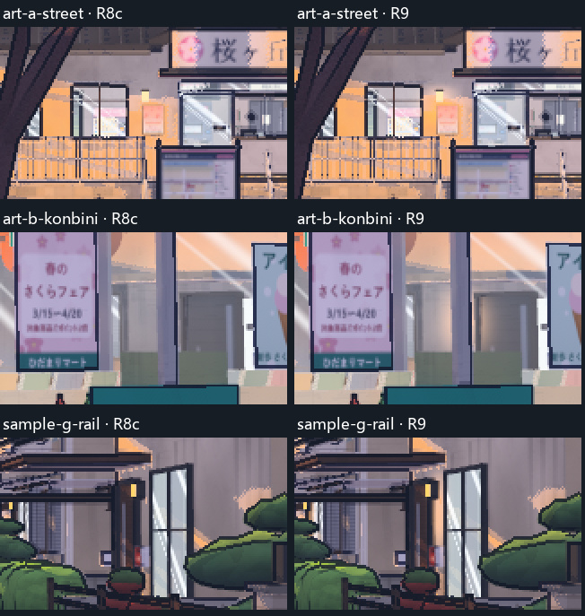
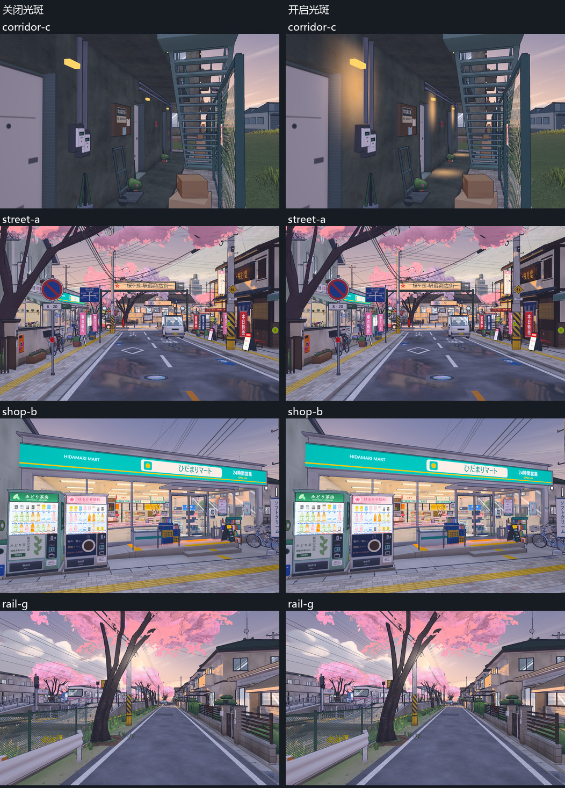
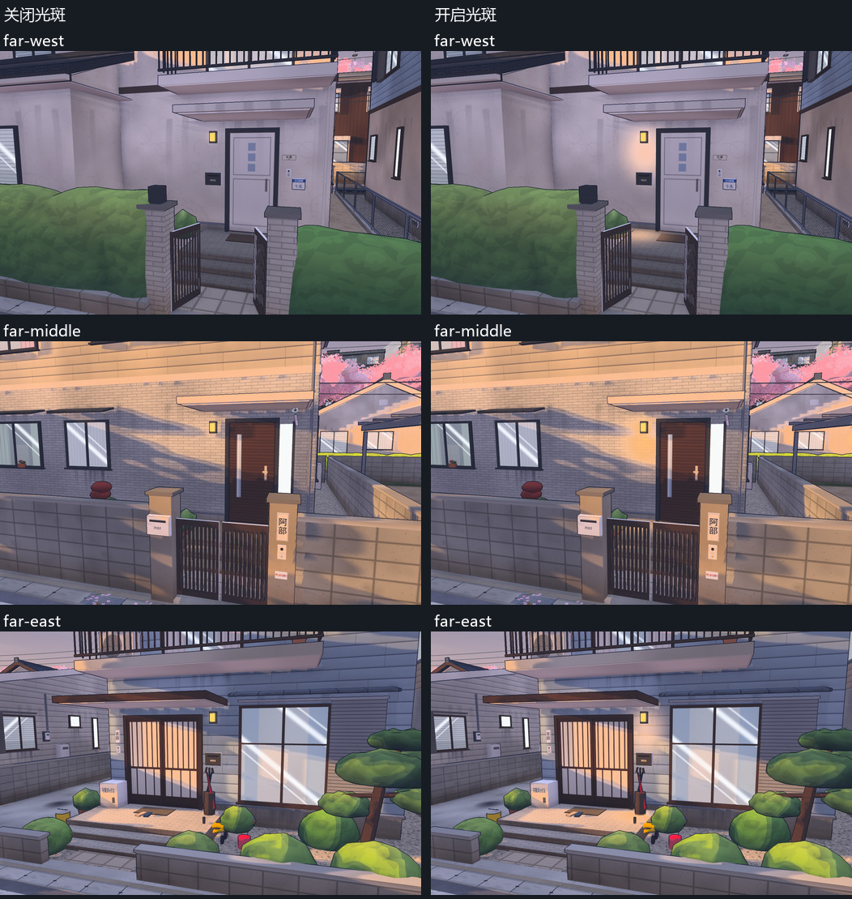
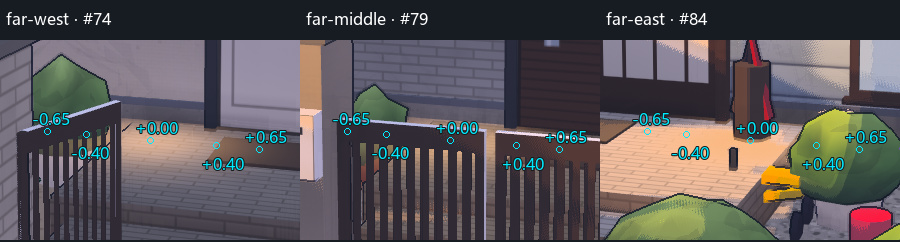
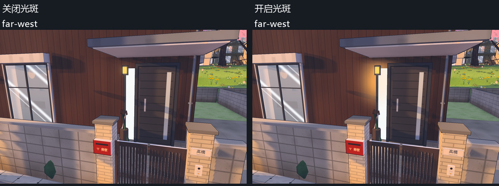
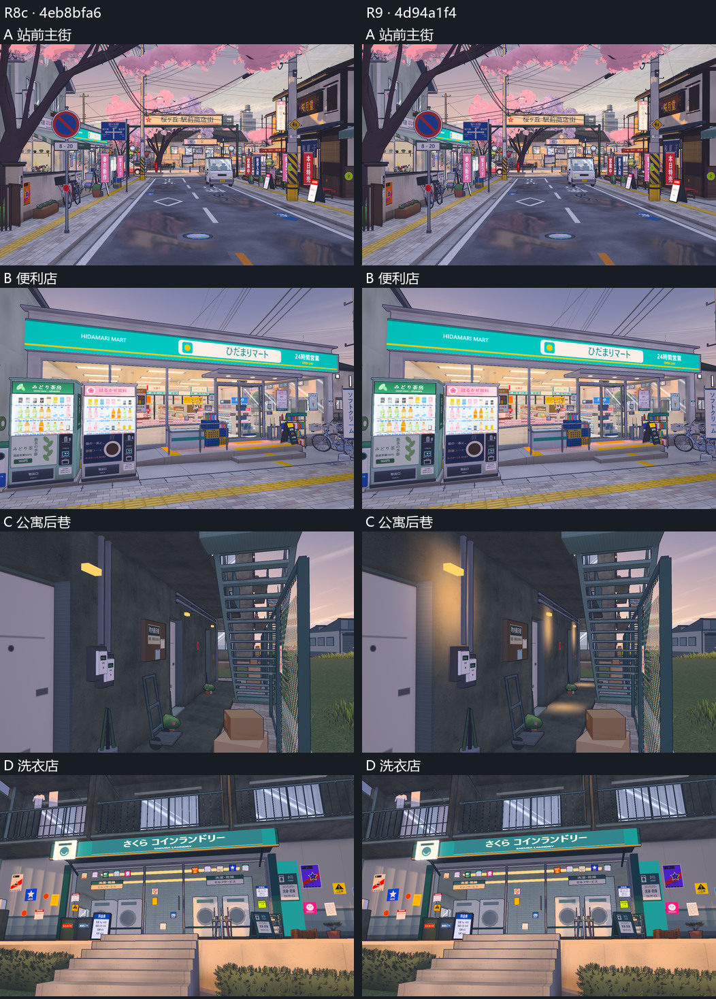
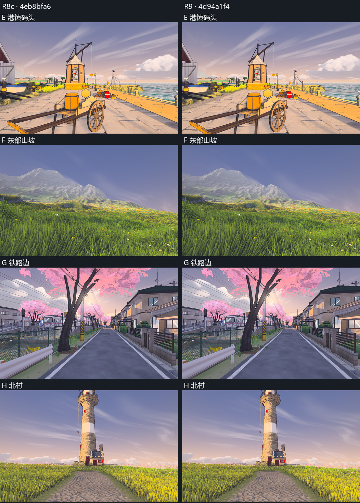

# 第九轮门灯光斑 · RTX 3060 Laptop 实机

基线 `4eb8bfa622cea6a1ea70098838de3e7fffd1b5c1`，候选 `4d94a1f41d17f18628e90e2c3f03914e37a3e471`。基线地面照片沿用同提交的 R8c 原片，候选 A–H 重新拍摄；两版各做一轮帧时。另在候选同一次启动中冻结相机和时钟，按关、开、重复开拍七个机位。原图 1440 × 900，傍晚。

## 画面与高光

后廊 C 近处灯下出现橙色光斑，墙面纹理仍可见，远处两灯也在墙、地上形成局部亮区。A、B、G 的小光斑分别位于街边招牌旁、便利店玻璃后的远处和铁路侧住宅门口；下图按两版原图中最大连通变化区作双倍最近邻放大。D 固定机位两版逐像素一致。

下表使用候选同机位开关两张原始 RGB 图。白点为三个通道均等于 255，近白为三个通道均至少 250；单通道到顶单独列出。只统计从关到开新达到该阈值的像素。最大差表示 8 位单通道最大绝对差。重复开差异用来检验冻结是否稳定。

| 机位 | RGB 变化 >2 | 新增纯白 | 新增近白 | 新增 R/G/B=255 | 最大差 | 重复开变化像素 | 原图 |
| --- | --- | --- | --- | --- | --- | --- | --- |
| corridor-c | 202,989 | 0 | 0 | 51 / 0 / 0 | 183 | 0 | [关](door-glow/corridor-c-off.png) · [开](door-glow/corridor-c-on.png) · [重复开](door-glow/corridor-c-repeat-on.png) |
| far-west | 44,386 | 0 | 0 | 0 / 0 / 0 | 130 | 0 | [关](door-glow/far-west-off.png) · [开](door-glow/far-west-on.png) · [重复开](door-glow/far-west-repeat-on.png) |
| far-middle | 39,739 | 0 | 0 | 2554 / 0 / 0 | 112 | 0 | [关](door-glow/far-middle-off.png) · [开](door-glow/far-middle-on.png) · [重复开](door-glow/far-middle-repeat-on.png) |
| far-east | 38,442 | 0 | 0 | 81 / 0 / 0 | 166 | 0 | [关](door-glow/far-east-off.png) · [开](door-glow/far-east-on.png) · [重复开](door-glow/far-east-repeat-on.png) |
| street-a | 1,494 | 0 | 0 | 100 / 0 / 0 | 108 | 0 | [关](door-glow/street-a-off.png) · [开](door-glow/street-a-on.png) · [重复开](door-glow/street-a-repeat-on.png) |
| shop-b | 1,080 | 0 | 0 | 0 / 0 / 0 | 91 | 0 | [关](door-glow/shop-b-off.png) · [开](door-glow/shop-b-on.png) · [重复开](door-glow/shop-b-repeat-on.png) |
| rail-g | 1,176 | 0 | 0 | 0 / 0 / 0 | 142 | 0 | [关](door-glow/rail-g-off.png) · [开](door-glow/rail-g-on.png) · [重复开](door-glow/rail-g-repeat-on.png) |

七个机位均未新增三通道近白或纯白像素，远排中段新增 2,554 个红通道到顶的像素，其余两个通道均未新增到顶。七张重复开启控制图与首次开启的原图逐像素相同。

## 灯位、远排住宅与支承面

实际登记包含 36 盏城镇公寓灯和 109 盏上游灯，其中住宅 103、商铺 4、车站 2。位置去重后有 145 盏，2 盏只做墙面光斑。两张实例网格各分配 145 个位置，无地面光斑的实例使用零缩放。没有增加点光源和阴影投射。

住宅登记局部 z ∈ [−75,−60] 的有 20 盏。按 x 排序取 15%、50%、85% 位置，选中灯号 74、79、84。三镜使用真实灯位和朝外法线构图。

该区间的 20 个住宅登记法线全部朝局部 +Z，其中 14 盏位于 z 约 −60 米，6 盏位于 z 约 −74 米。上述按 x 排序的三镜都落在 −60 米一排。三灯中心墙面射线都命中与预期外法线一致的面，门廊中心向下也都命中同高的水平实体。西、东机位的中心地面像素分别增加 RGB (121,78,38)、(115,78,36)，中间机位的门和围墙挡住大部分地面，中心像素只变 (0,1,0)。墙面亮斑可见于三镜。

住宅生成代码把灯放在靠外的门侧，灯的投影至同侧门廊边缘仅 0.23 米。地面着色器横向半径 1.2 米，缺少按门廊宽度收边的控制。离灯中心横向 0.40 米、离墙 0.40 米处已越出台沿 0.17 米，剩余强度系数 0.516732，线性 RGB 加值约 (0.180856, 0.099471, 0.045214)。在无邻近承托时，这部分会留在与门廊齐高的平面上。[源码尺寸与着色器复算](shader-support.json)

射线采样过滤了光斑自身和不写深度的材质。表中墙误差沿墙法线向内测，正值表示受测不透明面在目标墙面后方；地面误差向下测，正值表示实际受测面低于预定门廊高度。方向列为命中法线与预期外法线或向上法线的点积。屏幕位置和开关前后 3×3 像素 RGB 中位差来自原片，可与各侧探针互查。

| 灯号 | 横移 m | 墙误差 m | 墙方向 | 地面落差 m | 地面方向 | 画面 x/y | ΔR/G/B |
| --- | --- | --- | --- | --- | --- | --- | --- |
| 74 | 0 | 0.000 | 1.000 | -0.000 | 1.000 | 714 / 626 | 121 / 78 / 38 |
| 74 | -0.4 | 0.000 | 1.000 | -0.306 | 0.664 | 650 / 620 | 0 / 1 / 0 |
| 74 | 0.4 | -0.035 | 1.000 | -0.000 | 1.000 | 780 / 631 | 71 / 48 / 25 |
| 74 | -0.65 | 0.000 | 1.000 | 0.050 | 1.000 | 611 / 617 | 0 / 0 / 0 |
| 74 | 0.65 | -0.035 | 1.000 | -0.015 | 1.000 | 823 / 635 | 30 / 20 / 11 |
| 79 | 0 | 0.000 | 1.000 | -0.000 | 1.000 | 714 / 626 | 0 / 1 / 0 |
| 79 | -0.4 | 0.000 | 1.000 | -0.185 | 0.585 | 650 / 620 | 0 / 0 / 0 |
| 79 | 0.4 | -0.035 | 1.000 | -0.000 | 1.000 | 780 / 631 | 0 / 0 / 0 |
| 79 | -0.65 | 0.000 | 1.000 | -0.026 | 0.240 | 611 / 617 | 0 / 0 / 0 |
| 79 | 0.65 | -0.035 | 1.000 | -0.015 | 1.000 | 823 / 635 | 0 / 0 / 0 |
| 84 | 0 | -0.000 | 1.000 | -0.000 | 1.000 | 714 / 626 | 115 / 78 / 36 |
| 84 | -0.4 | -0.035 | 1.000 | -0.000 | 1.000 | 650 / 620 | 21 / 8 / -8 |
| 84 | 0.4 | -0.000 | 1.000 | 0.290 | 1.000 | 780 / 631 | 0 / 0 / 0 |
| 84 | -0.65 | -0.035 | 1.000 | -0.000 | 1.000 | 611 / 617 | 13 / 7 / 1 |
| 84 | 0.65 | -0.025 | 1.000 | -0.141 | 0.393 | 823 / 635 | 0 / 0 / 0 |

东侧灯 #84 位于世界坐标 (339.255,10.260,839.459)。沿切线 +0.40 米、离墙 0.40 米处，最近不透明水平面比预定门廊面低 0.290 米，加上光斑自身 0.012 米抬高，该处光斑几何距支承面 0.302 米。西侧 #74 横移 −0.65 米处实际水平面也低了 0.050 米。两点投影原片的 3×3 RGB 中位差均为 (0,0,0)，此次相机没有记录到两点可见的悬浮亮斑。几何缺口仍可按坐标复现。

同样横移 −0.40 米，#74 和 #79 的向下射线分别先命中 y = 8.616 和 8.495 米的倾斜物体，两处都高于 y = 8.322 米的光斑平面。此处可发生遮挡，不能计作悬空距离。两点的开关 RGB 中位差分别为 (0,1,0) 和 (0,0,0)。

[逐点实物命中、坐标与 RGB](support-probes.json) · [完整实机回执](door-glow/report.json.gz)

### 第二排住宅补拍

单独重启候选，选择 z ∈ [−75,−70] 的 6 盏住宅灯之一。灯 #91 局部坐标 (−40.135, 2.260, −74.455)，法线朝 +Z。门左外墙在开启时可见橙色光斑，地面被前景院墙和门挡住。开关两图有 69,178 个像素的最大单通道差超过 2，重复开启逐像素一致。全帧绘制 921 → 923，墙、地各多一次提交。

中心台面射线命中同高的水平物体，中心投影的 RGB 中位差是 (1,1,0)。左移 0.4 米及 0.65 米的位置，最近实物分别高于预定台面 0.296、0.300 米，投影中都没有 RGB 变化。下表与第一组采用同一误差符号。

| 灯号 | 横移 m | 墙误差 m | 墙方向 | 地面落差 m | 地面方向 | 画面 x/y | ΔR/G/B |
| --- | --- | --- | --- | --- | --- | --- | --- |
| 91 | 0 | -0.080 | 1.000 | -0.000 | 1.000 | 713 / 678 | 1 / 1 / 0 |
| 91 | -0.4 | -0.000 | 1.000 | -0.296 | 0.971 | 629 / 668 | 0 / 0 / 0 |
| 91 | 0.4 | -0.035 | 1.000 | -0.000 | 1.000 | 801 / 689 | 0 / 0 / 0 |
| 91 | -0.65 | -0.000 | 1.000 | -0.300 | 0.817 | 579 / 661 | 0 / 0 / 0 |
| 91 | 0.65 | -0.035 | 1.000 | -0.015 | 1.000 | 858 / 697 | 0 / 0 / 0 |

该镜新增纯白和近白均为 0，新增单通道 R/G/B 到顶分别为 3707 / 0 / 0。[关](door-glow-deep-row/far-west-off.png) · [开](door-glow-deep-row/far-west-on.png) · [重复开](door-glow-deep-row/far-west-repeat-on.png) · [探针数据](deep-support-probes.json) · [实机回执](door-glow-deep-row/report.json.gz)

## 绘制次数和帧时

冻结测量每次重置渲染器计数。以下墙、地计数来自对应实例网格的实际渲染提交，全帧计数同时含场景和后处理。

| 机位 | 全帧关→开 | 全帧增量 | 墙提交 | 地提交 | 全帧三角面关→开 |
| --- | --- | --- | --- | --- | --- |
| corridor-c | 988 → 990 | 2 | 1 | 1 | 8,661,694 → 8,662,274 |
| far-west | 905 → 907 | 2 | 1 | 1 | 7,190,575 → 7,191,155 |
| far-middle | 1000 → 1002 | 2 | 1 | 1 | 7,310,521 → 7,311,101 |
| far-east | 957 → 959 | 2 | 1 | 1 | 7,150,702 → 7,151,282 |
| street-a | 1609 → 1611 | 2 | 1 | 1 | 7,864,356 → 7,864,936 |
| shop-b | 1043 → 1045 | 2 | 1 | 1 | 7,654,207 → 7,654,787 |
| rail-g | 1545 → 1547 | 2 | 1 | 1 | 8,502,343 → 8,502,923 |

两次独立计时合计 10,397 个有效 RAF 帧间隔。固定机位至少 10 秒，两种可信 W 步行各至少 3 秒。平均至少 60 FPS 且 P95 至多 16.7 ms 定为达标，基线和候选分别为 5/8、4/8。

| 机位 | 改前 FPS / P95 ms | 候选 FPS / P95 ms | 改前每帧调用 | 候选每帧调用 |
| --- | --- | --- | --- | --- |
| art-a-street | 56.81 / 30.8 | 54.63 / 30.8 | 1591–1607 | 1589–1609 |
| art-b-konbini | 65.00 / 15.5 | 60.96 / 30.7 | 1038–1055 | 1040–1057 |
| art-c-alley | 65.00 / 15.5 | 65.00 / 15.5 | 981–983 | 983–988 |
| art-d-laundry | 63.81 / 15.5 | 65.00 / 15.5 | 917–919 | 919–921 |
| sample-e-harbour | 58.98 / 30.8 | 59.96 / 30.7 | 1532–1537 | 1534–1539 |
| sample-f-hillside | 65.00 / 15.5 | 65.00 / 15.5 | 775 | 777 |
| sample-g-rail | 49.61 / 30.8 | 41.92 / 30.9 | 1545–1548 | 1547–1550 |
| sample-h-north | 65.00 / 15.5 | 65.00 / 15.5 | 709–711 | 711–713 |
| walk-third | 45.47 / 30.8 | 47.56 / 30.9 | 1676–1703 | 1676–1705 |
| walk-first | 53.90 / 30.8 | 48.11 / 30.8 | 1460–1613 | 1462–1613 |

[改前逐帧](timing/1-before/frames.json.gz) · [候选逐帧](timing/2-after/frames.json.gz)

## 资源与原图

三个上游灯登记模块的实际 HTTP 响应均与对应版本的仓库文件相同。两套工作树中的 .local 原件各自匹配固定的 source-files 清单。4 个 GLB、9 张公寓纹理逐文件同哈希，26 枚贴花的完整 bakedItems 与两版运行回执逐项一致。[上游三文件与缓存指纹](upstream-transport.json) · [候选 Git 与传输验证](door-glow/verification.json) · [运行与资源总表](summary.json)

| 地面机位 | 改变像素 | 差值 >2 像素 | 两版原图 |
| --- | --- | --- | --- |
| art-a-street | 4,809 | 1,494 | [改前](photos/before/art-a-street.png) · [候选](photos/after/art-a-street.png) |
| art-b-konbini | 2,865 | 1,080 | [改前](photos/before/art-b-konbini.png) · [候选](photos/after/art-b-konbini.png) |
| art-c-alley | 343,599 | 202,989 | [改前](photos/before/art-c-alley.png) · [候选](photos/after/art-c-alley.png) |
| art-d-laundry | 0 | 0 | [改前](photos/before/art-d-laundry.png) · [候选](photos/after/art-d-laundry.png) |
| sample-e-harbour | 5,425 | 4,055 | [改前](photos/before/sample-e-harbour.png) · [候选](photos/after/sample-e-harbour.png) |
| sample-f-hillside | 0 | 0 | [改前](photos/before/sample-f-hillside.png) · [候选](photos/after/sample-f-hillside.png) |
| sample-g-rail | 5,126 | 1,176 | [改前](photos/before/sample-g-rail.png) · [候选](photos/after/sample-g-rail.png) |
| sample-h-north | 0 | 0 | [改前](photos/before/sample-h-north.png) · [候选](photos/after/sample-h-north.png) |

## 下载后复算

运行 `python tools/verify.py` 校验正式照片与帧时，`python tools/diagnostic.py` 独立校验开关原图及高光数，`python tools/probes.py` 复算世界探针投影，`python tools/compare.py` 和 `python tools/regions.py` 重建对照图，最后运行 `python tools/describe.py` 重建本文。图像分析使用 Python、Pillow、NumPy 及微软雅黑。

第二排独立进程使用 `python tools/diagnostic.py --deep` 核验三张原片，`python tools/probes.py --deep` 重建投影。
