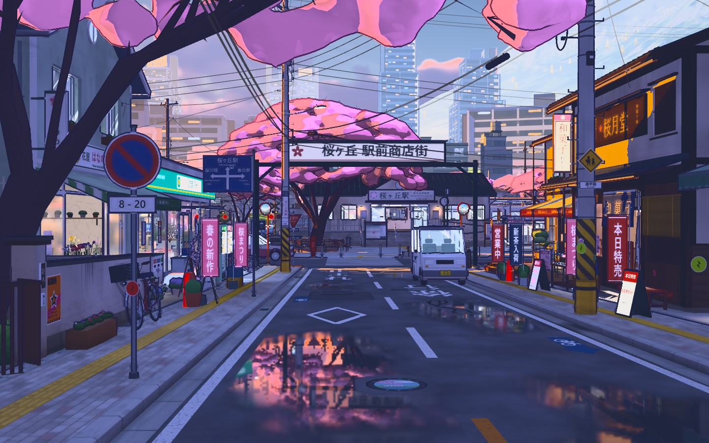
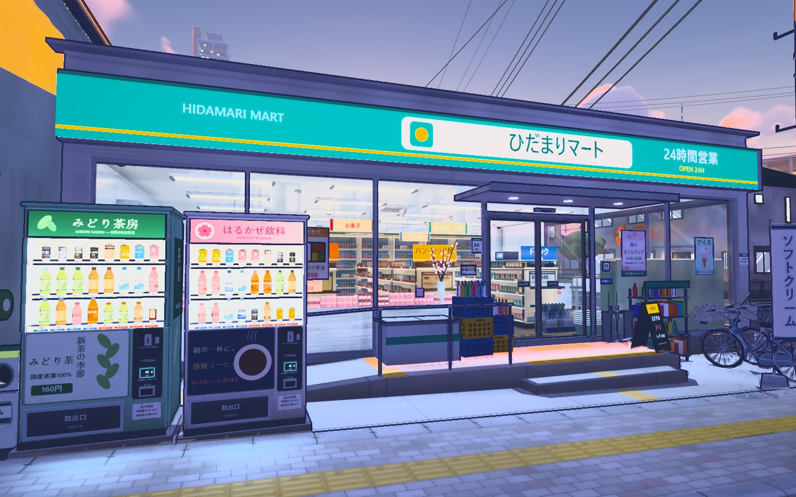
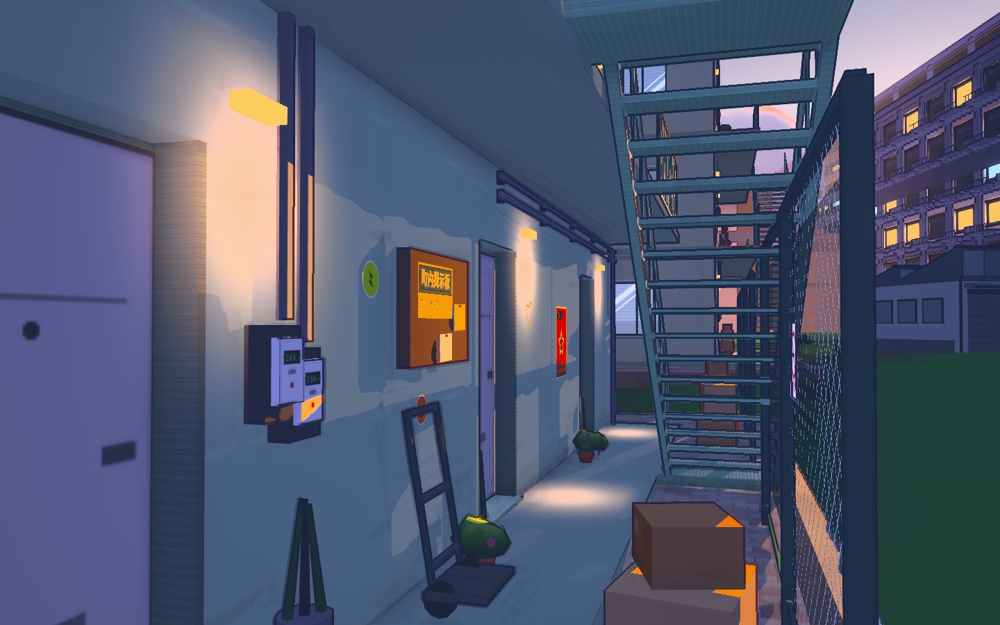
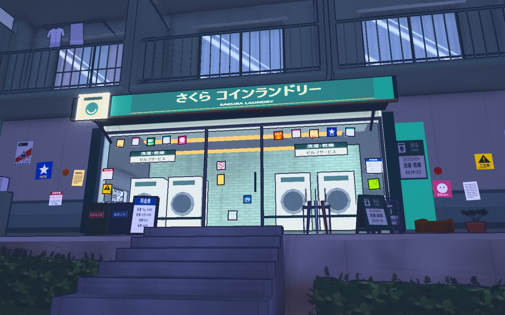
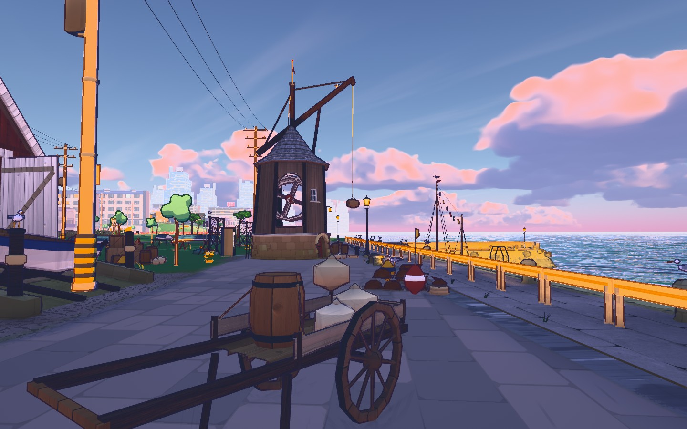
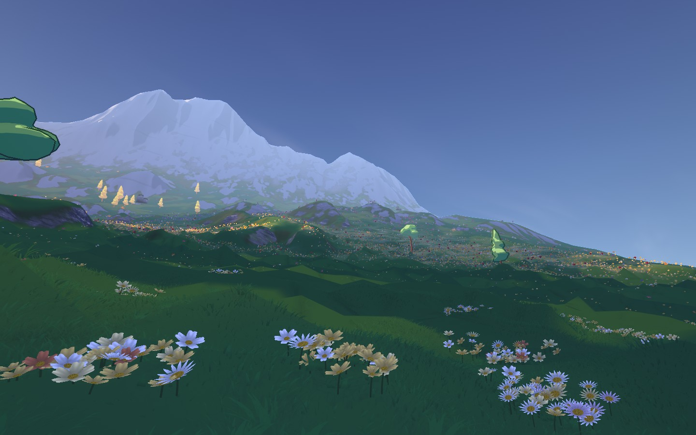
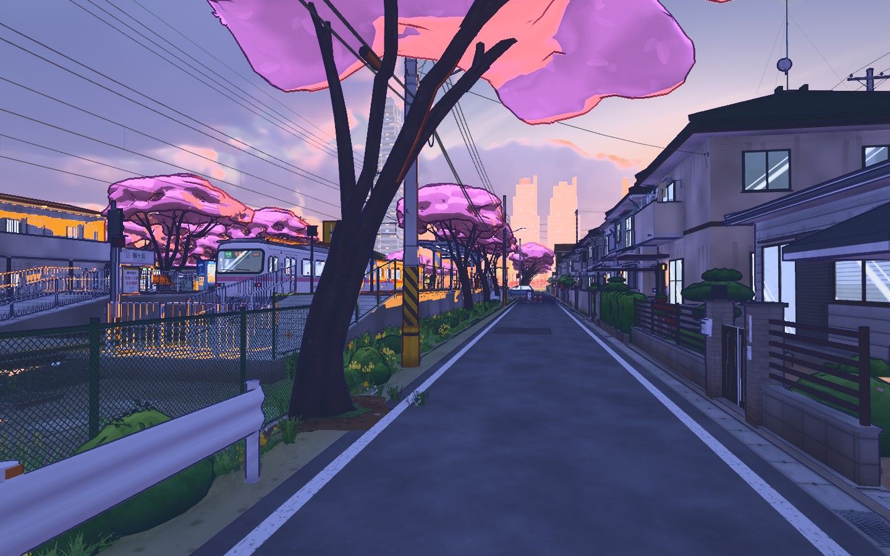
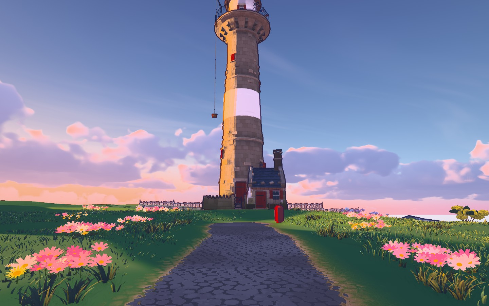

# X-51 全岛性能专项

场景从 0cf9bbd1 对照到 ad250a2d。RTX 3060 Laptop，1440 × 900、DPR 1，动画冻结 5 秒。每轮每机位预热 60 帧，使用 118 个有效 GPU 样本。
同一份 scripts/benchmark-render.cjs 轮换底分支和候选，表内为三轮最近秩 P95 的中值。

八机位均在 15 ms 内。

| 机位 | 底分支 P95 ms | 候选 P95 ms | 差值 ms |
| --- | ---: | ---: | ---: |
| A 站前 | 10.36 | 9.45 | -0.91 |
| B 便利店 | 11.02 | 9.89 | -1.13 |
| C 后巷 | 11.01 | 9.30 | -1.71 |
| D 洗衣店 | 7.02 | 6.47 | -0.55 |
| E 港镇 | 10.99 | 10.56 | -0.43 |
| F 山坡 | 7.61 | 6.29 | -1.32 |
| G 铁路 | 12.16 | 11.37 | -0.79 |
| H 北端 | 6.52 | 4.76 | -1.76 |

## G 铁路定位

合并基准的 97 帧分段计时里，按 GPU 中位数最重的三段是场景（含影图刷新） 14.60 ms、最终合成 0.56 ms、颜色与深度拷贝 0.35 ms。
逐帧记录的主要几何来源是 Petalwake 地形及道具、岛上植被和站区静态网格。每隔 30 帧刷新一次的阴影只占少数样本，排除刷新帧后 G 仍有超线样本。
阴影分辨率、相机范围和刷新设置沿用基准。铁路与远景楼体的现有 LOD 已核对，本轮的空间分批覆盖岛上草、远景树和原生岛屿道具。光束关闭时跳过光束通道，彩边关闭时合并颜色读取。

G 由 8,665,483 降至 6,366,602 三角形，绘制调用由 1032 变为 1084。B 由 7,736,115 降至 5,979,093 三角形，绘制调用由 524 变为 612。

## 同机位画面

| 机位 | 上一版 | 新版 | RGB 有变化的像素 | 最大通道差超过 3 的像素 |
| --- | --- | --- | ---: | ---: |
| A 站前 |  |  | 22 | 0 |
| B 便利店 |  |  | 0 | 0 |
| C 后巷 |  |  | 0 | 0 |
| D 洗衣店 |  |  | 0 | 0 |
| E 港镇 |  |  | 0 | 0 |
| F 山坡 |  |  | 0 | 0 |
| G 铁路 |  |  | 0 | 0 |
| H 北端 |  |  | 0 | 0 |

[比较结果](report.json) · [逐帧 GPU 与绘制记录](measurements.json) · [GPU 时钟](gpu-clocks.csv) · [基准分段与几何记录](baseline-gpu-profile.json)
