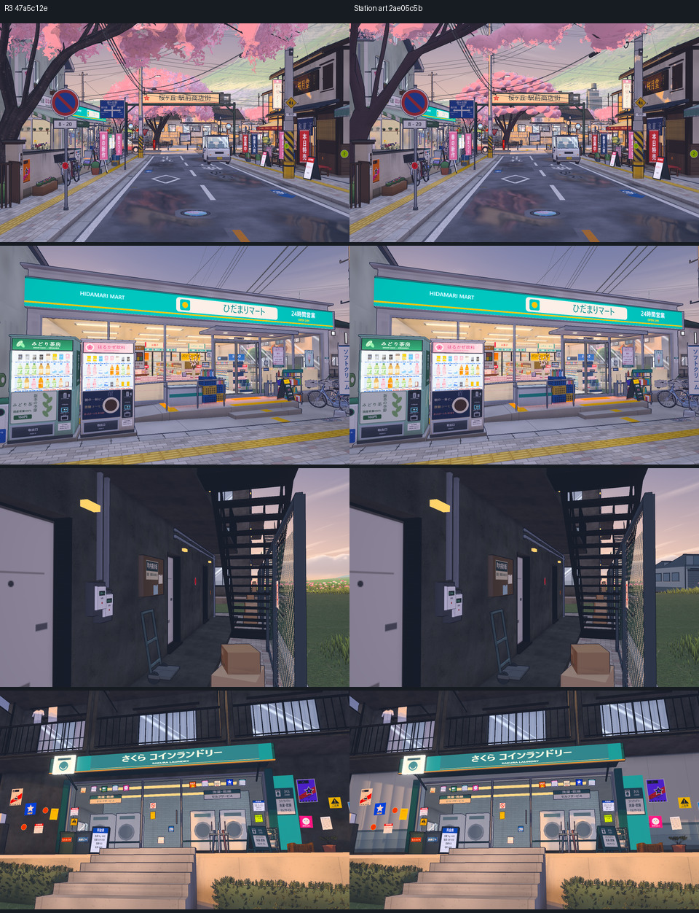

# 站区 Blender 素材与街面倒影实测

最终源为 `2ae05c5b0715fba94a167fa103babb72ae0ef9cf`，对照为 R3 原交件 `47a5c12eba910682ccbf8bc9138510bc01737bf3`。八个地面固定机位复拍成功，旧 26 张贴花和 3,147 条站区碰撞均保留。两次最终实测中，四个固定镜头与第一人称步行都达到 60 FPS、p95 ≤16.7 ms，第三人称的第二次实测出现慢帧。



| 机位 | 原生 1440 × 900 PNG | 最大 RGB 通道差 >8 的像素 | 画面观察 |
| --- | --- | ---: | --- |
| A 站前 | [原图](art-a-street.png) | 244,785 | 电线上方近冠可辨花瓣与枝梢，远樱、大门和东侧退台楼有清楚的层次。新树冠大色块内部比 R3 平整。 |
| B 便利店 | [原图](art-b-konbini.png) | 27,974 | 首次只换模型时与 R3 的 PNG 完全相同；更新倒影后，玻璃的反射发生变化，橙黄蓝分类牌、货架和门框仍可辨。 |
| C 后巷 | [原图](art-c-alley.png) | 24,010 | 工房在铁网右后方，原楼梯、灯和管线保留。|
| D 洗衣店 | [原图](art-d-laundry.png) | 165,534 | 门翼、门廊边框与材质已更换，旧告示和贴花保留，洗衣机可透过入口看见。 |
| E 港镇 | [原图](sample-e-harbour.png) | 3,671 | 港边小物区域有差异；单次跨进程图不足以分离港区已有动态因素。 |
| F 山麓 | [原图](sample-f-hillside.png) | 0 | 与 R3 最终存图逐字节一致。 |
| G 铁路小路 | [原图](sample-g-rail.png) | 2,447 | 铁路后方和近处的少量像素有差异。 |
| H 北村 | [原图](sample-h-north.png) | 0 | 与 R3 最终存图逐字节一致。 |

四区复拍沿用种子 252 对应的既有机位。全部照片使用正常地面入口、傍晚、无 HUD、冻结时钟 14 s；每张的坐标、四元数和垂直视角与 R3 一致。返回 A 的最终存图与初次 A 的最终存图 SHA 相同。照片驱动退出 0，JS 异常和 GL 错误均为 0。交付包的四个 GLB 在最终拍摄中均返回 HTTP 200，服务端发送字节及 SHA 与签出清单逐个相同。[四区对照](sample-ground.jpg) · [拍摄与请求记录](photos.json) · [像素统计](ground-diff.json) · [R3 原图证据](https://github.com/aa15119557034/agent-review-room/tree/6e35a4cb67c5c533acf6b3935d56ff5d7eba9e3b/apps/desktop/e2e/fixtures/world-base/evidence/art-r3-ground-3060-2026-11-18)

## 安装、几何与行走

运行 ZIP 的 SHA-256 为 `3ef6196ee62ad3b1bf9cfda4ea0feac017ccb64aac208ef4b8b82df0f7ea9d13`，共 1,031,291 字节。新检出可用离线准备入口验证本包 10 项内容。与基线共有的 809 个既有资产文件 SHA 相同。西侧 `town-house-0` 保留原建筑；这套源独立使用作者的 MIT 包。[准备实测](prepare-v2-result.json) · [两版包的内容差异](v1-v2-comparison.json) · [来源与许可](../../THIRD-PARTY.md)

- 东侧交换所地基位于站区 `[35, 4.430233, -124.2]`，8 级台阶接既有街道，踏深 0.2675 m。铁网后工房位于 `[-30, 5.143555, -142.6]`，yaw 2.03。两块地基分别在旋转后的实际足迹内采样 961 点，归入 city 正常的植被清理及资源释放。
- 原 35 个清草区和 6 段台阶逐项一致，新增两块地基及东侧入口后共有 38 个清草区。实际改写草图 texel 为 260→290。站区原生碰撞数据 3,147 条逐项相同，既有 11 个城镇及 9 个天际线做旧网格的种子、色调逐项相同。
- 洗衣店只使用 `Portal_wings`，原有玻璃、招牌、机器和门体沿用。首版给第 8 张海报造成 18 mm 的槽缝，签出包将其缩至 2 mm。整个场景重算真实指纹为 `1065:2670334:299375.3:953080.7`，22 张平面贴花的九点与 4 个原生曲面吸附全部通过，0 项额外遮挡。正常加载使用 baked，现场规划射线为 0。

[完整 CPU 对照](cpu-scene.json) · [最终源 26 处落点和碰撞复验](cpu-final.json) · [A 近冠 1:1](w3-crown-1to1.png) · [D 门翼 1:1](laundry-poster-1to1.png)

## 两时段倒影

从 `2a7c6f12` 的六面原始 HDR 发现两时段均有一个负蓝通道，位于 W1 旧橙瓶的同一像素。做旧的过饱和运算把漫反射率外推至负数。`17c126ad` 在这一行限制漫反射率下界。两个时段原像素的红绿逐位相同，蓝值均恢复到 0。`2ae05c5b` 安装从该源真实离线烘焙的两组 256² PNG。

| 时段 | 原始线性峰值 | 原始峰值 >2 的像素 / 393,216 | 映射后峰值 | 最大解码误差 |
| --- | ---: | ---: | ---: | ---: |
| 下午 | 2.3984375 | 1 | 2 | 0.006996 |
| 傍晚 | 2.939453125 | 89 | 2 | 0.007643 |

两组原始半浮点共 786,432 个像素，RGB 均有限且非负。超过 2 的像素按同一比例缩放三个通道。正式入口的 27 扇橱窗和湿路共享当前六面，运行时每帧倒影捕获 0 次。傍晚 A 潮湿路面裁区的平均亮度为 81.30→84.90，87,840 像素中三通道均 ≥250 的像素仍为 0；B 门玻璃和店内裁区平均为 142.95→146.71，68,200 像素中近白像素为 0→2。[12 面原始数据及核验](reflections/README.md) · [原位玻璃与湿路 1:1](road-and-glass-1to1.png) · [裁区数值](road-and-glass.json)

## RTX 3060 Laptop 帧时

每列为单次独立 Electron 进程，同一 1440×900、DPR 1、D3D11。固定镜头各采约 10 s，第三与第一人称实际按住 W，各采约 3 s。表格单元为 FPS / p95 毫秒。

| 场景 | 最终第 1 次 | R3 同场 | 最终第 2 次 |
| --- | ---: | ---: | ---: |
| A 站前 | 64.60 / 15.5 | 64.90 / 15.5 | 64.90 / 15.5 |
| B 便利店 | 64.80 / 15.5 | 64.21 / 15.5 | 65.00 / 15.5 |
| C 后巷 | 65.00 / 15.5 | 64.90 / 15.5 | 65.00 / 15.5 |
| D 洗衣店 | 65.00 / 15.5 | 65.00 / 15.5 | 65.00 / 15.5 |
| 第三人称 | 65.00 / 15.5 | 62.13 / 15.6 | 54.43 / 30.8 |
| 第一人称 | 65.00 / 15.5 | 65.00 / 15.5 | 64.68 / 15.5 |

第三人称均从相同的位置按住 W，记录实际脚部坐标。以下显卡数据取自各段采样起止时间内每约 0.5 秒的整卡观测。焦点栏的分母为同期前台窗口观测数。

| 第三人称 | 平均间隔 | 25–34 ms / >34 ms 帧数 | 每帧平均 draw / 三角数 | 实走距离 | GPU 核心 MHz / 负载 | 被测窗口在前台 |
| --- | ---: | ---: | ---: | ---: | ---: | ---: |
| 最终第 1 次 | 15.39 ms | 0 / 0（共 203 帧） | 1,692 / 8,326,580 | 9.56 m | 1,965–1,980 / 42–47% | 6/6 |
| R3 同场 | 16.09 ms | 9 / 0（共 195 帧） | 1,680 / 8,489,193 | 9.77 m | 1,935–1,972 / 41–46% | 0/7 |
| 最终第 2 次 | 18.37 ms | 31 / 1（共 170 帧） | 1,691 / 8,328,206 | 7.29 m | 1,965–1,980 / 32–46% | 5/6 |

三段均未出现 17–25 ms 的帧间隔。最终复测最长一帧为 46.2 ms。被测窗口在 15:25:56.544 UTC 的系统采样仍处于前台，15:25:57.059 UTC 转为其他窗口，采样在 15:25:57.419 UTC 结束。这个时间窗内相机行进距离和前台状态均有差异，尚无法确定慢帧的单一成因。[五段第三人称逐帧分布、真实轨迹端点及同期前台和显卡数据](performance/third-person.json)

较早的 `2a7c6f12` 在旧倒影下记录过 A 56.52、第三人称 59.24、第一人称 53.27 FPS，这三段 p95 均为 30.8 ms。当时紧邻的原 R3 也曾在 A 记录 59.27 FPS / 30.8 ms。以上均保留实际样本，运行波动使单次差值不足以归因于某个模型或探针。[五次逐帧数据、机位、阈值和进程状态](performance/runs.json) · [性能回放](performance/replay.cjs)

## 传输记录与重放

原生外层照片/计时驱动均已返回 0。五次计时宿主按运行顺序退出 1、1、1、0、1，五次的渲染、输入、运动和画风检验均完成。四次宿主退出 1 的直接原因是 CDP 记录取消请求。两时段旧、新烘焙的原始 CDP 严格零取消检查也均未通过；原始物理数据独立逐像素验证。最终照片中 4 个候选 GLB 的实际 HTTP 200、长度和 SHA 已另行核对。

独立的无硬件加载实验对同四个真实资源交错发出 96 次请求。Three FileLoader 与原生 fetch 均 48/48 收全且 HTTP 200。CDP 对 Three 记录 13 次 `ERR_ABORTED`，对原生 fetch 记录 0 次。生产加载器沿用原版。[96 次记录](transport-probe.json)

用准备好的独立 fixture 可重放正常入口截图、CPU 几何和静态反射离线验算：

```text
node capture.cjs on <Electron可执行文件> <新截图目录的绝对路径>
node probe-cpu.cjs <Electron可执行文件> <新JSON文件的绝对路径>
node performance/replay.cjs timing <Electron可执行文件> <新的artifacts目录名>
python reflections/verify.py
```
