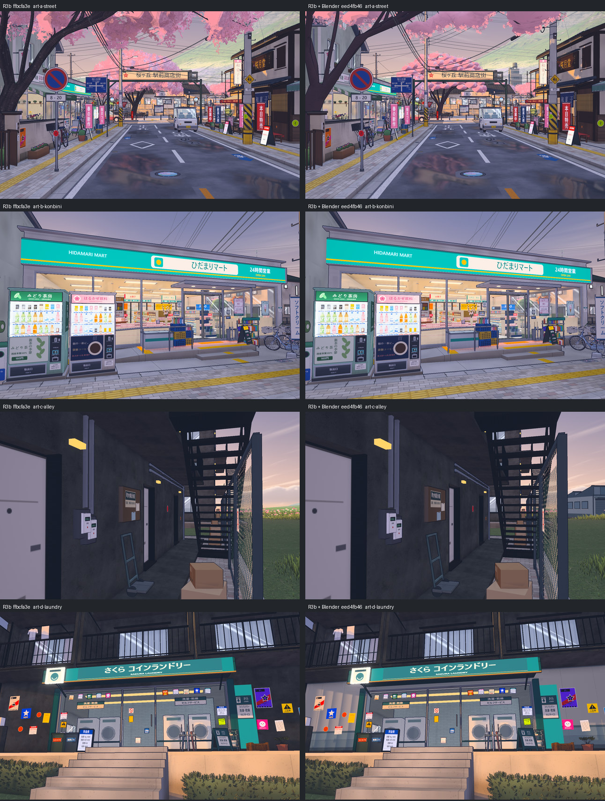

# 站区 Blender V2 与第三轮补修的合流候选

正常入口使用 R3b 的货台、印刷类别牌和后廊管线，同时载入两棵替换樱、站前交换所、后巷工房和洗衣店门翼。A 广场樱的冠体在地面原图中仍呈大块粉色。此版保留作比选，单棵广场樱已交美术继续修改。



独立合流源为 `38fd2506da335b6cd3092c6269e14f68278d6a79`，两个父提交为 `ffbcfa3e` 和 `22a043ae`。`eed4fb46eb7e78418fa319f6f24bdbfe654425a0` 随后更新了 8 个实际有变化的水平倒影面。下列最终照片、帧时和上传回读均对应后一个源码提交。

## 八个地面机位

同一 RTX 3060 Laptop，1440×900，傍晚，时钟冻结在 14 s，无 HUD。每个机位保存三次所得 PNG 的 SHA 相同，八个眼位、四元数和垂直视角与原 R3b 逐项相同。返回 A 再拍仍与首次 A 的 PNG 相同。四个原创 GLB 均取得 HTTP 200，实际收件为 1,902,104、79,160、70,344、60,052 字节，各与签出包 SHA 相符。

| 机位 | R3b → 合流最终图的差异像素¹ | 机位 | R3b → 合流最终图的差异像素¹ |
| --- | ---: | --- | ---: |
| [A 站前主街](art-a-street.png) | 244,781 | [E 港镇](sample-e-harbour.png) | 1,704 |
| [B 便利店](art-b-konbini.png) | 28,117 | [F 山麓](sample-f-hillside.png) | 0 |
| [C 后巷](art-c-alley.png) | 24,010 | [G 铁路](sample-g-rail.png) | 2,447 |
| [D 洗衣店](art-d-laundry.png) | 165,534 | [H 北村](sample-h-north.png) | 0 |

¹ 同位置 RGB 最大通道差超过 8。E 港区有动态物，单一跨进程差分无法归因。单独比较合流后换倒影前后，A 湿路裁区最大相差 1 级，B 玻璃裁区最大相差 3 级，四个站区全幅均无超过 8 级的像素。[四区地面对照](island-ground.jpg) · [湿路与玻璃原像素](wet-road-and-glass-1to1.png) · [相机及图像哈希](photos.json)

## 承托、贴花与碰撞

合流后基于实际原生站区再次向 60 件货物底面射线。51,036/51,036 个网格中心及 60/60 个底面中心获得支撑，三块陈列碰撞体逐字段与 R3 相同。三张打印头牌从 256×92 源画布进入同个 4096² 图集的同一合批网格，所有 70,656 个 RGBA 像素一致。原生 B 的零食牌文字由前景挡住，黄色牌的前部和蓝牌两侧仍可见。[W1 网格、图集与射线](w1/geometry-and-sight.json)

完整站区正常加载使用指纹 `1061:2670406:298285.6:949273.1`，现场规划射线 0。26 张旧贴花位置及顺序与 R3 相同，22 个平面的九点和 4 个曲面吸附均通过，无新增几何阻挡。站区原 3,147 条碰撞的完整数组哈希相同。城镇有 38 个清草区、7 段阶梯，洗衣店门翼继续接收原贴花。[场景复验](scene.json)

两份上游归档按项目固定的 SHA-256 校验后在隔离树解包，正常 prepare 核对 599 个 Petalwake 原件、161 个樱丘原件与 Blender V2 包内 10 项。另行装入两侧实测树均使用的夜间地形光照图，SHA-256 为 `debb02a7b38a1810fcd8b7ccac8f8d077dad030093a9a0398d16b32a13c08152`。该图由项目原有傍晚光照烘焙步骤生成。

## 两时段街面倒影

从站区原反射探针向 3 块店内类别牌、5 块街牌各取 9 个视线样本。W2、W4、W6 的 9 个样本全部直达牌面，W1 饮料牌有 7 个。W1 零食和面包牌的 9 个样本均被遮挡。W2 的负 X 面裁区中，下午 410、傍晚 408 个像素超过 8 级差。W1 饮料的负 Z 面裁区两个时段各为 19 个。原生六面均从相同原点和 14 s 时钟重新捕获，每个时段的水平四面确有变化，上下两面的原始线性数据和 PNG 逐字节相同。[探针内的街牌与饮料牌](reflections/signs-in-baked-cubes.png) · [每面的线性结果及投影裁区](reflections/comparison.json)

| 时段 | 原始线性峰值 | 原始 >2 像素 / 393,216 | 最终线性峰值 | 最大 sRGB8 解码误差 |
| --- | ---: | ---: | ---: | ---: |
| 下午 | 2.3984375 | 1 | 2 | 0.006996 |
| 傍晚 | 2.939453125 | 89 | 2 | 0.007643 |

两时段共 786,432 个原始 HDR 像素，RGB 值均有限且非负。每个时段的 27 扇橱窗分布为 W1 八扇、W2 五扇、E1 四扇、E2 五扇、E3 五扇，合批后 8 个玻璃网格和湿路共享同一立方体，正常帧实时反射捕获为 0。[可离线复查的 12 面 HDR、成图及几何方向](reflections/verify.py)

在最终源分别进入下午与傍晚的正常 B 机位，读取已用于渲染的 WebGL 立方体。对每面临时绑定只读 framebuffer，取回完整 256² RGBA，随即恢复绑定状态。每个时段的六面均各收到一次 HTTP 200；原始安装 PNG 解码、浏览器已解码图像和显卡回读三方逐字节一致，回读前后 GL 错误均为 0。傍晚第二次帧时的六段结束后，还独立核过相同六面的上传内容。[下午上传及请求](reflections/upload-afternoon.json) · [傍晚上传及请求](reflections/upload-evening.json) · [计时后的硬件回读](reflections/timing-repeat-upload-evening.json)

两次原生烘焙宿主均退出 1。CDP 在下午把 `boulders.glb` 和 `mature-sakura.glb` 记为取消，傍晚则记下 `menhir.glb`、`boulders.glb` 和 `plastic_crate_02.bin`。这 5 个请求逐个核对了应用 reader 的 HTTP 200、完整长度与 SHA，严格零取消检查仍未通过。烘焙报告归档将机器绝对路径转换为相对位置，并对请求标识去标识化，保留原采集文件与归档文件的哈希。[下午原生记录](reflections/afternoon/bake-report.json.gz) · [傍晚原生记录](reflections/evening/bake-report.json.gz)

## RTX 3060 帧时

下表每列是独立进程的一次实测，单位为平均 FPS / p95 毫秒。A–D 各约 10 秒，两个步行段分别实际按住 W 约 3 秒。所有试次使用相同地面预设与 D3D11。

| 路段 | R3b 第一次 | R3b 第二次 | 合流第一次 | 合流第二次 |
| --- | ---: | ---: | ---: | ---: |
| A 站前主街 | 65.00 / 15.5 | 64.70 / 15.5 | 63.72 / 15.5 | 64.11 / 15.5 |
| B 便利店 | 64.90 / 15.5 | 65.00 / 15.5 | 64.80 / 15.5 | 65.00 / 15.5 |
| C 后巷 | 65.00 / 15.5 | 65.00 / 15.5 | 65.00 / 15.5 | 65.00 / 15.5 |
| D 洗衣店 | 65.00 / 15.5 | 65.00 / 15.5 | 65.00 / 15.5 | 65.00 / 15.5 |
| 第三人称 | 64.03 / 15.5 | 64.67 / 15.5 | 64.68 / 15.5 | 62.12 / 15.6 |
| 第一人称 | 57.63 / 30.8 | 60.82 / 30.7 | 65.00 / 15.5 | 64.36 / 15.5 |

合流两次都达到平均 60 FPS、p95 ≤16.7 ms。第三人称两次分别有 1 和 9 帧超过 20 ms，水平走过 9.51 和 9.60 m；第一人称分别有 0 和 2 帧超过 20 ms，水平走过 9.47 和 9.62 m。系统前台采样中被测窗口占 0/183，与原 R3b 测量相近。两轮均有 4 个 CDP 取消，计时宿主退出 1，外层驱动退出 0，完整六段的渲染、输入和行走均完成。两组试次分别采自独立时段，不能单独从差值确定帧时变化的原因。[每帧数据、前台与显卡负载](performance/comparison.json) · [第一次原始帧](performance/final-1.frames.json.gz) · [第二次原始帧](performance/final-2.frames.json.gz)

两轮计时的取消资源相同，分别为 `menhir.glb`、`mature-sakura.glb`、塑料筐的 glTF 和 BIN。最终照片驱动退出 0，记录 4 个 CDP 取消。下午与傍晚的独立上传检查进程均退出 0，仅单独记录了六面 PNG 的 HTTP 状态与实际上传。浏览器资源计时缓冲并未保留每一次传输长度，服务器逐项记录每面一次 200，另一次正常 HTTP 读取核对了 12 个响应的完整字节、长度和 SHA。[12 个响应的字节与 SHA](reflections/http-bytes.json)

## 重放

在本证据目录运行下列两条命令，可离线核对 12 面原始线性数据、安装图、实际显卡回读以及完整 HTTP 响应。Python 使用 NumPy 和 Pillow。运行正常入口或计时时，将 `WORLD_FIXTURE` 指向已经准备本地运行资产的 `eed4fb46` 独立 fixture，文件名及输出目录均使用新名称。

```text
node reflections/check-http.cjs
python -B reflections/verify.py
node reflections/capture-upload.cjs <Electron> afternoon <新下午JSON>
node reflections/capture-upload.cjs <Electron> evening <新傍晚JSON>
```

计时使用 `TESTED_SOURCE=eed4fb46eb7e78418fa319f6f24bdbfe654425a0`。第二次再设置 `SAMPLE_CUBE_AFTER=1`，显卡取样在第六段结束后进行。

```text
node performance/replay.cjs timing <Electron> <新采样目录名>
```
