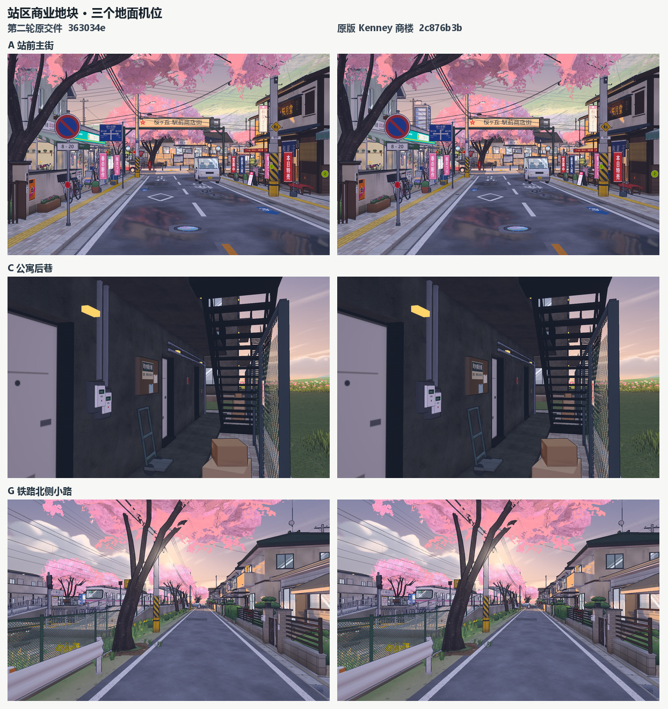

# 第二轮 Kenney 商楼实机验收

RTX 3060 Laptop 的主街画面能直接辨认电线和站牌后方的新楼顶。铁路小路逐像素相同。候选在两次回放的主街与两段步行均超过 p95 16.7 ms，当前性能验收未过。同场复测时原交件的这三段也超过门槛。

## 八个固定机位

左侧均取原交件 `363034e` 的正式 PNG，右侧由候选 `2c876b3b` 的真实场景重新渲染。均为 1440 × 900、DPR 1、夕照、动画 14 秒、HUD 隐藏，眼点、四元数和 FOV 逐机位一致。下表统计任一 RGB 通道相差至少 8 级的像素。每帧共 1,296,000 个像素。候选每个机位连拍 3 张均同哈希，回到 A 的原图也同哈希。[姿态与逐图哈希](photos.json)

| 地面机位 | 原交件 | 商楼候选 | 显著差异像素 |
| --- | --- | --- | ---: |
| A 站前主街 | [原图](363034e/art-a-street.png) | [原图](2c876b3b/art-a-street.png) | 8,122 |
| B 便利店 | [原图](363034e/art-b-konbini.png) | [原图](2c876b3b/art-b-konbini.png) | 0 |
| C 公寓后巷 | [原图](363034e/art-c-alley.png) | [原图](2c876b3b/art-c-alley.png) | 309 |
| D 洗衣店 | [原图](363034e/art-d-laundry.png) | [原图](2c876b3b/art-d-laundry.png) | 0 |
| E 拉克港码头 | [原图](363034e/sample-e-harbour.png) | [原图](2c876b3b/sample-e-harbour.png) | 2,099 |
| F 东部山麓 | [原图](363034e/sample-f-hillside.png) | [原图](2c876b3b/sample-f-hillside.png) | 0 |
| G 铁路北侧小路 | [原图](363034e/sample-g-rail.png) | [原图](2c876b3b/sample-g-rail.png) | 0 |
| H 北端村道 | [原图](363034e/sample-h-north.png) | [原图](2c876b3b/sample-h-north.png) | 0 |

B、D、F、G、H 的 PNG 字节完全相同。C 的显著差异集中在楼梯间与相邻墙面，均在商楼本体的投影框之外。E 的显著差异集中于船帆与索具。办公楼的包围盒在 E 图像左边界外超过 400 像素，原岛的 `Town` 会在每次初始化时为船的系泊摇摆分配随机相位。[A/C/E 原图 1:1 局部](ACE-native-crops.png) · [商楼世界包围盒的机位投影](office-projection.json)

## 四镜与两段步行

每格依次为 FPS 和 p95 毫秒。验收线为 FPS ≥ 60 且 p95 ≤ 16.7 ms。三次合计 8,661 个真实 RAF 间隔。交错顺序为候选首测、原交件复测、候选复测。后两轮在 Blender 制作窗口暂停预览后依次执行，使用同一回放、输入与遥测采样方式。

| 段落 | 候选首测 | 原交件同场复测 | 候选同场复测 |
| --- | ---: | ---: | ---: |
| A 站前主街 | 60.86 / 30.7 | 57.99 / 30.8 | 55.60 / 30.8 |
| B 便利店 | 64.41 / 15.5 | 62.53 / 15.6 | 64.90 / 15.5 |
| C 公寓后巷 | 64.11 / 15.5 | 64.80 / 15.5 | 65.00 / 15.5 |
| D 洗衣店 | 64.90 / 15.5 | 65.00 / 15.5 | 64.80 / 15.5 |
| 第三人称按 W | 49.31 / 30.9 | 58.60 / 30.7 | 49.70 / 30.8 |
| 第一人称按 W | 55.76 / 30.8 | 59.24 / 30.8 | 53.85 / 30.9 |

候选首测全程可见，系统前台采样均属于其他窗口。交错复测两轮的各段前台采样均属于被测窗口。后两轮各段设备 GPU 利用率中位数分别为 52%–59% 与 62%–69%。专窗内未采到已知 Blender 预览 PID 的 3D 占用。原交件更早的两次独立正式回放六段 p95 均为 15.5 ms。本次同场复测显示候选两段步行分别比原交件低 8.89 和 5.39 FPS，现有配对次数不足以单独确定楼体的性能开销。[本次逐段负载与焦点](../performance/comparison.json) · [原交件历史两轮](../performance/earlier-r2.json)

原生拍照程序退出 0，GL 错误码和 JS 异常数均为 0。三次计时外层驱动均退出 0，Electron 原生均退出 1。三次均完成渲染与六段计时，但启动阶段有浏览器取消的 GLB、glTF 或 BIN 请求，严格网络检查未通过。两次候选对办公楼 GLB 的请求均收到 HTTP 200 并完成，场景读到 1,704 个三角形、一个 512 × 512 原图集。三次均读取预烘焙贴花，规划射线为 0。原交件与候选共用的 782 个本地文件逐字节一致。[资源摘要](../performance/assets.json) · [逐项错误、退出码与原始样本清单](../performance/comparison.json)

在 fixture 目录执行 `node evidence/station-commercial-lot-2026-11-18/verify-native.cjs`，可离线核对原图哈希、注册姿态及 18 段原始样本。重拍可运行 `capture.cjs on <Electron> <新的绝对输出目录>`。复测帧时可将 `WORLD_FIXTURE` 指向已准备的 `363034e` 或 `2c876b3b` 独立 fixture，再运行原生回放。 [拍照程序](../capture.cjs) · [帧时回放](../performance/replay.cjs)
