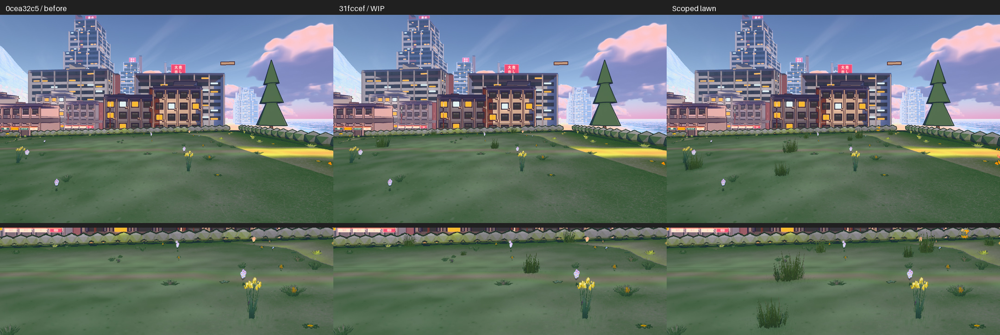

# X-51 站外东侧草坪复拍

本机 Electron 44.9.0，1440 × 900、像素比 1。傍晚冻结时钟，站区局部机位 `(66.8, 119.1)`、朝向 `273°`。基线 `0cea32c5`，C酱 WIP `31fccef`。

| 场景 | 草坪带 | 世界 `(60, 110)` 周围 200 m | 草坪带外新增 / 移除落点 |
|---|---:|---:|---:|
| 基线 | 0 | 2,867 | 0 / 0 |
| WIP | 57 | 1,294 | 1,248 / 2,850 |
| 限定草坪 | 65 | 2,867 | 0 / 0 |

限定草坪的 65 个落点按场景 `getContext` 复核，0 个触及建筑、道具、镇区或站区碰撞体，0 个落在道路边缘 0.6 m 以内。三版本各测一张 `?veg=off`，均未创建植被批次。WIP 与限定草坪的关态像素一致。基线与限定草坪关态只有 55 / 1,296,000 像素相差 1 级，最大单通道差 1。六次场景加载无记录到的页面错误。

[Whetstone 明暗对照](./look.png)由仓库外的 [look.py](https://github.com/shoal-rat/whetstone/blob/main/skills/whetstone/scripts/look.py) 生成。基线和限定草坪的亮度 P2/P50/P98 均为 51/108/223。此项验证覆盖指定机位与铺放位置，未单独测 GPU 帧时。
