# 站前商店街与镇边公寓 · 傍晚精修前基线

第 18 轮 `56e4990b0218cfd6ce84d7bda9122a3802df5f92` 与最终建模 `b0259599bd51178c2d4980243a9c87553eac1a66`。同一台 RTX 3060 Laptop、ANGLE D3D11、1440×900、DPR 1。八组分别核对了相机位置、四元数、FOV、灯光、后处理、AO 0.55、隐藏 HUD 和固定场景时间参数 14。每个视角取第二次正式截图。展示图用原始 PNG 编码为全分辨率 JPEG，未裁切、调色或重构。PNG 和 JPEG 的 SHA-256、逐组 RGB 差异见[对照清单](comparison.json)。

| 机位 | 第 18 轮 · 改造前 | 傍晚精修前 · 最终建模 |
|---|---|---|
| 01 站前主街 | [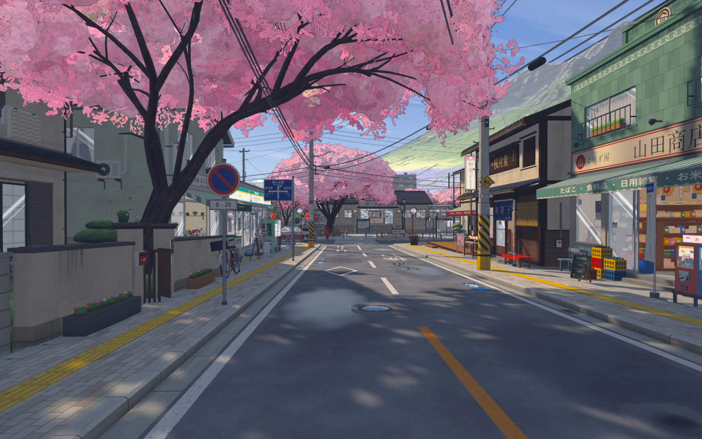](images/01-before.jpg) | [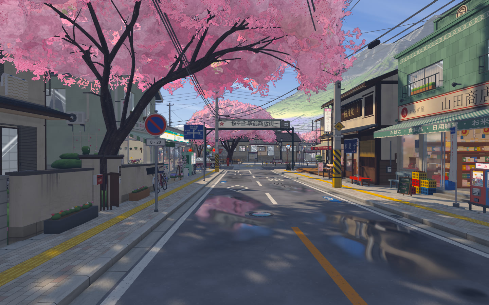](images/01-after.jpg) |
| 20 公寓后廊 | [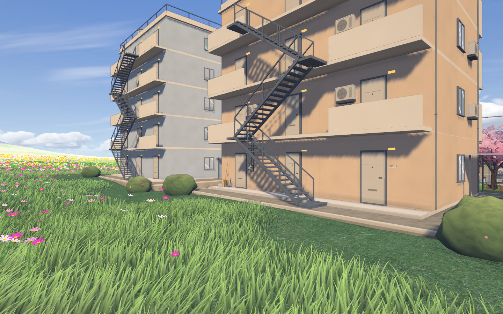](images/20-before.jpg) | [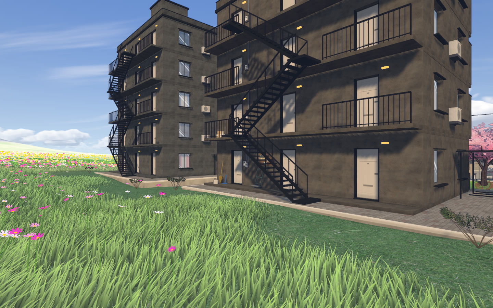](images/20-after.jpg) |
| 21 洗衣店前 | [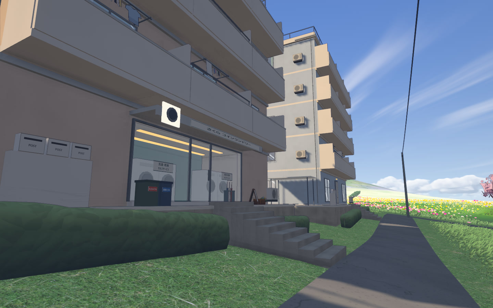](images/21-before.jpg) | [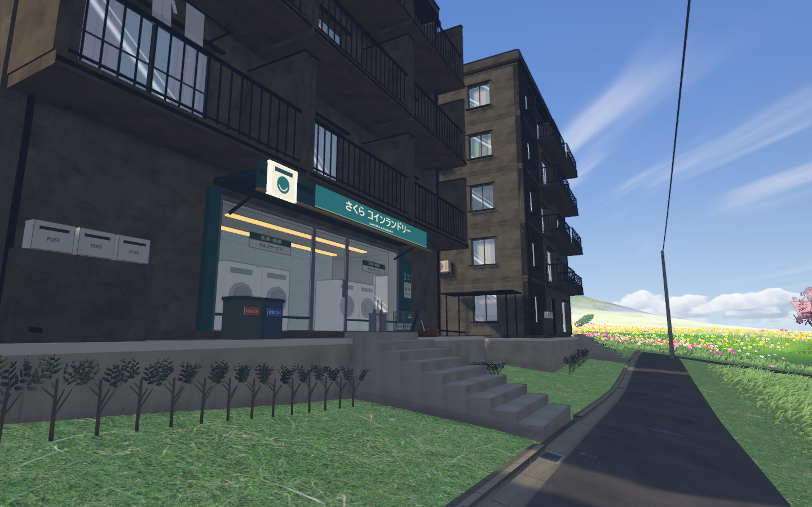](images/21-after.jpg) |
| 23 维修角 | [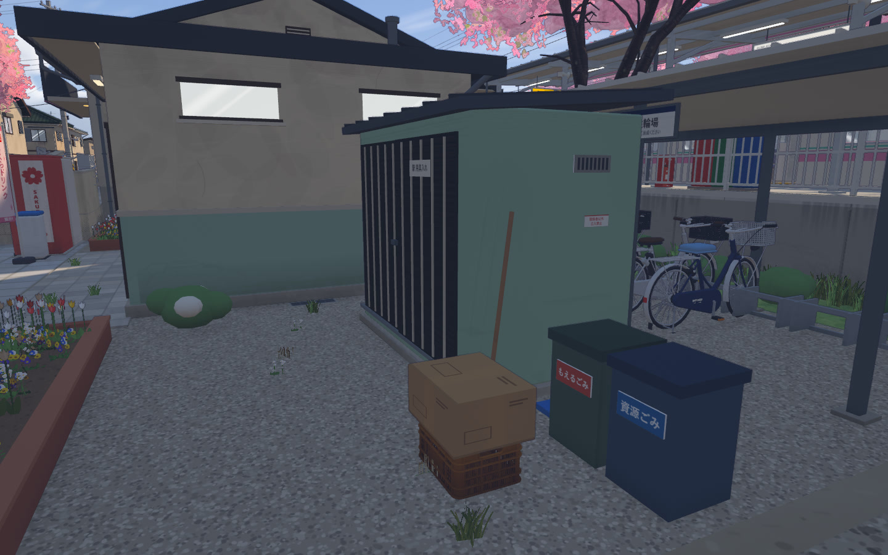](images/23-before.jpg) | [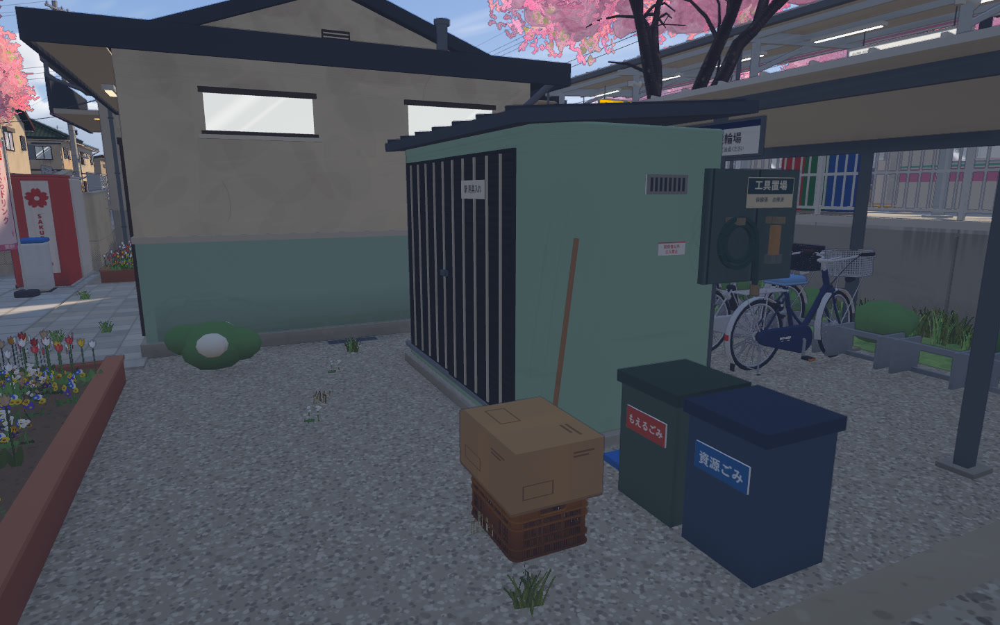](images/23-after.jpg) |
| 24 洗衣店细节 | [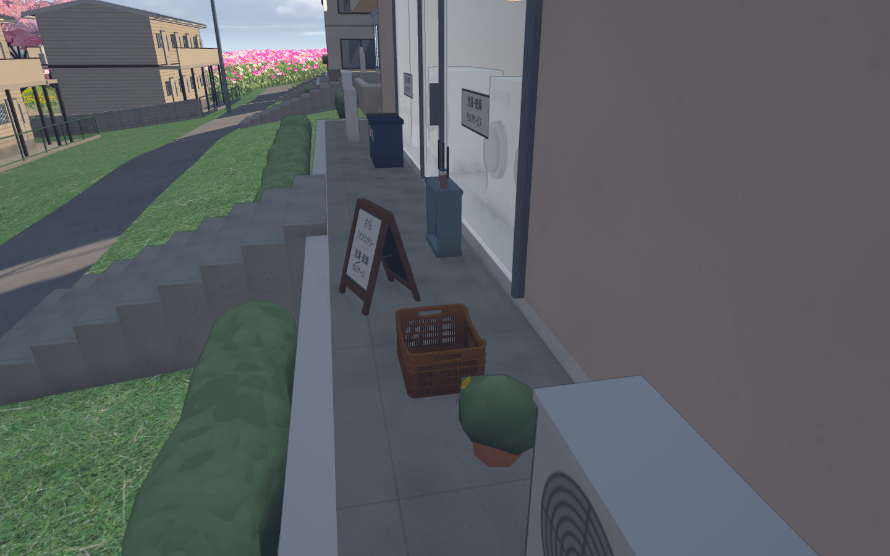](images/24-before.jpg) | [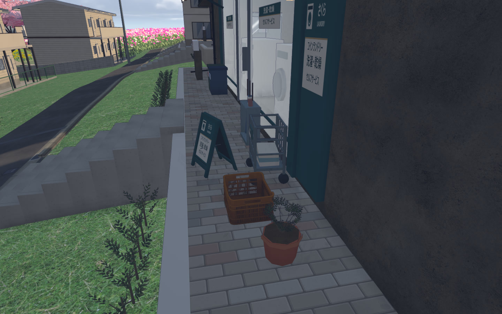](images/24-after.jpg) |
| 04 便利店内 | [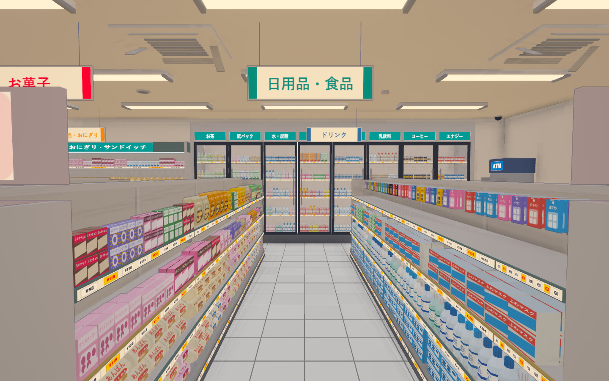](images/04-before.jpg) | [](images/04-after.jpg) |
| 03 全岛鸟瞰 | [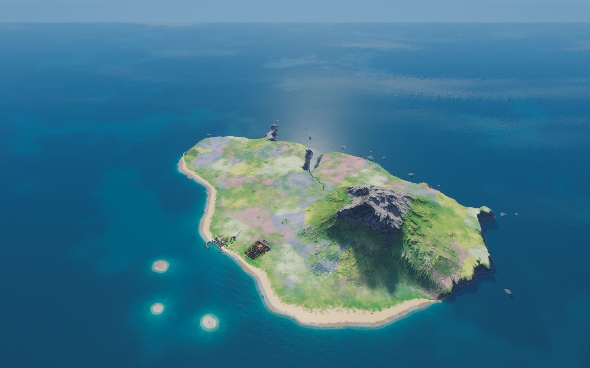](images/03-before.jpg) | [](images/03-after.jpg) |
| 补充 商店橱窗近景 | [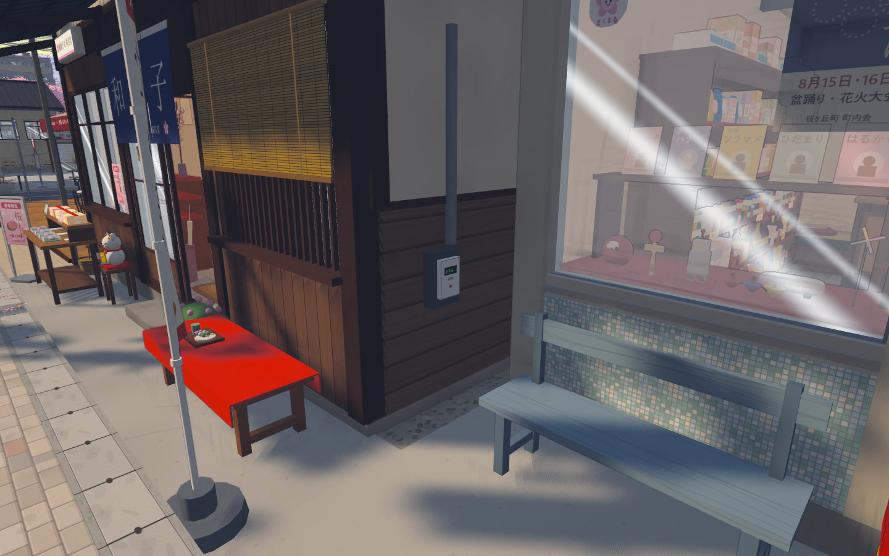](images/detail-before.jpg) | [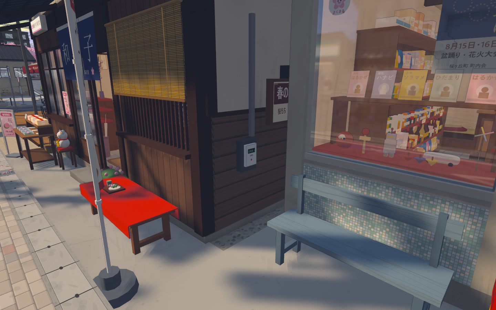](images/detail-after.jpg) |

01 的街口灯箱和积水中的樱花与店面倒影均可见。20 的外廊、栏杆和楼梯轮廓清楚，21 的阴面阳台挤在一起，洗衣店台阶旁的绿篱还能看出一排稀疏、等距的细干。24 的推车和铺砖在近景可辨。04 店内原图的 RGB 完全一致，全岛鸟瞰有 376 个像素变化。

## 四个镇边机位的帧时

使用与截图相同的相机，在程序正常运行时采样。每轮先预热 5 秒，每次换机位后稳定 1.5 秒，每个机位单独记录约 10.1 秒。逐段核对镜头起止姿态、岛屿与站区时钟推进及每帧 WebGL 绘制调用。帧时为相邻 RAF 的间隔，包含显示同步和现有 WebGL 统计开销。平均 FPS 为帧数除以总秒数，p95 取最近秩。

| 机位 | 帧数 | 平均 FPS | p95（ms） | 最慢帧（ms） | 超过 20 ms 的帧数 |
|---|---:|---:|---:|---:|---:|
| 20 公寓后廊 | 655 | 64.80 | 15.5 | 30.8 | 2 |
| 21 洗衣店前 | 655 | 64.80 | 15.5 | 30.7 | 2 |
| 23 维修角 | 652 | 64.50 | 15.5 | 30.8 | 5 |
| 24 洗衣店细节 | 657 | 65.00 | 15.5 | 15.7 | 0 |

20、21、23、24 平均每帧分别为 1,276、847、1,156、904 次绘制调用；所有渲染阶段合计平均提交 9,649,011、8,769,088、7,599,545、8,838,589 个三角。镇边模型自身为 67,106 个三角。

同一源码此前的六段基线继续适用。主街 64.68、港口 65.00、鸟瞰 65.00、店内 65.00、第三人称步行 65.00、第一人称步行 64.36 FPS，六段 p95 均为 15.5 ms。主街和第一人称分别出现 1 和 2 帧超过 20 ms。14 项行为检查通过。[常规实机回执及原始帧](baseline/)

## 运行记录

| 实测 | 渲染与异常 | 加载时取消的请求 | 退出码 |
|---|---|---|---:|
| [最终八机位截图](captures/after.json) | 24 帧成图，0 JS 异常 | `menhir.glb` | 1 |
| [最终四机位帧时](town/timing-report.json) | 四段合格，0 JS 异常 | `menhir.glb`、`plastic_crate_02.bin` | 1 |
| [沿用的最终常规基线](baseline/execution.json) | 六段合格，0 JS 异常 | `plastic_crate_02_1k.gltf` | 1 |

上述取消均为 `net::ERR_ABORTED`。四机位计时前后校验同一份 235 项源码与资源清单。第 18 轮的[原七视角记录](captures/before.json)及[单独补拍的鸟瞰记录](captures/aerial.json)也保留了原退出码和加载失败。

[四段逐帧 JSON、起止时钟和实际退出码](town/) · [机位参数](captures/cameras.json) · [完整源码与资源清单](baseline/source-manifest.json)

在最终建模源码的 fixture 内，使用下列命令复测四个机位。将 `<证据目录>` 指向本目录的独立副本，将 `<新目录>` 指向已有父目录下尚未创建的路径。

```text
node <证据目录>/town/town-frame-times.cjs . <electron.exe> <证据目录>/captures/cameras.json <证据目录>/baseline/source-manifest.json <新目录>
```
