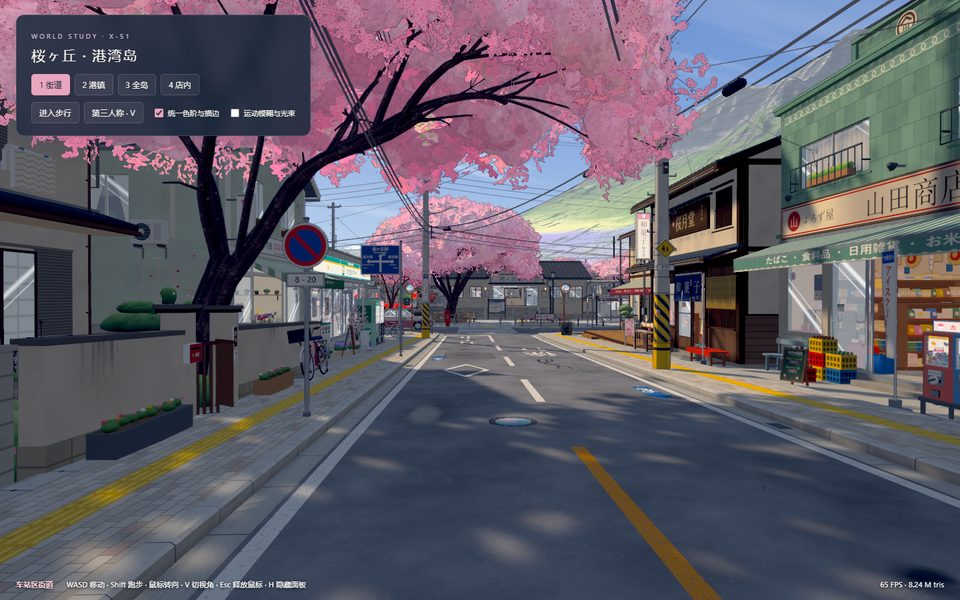
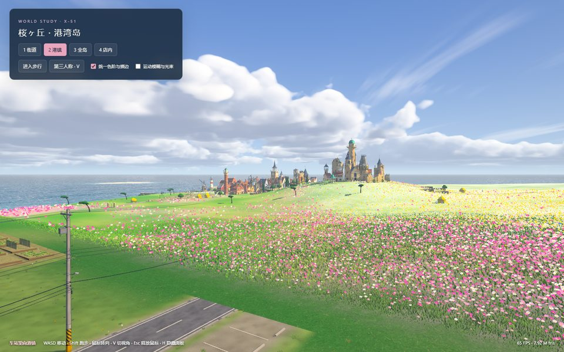
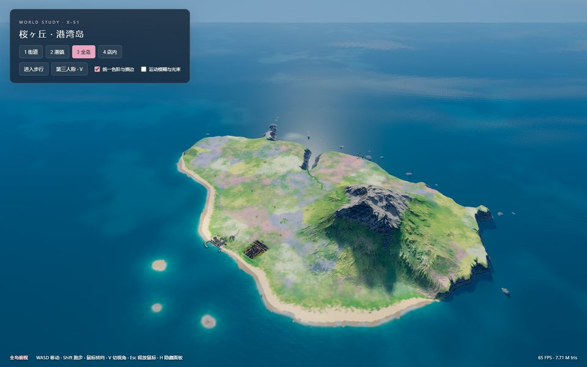
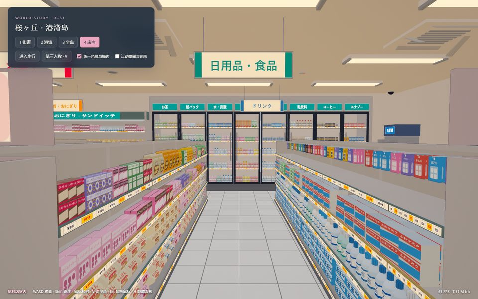
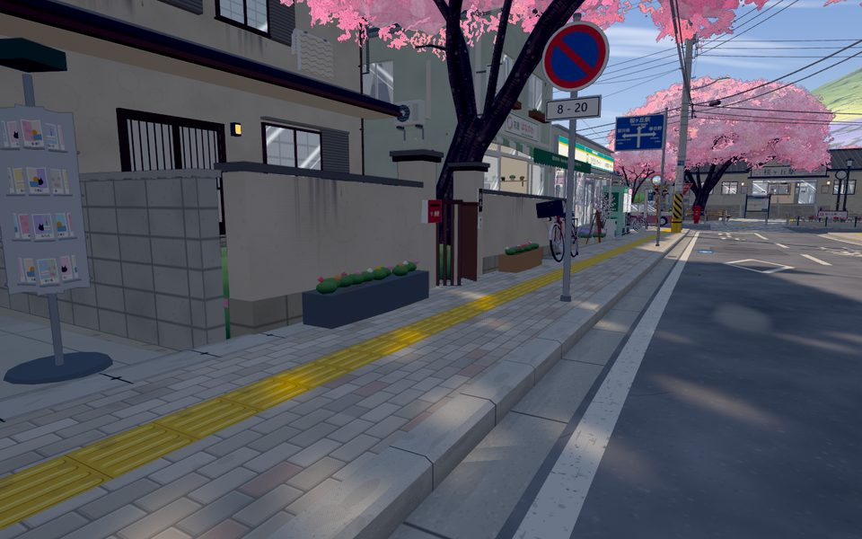
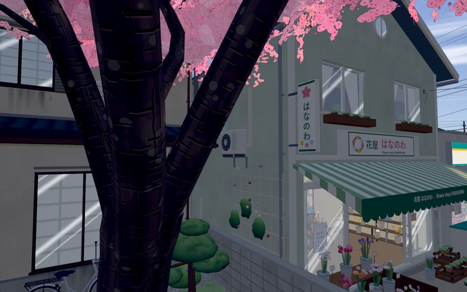
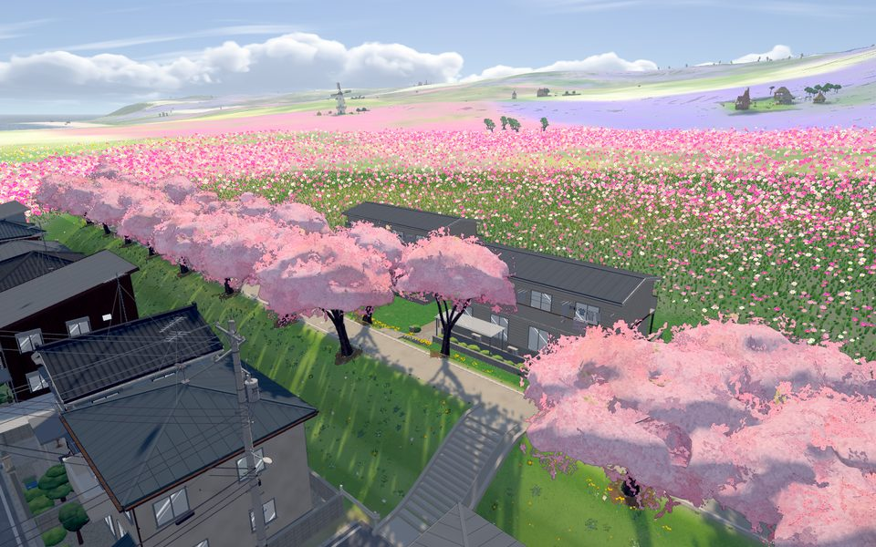
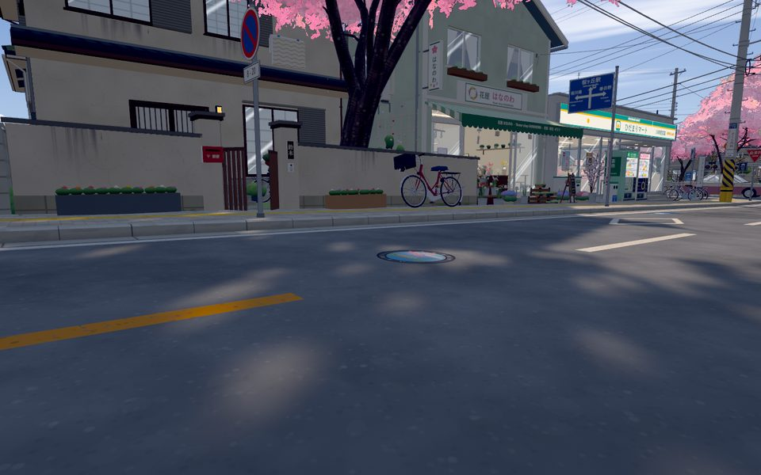

# 街景补充与未解决湿面：2026-11-17

当前四机位、真实步行和 14 项行为检查通过，RTX 3060 Laptop 约 65 FPS。**湿面可见效果仍未解决；资源检查也未全绿**，本轮交 C酱协助，不能标为 P2 完成。

受测源码：`7c102eb2162abc6b0482c254d9702d5a51205fea`。采集前已提交；[source-manifest.json](./source-manifest.json) 的 196 个场景文件逐一与该提交的 Git 内容核对一致。采集脚本 SHA-256、机位、版本、完整数值及文件哈希见 [measurements.json](./measurements.json)。这轮证据提交不再修改场景代码。

## 实际结果

2026-11-17（Asia/Shanghai），1440×900、pixelRatio 1、Electron 44.9.0 / Chromium 152，ANGLE NVIDIA GeForce RTX 3060 Laptop / D3D11。首次可见帧 33.751s；15.108s 主采样记录 982 帧，64.9995 FPS，p95 15.5ms。帧率受约 65 FPS 同步上限限制，不证明新增资产没有 GPU 成本。

| 机位/操作 | FPS | p95 帧时 | 平均 draw calls | 平均三角形 |
|---|---:|---:|---:|---:|
| 街道 | 65.002 | 15.5ms | 1475.67 | 8.242M |
| 港镇 | 65.000 | 15.5ms | 808.50 | 7.903M |
| 全岛 | 65.002 | 15.5ms | 1712.00 | 7.713M |
| 店内 | 65.002 | 15.5ms | 882.00 | 7.509M |
| 第三人称真实 W 步行 | 65.000 | 15.5ms | 见 JSON | 9.463m / 3.108s |
| 第一人称真实 W 步行 | 65.000 | 15.5ms | 见 JSON | 9.375m / 3.108s |

14/14 行为通过：包括原有门墙/室内/镜头检查、新增连续人行道路线、院门入口、两只低花箱踩踏及退出。着色开关、步行验证通过，脚点切换不漂移，JS 异常 0。

`renderOk=true`，**`transportClean=false / ok=false`**。`menhir.glb` 一次 `net::ERR_ABORTED`；同次 Resource Timing 是 HTTP 200、encoded/decoded body 620588 字节。取消原因未确认，不把传输警报当作已解决，也不反复重跑挑选全绿结果。

实际执行：

```bat
node scripts\baseline.cjs --scene=combined --stills --electron=D:\codex\2026-11-16\world-implementation\runtime-path-probe\electron.exe --output=artifacts/streetscape-source-final --timeout-ms=240000
```

退出 1（上述资源取消警报）；渲染/行为子检查通过。另对全部 `src/*.js`、`scripts/*.cjs` 及两处改动的上游 JS 执行 `node --check`，22 项通过；`git diff --check` 通过。本轮没有录像，也没有固定时间的逐像素复现验收。

C酱 `a7fe1e7` 第二轮精修在添加本轮资产前已单独复测：四机位与步行约 65 FPS，`ok/renderOk/transportClean=true`，11 项原有行为通过。结果和来源独立保存在 [a7fe1e7 GPU 证据](../gpu-polish-a7fe1e7/README.md)，不能混用两个受测版本。

## 当前画面

| 街道 | 港镇 |
|---|---|
|  |  |
| 全岛 | 店内 |
|  |  |







复用同版本 Sakuragaoka 的原花箱、外机、公寓和程序图集，来源见 [streetscape-assets.json](../../streetscape-assets.json)。两栋公寓按原比例构建，背景输出 20 个 mesh、19,491 个三角形，新增纹理 0；院落与堤顶路之间各接 11 级台阶。背景依然不可步行，未扩大站区导航范围。

植被仅清理两院落和连接处：78 个原本非零的 splat texel 改动，纹理分辨率对应 3m/texel，保留 G 物种/B 湿度通道；边界包含双线性采样支持范围。共享 GPU 纹理原地更新并重建 CPU cover grid。没有改地形高度。

这些是近郊层次和少量道具补充，**没有完成参考图的大体量城市天际线、商业街密度或完整湿地反射**。港镇远坡/花海仍偏亮。代码编译与碰撞通过不代表视觉目标达标。

## 交 C酱协助的湿面问题

入口 `src/wet-road.js`，`src/station.js` 在 trim 后、batch 前接入。512² RG mask：R 湿区/G 积水核心，五组局部斑块，保留原沥青、路标和井盖。当前公式只近似天光，没有店铺倒影；无额外全屏 pass 或反射渲染目标。

已实测 GPU：最终渲染树中该材质引用数 1；程序已编译；`uWetEnabled=1`，`uWetBounds=[-4,4,8,30]`（x0,z0,width,depth），world→local 逆平移 `[-280,-8,-900]`。CPU 目标局部点 `(-1.85,28)` 的 UV `(0.26875,0.8)` 处 mask RG=`(1,1)`，原 toon 回调未覆盖湿面注入。

但是道路开关前后尚无可信的可见变化。v2 的原始 PNG [湿](./diagnostic-v2-wet.png) / [干](./diagnostic-v2-dry.png) 在三个道路 ROI 最大通道差均只有 `1/255`，平均约 `0.4/255`；动画没有冻结，不能证明湿面生效。区域定义及数值见 [比较方法](./diagnostic-v2-pixel-method.cjs.txt) / [结果](./diagnostic-v2-pixels.json)；v2 是未提交原型，准确来源以它的 [文件哈希清单](./diagnostic-v2-source-manifest.json) 为准。

| 当前代码，湿面开 | 当前代码，湿面关 |
|---|---|
|  |  |

这些也是动画运行中的定性截图。**尚未排除** GPU mask 上传/绑定/采样、其他覆盖几何、实际片元路径及后处理中的影响。建议 C酱先冻结时间与镜头做同一 ROI 的 A/B/A，临时直接显示 mask、核对后处理前颜色；确认 mask 到达可见道路像素后再判断公式。现在继续调强度缺少依据。请回传根因、修复 commit、真正的干湿对照与经验。

## 失败记录与经验

[attempt-history.json](./attempt-history.json) 保存各轮来源哈希、失败断言和资源事件，没有将旧失败改写成成功。

| 采集 | 实际失败/限制 | 后续处理 |
|---|---|---|
| v1 | 两项新增行为失败；一次 boulders 取消 | 花箱与自行车占地冲突；低箱需可踩顶面；原始直线/中心落点断言不符合真实走路 |
| v2 | 独立直线通行仍碰既有设施；网络无失败 | 改为从上一步解析坐标继续的真实连续路线，保留侧滑，未松阈值 |
| diagnostic | 14 项行为与渲染通过；一次 boulders 取消 | GPU 材质/编译/uniform 已核实，湿面可见性仍未证实；1s 主采样不是完整性能基线 |
| final（缓存更新前） | 渲染通过；一次 menhir 取消 | 清植被后补重建 cover grid，再对提交后的最终源码完整采集 |

1. 低花箱矮于原 0.45m 跨步阈值，普通碰撞箱不自动提供可踩顶面；用既有 `addWalkBox`，不抬高假碰撞体。
2. 放道具需同时检查原有设施占地、院门和眼高视线；外机进视锥仍可能被遮住。本轮从 W4 移到 W2 侧墙再看实图。
3. 单体细节不等于空间成立。初稿两栋孤立房子放在花海里不合适，最终相邻错列并接入现有道路；还不能当作城市天际线。
4. 连接区要采样真实可见三角面，不能把被覆盖的岛屿高度场当路面。清草花须同步 CPU 密度缓存和共享 GPU 纹理。
5. CPU mask、shader 编译和 GPU uniform 正确只是排除部分故障；材质必须以最终可见像素验收。

以前的固定帧诊断差异、浅水录像资源警报和生产测试偶发失败未在本轮修复，历史见 [地表/浅水证据](../terrain-water-2026-11-17/README.md)。
