# X-51 第一批 · 全岛材质与树冠

沿用全岛基线的固定机位、傍晚预设和 1440×900 原图。山坡、铁路和北端参考按图注所列的画风要素比较。[相机位姿](camera-poses.json) · [采集校验](capture-checks.json) · [渲染源校验](capture-source.json)

本轮先逐镜评审画面，60 FPS 验收放在画面确定之后。

## 八个傍晚机位

### A 站前主街

| 参考 | 上一版 | 新版 |
| --- | --- | --- |
|  | [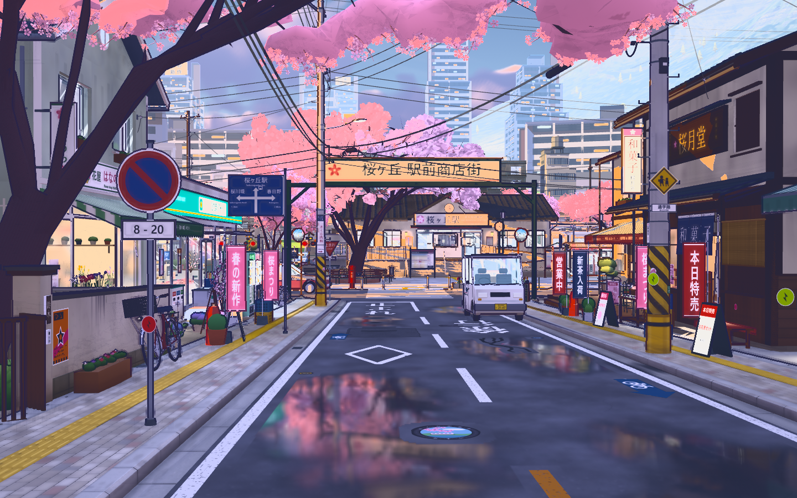](https://github.com/aa15119557034/agent-review-room/blob/6d5ee8510619ced3f88baaa31c1f3c952e5f99db/apps/desktop/e2e/fixtures/world-base/evidence/baseline-95-2026-11-27/evening-art-a-street.png?raw=true) | [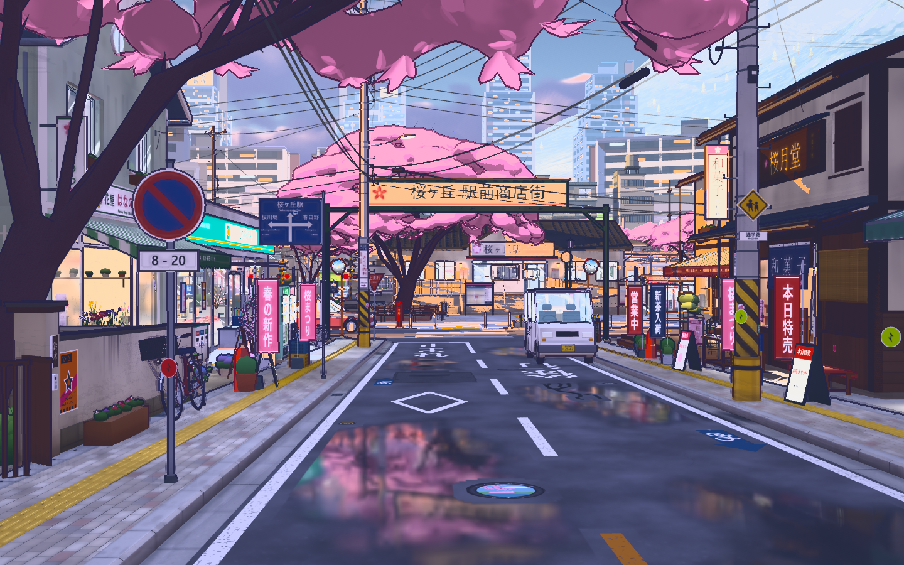](evening-art-a-street.png) |

HoYoverse 游戏截图。定版参考用于比较人眼高度的街道纵深、店面与道具密度。参考图是白天，傍晚用光参照 B、C。 [Beebom 刊载](https://beebom.com/zenless-zone-zero-review/)

### B W1 便利店

| 参考 | 上一版 | 新版 |
| --- | --- | --- |
|  |  | [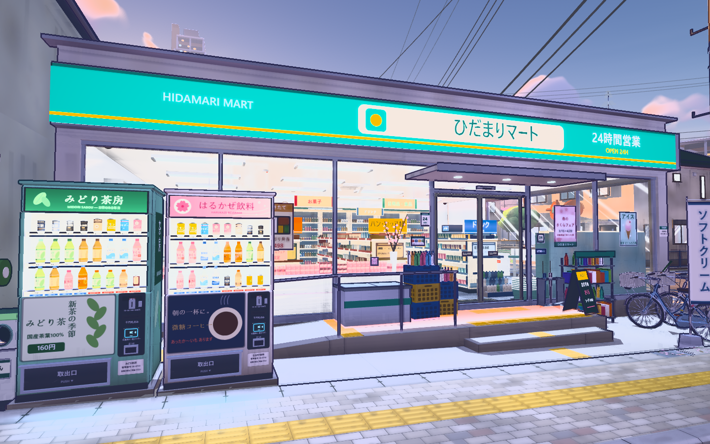](evening-art-b-konbini.png) |

HoYoverse 游戏截图。比较正对入口的构图、橱窗透出的货架、门外陈列和冷暖关系。 [Theria Games 刊载](https://theriagames.com/guide/zenless-zone-zero-141-convenience-store-guide/)

### C 公寓后巷

| 参考 | 上一版 | 新版 |
| --- | --- | --- |
|  | [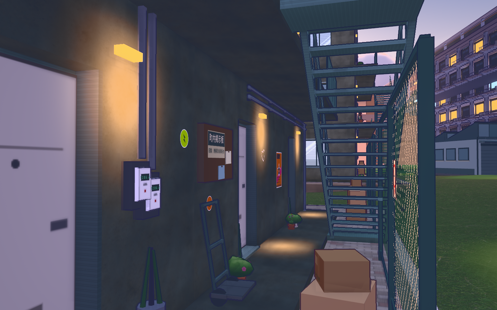](https://github.com/aa15119557034/agent-review-room/blob/6d5ee8510619ced3f88baaa31c1f3c952e5f99db/apps/desktop/e2e/fixtures/world-base/evidence/baseline-95-2026-11-27/evening-art-c-alley.png?raw=true) | [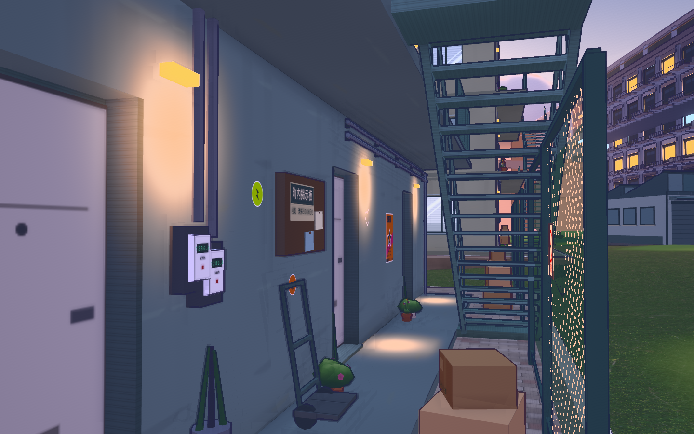](evening-art-c-alley.png) |

HoYoverse 游戏截图。比较狭窄空间、管线和杂物层次，以及冷色暗部的可读性。 [Game8 刊载](https://game8.co/games/Zenless-Zone-Zero/archives/460753)

### D 洗衣店

| 参考 | 上一版 | 新版 |
| --- | --- | --- |
|  | [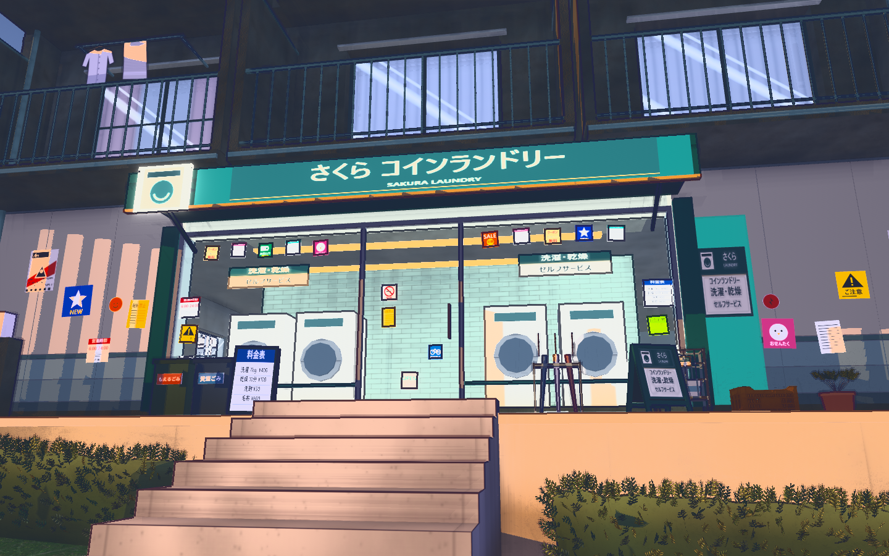](https://github.com/aa15119557034/agent-review-room/blob/6d5ee8510619ced3f88baaa31c1f3c952e5f99db/apps/desktop/e2e/fixtures/world-base/evidence/baseline-95-2026-11-27/evening-art-d-laundry.png?raw=true) | [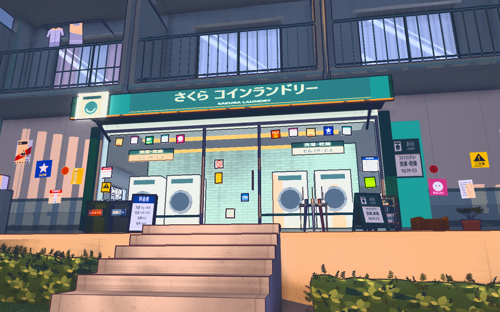](evening-art-d-laundry.png) |

Mr.ちゅらさん 摄影，CC BY-SA 4.0。定版目标为店面比例、招牌占比与玻璃告示密度。场景配色沿用 X-51 方向。 [Wikimedia Commons 原图和授权](https://commons.wikimedia.org/wiki/File:Nomura_Cleaning%26Coin_Laundry_Konoike_Higashi-Osaka.jpg)

### E 港口

| 参考 | 上一版 | 新版 |
| --- | --- | --- |
|  | [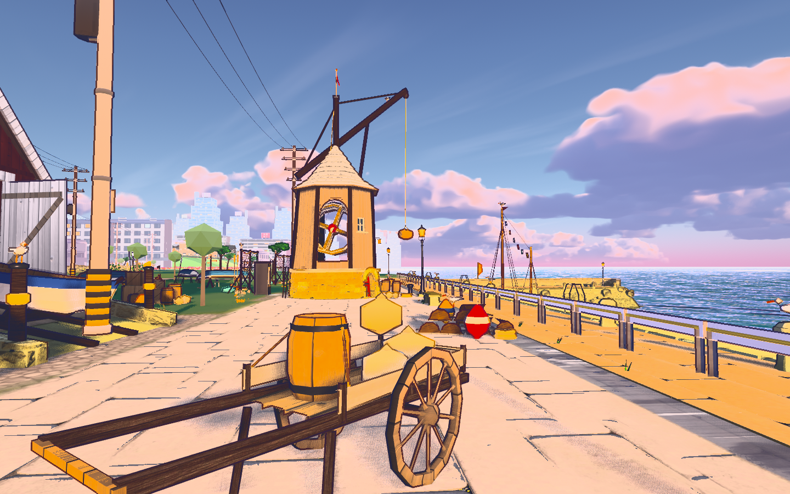](https://github.com/aa15119557034/agent-review-room/blob/6d5ee8510619ced3f88baaa31c1f3c952e5f99db/apps/desktop/e2e/fixtures/world-base/evidence/baseline-95-2026-11-27/evening-sample-e-harbour.png?raw=true) | [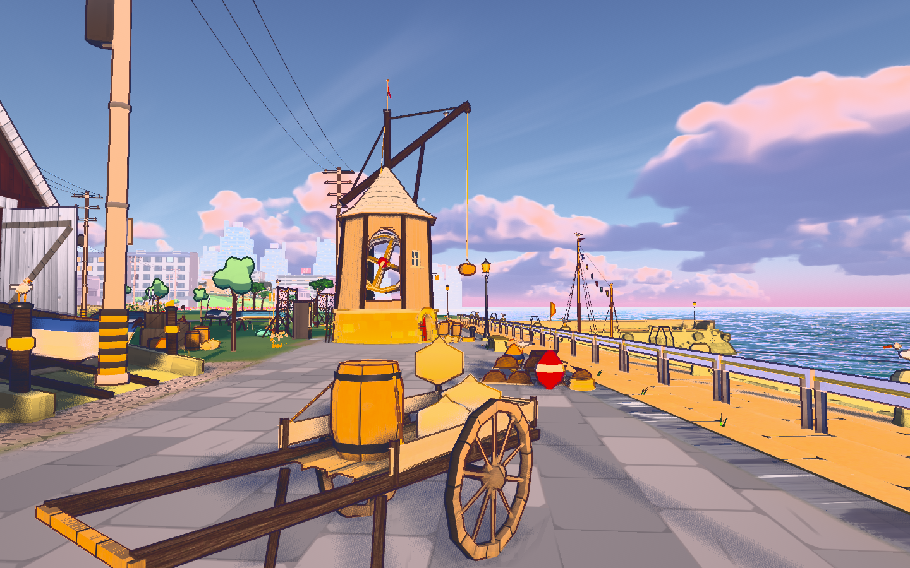](evening-sample-e-harbour.png) |

HoYoverse 游戏截图。对照人眼高度下码头护栏、水面和远处天际线的三个层次。 [X-51 参考集原图](https://github.com/aa15119557034/agent-review-room/blob/282c5dbb1e0e83657121d86b0087fa85ad1626ec/images/1.jpg)

### F 山坡

| 参考 | 上一版 | 新版 |
| --- | --- | --- |
|  | [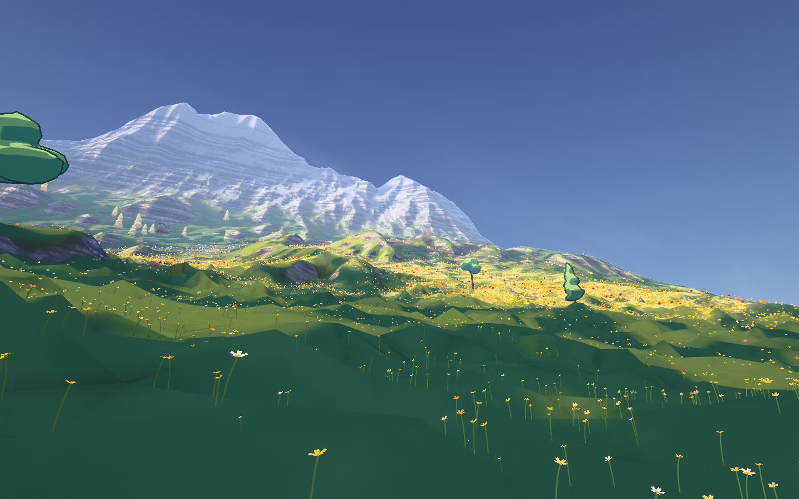](https://github.com/aa15119557034/agent-review-room/blob/6d5ee8510619ced3f88baaa31c1f3c952e5f99db/apps/desktop/e2e/fixtures/world-base/evidence/baseline-95-2026-11-27/evening-sample-f-hillside.png?raw=true) | [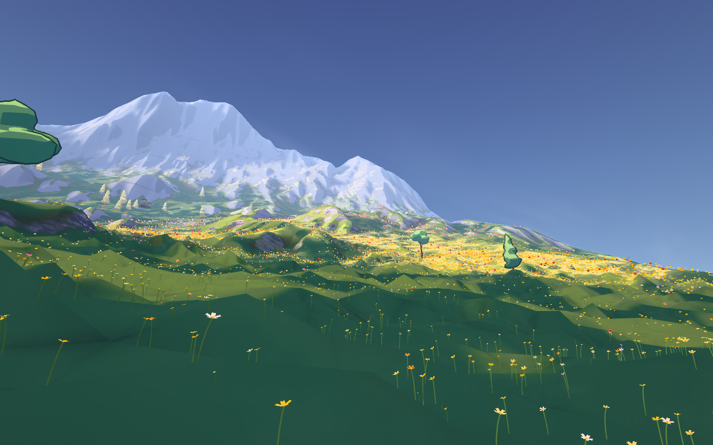](evening-sample-f-hillside.png) |

用户提供，拍摄或绘制者待核。对照花簇疏密、草地起伏和亮面与冷阴影的衔接。参考取俯视，现状保留固定的地面视点。 [汐的风景参考记录](https://github.com/aa15119557034/agent-review-room/pull/254#issuecomment-7020838168)

### G 铁路

| 参考 | 上一版 | 新版 |
| --- | --- | --- |
|  | [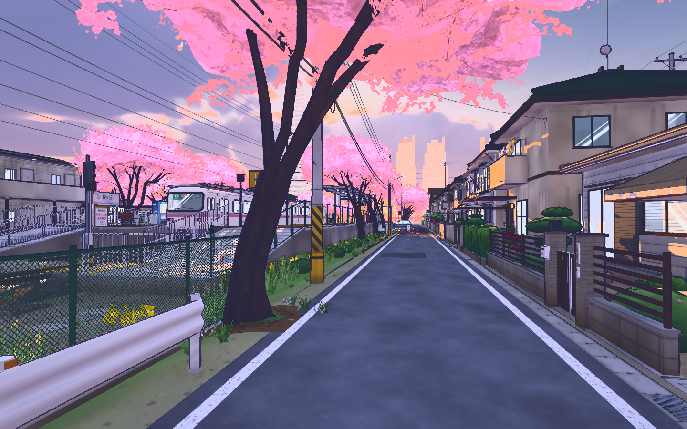](https://github.com/aa15119557034/agent-review-room/blob/6d5ee8510619ced3f88baaa31c1f3c952e5f99db/apps/desktop/e2e/fixtures/world-base/evidence/baseline-95-2026-11-27/evening-sample-g-rail.png?raw=true) | [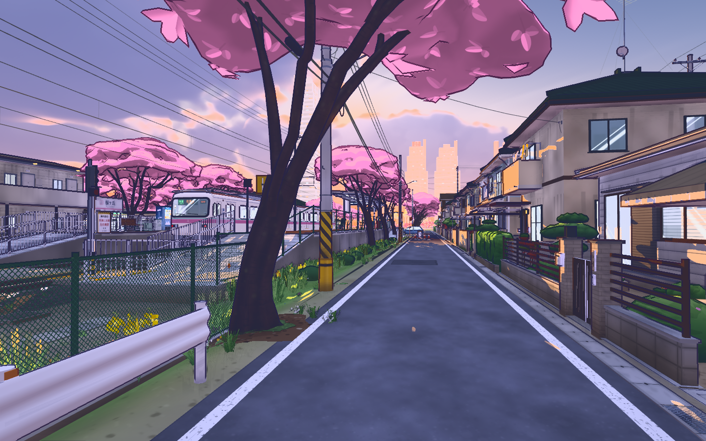](evening-sample-g-rail.png) |

HoYoverse 游戏截图。对照轨旁街景的树冠遮荫、墙体色块和栏杆层次。参考主题为街角，现状主题为铁路与直路。 [X-51 参考集原图](https://github.com/aa15119557034/agent-review-room/blob/282c5dbb1e0e83657121d86b0087fa85ad1626ec/images/3.jpg)

### H 北端

| 参考 | 上一版 | 新版 |
| --- | --- | --- |
|  | [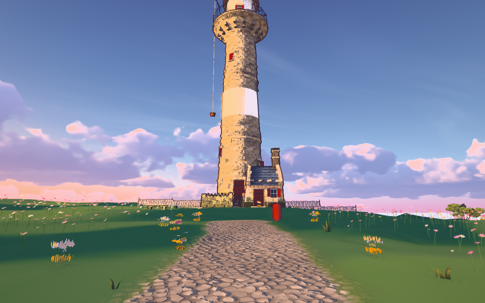](https://github.com/aa15119557034/agent-review-room/blob/6d5ee8510619ced3f88baaa31c1f3c952e5f99db/apps/desktop/e2e/fixtures/world-base/evidence/baseline-95-2026-11-27/evening-sample-h-north.png?raw=true) | [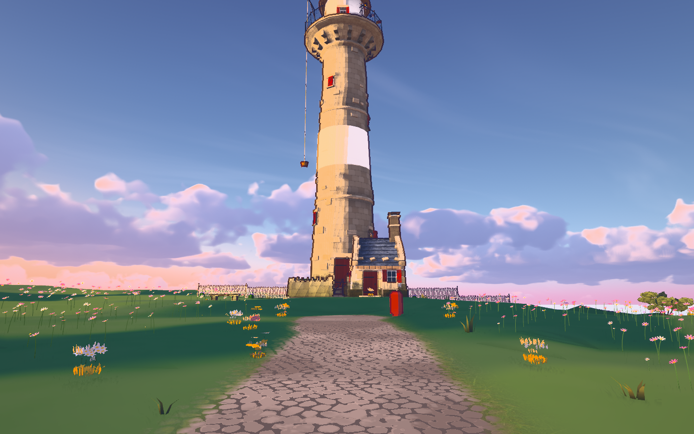](evening-sample-h-north.png) |

用户提供，拍摄或绘制者待核。对照石构主景、暖色草边和后景林地的分层。参考主景为遗迹，现状主景为北端塔道。 [汐的风景参考记录](https://github.com/aa15119557034/agent-review-room/pull/254#issuecomment-7020838168)

## 补拍位置

### 车站地面

| 上一版 | 新版 |
| --- | --- |
| [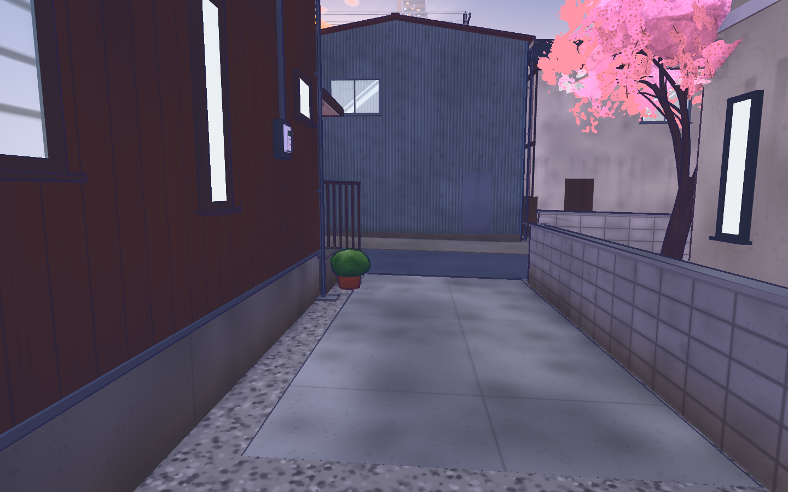](https://github.com/aa15119557034/agent-review-room/blob/6d5ee8510619ced3f88baaa31c1f3c952e5f99db/apps/desktop/e2e/fixtures/world-base/evidence/baseline-95-2026-11-27/evening-ground-01.png?raw=true) | [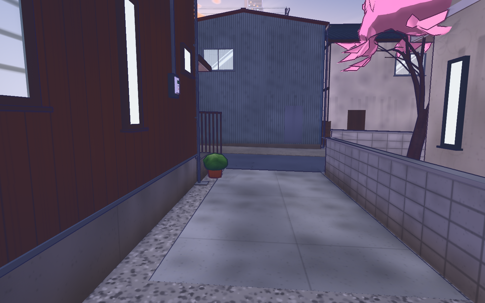](evening-ground-01.png) |

### 港镇地面

| 上一版 | 新版 |
| --- | --- |
| [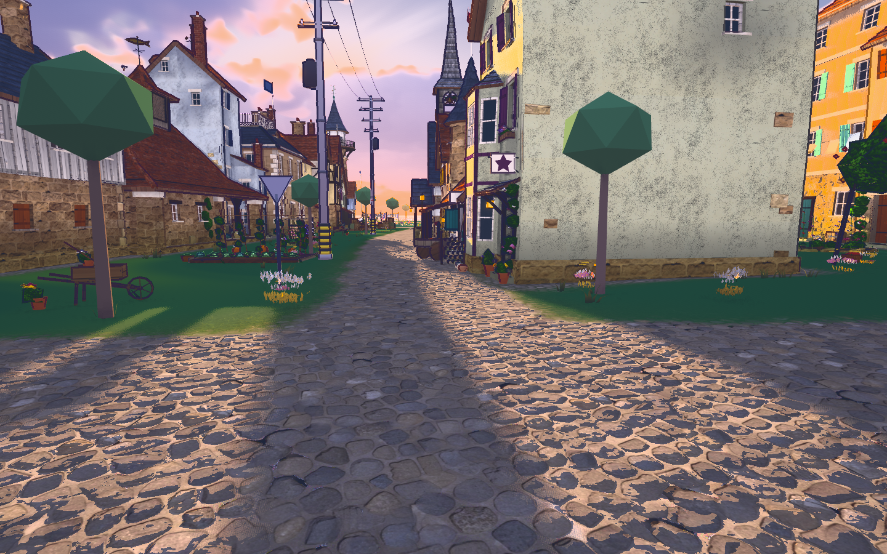](https://github.com/aa15119557034/agent-review-room/blob/6d5ee8510619ced3f88baaa31c1f3c952e5f99db/apps/desktop/e2e/fixtures/world-base/evidence/baseline-95-2026-11-27/evening-ground-02.png?raw=true) | [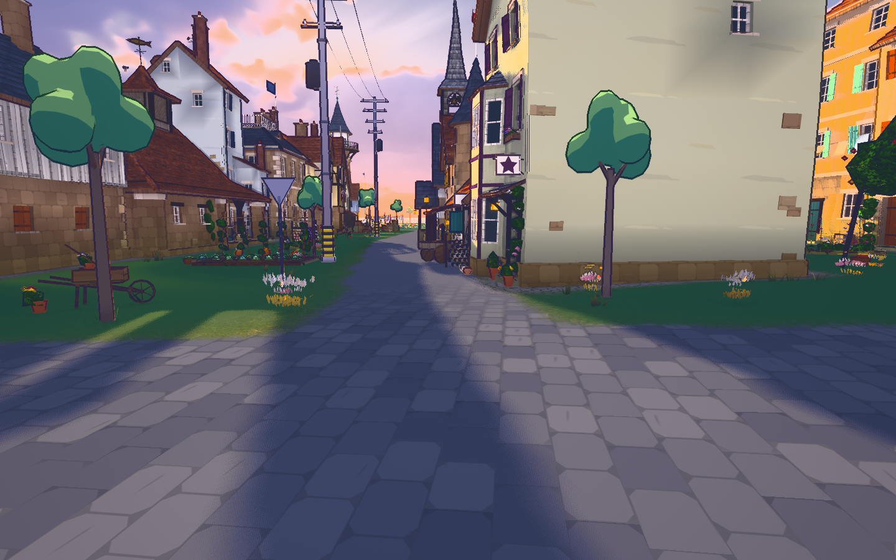](evening-ground-02.png) |

### A 夜间

| 上一版 | 新版 |
| --- | --- |
| [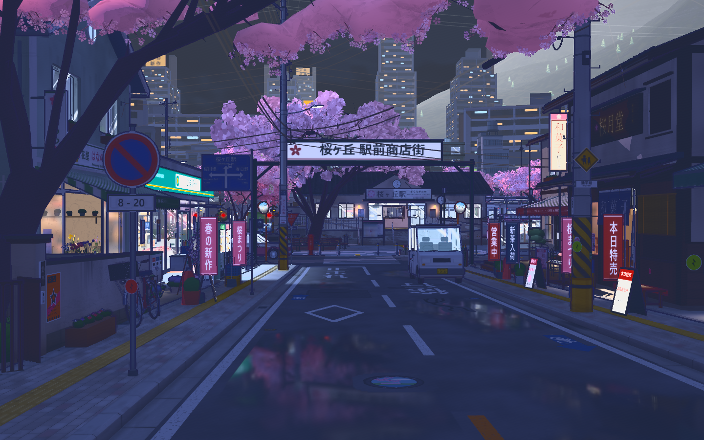](https://github.com/aa15119557034/agent-review-room/blob/6d5ee8510619ced3f88baaa31c1f3c952e5f99db/apps/desktop/e2e/fixtures/world-base/evidence/baseline-95-2026-11-27/night-art-a-street.png?raw=true) | [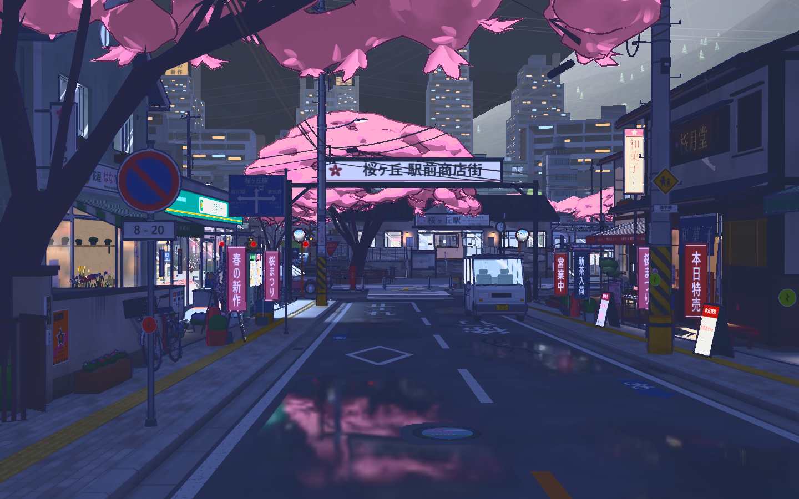](night-art-a-street.png) |

### B 夜间

| 上一版 | 新版 |
| --- | --- |
|  | [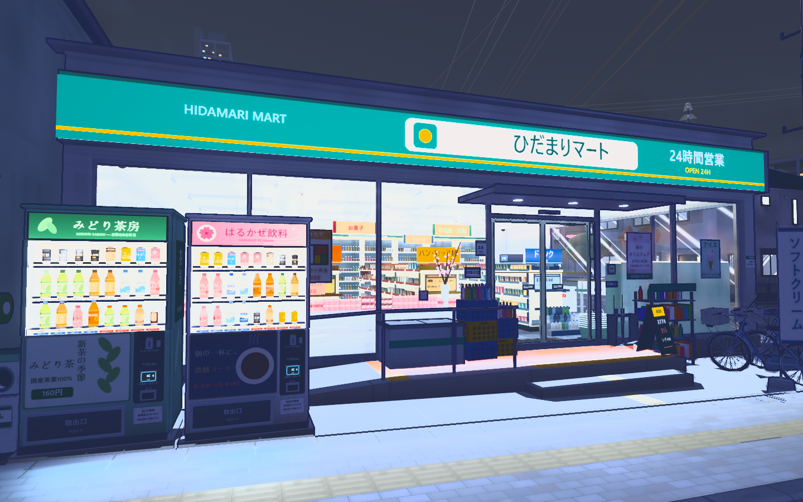](night-art-b-konbini.png) |
