# X-51 站区光影与樱花复拍

使用上一轮固定相机、天气预设和冻结时钟，采集 1440×900。[相机位姿](camera-poses.json) · [采集校验](capture-checks.json) · [渲染源校验](capture-source.json)

樱花手绘色阶进入场景光照，大部分小叶尖收进冠层，暗部保留随日光和月光变化的透光层次。湿路减轻反射扰动与拖尾，近处积水可辨认树枝和招牌。站区东侧接缝接收站区投影，继续使用原地形光照图和港镇阴影。

| 机位 | 上一版 | 本轮 |
| --- | --- | --- |
| A 站前主街傍晚 | [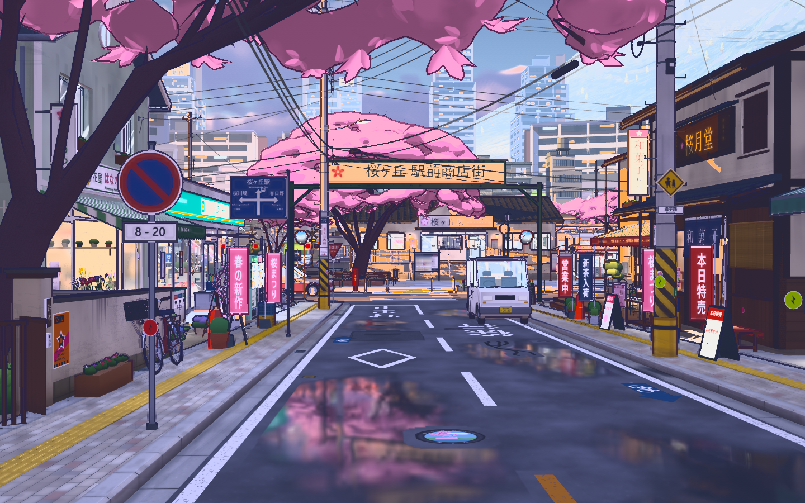](https://github.com/aa15119557034/agent-review-room/blob/4abad8103a55bfce8998e556a076cd23b0a45c26/apps/desktop/e2e/fixtures/world-base/evidence/style-batch-1-2026-11-27/evening-art-a-street.png) | [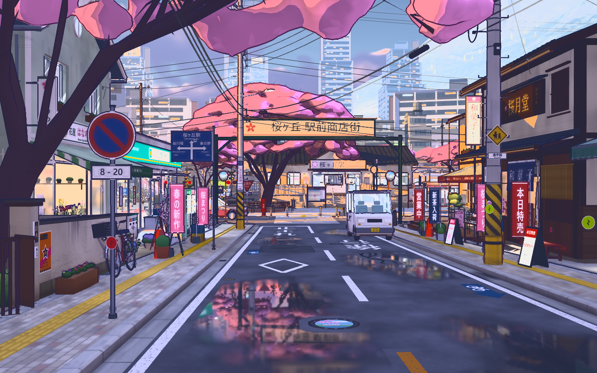](evening-art-a-street.png) |
| A 站前主街夜间 | [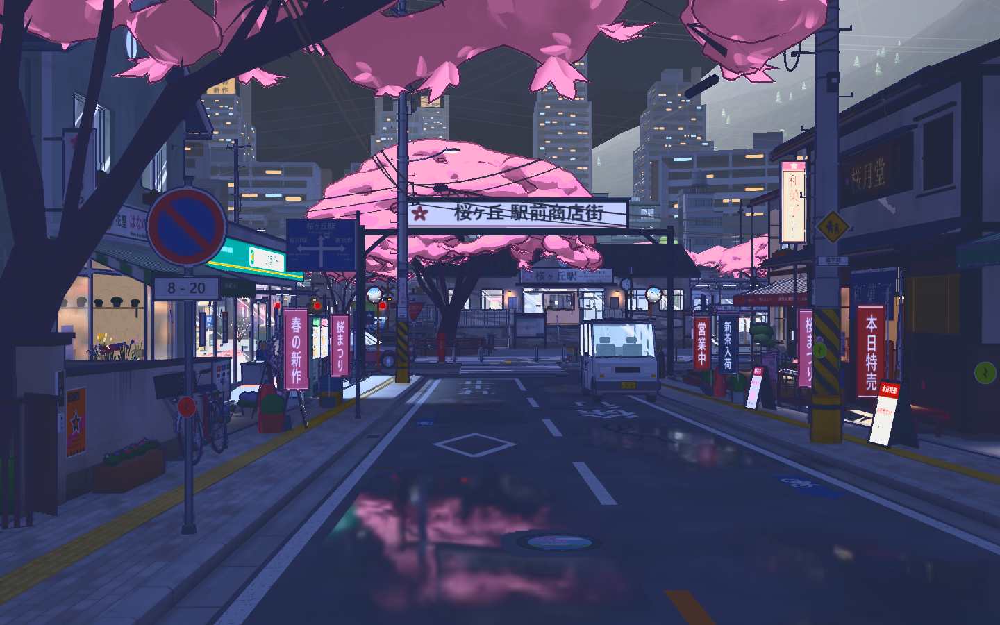](https://github.com/aa15119557034/agent-review-room/blob/4abad8103a55bfce8998e556a076cd23b0a45c26/apps/desktop/e2e/fixtures/world-base/evidence/style-batch-1-2026-11-27/night-art-a-street.png) | [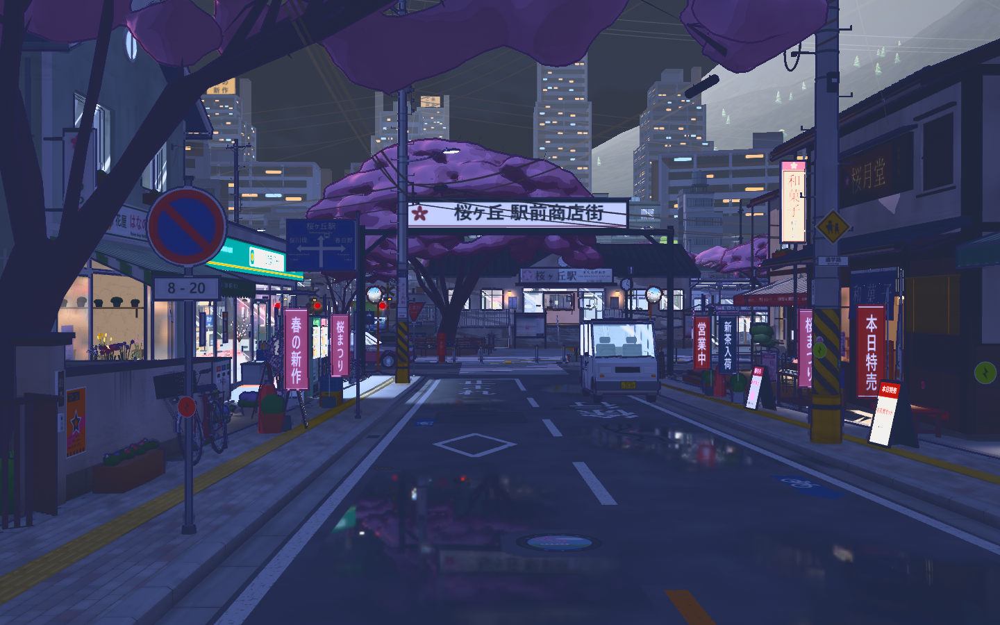](night-art-a-street.png) |
| G 铁路旁树冠 | [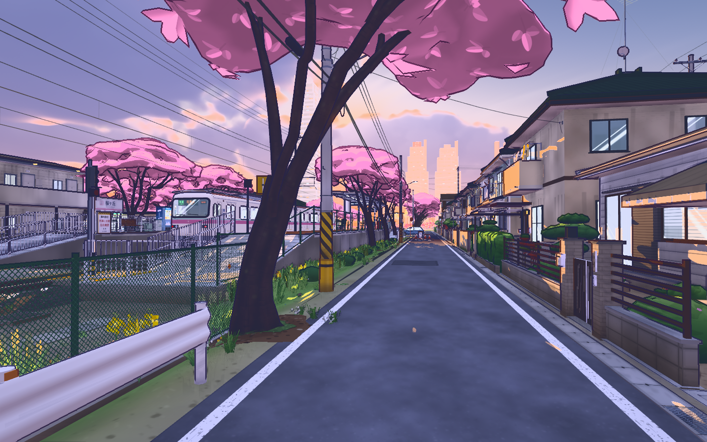](https://github.com/aa15119557034/agent-review-room/blob/4abad8103a55bfce8998e556a076cd23b0a45c26/apps/desktop/e2e/fixtures/world-base/evidence/style-batch-1-2026-11-27/evening-sample-g-rail.png) | [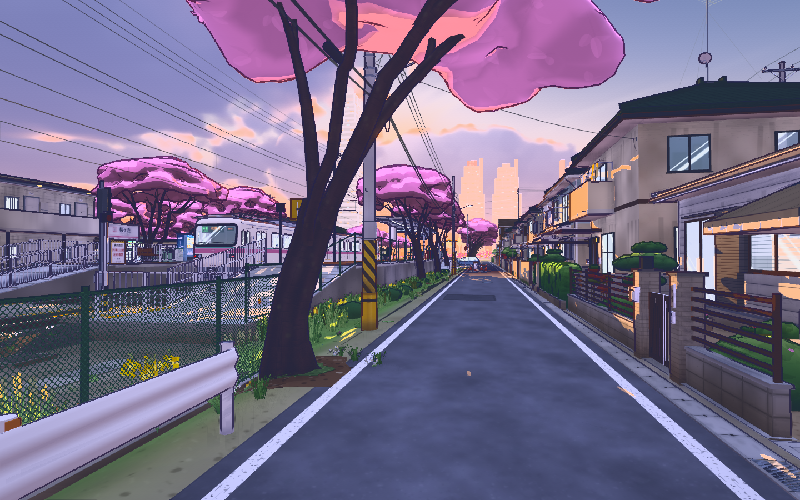](evening-sample-g-rail.png) |
| C 公寓后巷暖灯 | [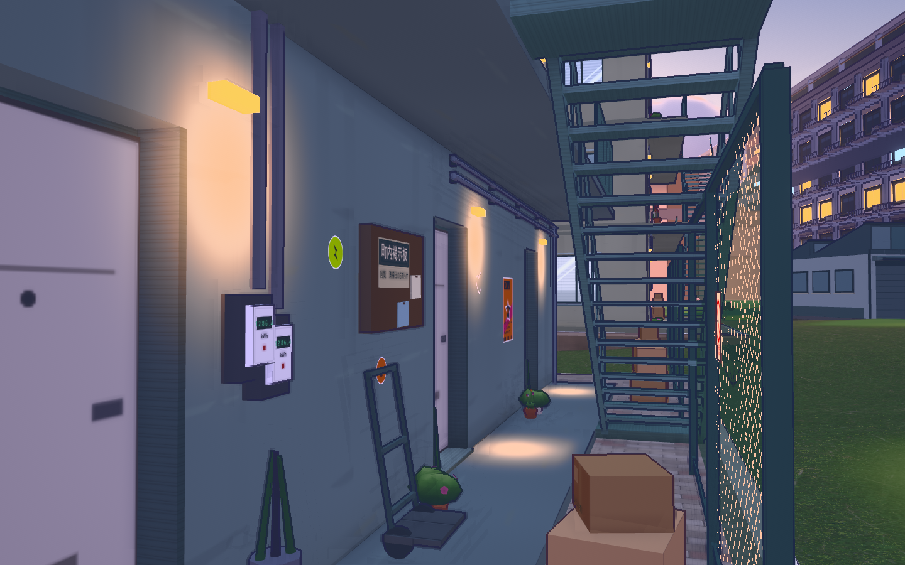](https://github.com/aa15119557034/agent-review-room/blob/4abad8103a55bfce8998e556a076cd23b0a45c26/apps/desktop/e2e/fixtures/world-base/evidence/style-batch-1-2026-11-27/evening-art-c-alley.png) | [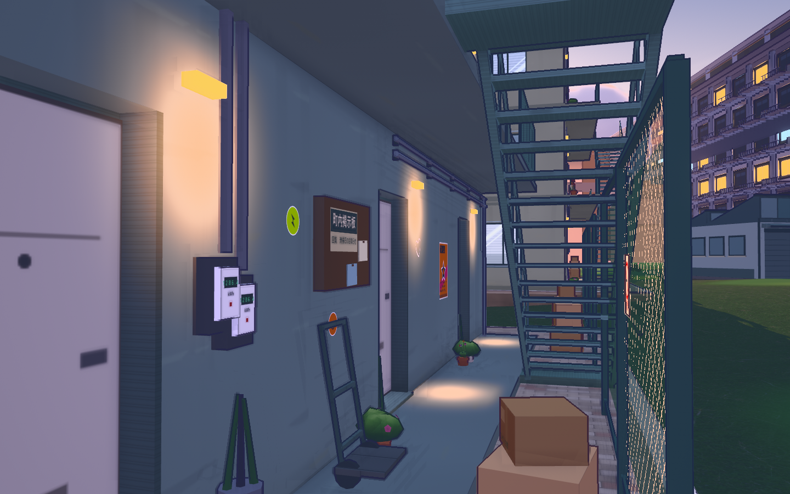](evening-art-c-alley.png) |
| E 港口 | [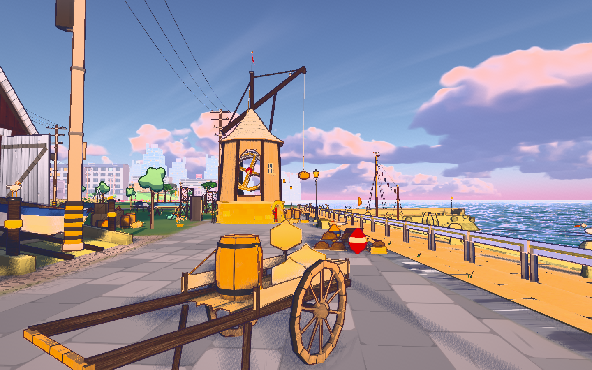](https://github.com/aa15119557034/agent-review-room/blob/4abad8103a55bfce8998e556a076cd23b0a45c26/apps/desktop/e2e/fixtures/world-base/evidence/style-batch-1-2026-11-27/evening-sample-e-harbour.png) |  |
| 站区地面 | [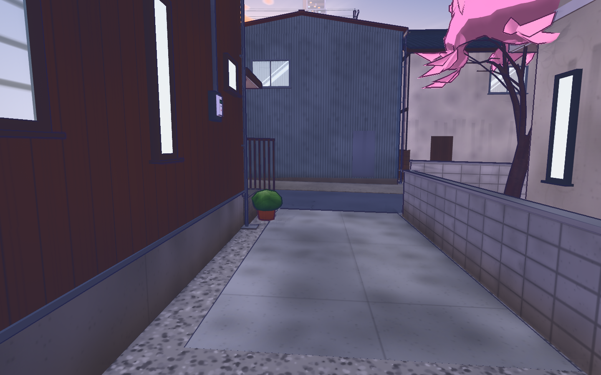](https://github.com/aa15119557034/agent-review-room/blob/4abad8103a55bfce8998e556a076cd23b0a45c26/apps/desktop/e2e/fixtures/world-base/evidence/style-batch-1-2026-11-27/evening-ground-01.png) | [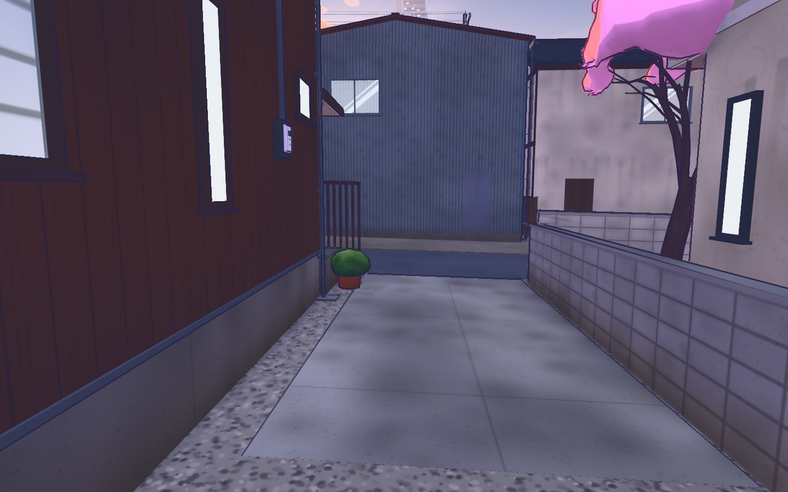](evening-ground-01.png) |

## 东侧接缝

同一场景、同一机位，仅切换站区阴影接入。关闭时阴影在接缝前变淡。启用后建筑投影延伸过两米宽的过渡带，天空与上部建筑的对照区域逐像素一致。[射线与相机记录](seam-capture.json) · [像素检查](seam-pixel-check.json)

| 关闭接缝阴影 | 本轮默认 |
| --- | --- |
| [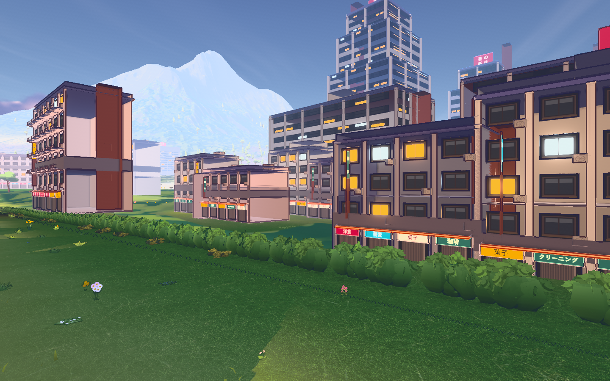](seam-bridge-off.png) | [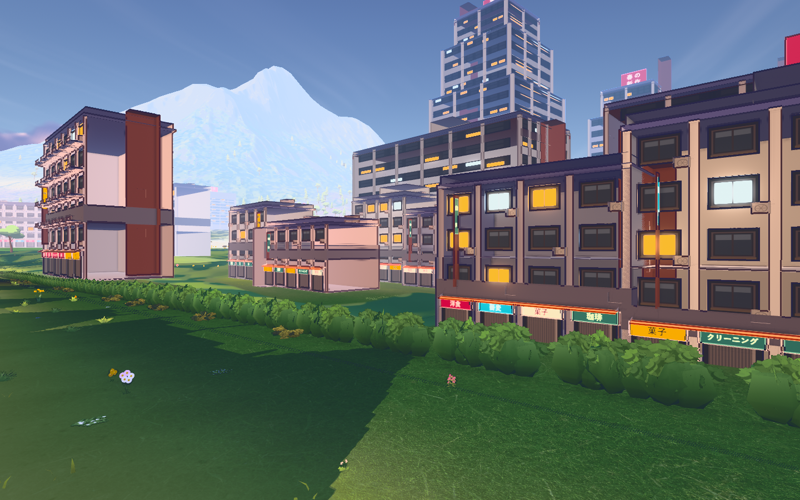](seam-default.png) |
