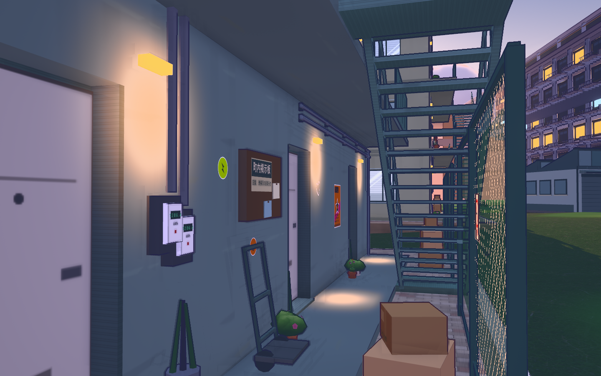
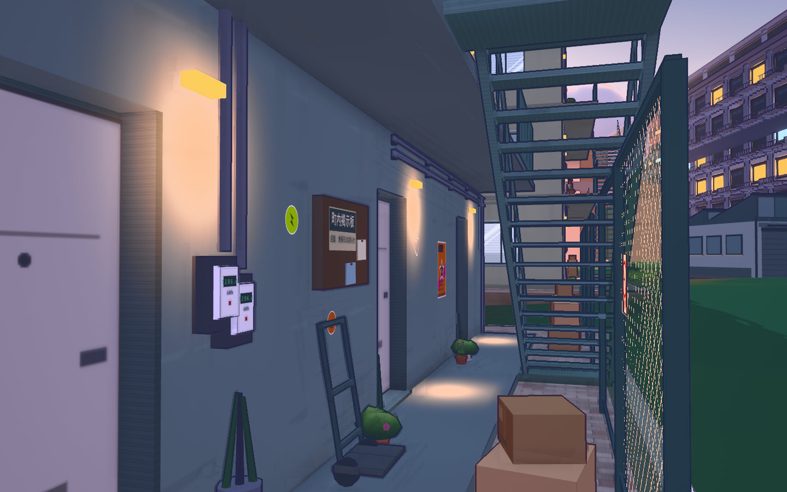
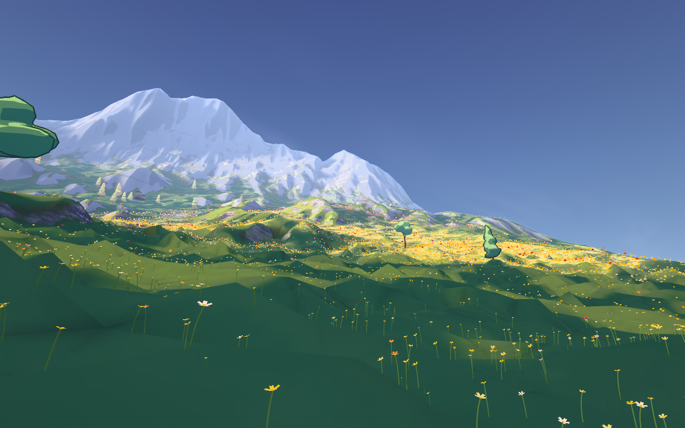
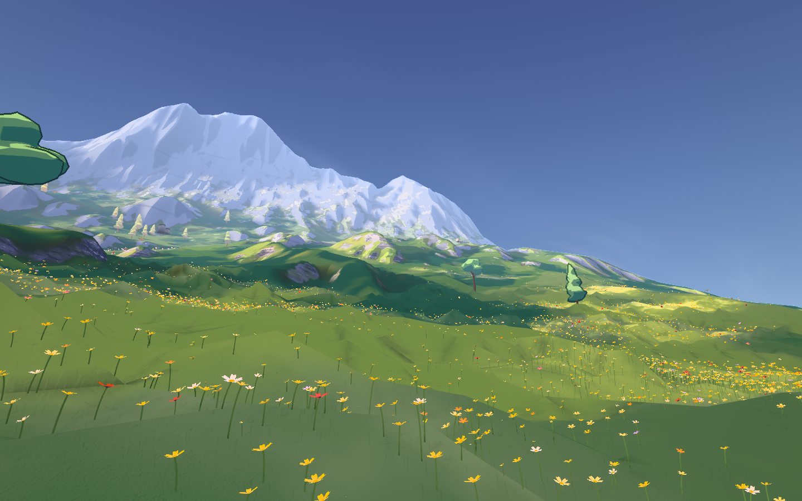
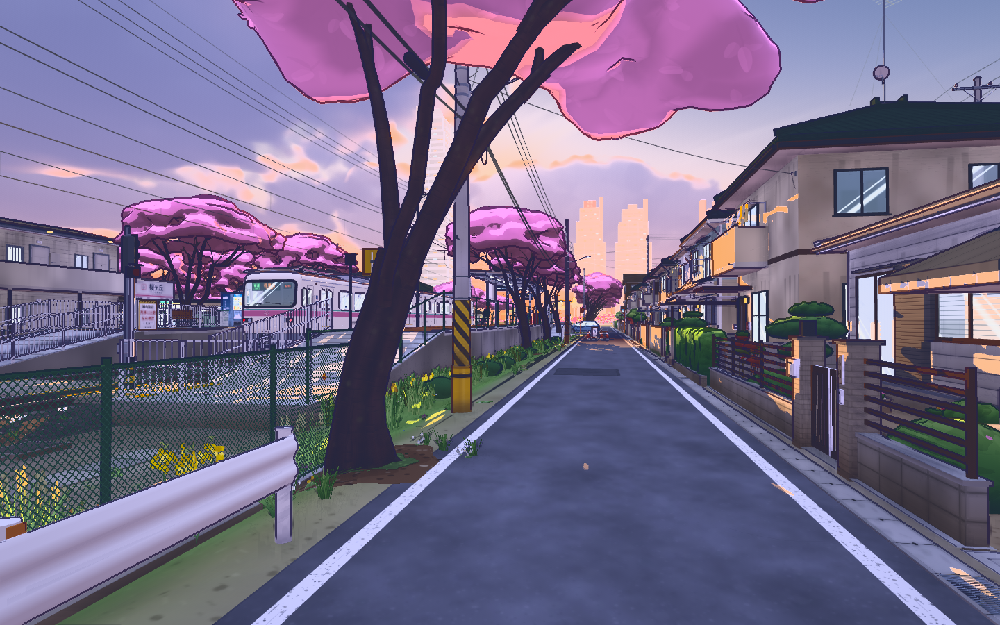
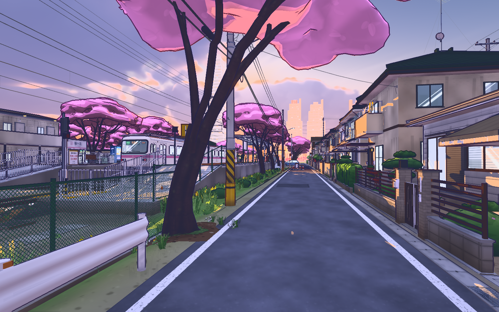
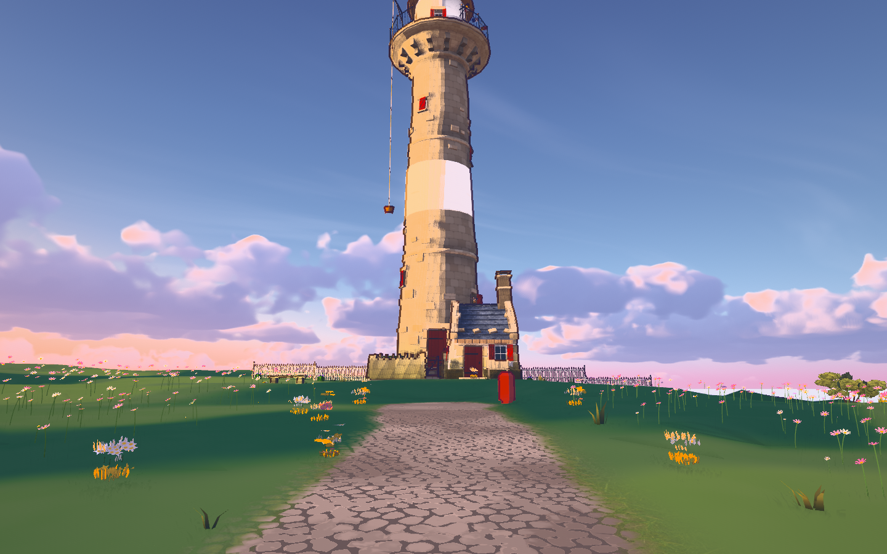
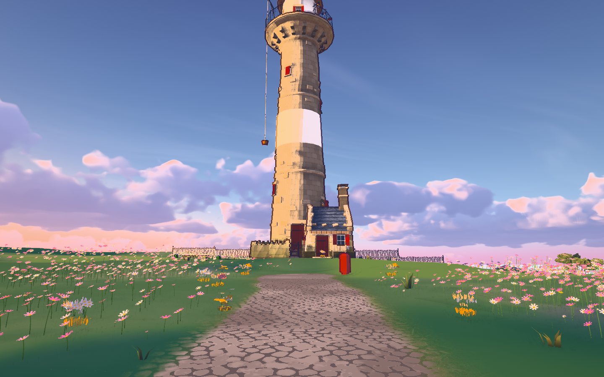
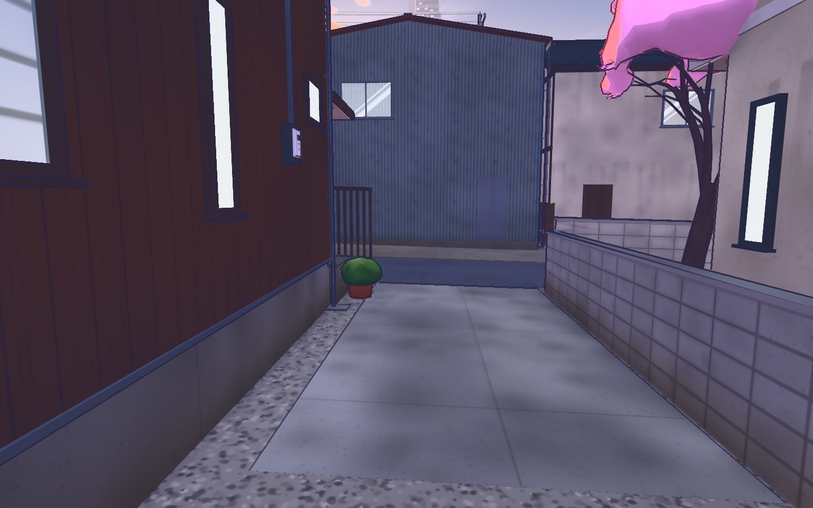
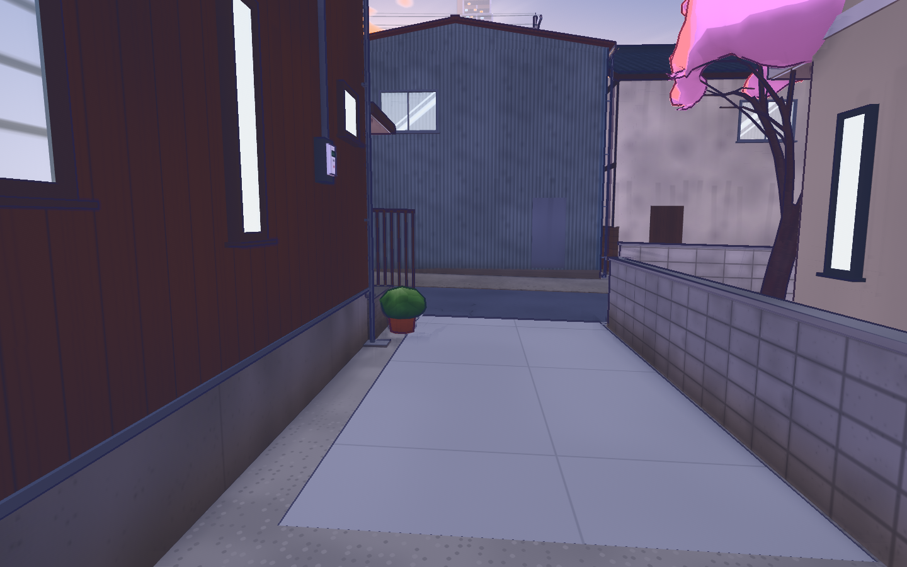

# X-51 第二批 · 草地、花簇与站区地面

傍晚 1440×900。相机位置与投影沿用首轮基线，场景时钟冻结在 5 秒。F/G/H 比较画风要素，保留各机位的原有构图。[相机位姿](camera-poses.json) · [采集校验](capture-checks.json) · [渲染源校验](capture-source.json)

| 机位 | 参考 | 上一版 | 本轮 |
| --- | --- | --- | --- |
| C 后巷右侧草坪 |  |  |  |
| F 山坡花地 |  |  |  |
| G 铁路沿线 |  |  |  |
| H 北端塔道 |  |  |  |
| 地面 01 站区侧巷 | 对照原机位的碎石带、混凝土分缝和墙脚 |  |  |
