# X-51 Blender 草与叶片

草叶及叶片在 Blender 5.2.2 中建模，保留可编辑几何和着色，导出后进场景同机位复拍。[草的 Blender 源文件](../../assets/station-foliage-2026-11-27/meadow-grass/meadow-grass.blend) · [铁道灌木叶片源文件](../../assets/station-foliage-2026-11-27/rail-leaf-sprays.blend)

| Blender 草叶原模 | Blender 灌木枝叶原模 |
| --- | --- |
| [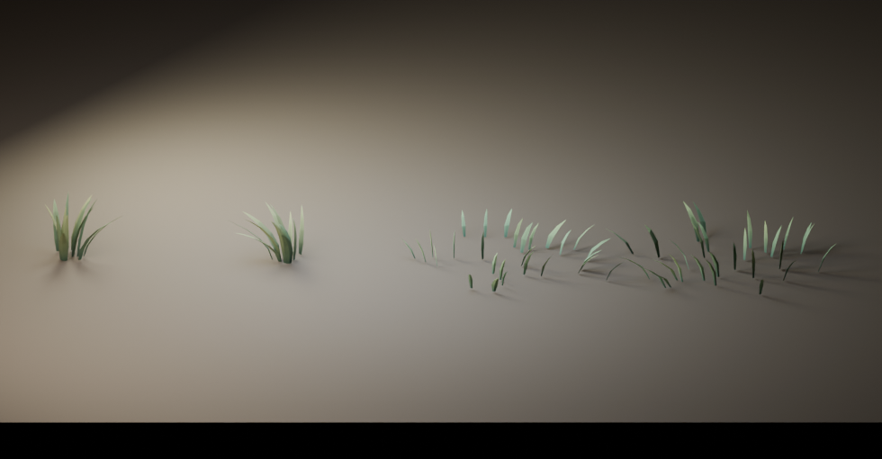](grass-blender.png) | [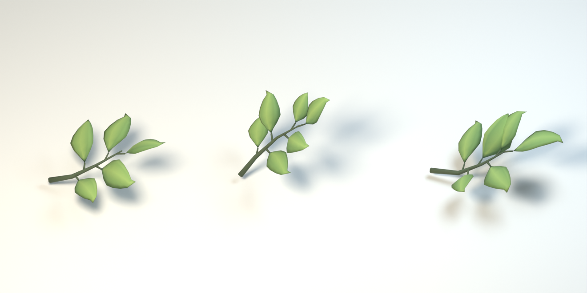](leaves-blender.png) |

用交接的草地参考比较冷暖草层，用街角参考比较卵形叶片的叠搭与枝梢。草坡新增短草面，旧高草与弯叶草丛交替。塔道路面保持可走，轨旁叶片沿用原灌木位置。

[相机位姿](camera-poses.json) · [渲染校验](capture-checks.json) · [资产及源文件校验](capture-source.json) · [运行实例](planting.json) · [短草覆盖检查](grass-placement-check.json)

| 原机位 | 上一版 | 本轮 |
| --- | --- | --- |
| F 草坡 | [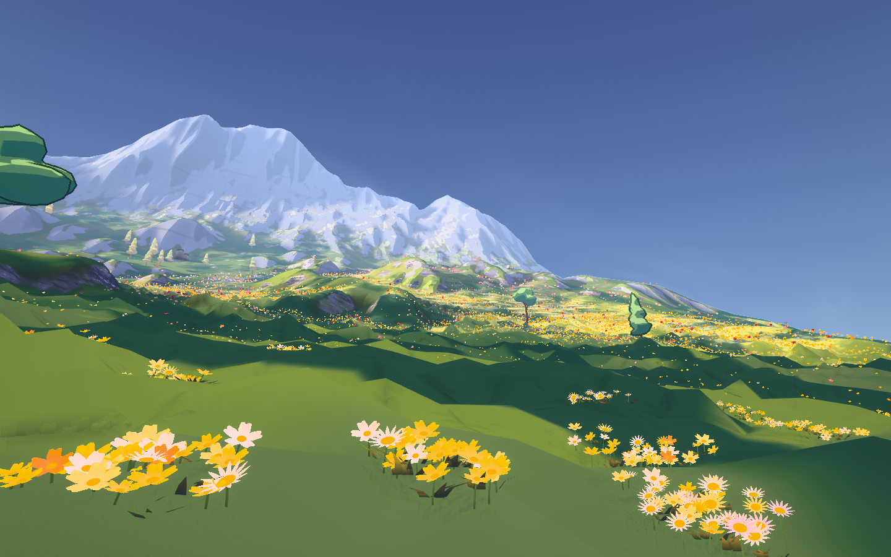](https://github.com/aa15119557034/agent-review-room/blob/d305eb752d02cad529a7403691aa8d580f4d4305/apps/desktop/e2e/fixtures/world-base/evidence/style-batch-2-round-3-2026-11-27/evening-sample-f-hillside.png?raw=true) | [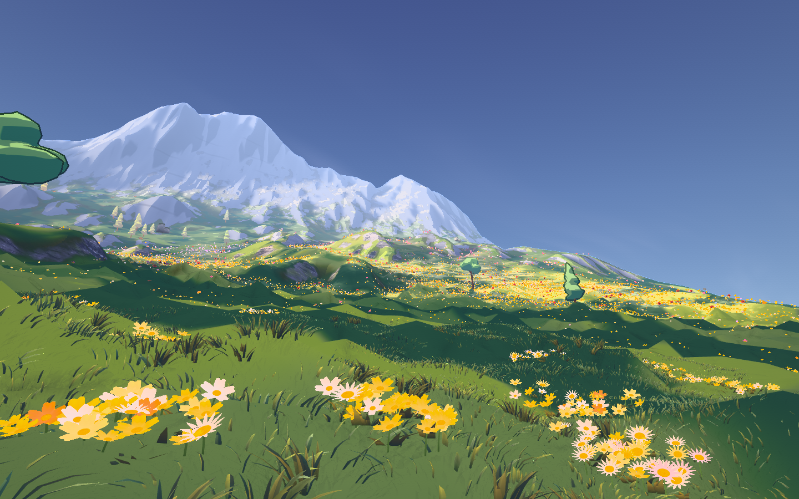](evening-sample-f-hillside.png) |
| H 塔道 | [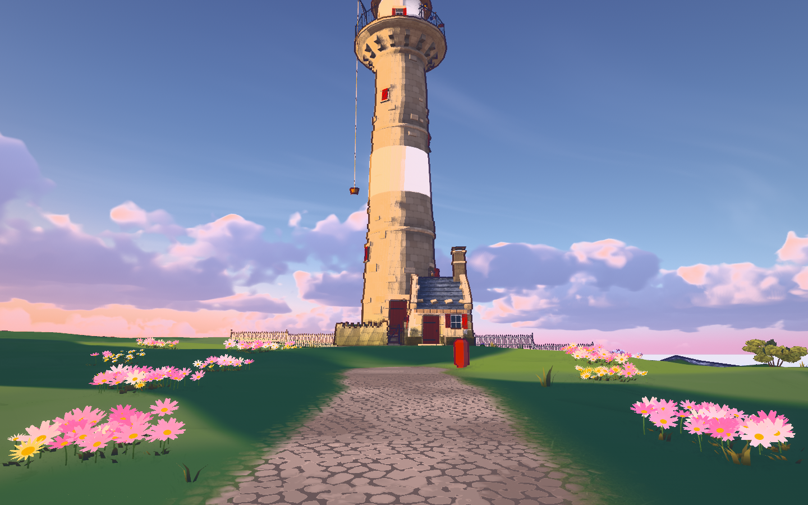](https://github.com/aa15119557034/agent-review-room/blob/d305eb752d02cad529a7403691aa8d580f4d4305/apps/desktop/e2e/fixtures/world-base/evidence/style-batch-2-round-3-2026-11-27/evening-sample-h-north.png?raw=true) | [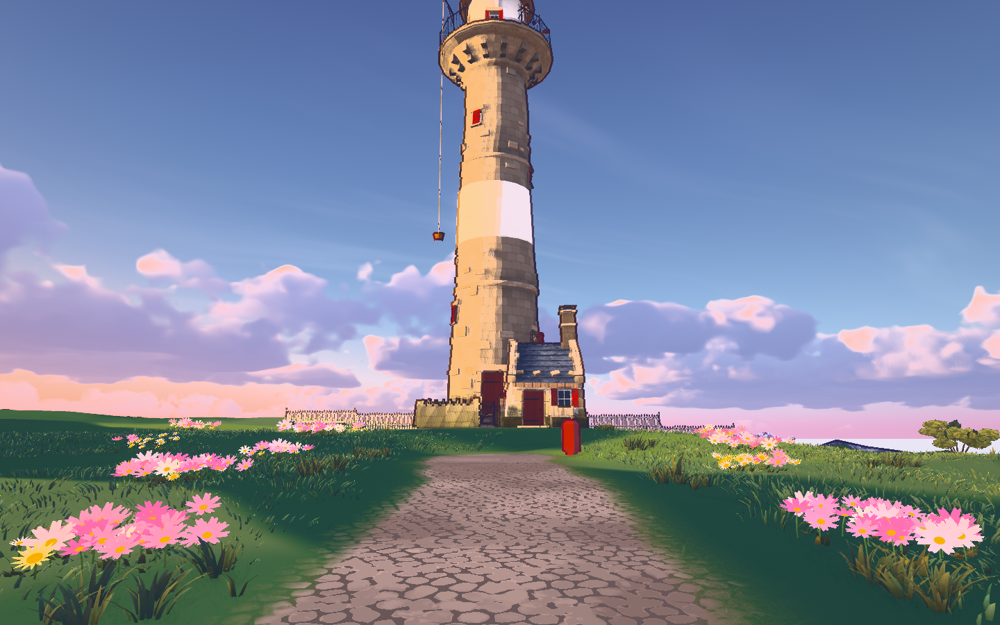](evening-sample-h-north.png) |
| G 铁路 | [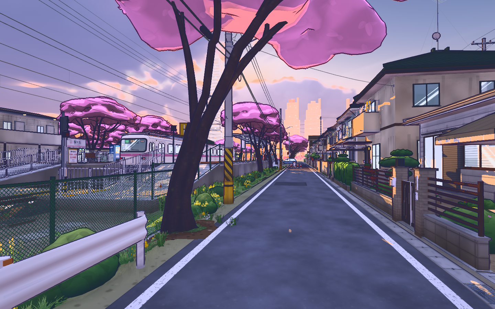](https://github.com/aa15119557034/agent-review-room/blob/fad361bb34b911ff909bd751775a7759ecae766e/apps/desktop/e2e/fixtures/world-base/evidence/style-batch-2-round-2-2026-11-27/evening-sample-g-rail.png?raw=true) |  |

## 单独开关网格

每组使用相同相机、灯光与地面材质。关闭时只隐藏本轮对应的 Blender 网格。

| 近景 | 仅隐藏新增网格 | 默认显示 |
| --- | --- | --- |
| F 草坡 | [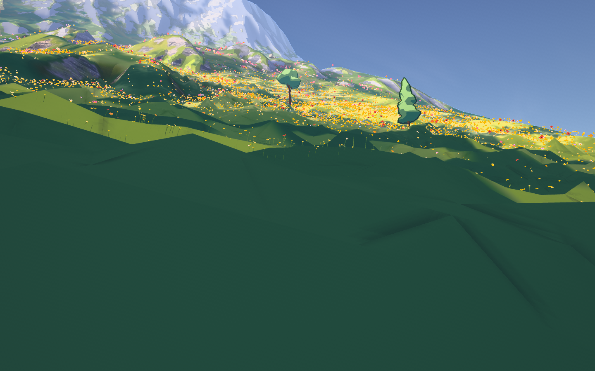](evening-blender-grass-hidden.png) | [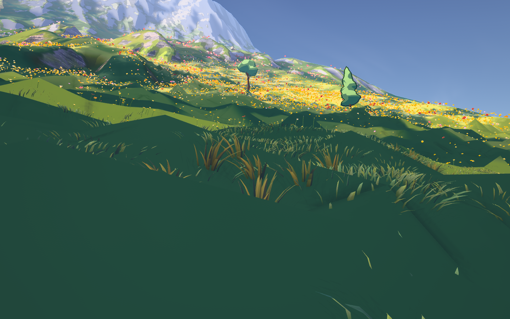](evening-blender-grass-close.png) |
| G 灌木 | [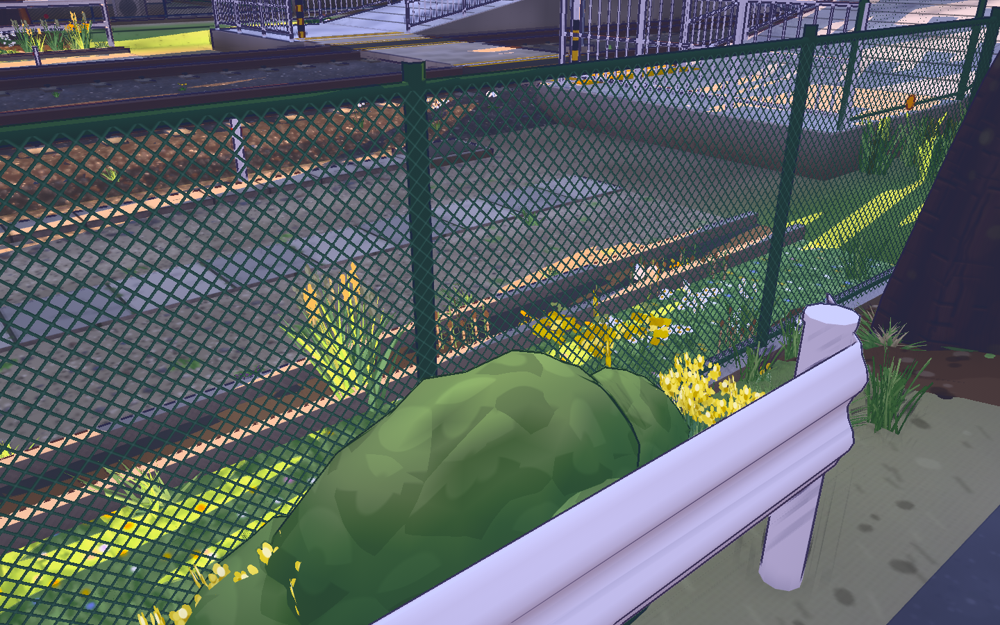](evening-blender-leaves-hidden.png) | [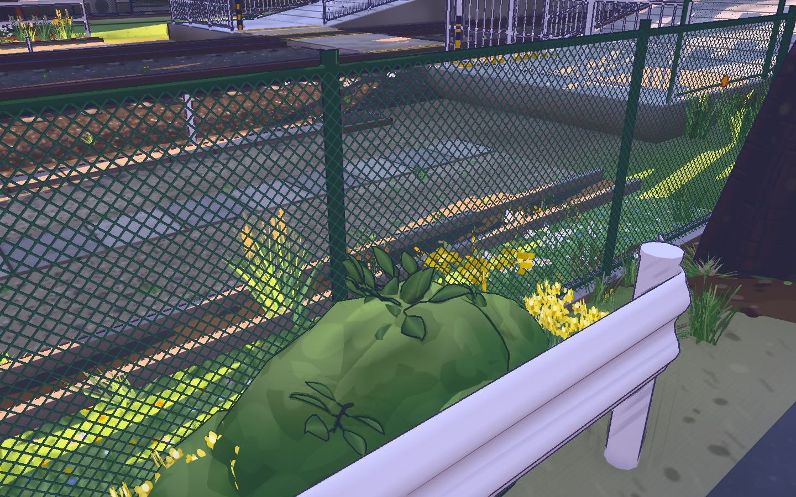](evening-blender-leaves-close.png) |

[近景固定相机像素校验](geometry-visibility.json)
