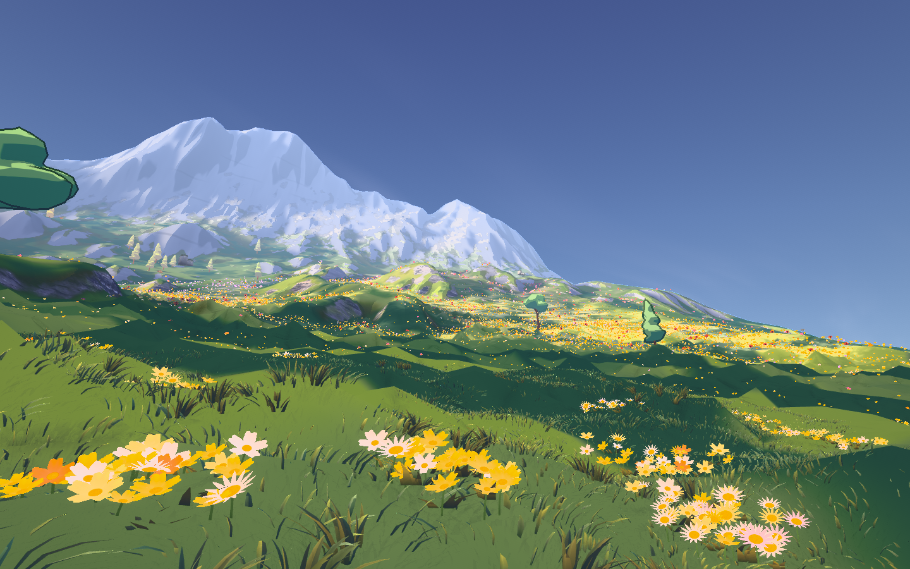
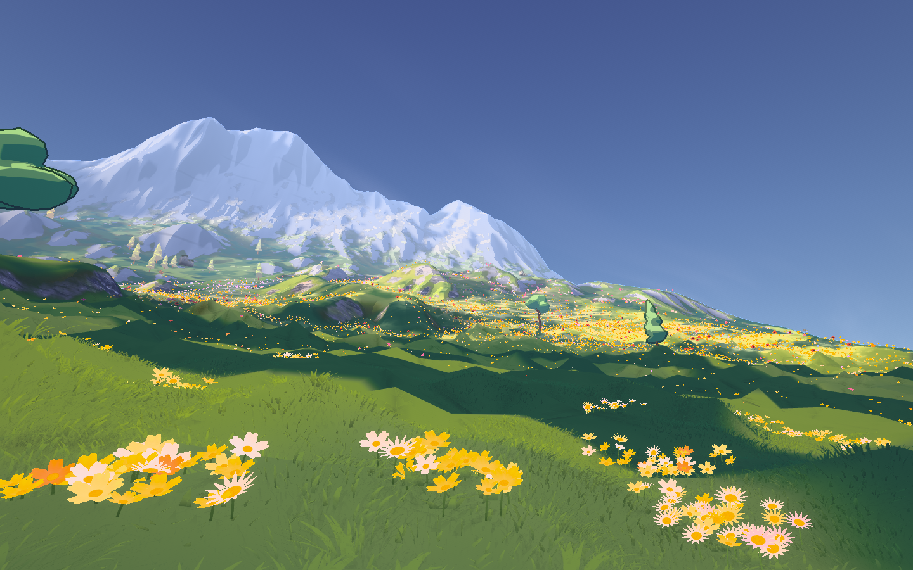
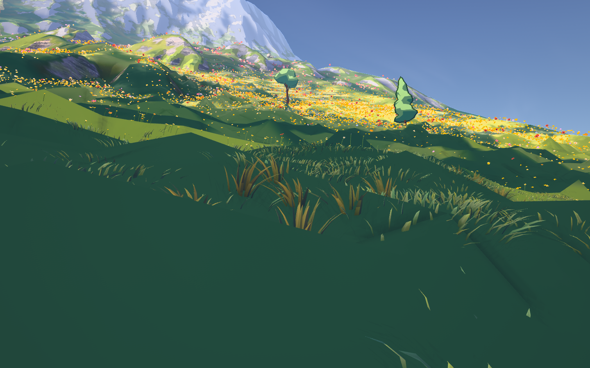
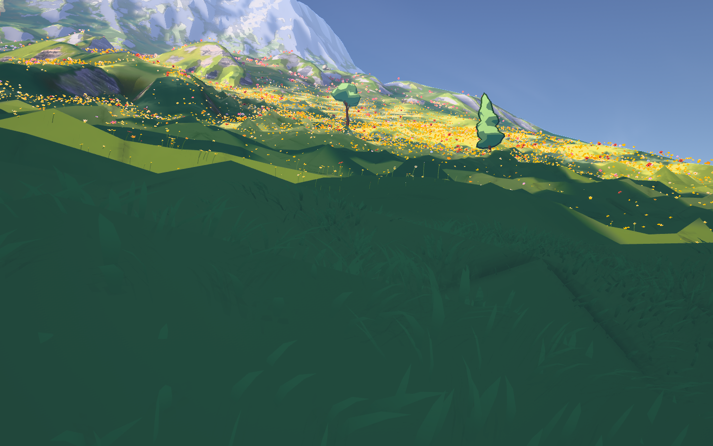
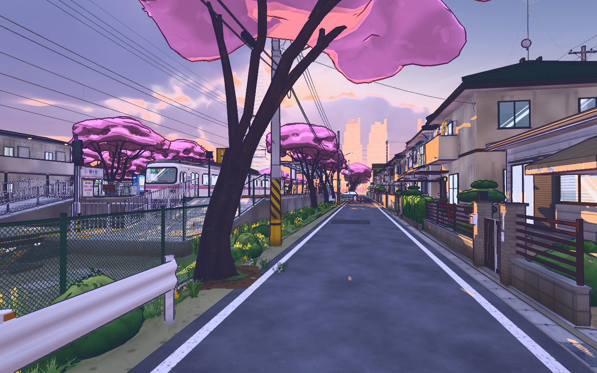
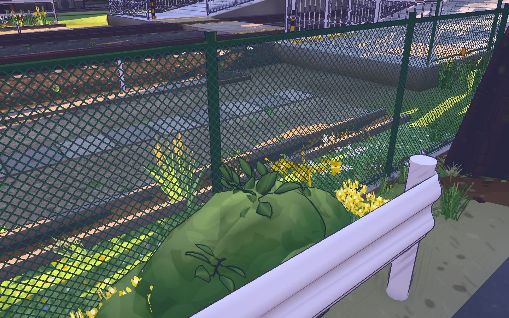
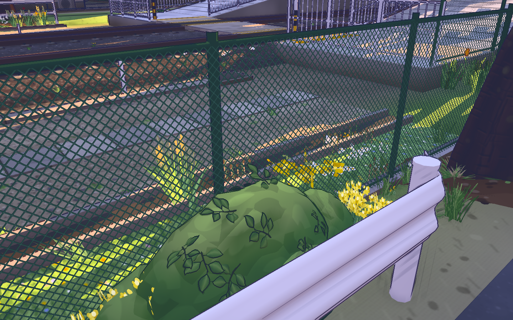

# X-51 Blender 草叶第二轮

F 坡肩高低草叶连成有厚度的草缘，根色沿用地面冷暖场，叶尖只提亮一档。G 灌木小叶沿原团块肩部和轮廓分布。保持原相机与傍晚 5 秒场景时钟。

[相机位姿](camera-poses.json) · [渲染校验](capture-checks.json) · [渲染源校验](capture-source.json) · [运行实例](planting.json)

| 机位 | 上一轮 | 本轮 |
| -- | -- | -- |
| F 山坡 |  |  |
| F 草叶近景 |  |  |
| G 铁路 |  |  |
| G 灌木近景 |  |  |
| H 塔道 |  |  |

H 同机位复核记录超过 3 阶 RGB 变化的像素数为 0。
