# X-51 第二批 · 花簇、斑驳光与轨旁植物复拍

沿用固定相机和投影，场景时间冻结在 5 秒，原图 1440×900。[相机位姿](camera-poses.json) · [采集校验](capture-checks.json) · [渲染源校验](capture-source.json) · [实例统计](planting.json) · [花簇布点检查](flower-bed-check.json)

| 机位 | 参考 | 批 1 合入版 | 批 2 第一轮 | 本轮 |
| --- | --- | --- | --- | --- |
| F 山坡 |  | [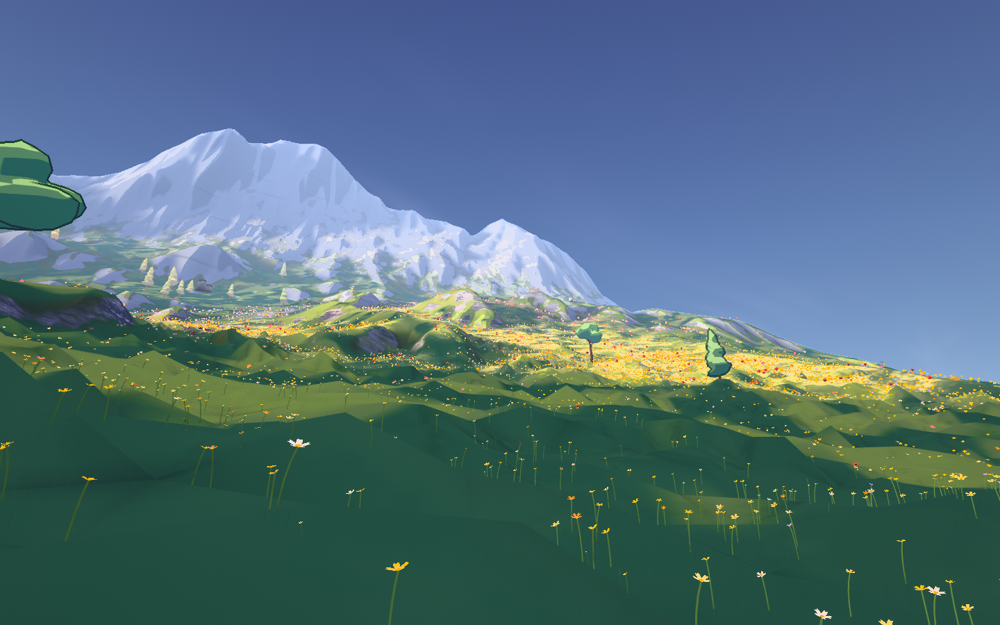](https://github.com/aa15119557034/agent-review-room/blob/77f7107907c00e91835a9fcafa371f19091aaaec/apps/desktop/e2e/fixtures/world-base/evidence/style-batch-1-2026-11-27/evening-sample-f-hillside.png?raw=true) | [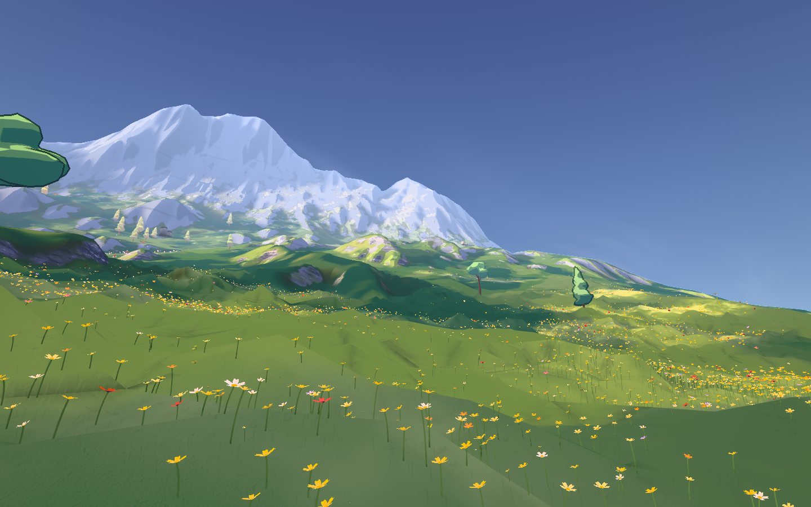](https://github.com/aa15119557034/agent-review-room/blob/2033b527e23e96211a7f4e5a9489ce336b077edc/apps/desktop/e2e/fixtures/world-base/evidence/style-batch-2-2026-11-27/evening-sample-f-hillside.png?raw=true) | [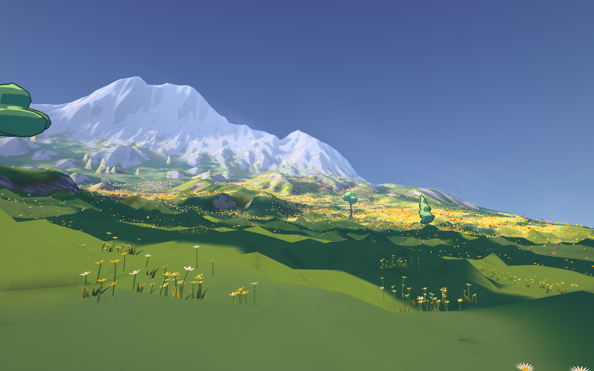](evening-sample-f-hillside.png) |
| H 塔道 |  | [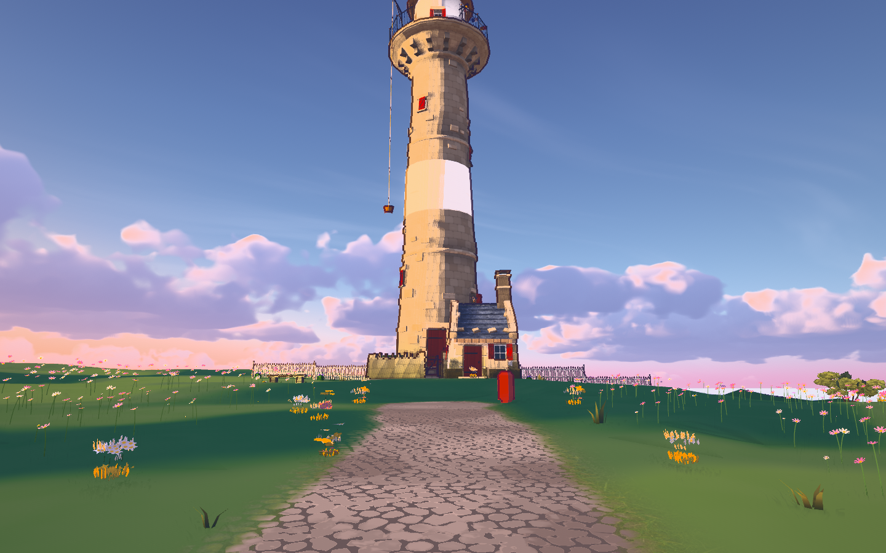](https://github.com/aa15119557034/agent-review-room/blob/77f7107907c00e91835a9fcafa371f19091aaaec/apps/desktop/e2e/fixtures/world-base/evidence/style-batch-1-2026-11-27/evening-sample-h-north.png?raw=true) | [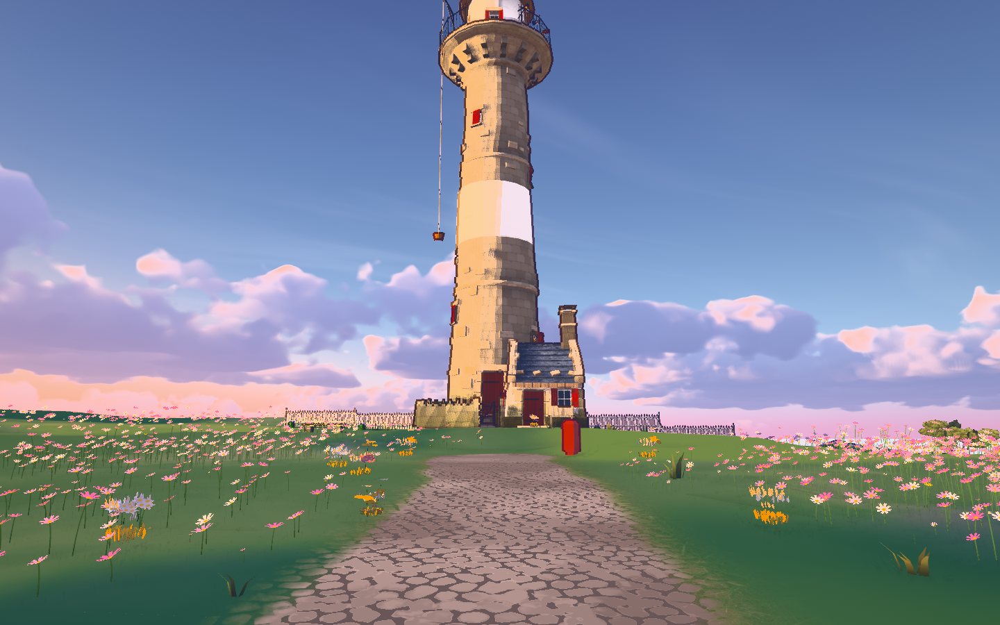](https://github.com/aa15119557034/agent-review-room/blob/2033b527e23e96211a7f4e5a9489ce336b077edc/apps/desktop/e2e/fixtures/world-base/evidence/style-batch-2-2026-11-27/evening-sample-h-north.png?raw=true) | [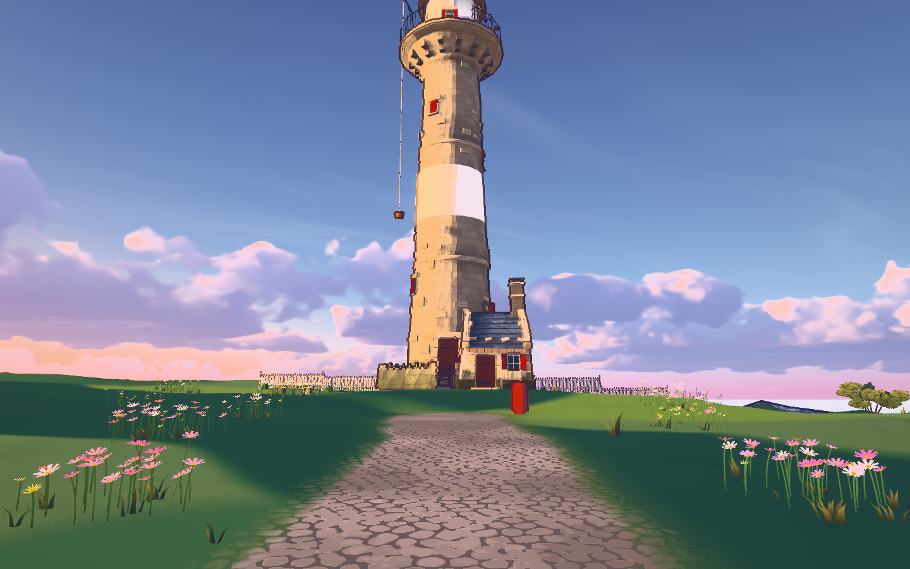](evening-sample-h-north.png) |
| G 铁路 |  | [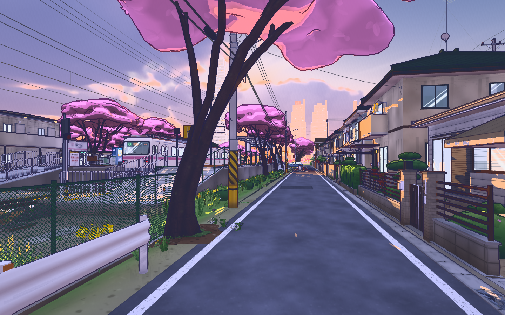](https://github.com/aa15119557034/agent-review-room/blob/77f7107907c00e91835a9fcafa371f19091aaaec/apps/desktop/e2e/fixtures/world-base/evidence/style-batch-1-lighting-2026-11-27/evening-sample-g-rail.png?raw=true) |  | [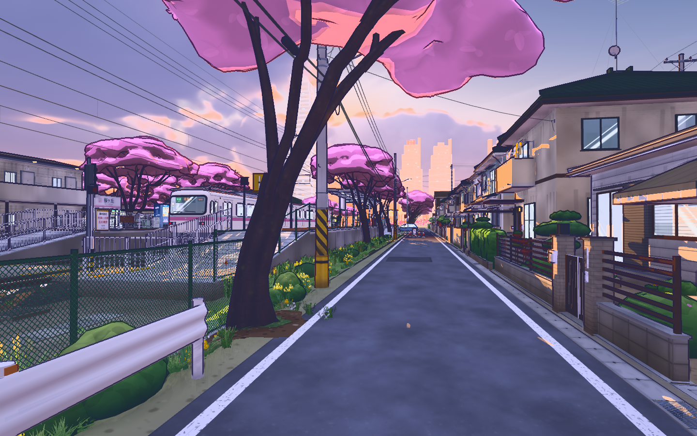](evening-sample-g-rail.png) |
| 地面 01 | 沿用首轮固定机位 | [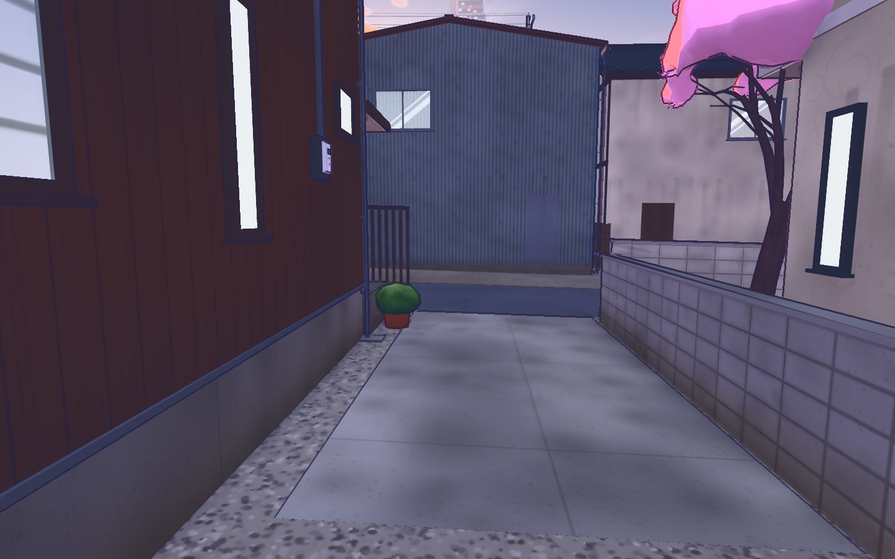](https://github.com/aa15119557034/agent-review-room/blob/77f7107907c00e91835a9fcafa371f19091aaaec/apps/desktop/e2e/fixtures/world-base/evidence/style-batch-1-lighting-2026-11-27/evening-ground-01.png?raw=true) |  | [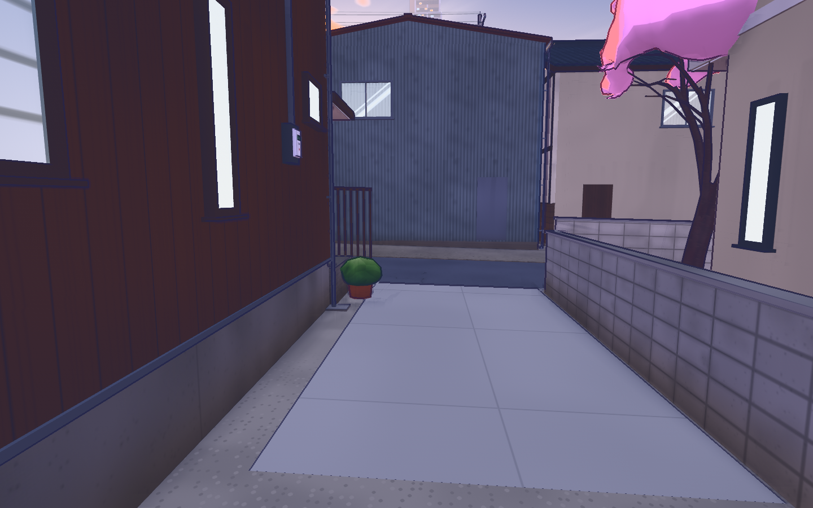](evening-ground-01.png) |
| C 后巷 | 沿用首轮固定机位 | [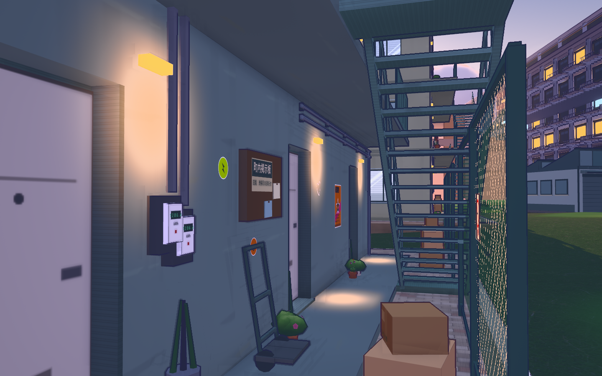](https://github.com/aa15119557034/agent-review-room/blob/77f7107907c00e91835a9fcafa371f19091aaaec/apps/desktop/e2e/fixtures/world-base/evidence/style-batch-1-lighting-2026-11-27/evening-art-c-alley.png?raw=true) |  | [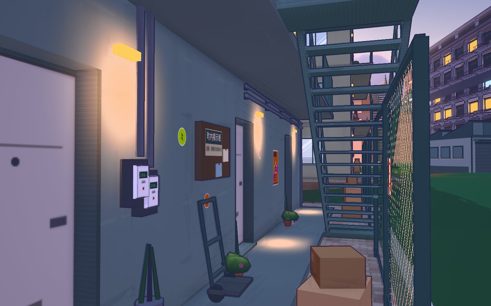](evening-art-c-alley.png) |
