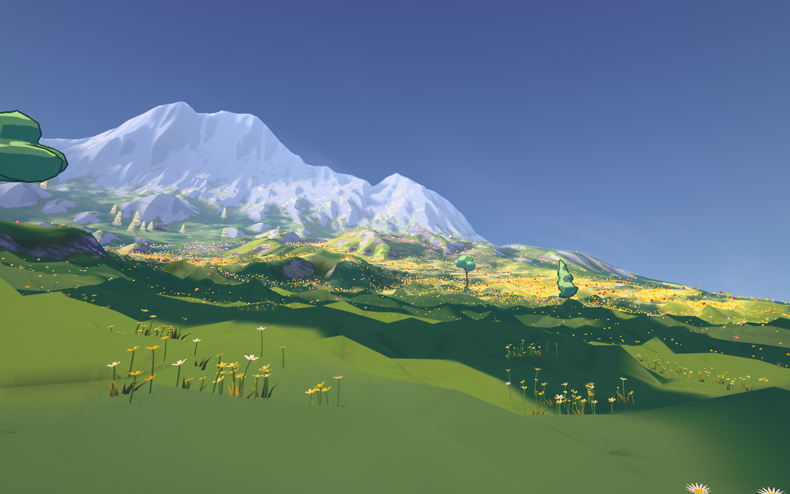
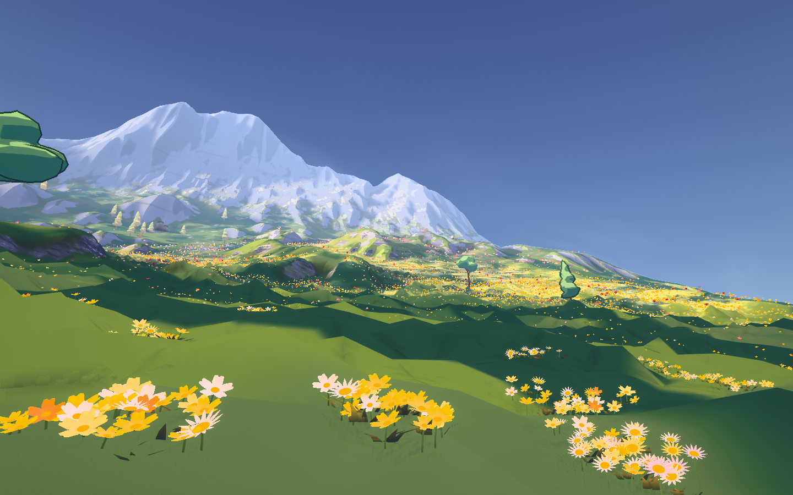
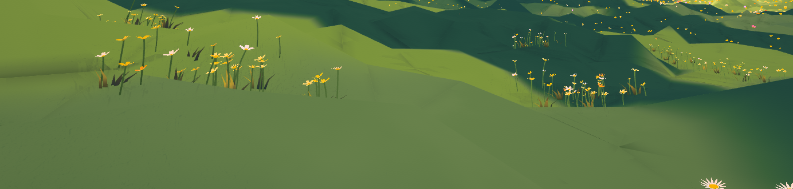
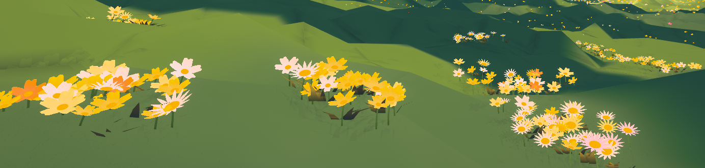
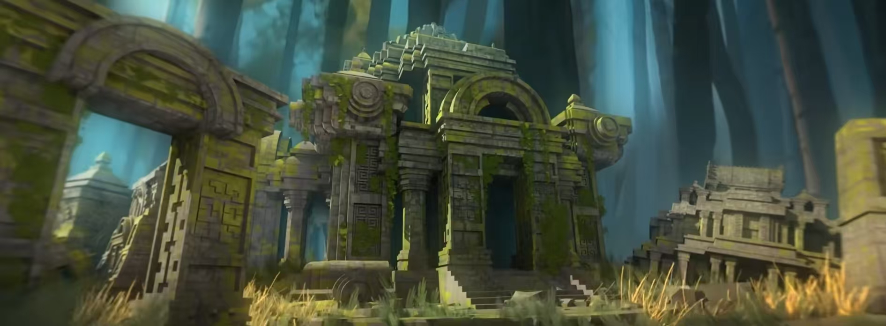
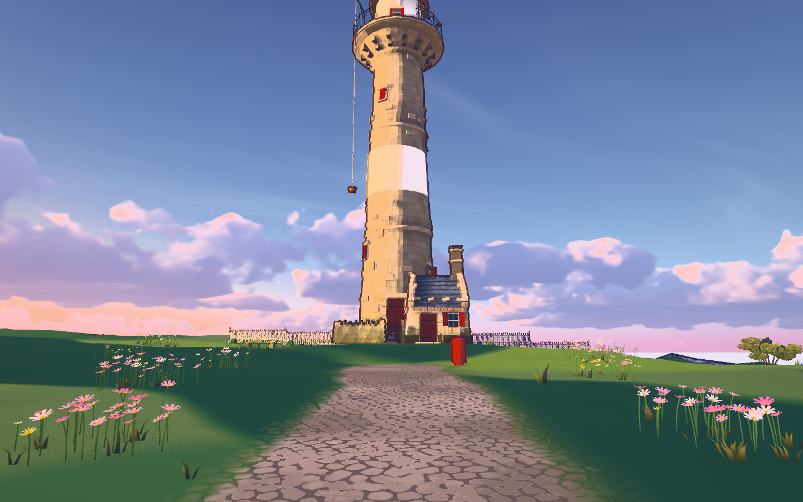
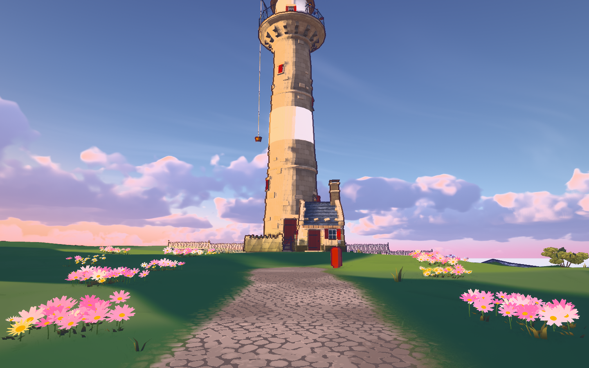
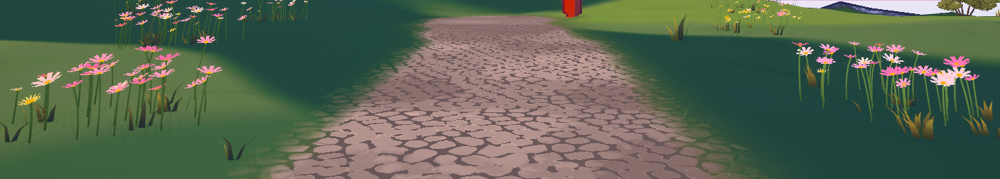
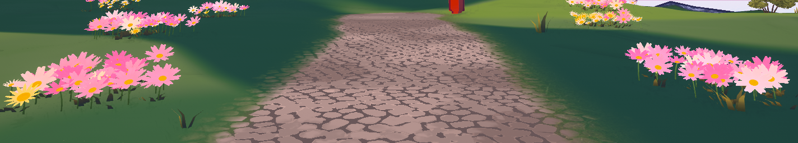

# X-51 第二批 · 低茎近景花簇

沿用前一轮傍晚机位，1440×900。下方细节取原图相同范围，便于对照花头与矮草如何遮住茎根。[相机位姿](camera-poses.json) · [渲染源校验](capture-source.json) · [实例统计](planting.json) · [近景花簇投影](near-bed-projection.json)

| 机位 | 参考 | 上一轮 | 本轮 |
| --- | --- | --- | --- |
| F 山坡 |  |  |  |
| F 山坡 近景细节 | 同范围裁切 |  |  |
| H 塔道 |  |  |  |
| H 塔道 近景细节 | 同范围裁切 |  |  |
