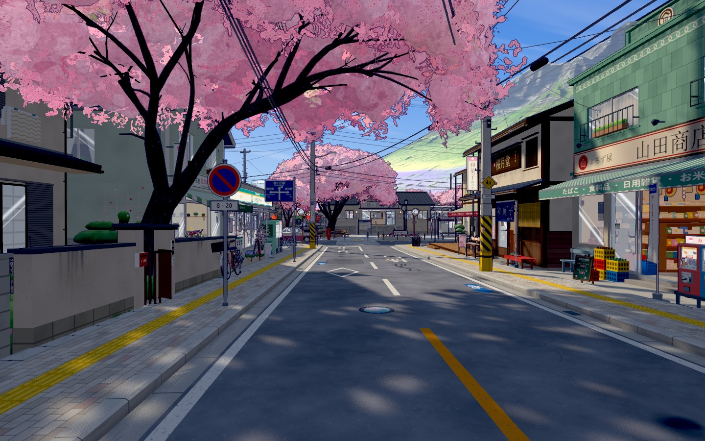
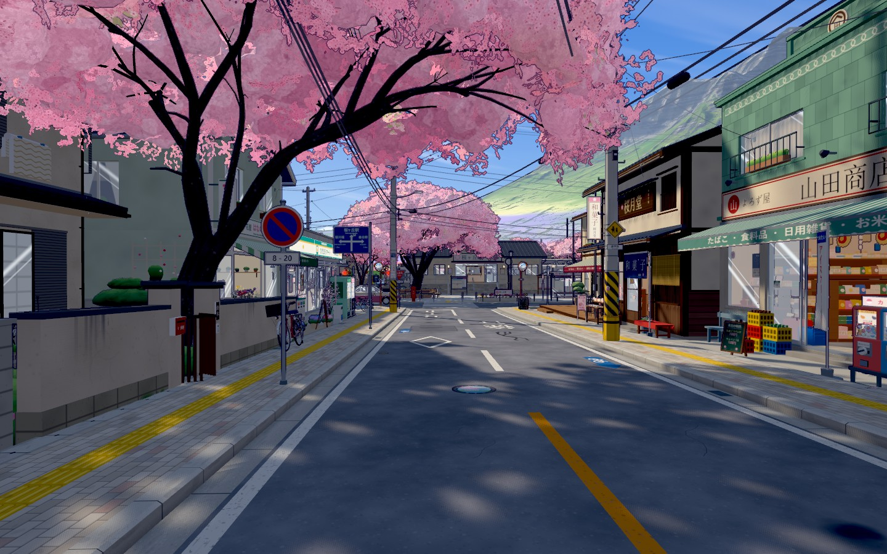
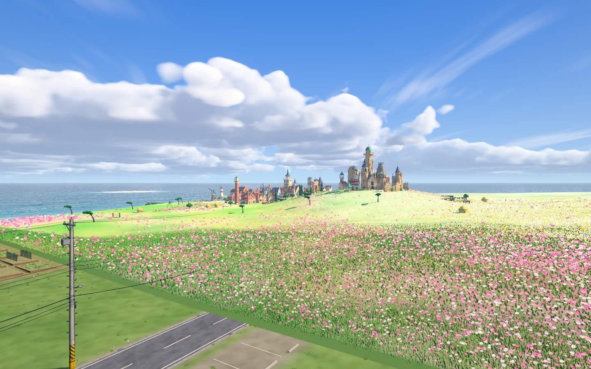
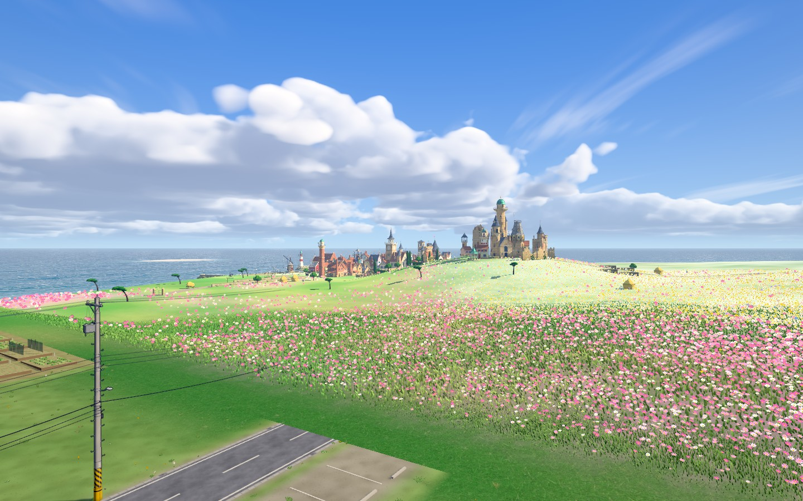
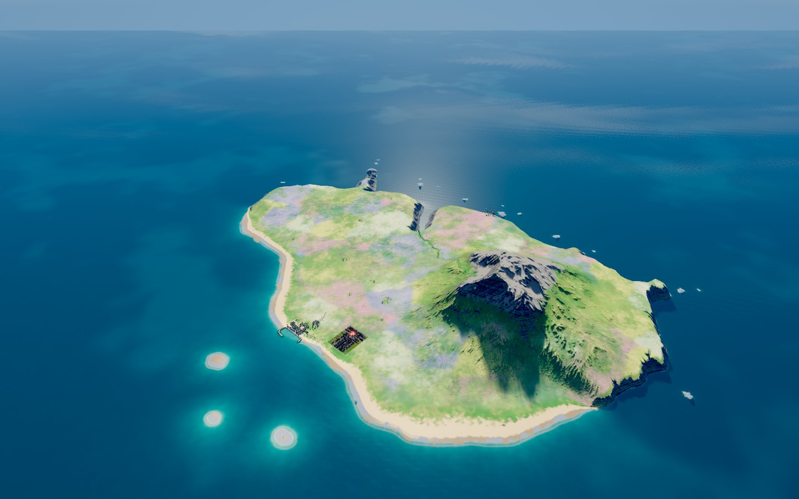
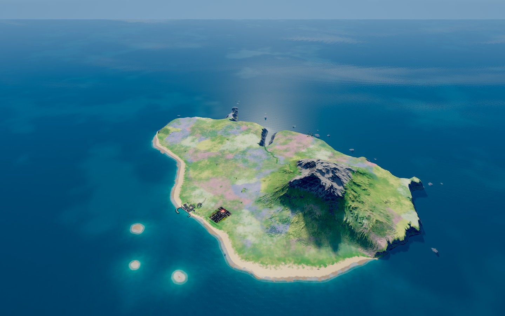

# 地表与浅水修正 · 2026-11-17

受测场景提交：`265c0e914dd6a51899b4aa73b06716c3d74f0e05`。旧对照为 `d049e874a1803d86d6e0d42853a39c09d17cb3ab`，其中场景仍是 C酱的 `294e85d` 精修。193 个场景文件的哈希在静帧、完整基线、录像三次采集中均与受测代码一致；后续证据提交未改变场景。

## 改动与画面

- **草坡**：地形和填缝带对已经包含 grass wrap 校正的 `dif` 做四档量化，港镇保留原阈值。没有改变 C酱的公共曝光、灯光、软曲线、空气透视和店内调色。
- **接缝**：原 1,636 三角形填缝几何及高度不变，改用岛屿地表 shader；边界草花在 12m 范围渐变恢复。站区真实草地的内侧 12m 同步渐变到岛屿材质。道路、停车碎石、铁路、农圃、堤顶和石砌按原布局排除，避免把铺装涂绿。新增 pass 共享纹理及原顶点属性，仅新建边带索引；实际 GPU 图未见地表漏缝。
- **浅水**：浅散射色缩至原来的 0.4，保留深海色。远景焦散收敛到原纹理测得的约 0.398 均值，避免 mip 均值经过非线性公式后反而升到约 1.6。解析不出的岸边泡沫降低覆盖；近景泡沫、海上白帽和后续 wake/瀑布项保留。

固定对照：1440×900、pixel ratio 1、原相机、`U.uTime=14`、隐藏面板，关闭 blur/rays。跨版本是独立加载；累积的站区车辆状态可能不同，因此局部数值仅用于相同山坡/浅滩区域，不能宣称整场逐像素同状态。

| 机位 | 修正前 | 修正后 |
|---|---|---|
| 街道远坡 |  |  |
| 望港镇接缝 |  |  |
| 全岛浅滩 |  |  |

山坡核心矩形区域的显示编码亮度均值从 **234.58 降至 215.07**，亮度 ≥240 的像素比例从 **45.66% 降至 13.08%**。这是屏幕 RGB 加权值，不是物理亮度，也不等于“过曝像素”；矩形内仍有电线。

| 浅滩区域 | 亮度均值，前 → 后 | p95，前 → 后 |
|---|---:|---:|
| 三岛合框 | 95.76 → 82.30 | 180 → 148 |
| 岛 1 | 108.85 → 91.27 | 185 → 164 |
| 岛 2 | 106.40 → 89.43 | 190 → 158 |
| 岛 3 | 112.81 → 95.21 | 196 → 184 |

区域包含沙岛和海水，不是语义分割 mask。原诊断合框漏了第三岛；上述数值使用新版合框及三个独立小框，重新计算原始 PNG 与最终 PNG，旧报告没有改写。[街道 PNG 数据](./surface-compare-street.json)、[浅滩 PNG 数据](./surface-compare-aerial.json)保留坐标、来源哈希及 RGB 差值。

## 根因对照与诊断限制

旧提交完成 8 组固定状态 A/B/A：局部关闭地形色阶、去掉远草初始增益、关闭 bloom、浅散射、焦散、高光、泡沫、临时隐藏填缝网格。控制状态与恢复后的像素检查全部通过，页面异常和网络失败均为 0。结果区分了草坡明暗、浅散射光晕与贴岸泡沫；没有把“泡沫关闭后的整框均值变化小”误当成泡沫无关。

`node scripts/analyze-caustics.cjs .` 实跑成功。它直接执行固定源码的纹理生成函数，以 CPU 容器替代 DataTexture，无 GPU。原始纹素分布积分约 **0.397443**，250,000 次 bilinear 采样约 **0.397765**，远 mip 公式约 **1.599907**。[结果](./caustic-distribution.json)记录种子、源码哈希和近似边界。LOD 3–5 的过渡与世界空间像素跨度是工程近似，不是精确的局部积分或完整抗混叠方案。

**最终固定帧诊断未通过逐像素复现门槛。** 街道和全岛重复图一致；港口在固定一次 A0→A1→A2 中，A1/A2 有 3 个像素不同，A2/准备后有 18 个像素不同，都是单通道一级差异。未循环挑帧、未放宽阈值，`strictStaticIsolation=false`，因此没有把最终版本的后续 8 组诊断记为通过。先前候选还记录过 1/14 像素差，根因未确定；预热没有解决这一限制。

[诊断报告](./diagnostics.json)保留旧成功结果和新失败结果；港口 [A1](./port-repeat-A1.png)、[A2](./port-repeat-A2.png)、[准备后](./port-repeat-prepared.png)原始 PNG 可复核。最终外观判断结合下述独立的完整运行回归及录像，不依赖失败的最终 A/B 断言。

## RTX 3060 完整回归

Windows、RTX 3060 Laptop、Electron 44.9.0 / Chromium 152，实际参数和设备信息见 [measurements.json](./measurements.json)。首个可用完整帧 **32.475s**；15.123s 采样 983 帧，约 **65.00 FPS**，p95 **15.5ms**。

| 项目 | FPS | p95 | 平均 draw calls | 平均三角形 |
|---|---:|---:|---:|---:|
| 街道 | 65.000 | 15.5ms | 1452.68 | 8.218M |
| 望港镇 | 65.004 | 15.5ms | 800.47 | 7.864M |
| 全岛 | 65.000 | 15.5ms | 1688.00 | 7.689M |
| 店内 | 65.002 | 15.5ms | 881.25 | 7.522M |
| 第三人称实际 W 步行 | 65.000 | 15.5ms | 1435.55 | 8.166M |
| 第一人称实际 W 步行 | 64.998 | 15.5ms | 1296.14 | 8.101M |

步行水平位移分别 9.419m/3.123s 与 9.372m/3.108s，切换镜头时脚点位移 0。11 项浏览器行为、着色开关检查通过，页面异常 0、网络失败 0，完整基线 `ok=true / renderOk=true / transportClean=true`。约 65 FPS 受同步上限限制，不能据此声称新增着色没有 GPU 成本。

原机位实拍：[街道](./01-station-street.jpg)、[望港镇](./02-station-port.jpg)、[全岛](./03-island-aerial.jpg)、[店内](./04-shop-interior.jpg)。所有帧间隔样本随报告保留。

实际执行：

```bat
node scripts\check-ground-transition.cjs
node scripts\analyze-caustics.cjs . artifacts\caustic-distribution.json
node scripts\baseline.cjs --scene=combined --stills --electron=<已有electron.exe> --output=artifacts\surface-final-baseline --timeout-ms=240000
```

地表测试 7 项 PASS，包含实际生成地表的 91 个停车顶点排除检查。全部 `src/*.js`、`scripts/*.cjs` 的 `node --check` 及 `git diff --check` 通过。受测场景提交的 [Windows CI](https://github.com/aa15119557034/agent-review-room/actions/runs/43915541844/job/133468532150) 通过。

## 当前录像

[播放/下载 12.103 秒四机位录像](./world.webm)。仅录 fixture WebContents，原始 CDP 时间戳编码，无补帧或加速。382 个采集帧对应 382 个编码帧，容器最大帧间隔 **53ms**，无超过 120ms 的缺口，最大时间戳误差 **0.661ms**。顺序解码验收通过，播放质量统计 dropped/corrupted 均为 0；呈现回调仍少报 28 次，这一仪器现象也保留在[验收报告](./video-verification.json)，不把回调数等同于编码帧数。

录像启动单独出现一次 `menhir.glb net::ERR_ABORTED`。Resource Timing 同时记录 HTTP 200、620,588 字节，与本地完整文件一致，取消根因仍未证实。因此录像采集为 **renderOk=true / transportClean=false / ok=false**，不能将整轮说成全部网络检查通过。容器及解码验收独立通过；没有为消掉取消记录重录。

```bat
node scripts\baseline.cjs --scene=combined --video-only --video-ms=12000 --electron=<已有electron.exe> --ffmpeg=<已有ffmpeg.exe> --output=artifacts\surface-final-video --timeout-ms=240000
node scripts\verify-video.cjs --electron=<已有electron.exe> --video=artifacts\surface-final-video\world.webm
```

## 交回精修的边界

本轮收敛了山坡增亮、草地接缝和浅水亮圈，保留可见浅滩和海岸线。**道路在站区裁切边界仍有断头，港镇远处花海仍偏亮**；前者需要后续布局收口，后者留给 C酱判断下一轮配色。当前 PR 仍为草稿，不接生产页面、不加人物、不改规则/存档/契约。
