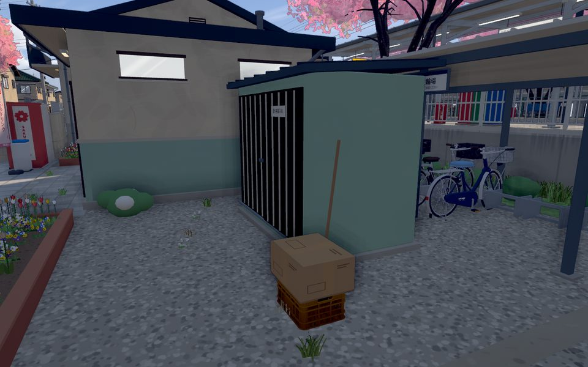
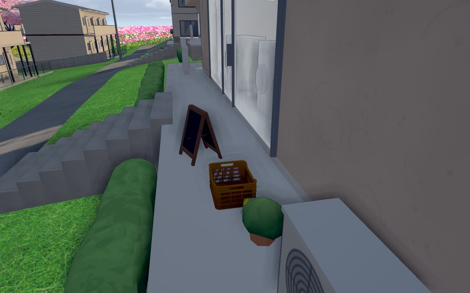
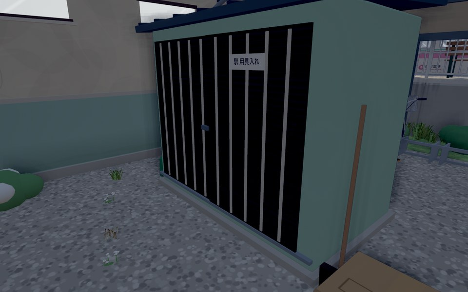
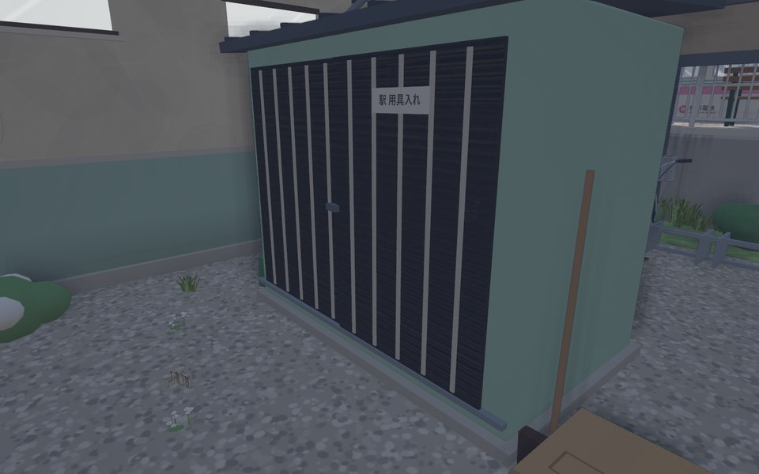
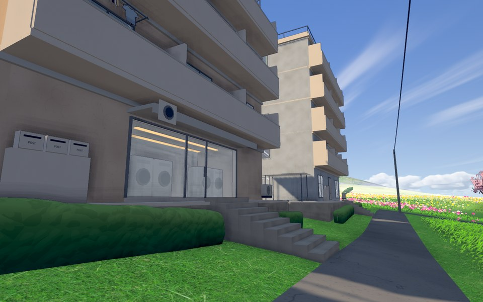
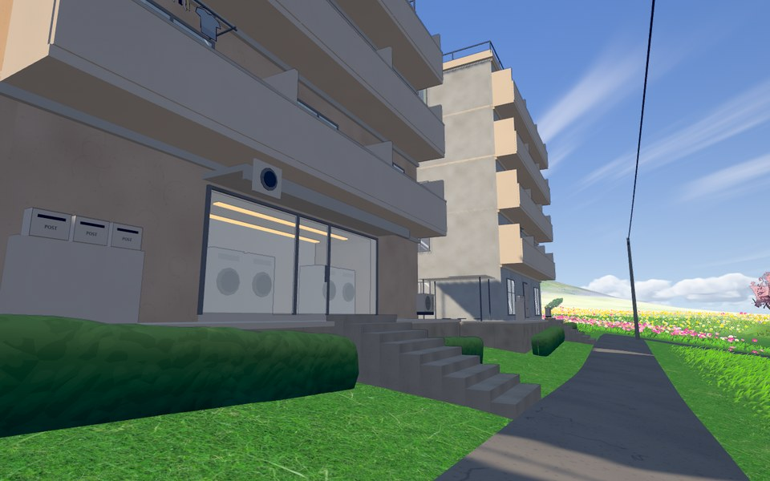

# 第8轮：投影回验与带纹理道具

两处道具已接入，近景裁切已修；**卷帘暗部与深度 AO 条带尚未修好，P2 未验收**。这份记录保留失败和因果对照，`renderOk` 只代表脚本的渲染／行为条件通过。

## 版本与场景

| 记录 | 源码 | 作用 |
|---|---|---|
| original-c8／meadow／ao | `5463714131eba64f83a828ba509c023072f4d4ea` | C酱原 C8：城镇投影、4096 阴影图、深度 AO |
| integrated／targeted／shutter-* | `5cf3ef7d784ff069b87fef9b8051de63b6695e48` | 接入道具；AO 越界采样修补；首轮镜头及材质诊断 |
| final | `38087c701e41279b1d4c5721ba4d7b1e16eef0e9` | 只修两条近景机位，材质与全局光影保持 |

运行使用本机已有 Electron 44.9.0、Three r187、RTX 3060／D3D11，1440×900、pixelRatio=1。JPG 是采集时产生的 960×600 预览，精选 PNG 保留原始分辨率；没有后期修图或挑选最好的一次。固定时间诊断预先规定 warmup、capture-1、capture-2，展示 capture-2，完整报告保存全部记录。

工具棚前增加原比例周转箱与跨筐沿纸箱，原门板替换卷帘材质；洗衣店右平台增加周转箱、矮牌与小盆。城市总计 28,401 三角形，六组原台阶与门口保留。站区有新增堆物碰撞；**镇边仍是不可步行背景**。

## 当前两处近景





站区本地坐标下，服务角眼位 `[28.4,1.612,-27.1]`、看向 `[25,.85,-28.7]`；洗衣店眼位 `[8,6.384808464,-122.1]`、看向 `[5.15,5.144808464,-122.7]`。两者都是支撑面上 1.6m、FOV55。旧镜头的底缘裁切见 [服务角初版](./integrated/23-service-corner.jpg)／[店前初版](./integrated/24-laundry-details.jpg)。[CPU 视锥范围](./analysis/x51-props-v1-readonly-diagnosis.json)不能替代这些实拍。

## 实际性能与退出结果

| 正常基线 | 街道 | 港口 | 鸟瞰 | 店内 | 三／一人称 | 实际退出 |
|---|---:|---:|---:|---:|---:|---|
| 原 C8 | 64.998 | 65.000 | 65.002 | 65.004 | 65.000／65.000 | 1，1 次加载取消 |
| 道具初版 | 65.000 | 65.002 | 62.450 | 65.002 | 65.002／65.000 | 1，3 次加载取消 |
| 镜头修补后 | 65.002 | 64.998 | 61.157 | 65.002 | 64.679／64.997 | 0，本次未记录取消 |

三轮均完成原四机位和真实键盘走路，14／14 行为、look 与 walking 通过。末轮街道／港口／店内及走路 p95=15.5ms，**鸟瞰 p95=30.7ms**；不能称全程无掉帧。初版初始化 944 帧中 39 帧 >20ms，末轮初始化 982 帧中 1 帧 >20ms。这些初始化数字也不能代替鸟瞰或步行段。

原 C8 在本次有帧率上限的采样中约65 FPS，没有观察到 4096 阴影导致的明显帧率下降；它不证明阴影图零成本。新布置正常循环的鸟瞰波动仍未定位。定向冻结场景、只手动渲染的 AO 开／关／开：街道 65.001／65.000／65.001，鸟瞰 64.999／65.001／64.599。它不运行每帧 station／island／walker 更新，不能替代正常基线或分离阴影／道具开销。

[原 C8 指标](./original-c8/measurements.json) · [初版指标](./integrated/measurements.json) · [末轮指标](./final/measurements.json) · [定向检查与原始帧文件索引](./targeted/measurements.json)

## 卷帘压黑：已确认处理层，尚未改全局调色

原贴图、UV、合批后的两门面和真实 GPU 材质／灯光均已检查。ARM 的金属通道均值约0.651／255，不能因为 `metalness=1` 就称为全金属；AO 使用 UV0。分别关材质 AO、法线、receiveShadow，门仍近黑。仅 map 的临时 MeshBasic 能显示纹理，但它只是诊断，**没有进入源码**。[因果图与状态](./shutter-cause/measurements.json)

进一步只改 contrast：**1.05 → 1.0 → 1.05**。两块门内 ROI 的 sceneRT／compRT 原始 HalfFloat 数值三态完全相同。一个固定像素的线性 RGB 始终是 `[.00700760,.00672150,.00731277]`，最终图的 RGB 却为：

```text
contrast 1.05  [0,0,5]
contrast 1.00  [32,37,47]
恢复 1.05      [0,0,5]
```

恢复后的全幅 PNG 与原始 PNG 字节完全相同，三态各自两帧也一致。因此已确认现有 `(col-.5)*1.05+.5` 的负偏移参与吞掉正的暗部信号；不是原图全黑或丢失受光。保留太阳、曝光与当前 contrast 默认值，交给 C酱在后期层处理暗部，同时保护街道和店内现有配色，**不把全局降为1当作已完成的修复**。





[完整数值与恢复证明](./analysis/x51-c8-shutter-grade-v2-analysis.json) · [三态记录](./shutter-grade/measurements.json)

前一个 grade-v1 因外部驱动读取不存在的 `shot.renderer.glError` 失败，零截图；[失败报告](./shutter-grade-driver-failed/grade-report.json.gz)保留。修复驱动接口后另开 v2，未覆盖失败。此前 normal／shadow／Basic 因果运行的部分帧与恢复图不是逐字节相等，因此只作受控状态对照；不能套用 grade-v2 的严格恢复结论。

## 深度 AO：边缘修补与内侧条带分开

固定同机位、同时间、同灯光和深度，AO=.55／0 对照显示店前、楼后新增条带来自 AO 贡献，关闭 AO 后原有投影仍保留。屏幕边缘 ClampToEdge 会破坏相反方向采样的平面对称性，已跳过越界成对样本；原16项分母保留，AO=0时跳过调用。**这项修补没有消除深度断层附近的条带。**





[三机位对照](./ao/measurements.json) · [平面边界 CPU 证明](./cpu/x51-c8-ao-plane-fixed-proof.json) · [新布置 AO 对照](./targeted/laundry-details-world-ao-off-capture-2.jpg)

新布置右墙的大环纹在 AO 关闭后仍在，属于既有 grime，不能混算为 AO 条带。当前店内图也有明显横向暗纹，下一轮须一并复核，不能只看楼后。实际深度为 FloatType／DepthFormat／Nearest，不能仅凭“远处精度低”就给条带定因。

## 资产、行为与资源所有权

九个原文件共3,579,256字节。crate 为5840三角形单primitive，源尺寸约 `.5055×.2541×.4055m`；补官方独立opacity后使用 alphaTest=.5 的cutout，保留原 albedo、法线方向和其他贴图。卷帘仅使用 diffuse／GL normal／ARM 三张1K原图。[固定来源与哈希](./source-map/prop-assets.json)

station 统一拥有七张新纹理；city 拥有独立几何／材质、借用四张crate纹理，先释放city再释放station。早期 CPU 验证包含支撑、失败清理和重复释放；该版本尚未补卷帘 `aoMap:arm`，其[准确差异](./source-map/early-cpu-audit.json)单列，不能声称它测试了最终全部材质。

实际 GPU 定向检查确认：两块门共24个三角形经过合批仍使用目标材质，贴图／UV正常；两个箱子确实提交渲染；city独立资源与共享纹理关系正确；服务角堆物胶囊阻挡与邻侧通路成立；两个detail→walk转换恢复FOV58。没有在活场景销毁city来冒充可恢复的释放测试。

## 运输失败与证据范围

正常场景和各诊断的取消全部保留。单独运输对照 72／72 字节及 SHA256 正确，但 native fetch 36／36运输干净、FileLoader只有13／36干净，23次 `ERR_ABORTED` 导致实际退出1；没有忽略CDP失败来判绿。新JPG／PNG的 FileLoader 压测失败不等于实际场景 ImageLoader 丢图。[完整运输记录](./transport/entry-fixed/measurements.json)

首次运输只有空日志／原生退出，已另用无窗口探针证明 Electron 直接入口的 `require.main` 是 `electron`，导致旧guard跳过host。已修入口判断，**没有证明原生 `0x80000003` 的具体机制**。[入口证据](./transport/entry-probe/conclusion.json)

运输发生在提交前的未提交输入上，config的HEAD5463714不能代表当时脚本；各文件与后续5cf3或冻结审计的关系单列。所有正常／定向场景 manifest 对其准确 Git 提交核验；九个忽略资产对对应 `prop-assets.json` 和本机实际 size／MD5／SHA 核验。原资产、运行profile、缓存均不上传。[总来源](./summary.json) · [逐文件 SHA256](./provenance.json)

## 验证命令与 CI

```text
node scripts/prepare-props.cjs --source=D:/codex/2026-11-16/world-implementation/asset-candidates/textured-props
node scripts/prepare-props.cjs
9 files / 3,579,256 bytes verified

node scripts/baseline.cjs --scene=combined --electron=D:/codex/2026-11-16/world-implementation/runtime-path-probe/electron.exe --stills --output=artifacts/gpu-props-c8-framing-fixed
Electron exited 0
```

每次外部诊断的driver、run-config和完整报告保存在对应子目录。它们使用当前工作区与已有运行时的绝对路径，复制到别处须显式适配路径，不能当独立安装包。

C8、道具初版及镜头修补`38087c7`的Windows实际日志均为1615／1615测试、9类型检查、2构建，全部退出0；[末轮日志摘要](./ci/final.json)对应[Windows job](https://github.com/aa15119557034/agent-review-room/actions/runs/44037615195/job/133884190970)，完成于2026-11-17T07:22:35Z。CI不验证本页的美术取舍。
