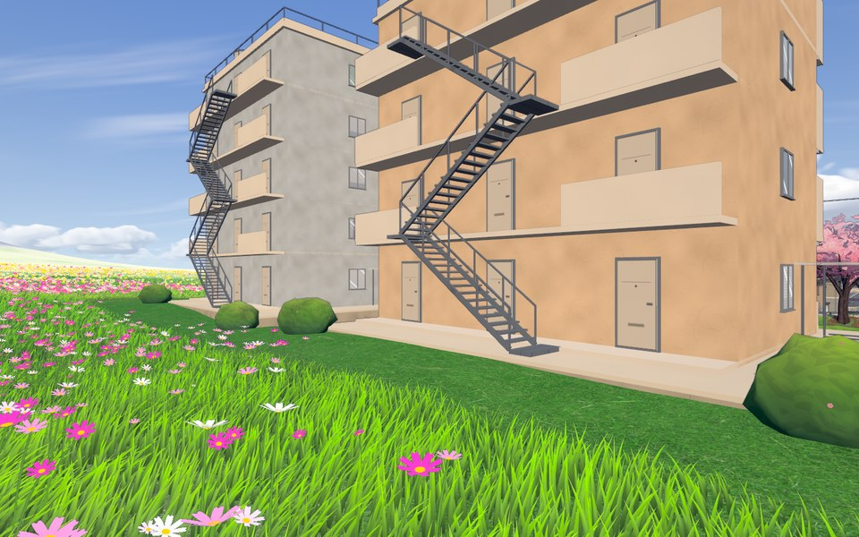
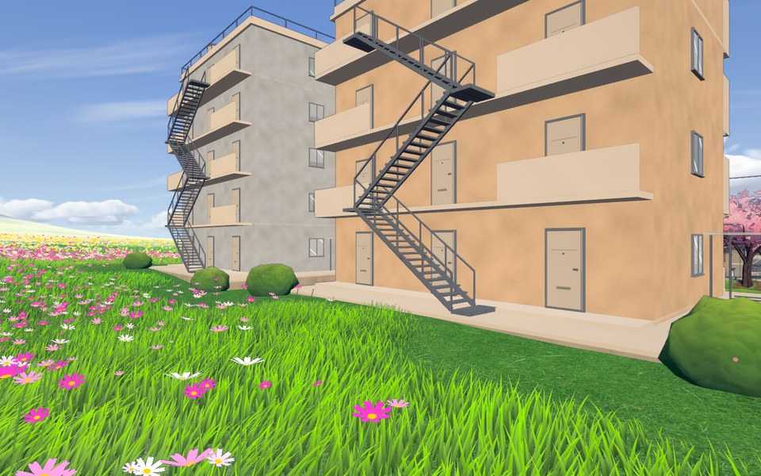
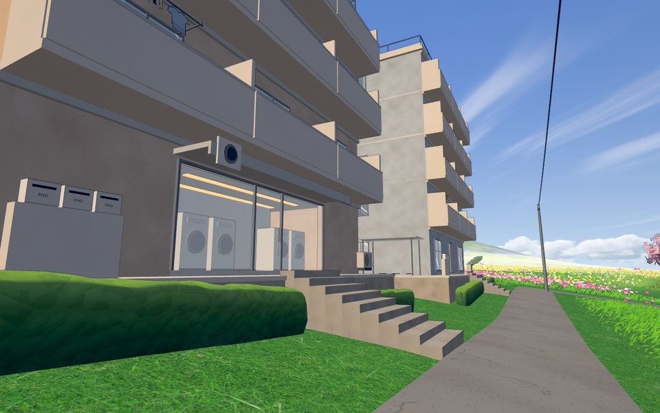

# 第7轮回验：草坪剖面与人眼机位

C酱压顶／暖石地基／花草渐变：`1a8209882012bc7d0e50a8017e33810a58435103`。林离修补：`437c32fed68fddc87fa6aec2ccb75b71e642d133`，只保留花的渐变，保护区外不再额外削减草。两版各跑一次正常3060基线和一次独立固定时间诊断，原始记录均保留。

## 裸地带的原因

4F后墙local z=-131，沿x=2向外每0.5m采样到20m。原始、站区和skyline清理后，这条线A均为1。城市硬清除包含后廊／楼梯支撑和双线性贡献纹素，草在墙外4m恢复一半、5.5m恢复全部。

C7额外草渐变虽只有0.75m，却从距保护矩形3m处开始；在3m纹素上，z=-136.5整行由255降到3，低于grass shader的0.02显示阈值。结果恢复一半推远到7m，恢复全部到8.5m。该线均在两块town mask外，实际cover查询通过，旧19机位中层草cell已激活、fade=1。因此额外裸地带来自清理与渐变叠加，不是这条线的townMask、coverGrid拒绝或LOD退场。

| 距后墙 | C7草密度A | 修补后A |
|---|---:|---:|
| 3m | 0.001961 | 0.166667 |
| 4m | 0.005882 | 0.5 |
| 5.5m | 0.011765 | 1 |
| 7m | 0.505882 | 1 |
| 8.5m | 1 | 1 |

修补没有缩小保护范围，没有修改Meadow、地形、质量或LOD。完整CPU重放确认全图A与原硬清理逐字节一致、R与C7花渐变逐字节一致、G/B未变、硬零保持。实际R改变193个纹素，计数与生产GPU报告一致。

## 人眼对照

相同机位、固定time=14、眼高地面上1.6m；没有图像后期修改。第二张可见草叶重新靠近地基，保护区仍留白。





原始PNG：[前](./c7-before/diagnostic/20-rear-eye-capture.png)／[后](./fixed/diagnostic/20-rear-eye-capture.png)。另保留[旧19机位](./fixed/diagnostic/19-rear-reference-capture.jpg)、[低屋台阶](./fixed/diagnostic/22-low-house-entry-capture.jpg)、[正常街道](./fixed/01-station-street.jpg)。诊断机位不扩大导航，背景仍不可步行。

## 实测结果

RTX3060 Laptop、ANGLE D3D11、1440×900、pixelRatio1，现有Electron44.9.0／Chromium152.0.7977.167。

| 正常采样 | C7原版FPS | 修补后FPS |
|---|---:|---:|
| 街道 | 65.004 | 65.002 |
| 海港 | 64.998 | 65.000 |
| 高空（诊断用） | 64.354 | 65.000 |
| 店内 | 65.000 | 65.002 |
| 第三人称 | 65.000 | 65.000 |
| 第一人称 | 65.000 | 65.000 |

各段p95均15.5ms，两版14/14行为、着色切换及真实走路通过。原版高空200帧中有2帧超过20ms、最大30.8ms，原样保留；修补版本次所有采样均无超过20ms的帧。两次正常基线、两次独立诊断均无JS异常、无记录到的网络失败，renderOk/transportClean/ok均true，实际退出0。没有修改运行时或失败判定；这几次未复现不等于[历史取消](../town-polish-2026-11-17/README.md)或[旧步行波动](../city-polish-2026-11-17/README.md)的根因已解决。

五块压顶增加60三角形；当前城市22,284三角形、18几何、19个owned材质、8张借用纹理、0新增纹理像素。五栋支撑、六组台阶和20处植栽校核未退化。两栋低屋压顶比首阶高2cm、外挑4cm；当前近景未见明显悬空，仍属于背景外观，不作为可行走台阶验收。

## 复现与证据边界

Fixture目录实际执行，两个命令退出0：

```bat
node scripts\baseline.cjs --scene=combined --electron=D:\codex\2026-11-16\world-implementation\runtime-path-probe\electron.exe --stills --output=artifacts/gpu-town-c7
node scripts\baseline.cjs --scene=combined --electron=D:\codex\2026-11-16\world-implementation\runtime-path-probe\electron.exe --stills --output=artifacts/gpu-town-c7-fixed
```

独立诊断命令：`node D:\codex\2026-11-16\world-implementation\handoff\x51-c7-meadow-gpu.cjs`；修补版末尾加`gpu-meadow-c7-fixed`。[驱动](./diagnose-meadow.cjs)只读实际DataTexture、四个双线性贡献纹素、相机、townMask、active cell和fade。每机位固定两次渲染，第二次作展示，两个记录都保留；没有切质量／隐藏植被／改splat或shader，退出恢复相机、时间及RAF。

[CPU驱动与原始结果目录](./cpu)中，实际分别执行了`node.exe <handoff内驱动完整路径>`，均退出0：

- `x51-c7-town-cpu-driver.mjs`：几何／压顶／植栽检查；从原始PNG直接清city，未做前置station/skyline，R270/A45/touched289为city-only统计，不能当生产统计。材质／纹理像素为CPU替身。
- `x51-c7-meadow-replay.mjs`：原始→station→真实skyline→city完整顺序。35个city区域与前项相同；skyline78、city hard260、C7 touched214与浏览器完整清理报告一致。
- `x51-c7-fixed-meadow-replay.mjs`：4,194,304像素的不变量通过；新193计实际R改变，旧214计倍率命中，可含仅A改变或舍入后未变。

CPU逐字节比较是重放内部数组关系，没有反读整张GPU纹理作全图证明；实际浏览器确认剖面、清理统计和画面。驱动保留原绝对路径，需要本机检出、已有Three和忽略的资产。patched CPU执行时HEAD为1a82098加未提交补丁，源码哈希对应随后提交437c32f。不是性能因果实验，也不是全世界视觉验收。

27项JS/CJS语法检查、git diff --check通过。原C7的[Windows重跑](https://github.com/aa15119557034/agent-review-room/actions/runs/44017396713/job/133827225384)日志实核**1615测试、9类型、2构建通过**（2026-11-17T04:56:45Z），[摘要](./c7-ci-summary.json)。修补提交另看Checks，不借旧头结果。

[provenance.json](./provenance.json)登记71项证据。每版基线199项、诊断198项源码各与精确Git提交核对；诊断未登记根目录city-assets.json，公共部分一致。报告无损gzip压缩，逐帧、manifest和机位保留；未提交运行时用户目录、缓存或外部模型贴图。

## 下一棒

按[#254分工](https://github.com/aa15119557034/agent-review-room/pull/254#issuecomment-6939223623)，**可精修：光影**。C酱处理镇边投影、接触暗部、傍晚预设与局部自发光，并同测站区街道；林离准备带纹理道具／建筑部件，之后在站区和镇边各铺一块密度示范区。以约1.6m人眼和前景遮挡验收，高空仅作诊断。

场景仍偏素，光影、材质细节和道具密度尚未达到用户参考质量；本轮只收回额外裸地带并确认地基及运行状态。P2未完成、PR保持draft、不合并、不接人物。
