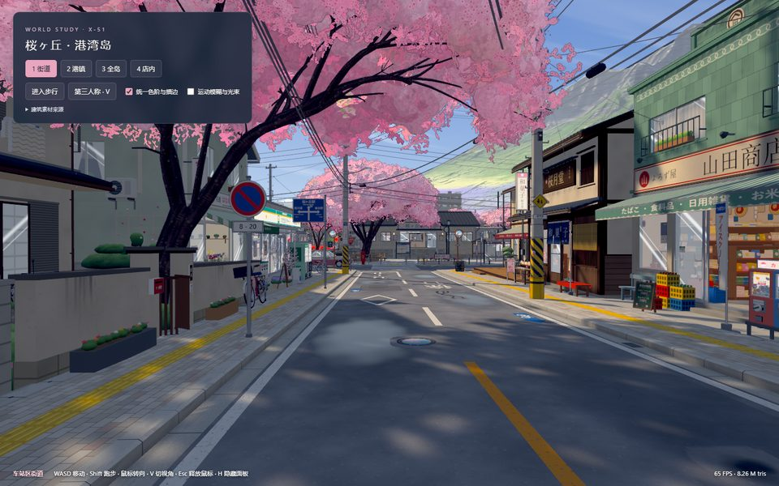
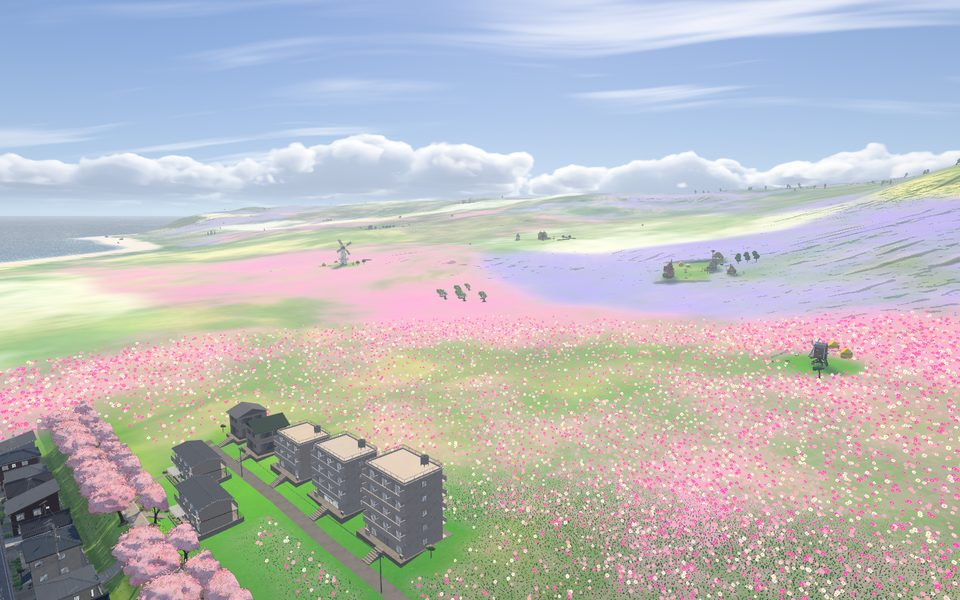
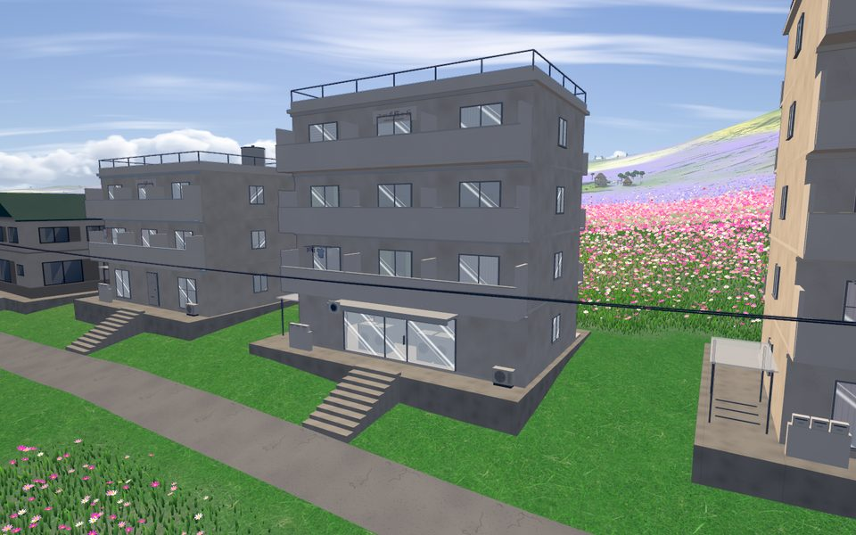
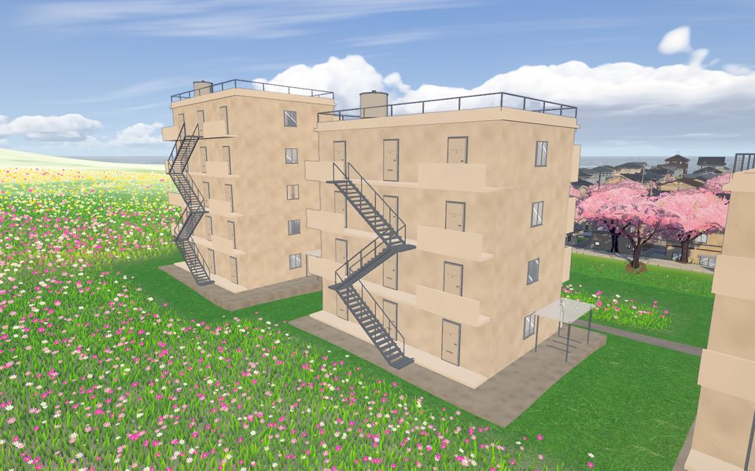

# 第5轮 · 站区套件替换外部城市楼群

源码 `3740d47b9080a3433071ca0f4e5d2ba7ba7a261b`，2026-11-17 02:41:08 UTC 完成本机采集。依据 [C酱第5轮评审](https://github.com/aa15119557034/agent-review-room/pull/254#issuecomment-6935791702)，停止在美式砖楼上调亮度，改用 Sakuragaoka 已有构件搭建真实3／4／5层公寓、首层洗衣店、两栋低屋及相连的小路。

**结构已实装，仍需美术精修。** 街景里的深色硬剪影已减轻，阳台、外廊、钢楼梯和屋顶设施可辨；近景正面仍偏灰，洗衣店玻璃反光过强、机器不易读，镇边排列和地块边界仍显整齐。这轮不标P2或最终风格验收完成。






[店面原分辨率PNG](./18-town-shop-balconies.png)、[后楼梯原分辨率PNG](./19-town-rear-stairs.png)。旧17落地机位原样保留，但替换后主体落在其右边缘，不把它当完整近景验收。18／19是新增机位，实际坐标随报告保存；它们在全部性能采样结束后才拍，不改变原预热和走路顺序。

## 实测

RTX 3060 Laptop GPU，ANGLE D3D11，1440×900，pixelRatio=1；Electron 44.9.0 / Chromium 152.0.7977.167。帧率接近同步上限，不能据此说新增几何没有成本。

| 采样 | FPS | p95帧时 |
|---|---:|---:|
| 初始15秒 | 65.000 | 15.5ms |
| 街道 | 65.000 | 15.5ms |
| 港口 | 65.000 | 15.5ms |
| 全岛俯瞰 | 63.715 | 15.5ms |
| 店内 | 65.000 | 15.5ms |
| 第三人称走路 | 64.356 | 15.5ms |
| 第一人称走路 | 65.000 | 15.5ms |

14／14行为检查、着色切换和真实W键步行通过；两段水平移动分别约9.378m／9.419m，JS异常0，`renderOk=true`。本轮好结果不能覆盖[前一版第三人称57.633及交替诊断中的慢段](../city-polish-2026-11-17/README.md)，也不能证明换楼已修复波动；原因仍未明。没有加预热、纹理降质或碰撞性能补丁。

正常场景初始化仍有1次 menhir `net::ERR_ABORTED`，`transportClean=false`、总 `ok=false`，进程退出1，未改为通过。

## 成本、落地和所有权

- GPU运行报告实际统计：整片新镇边14,950三角形，15个几何、17个自有材质；包括3栋公寓、2栋低屋、2树、2杆、道路与台阶，不仅是公寓模型。原始`modelPrimitives=25`按几何groups计数，不是实测draw calls。
- 借用8张现有纹理，独立纹理0、新纹理像素0。没有另行加载Downtown或高层包；不把旧313 MiB格式估计当作已测VRAM节省值。
- 公寓层高2.85m、总高约10.735／13.585／16.435m；没有拉伸旧两层模型。洗衣店复用玻璃材质，机器和图标由几何表达，不冒用别家文字招牌。
- 五处基础按真实双线性地形格点与边界极值取支撑；6组台阶CPU检查通过，最小净空约3.04cm。两条道路共享边界，未用共面覆盖制造T字接头。仅清理建筑与通路范围的草花。
- `GB.flush`合批；实例、几何、自有材质与Laundry深度材质归city释放，不释放借用的站区图集／渐变。CPU双次dispose检查记录15／15几何、4实例、0纹理释放。全城仍为不可步行背景，不扩大导航或添加人物。

`cpu/result.jsonl`为实际CPU检查stdout；`cpu/driver.mjs`保留原脚本。它使用真实几何构建器、图集矩形元数据和地形，但材质／纹理为未绘制像素的CPU对象，不证明shader、显存或视觉效果。脚本保留原本机依赖路径，并依赖忽略的Petalwake高度图；不能冒称独立可运行的资产包。

## 资源传输复核

本轮目标改为当前仍使用的menhir、boulders、lighthouse，不是退休的城市BIN／GLB。18／18次最终字节长度和SHA正确，native fetch 9／9正常；FileLoader有8／9被报取消，9次读取都到EOF，没有Abort调用或缺终态，输入未变。现象继续与已记录的Chromium终结状态问题吻合；本机运行时未修复，保持失败结果，完整报告在 [transport-current.json](./transport-current.json)。

## 实际命令与证据

Fixture目录运行：

```bat
node scripts\baseline.cjs --scene=combined --electron=D:\codex\2026-11-16\world-implementation\runtime-path-probe\electron.exe --stills --output=artifacts/gpu-town-kit-v1
node scripts\diagnose-asset-transport.cjs --electron=D:\codex\2026-11-16\world-implementation\runtime-path-probe\electron.exe --output=artifacts/asset-transport-town-kit-v1
node scripts\prepare-city.cjs --retired=downtown
node scripts\prepare-city.cjs --retired=highrise
```

前两条退出1，原因见上述保留结果；历史只读审计分别通过26文件／55引用和1文件哈希。27项当前JS／CJS `node --check`与`git diff --check`通过。此处不引用旧CI作为新源码验证结果。

[measurements.json](./measurements.json)保存实际指标、相机、行为和失败；[render-report.json.gz](./render-report.json.gz)为未删字段的完整报告无损压缩。逐帧数据、原图、源清单和CPU证据的哈希见 [provenance.json](./provenance.json)。199项采集源码逐项与上述Git提交字节一致。旧候选的许可、哈希和失败记录均保留。
