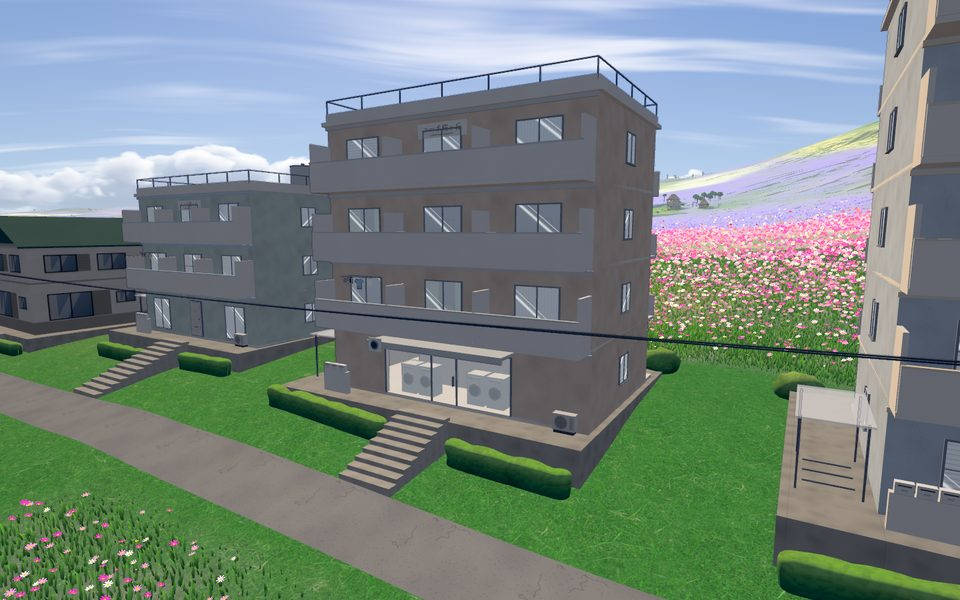
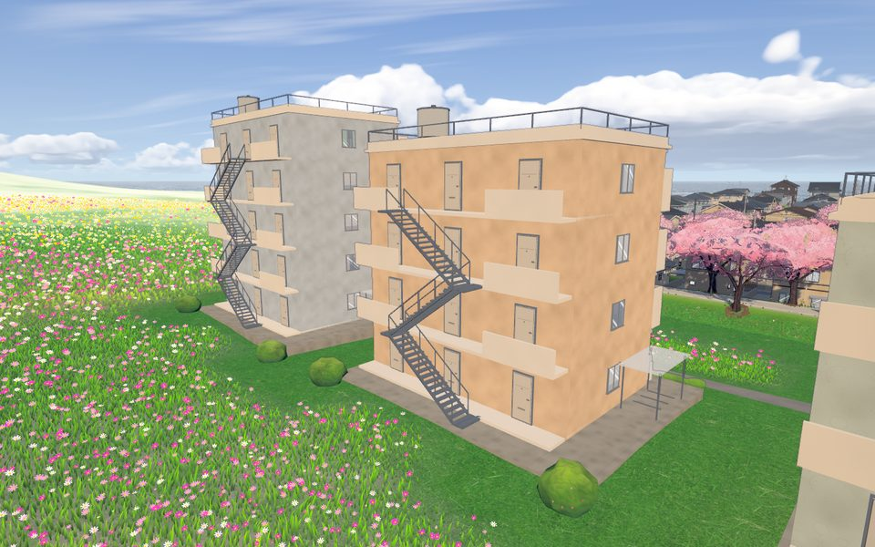

# 第6轮镇边精修与本机回验

C酱的墙色、错位退界、清玻璃及低植栽为 `9a392e23e2d8b6800cc91f2b1995d639f22ff3ca`。林离补齐店面玻璃所有权和新增植栽清除范围，源码为 `05728c277e4606d3e9ffbddde8dccdcbec70407b`。本目录同时保留两版正常运行数据；每版199项采集源码均与对应Git提交核对，修补版另与本机文件核对。

## 本轮结果

- 店铺四台洗衣机可透过玻璃看清，三栋墙色和白色阳台带可区分，后楼梯与台阶保持接地。原固定街道机位仍保留阴影、店内商品和湿面。
- 专用玻璃原先直接从 station 材质缓存创建，未被 city 或 station 的释放集合收集。本轮从 city-local 住宅玻璃另克隆独立 uniforms，保留编译 hooks，由 city 释放；不修改住宅或 station 原型，不新增该店面缓存项。
- 新增20处绿篱／灌木的原生花草清除范围，覆盖其实际完整几何范围。补齐前四株后侧灌木根部的 splat R/A 非零；补齐后完整范围的双线性贡献纹素全部为零。没有移动建筑、台阶或地形。
- 整片镇边仍为22,224三角形、18个几何、8张借用纹理、0新增纹理像素；owned material统计由18变19，因为专用玻璃现在纳入释放集合。`modelPrimitives=28`为几何group计数，不是实测draw call。

| 正常采样 | C6原版 | 所有权／植栽修补版 |
|---|---:|---:|
| 街道 FPS | 65.000 | 65.002 |
| 海港 FPS | 65.002 | 65.002 |
| 高空 FPS | 65.000 | 65.000 |
| 店内 FPS | 65.000 | 65.002 |
| 第三人称 FPS | 65.002 | 65.002 |
| 第一人称 FPS | 65.004 | 64.680 |
| 上述各段 p95 | 15.5ms | 15.5ms |
| 行为检查 | 14/14 | 14/14 |
| renderOk / JS异常 | true / 0 | true / 0 |
| transportClean / ok / exit | false / false / 1 | false / false / 1 |

两次均为RTX3060 Laptop、ANGLE D3D11、1440×900、pixelRatio1，现有Electron44.9.0／Chromium152.0.7977.167。修补版第一人称201帧中有1帧30.7ms；原版两段走路和修补版第三人称均无超过20ms的帧。两次正常运行都留下1次初始化 `boulders.glb net::ERR_ABORTED`，未更改失败判定。这是一对依次执行的正常运行，不能用来证明性能因果或旧步行波动已解决。

## 同机位原图

| 机位 | C6原版 | 修补后 |
|---|---|---|
| 店面与阳台 | [原图](./c6-before/18-town-shop-balconies.jpg) | [原图](./fixed/18-town-shop-balconies.jpg) / [PNG](./fixed/18-town-shop-balconies.png) |
| 后楼梯与植栽 | [原图](./c6-before/19-town-rear-stairs.jpg) | [原图](./fixed/19-town-rear-stairs.jpg) / [PNG](./fixed/19-town-rear-stairs.png) |
| 镇边全景 | [原图](./c6-before/16-city-context.jpg) | [原图](./fixed/16-city-context.jpg) |
| 街道 | [原图](./c6-before/01-station-street.jpg) | [原图](./fixed/01-station-street.jpg) |




## 实际命令与证据边界

在fixture目录执行，两个命令均实际退出1，原因和原始网络失败保留在报告中：

```bat
node scripts\baseline.cjs --scene=combined --electron=D:\codex\2026-11-16\world-implementation\runtime-path-probe\electron.exe --stills --output=artifacts/gpu-town-c6
node scripts\baseline.cjs --scene=combined --electron=D:\codex\2026-11-16\world-implementation\runtime-path-probe\electron.exe --stills --output=artifacts/gpu-town-c6-fixed
```

CPU驱动的实际命令为 `node.exe <下列驱动的完整本机路径>`，工作文件位于 `D:\codex\2026-11-16\world-implementation\handoff\`，已按原字节附在本目录：

- [修补前几何驱动](./cpu/x51-c6-town-cpu-driver.mjs)、[原始输出](./cpu/x51-c6-town-cpu-result.jsonl)、[审计](./cpu/x51-c6-town-audit.json)。
- [修补后几何驱动](./cpu/x51-c6-rootfix-town-cpu-driver.mjs)、[原始输出](./cpu/x51-c6-rootfix-town-cpu-result.jsonl)、[审计与源码哈希](./cpu/x51-c6-rootfix-town-audit.json)：20处完整范围清零，六组台阶报告与修补前完全相同，最小净空0.030398m；植栽根部进入地形约0.026–0.134m，未发现与台阶或既有props重叠。
- [修补前玻璃所有权缺口](./cpu/x51-shop-glass-ownership-9a392e2.json)、[真实Three工厂回归驱动](./cpu/x51-shop-glass-patched-lifecycle.cjs)、[16项全通过的结果](./cpu/x51-shop-glass-patched-lifecycle.json)。执行源码中的clone、shop、dispose片段及真实店面builder；连续调用两次dispose，shop与house各1次、station原型0次。它验证CPU事件与所有权，不是GPU显存测量。

两套几何检查使用真实GB／Frame、地形高度及原始splat；修补前材质为mock，修补后改用真实材质工厂以执行新uniforms，纹理像素和foliage shader仍是CPU替身。没有把密度清零推断为所有视角的视觉穿插验收。CPU结果中的HEAD为执行时的9a392e2加未提交修补；源码哈希与随后提交的05728c2相同。驱动保留原绝对依赖路径，需要本机检出及忽略的Petalwake资产，不能在无资产环境中直接运行。

27项JS/CJS `node --check` 和 `git diff --check` 通过。C6原提交的[Windows CI](https://github.com/aa15119557034/agent-review-room/actions/runs/44011208287/job/133798378237)实际日志为1614项测试、9项类型检查、2项构建通过，完成于2026-11-17T03:41:29Z；[核对摘要](./c6-ci-summary.json)。此结果不代替后续修补提交的CI。

两组 `measurements.json` 保留指标与机位；`frame-samples*.json` 保留逐帧数据；完整 `render-report.json.gz` 可无损解压；[provenance.json](./provenance.json)登记57项证据的原字节长度、SHA-256及压缩前报告哈希，已逐项核对。18／19近景在全部性能和步行采样后拍摄。没有复制运行时用户目录、缓存、GLB或纹理。

## 下一轮仍需处理

草坪与花海之间仍有突兀的亮绿矩形边界，补齐植栽清除后部分范围更宽；侧面灰色地基仍显整块。技术清除范围正确不等于这个边界已经好看。下一轮只精修受保护落脚范围以外的植被过渡和局部地基外观，保留建筑／台阶／道路／植栽脚下硬清除，避免原生花草重新穿入；保持全局光照、曝光、后期和可比机位。

P2未完成，没有把本轮视为Petalwake／绝区零参考质量验收。背景仍不可步行、没有新增可进入室内；花海亮部、道路断头、全岛导航与旧步行帧时波动仍未最终解决。旧[57.633 FPS及交替采样证据](../city-polish-2026-11-17/README.md)和[上轮资源传输失败](../town-kit-2026-11-17/transport-current.json)继续保留，本轮未重复未受改动的专用湿面或传输诊断。
