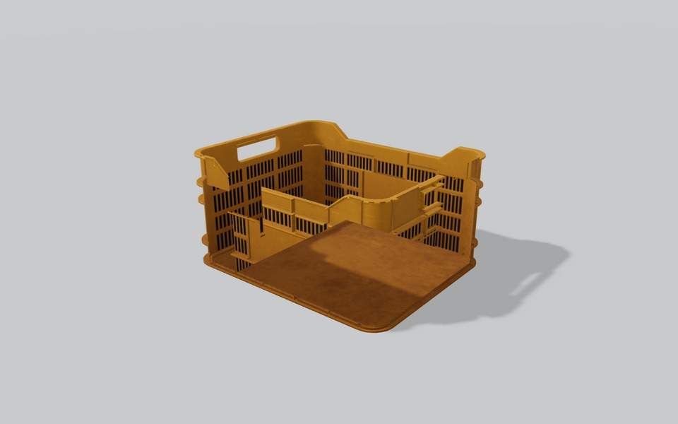
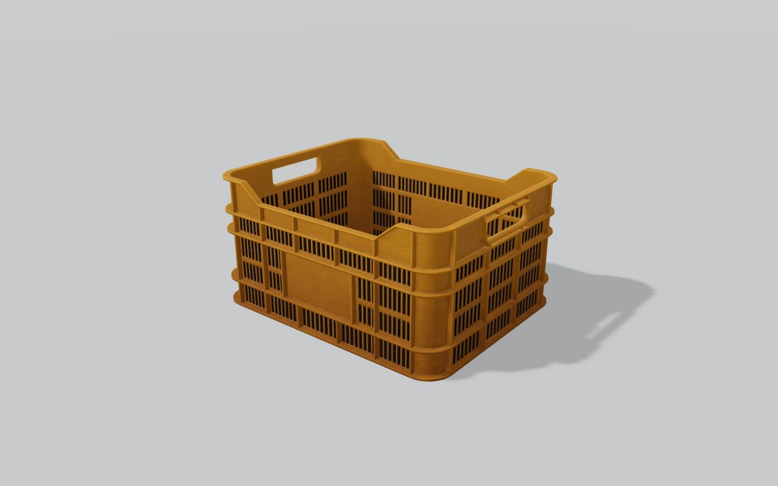
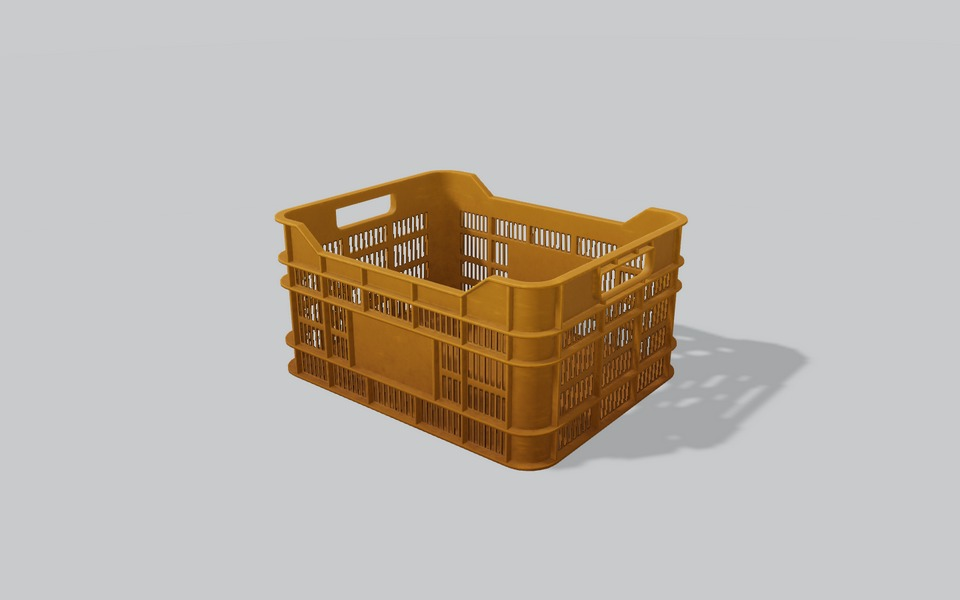
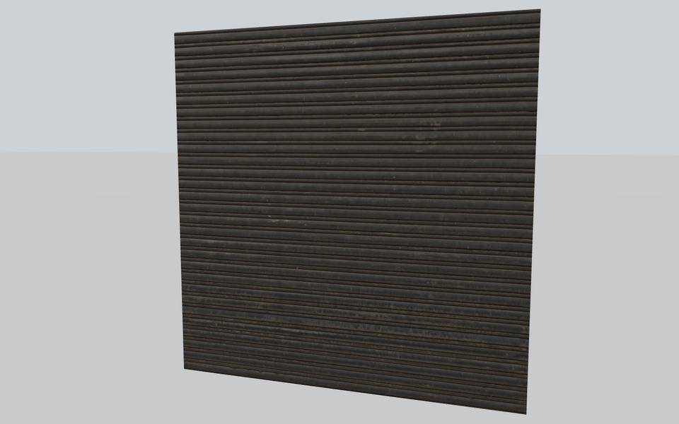
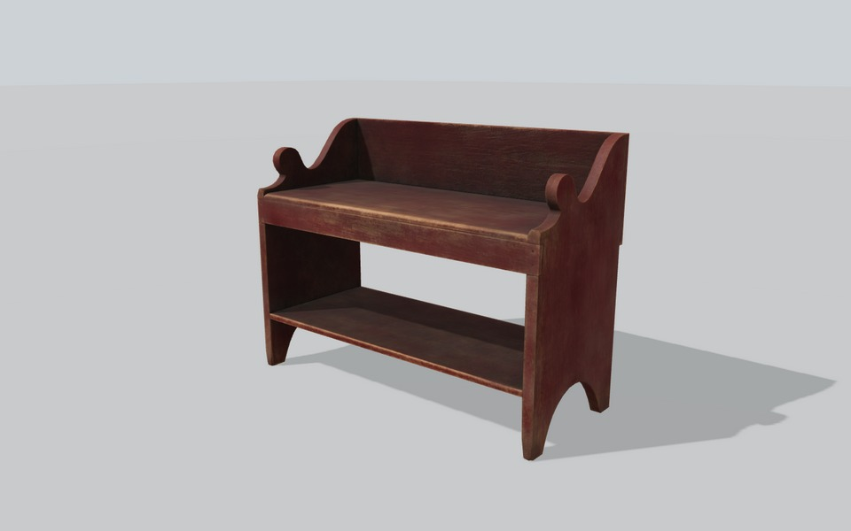

# X-51 首批带纹理道具：实拍筛选与导出遗漏回验

2026-11-17，林离。这里只保存本机独立素材预览和审计，主场景仍由C酱做光影；素材尚未接入站区/镇边示范区，也未做场景FPS验收。

## 取舍

| 素材 | 实际结果 | 本轮判断 |
|---|---|---|
| [Plastic Crate 02](https://polyhaven.com/a/plastic_crate_02) | 5,840三角形，约0.506×0.254×0.406m，官方独立Opacity接回后箱壁及镂空正常 | 保留候选；入场需明确的单资产cutout适配，不能直接使用原glTF材质 |
| [Worn Shutter](https://polyhaven.com/a/worn_shutter) | 3张1K贴图，凹槽和磨损可读，颜色深；这里只在1.37m正方平面预览 | 保留店面局部候选，等待C的光影后与周边toon材质一起验收 |
| [Painted Wooden Bench](https://polyhaven.com/a/painted_wooden_bench) | 630三角形，木纹清楚，深红旧漆、卷边扶手造型偏复古 | 淘汰为本轮现代日式街道示范区道具，保留原图和审计 |

三项作者资产的许可来自[Poly Haven官方CC0说明](https://polyhaven.com/license)。本包中的图片为本机自渲染；没有复制官网预览图。原始13文件共5,552,110字节，补充Opacity 16,785字节；下载来源、作者、MD5和SHA256见[SOURCE-LICENSE](SOURCE-LICENSE.md)、[原始下载记录](download-receipt.json)、[Opacity补充记录](supplemental/opacity-receipt.json)。渲染前后原字节保持相同。

## 周转箱：三种状态同机位

原glTF把材质标作BLEND，颜色贴图为无alpha的JPEG；载入后transparent=true、depthWrite=false，近侧壁明显穿透。

仅改不透明/写深度，箱壁恢复，但黑色栅格仍被封住。不能把这一步当完成。

官方同款的blend清单含独立`plastic_crate_02_opacity_1k.png`，glTF清单漏了它。下载原PNG并核对官方MD5后，给克隆材质加alphaMap与alphaTest=0.5，按glTF UV设flipY=false、数据色彩空间，保留原色/法线/粗糙度/金属贴图和FrontSide。箱壁、背景透视和透光阴影均能看见。没有补AO、改灯光或改变模型原字节。

[完整同机位证据和恢复对照](preview-output/crate-mask-ab/README.md)。相机、光照、曝光、物体变换、非alpha贴图引用一致；实际GPU error均0、无contextLost/异常/失败请求，退出0。恢复原材质后有355个通道的细微变化，最大2/255、均差0.00009182/255，未声称逐像素完全相等。

**可复用经验：** glTF依赖闭合并不保证材质语义齐全；遇到BLEND配无alpha颜色图，先对照作者其他格式的贴图清单。只改opaque会掩盖排序问题并堵死真实cutout意图。这里的修正只针对这一款资产，不能推广成全场景材质开关。

## 另两项实拍

## 证据与限制

- [预览索引](preview-output/INDEX.md)保留首次缺少RoomEnvironment模块的404失败、成功原版预览、opaque对照和官方mask对照。
- [CPU审计](AUDIT.md)、[模型/贴图数据](asset-inspection.json)、[来源汇总](preview-output/source-provenance.json)、[本包文件SHA256](SHA256SUMS.txt)。
- 固定Three r187、已有Electron、RTX3060 Laptop、1440×900。中性灰地面/背景和本地灰度环境，仅用于素材观察；没有据此报告FPS或宣称符合最终场景风格。
- 原glTF的ARM未接occlusionTexture，本轮crate没有额外补AO。以后接入要单独比较，不能与C的全局AO重复压黑。
- 首轮素材并不足以完成两块密度示范区。下一棒接回C的光影提交后，以约1.6m人眼/前景遮挡实装比较，检查道路和店门通行、贴图成本及实际帧时。
