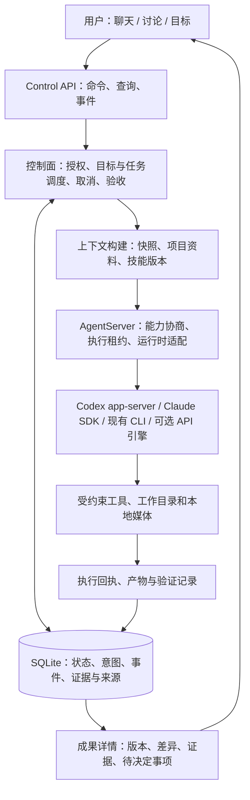

# ADR-007：面向成果的 Super Agent 工作台

- 状态：**提议中；仅文档，不是已实现的契约或运行能力**。
- 日期：2026-11-05；任务：X-38；作者：林离（Codex）。
- 代码基线：main `dd3f7d3`，已包含 #205、#206。研究入口：[生态研究](../research/2026-11-05-agent-ecosystem.md)，实施顺序：[Phase 2 候选任务](../phase2-候选任务.md)。
- 授权依据：江浩要求整合 DeepSeek 的 super agent 思路，深入研究官方和独立团队方案，调整整个项目架构与迭代方向。本文提出对冻结设计的增量修订，不改已有契约，不把合并文档等同于完成运行验收。

## 0. 2026-11-16 修订：应用能力、Harness 与 Super Agent 一起收束

- 任务：X-38b；修订基线：main `8ab6bd36378e69d8355eb0386c55c29ba5504bc5`。作者：林离；请求 C酱（Fable 5.2）评审。
- #207 已合并的是研究、ADR 与候选路线图。Harness 运行时、Super Agent 的通用目标/路由/执行闭环尚未接入；不能把文档合并写成已经实现。
- 新证据：[DeepSeek 应用接口与运行时接入核对](../research/2026-11-16-deepseek-integration.md)。chat-demo、Harness、Super Agent 分别承担客户端参考、执行运行时、协调机制参考三个角色。
- 本次建议：先补结构化结果与可追溯资料，交付搜索/文档/历史导入闭环；固定版本比较 Codex 与 Harness 的执行接入资格，一次只落地一个；把既有 Super Agent 方案落实到同一套 Goal/WorkItem/Attempt 与 inbox/outbox。
- 保留 Electron、main 单写 SQLite、Node 执行节点、既有聊天和讨论入口；以下是逻辑边界修订，不要求创建插件平台、第二数据库或新微服务。契约与实现仍分别提交，本文不批准软件安装或外部自动写入。
- 世界规则内核 #231、取消屏障契约 #244、隔离 profile 契约 #247 已合并；#242、#248—#251 的运行时/客户端/接线在本次核对时仍未合并。后续任务先复核这些实现，复用可用机制，不重复造屏障，也不把世界专用 profile 当成通用工具权限。

## 1. 结论与产品目标

建议将项目从“多模型聊天与协同讨论”演进为：**本地优先、跨模型、能持续完成目标且每项成果有证据的个人工作台**。聊天和讨论继续是入口；真正的工作单位改为可追踪的目标、任务、产物与验收。

Super Agent 是这套能力的用户入口：接住一个目标，安排工作，记录进展，遇到失败调整方法，最后交付可检查的结果。它可以由林离、C酱或汐承担，不新增一个固定人格，不强制每件事都召集三个人。模型负责判断下一步，程序负责授权、并发所有权、状态和证据；二者不能互相冒充。

第一版成功的样子：用户说“调研这个问题并形成改进 PR”，系统能留下来源、方案、工作分支、实际检查结果和 PR；中途暂停或重启后知道做到哪里；用户改方向时停止旧任务并保留已有成果。不会只得到一段“已经完成”的文字。

本项目的差异化应是：三位秘书的持续协作体验、已有订阅与本地节点接入、跨模型独立评审、可追溯的决定、Windows 和本地媒体资源。模型数量、插件数量和自动讨论轮数不作为核心竞争指标。

## 2. DeepSeek 官方提案的对照与修订

**纠正上一版的查找范围。** 用户指的是 DeepSeek 公司 Harness 团队公开的方案，不是项目内汐的架构提案。2026-11-05 补查确认了 [DeepSeek 认证机构账号的中文原文](https://zhuanlan.zhihu.com/p/2099987320443237060)（10 月 31 日）及 [DeepSeek Harness 的 X 英文机器译文](https://x.com/DeepSeekHarness/status/2116857257245987236)（11 月 1 日）。项目 ADR-001 仍有效，但不能用它代替这篇官方文章。

已对照 [官方原型固定版本](https://github.com/deepseek-ai/dsh-superagent-prototype/tree/8c32a9dc5d72c033816c6a8110b37f40cf94fba4)的 README、六份设计/部署文档和三个关键实现。文章、团队内部实例、公开原型与本项目是四个不同层次；文章并未宣称整套能力已公开上线。完整来源及站外补查见 [补充研究](../research/2026-11-05-web-supplement.md)。

| 原文机制 | 采用方式 | 不照搬的部分 |
|---|---|---|
| Router / Worker 分层 | 交互协调保持响应；目标内部计划与执行放在隔离 Worker；普通请求可直接回答 | Router 不成为持有所有任务细节的万能规划者；不额外增加固定人格 |
| Trigger、快慢过滤、Thread 订阅直通 | 提前加入事件身份、去重、已有任务后续输入与新工作准入；程序先过滤，再按需让模型判断 | 订阅只交付上下文，不扩大授权；不把 CI/bot 消息当用户命令 |
| Inline & Spill / Chain of Recall | 近期相关信息内联，大结果存引用；按引用逐层取回且每次校验可见性 | 不以摘要代替原始证据；不把跨月记忆视为已解决 |
| 全双工、多信道交互 | 长工具调用异步，结果和追问能可靠回流；先桌面与 GitHub，用户不用切底层 session | 原文说异步机制尚未默认开启，不据此认定本机 dsh 已支持；不立刻接所有 IM |
| 计算 / 状态 / 执行环境分离 | 保留现有控制/执行分离，状态由本项目掌管；接口预留后台服务演进 | 不默认把私人状态和模型计算迁云；桌面退出后的持续运行仍须另做部署 ADR |
| 独立 Watchdog | 先程序监测进程/超时/租约，再按需做语义停滞诊断；诊断记录不能自己写通过 | 不给监控者无限权限或重试；它不替代验收，也不能解除用户暂停 |
| 主动行动与低注意力成本 | 未请求的新工作先 observe；范围内既有授权直接复用；只通知结果、阻塞或必须决定的变化 | 不把“主动”解释成任意发评论/推送；不复制投机性外部写入 |

原型中最重要的额外证据是 Mandate（工作授权范围）与 Subscription（上下文来源）分离。项目复用 Goal 授权策略引用，不平行建立第二套授权表意；协议契约先明确输入身份、任务归属、来源范围和发送权限。

原型允许结束后的 Ticket 再次打开，并在部分场景仅于恢复时重验授权；本项目保留不可复活的 Run 终态，后续工作另起 Attempt，需要变更目标则生成新 revision。撤销授权后必须在下一次动作边界阻断，不能仅给模型一条提示。原型的全权限 OS 用户执行、基于提示词的合并规则也不采用。合并仍由江浩决定。

## 3. 当前资产与真实缺口

下表保留 11 月 5 日基线的静态核对，行号和规模只代表当时快照；11 月 16 日增量以第 0 节和补充研究为准。两次均不是运行验收。

| 已有资产/缺口 | 基线位置 | 新方案的处理 |
|---|---|---|
| 控制面和节点分离，profile 白名单，快照 hash，事件序号与租约 | ADR-001；`packages/remote-client/src/http-remote-adapter.ts`；`apps/agent-server/src/remote-run.ts` | 保留；不另搭一套无关网关 |
| Approval、Run、Round、Plan 分离；终态不可复活 | `packages/schemas/src/state-machines.ts` | 保留；长任务恢复通过新 attempt/run，不把终态 Run 改回运行中 |
| 聊天、摘要、记忆清单、项目笔记与换窗口 | `main/chat.ts`、`main/notes.ts`、`core/src/discussion/` | 作为上下文来源，不充当任务状态数据库 |
| 资料查询、决定版本、备份恢复 | ADR-006；`main/workspace.ts`、`db/src/workspace.ts` | 复用为成果检索和数据恢复基础 |
| 回答与待执行媒体意图同事务保存 | `packages/db/src/schema-v24.ts`；`ChatService.repairPendingImmersive` | 有可借鉴的持久化意图模式；不宣称已有通用任务队列 |
| 工具权限链路未完成 | `http-remote-adapter.ts:201,482` 声明 permissionRequests=false 并忽略权限事件；`agent-server/src/server.ts:198-200` 返回 501 | **自动写入前的硬依赖**；补握手、请求关联、决定回执、取消与重连，不靠改 Prompt 解锁 |
| Codex parser 主要收最终文本，忽略工具 item | `apps/agent-server/src/parsers/codex-exec-json.ts` | 文本 profile 保持兼容；执行 profile 单独接结构化 runtime |
| 聊天编排集中且包含多种用途 | `apps/desktop/src/main/chat.ts` 约 2070 行 | 新目标执行走独立的内部用例边界；不继续往 chat.send 增加布尔开关 |
| 当前任务列表是已有 run/job 的聚合 | `packages/schemas/src/workspace.ts`、`db/src/workspace.ts` | 不能把列表项直接当可调度任务；新增概念先做契约，不重复存储旧记录 |
| 自动验证与真机体验分离 | `docs/Phase1B-验收记录.md` | Electron 启动、安装与恢复切换、真实节点/GPU仍需按记录验收；CI绿不代替它们 |

## 4. 架构取舍

选择“保留现有控制面与数据库，增加目标执行用例，节点适配成熟运行时”。不整体 fork 另一个应用，不把多个 Agent 框架嵌套成一条执行链。

| 备选 | 优点 | 主要代价 | 决定 |
|---|---|---|---|
| 全量改成 DeerFlow / OpenHands | 现成执行工作台与工具循环 | 迁移 Python/服务栈、身份与本地资料、既有三家 CLI 语义；两套持久化难对账 | 作为参考与可选远端执行器，不替换主应用 |
| 全应用改为 LangGraph / Agent Framework | 图工作流、checkpoint、生态完善 | 现有 Run/Approval 与框架状态双重所有权；重启后副作用仍需自行处理 | 暂不作为全局调度核心；未来复杂工作流可在节点封装 |
| 仅加总控 Prompt | 初期快 | 任务、权限和完成状态全靠模型自报，无法可靠恢复 | 不采用 |
| 自写所有模型工具循环 | 最灵活 | 需要持续追赶协议、压缩、工具调用、鉴权和兼容性 | 不采用为默认路径 |
| 增量控制面 + 可替换运行时 | 最大程度保留现有资产；先做一条真实闭环 | 必须清楚区分任务、模型 turn、工具 action 的状态 | **采用** |

OpenAI 官方区分 manager 的 agents-as-tools 与转交控制权的 handoff；这里优先前者，目标仍有一个负责人。[官方编排说明](https://developers.openai.com/api/docs/guides/agents/orchestration)

Anthropic 把 session、harness、sandbox 分开，说明会话记录不应绑死于一次模型上下文或执行容器。这里吸收这个边界，不照搬云服务部署。[官方设计](https://www.anthropic.com/research/managed-agents)

## 5. 逻辑边界与部署

下图是职责划分，不要求新增对应的包或微服务。

初期仍是桌面 main 单写 SQLite，现有 WriteQueue 和事务负责领域状态。新调度逻辑应可注入 clock、adapter、持久化和事件出口，避免依赖 BrowserWindow；外部执行保持在节点。

大文件复制、解析、索引与模型运行不能长期堵塞主线程。先测 UI/IPC 的 p95 延迟；需要迁移时，将无数据库写权限的文件 worker/utilityProcess 拆出，向 main 申请提交结果。后续若增加关窗后持续执行，再单独讨论控制面服务化、认证和数据目录锁。**当前桌面退出后任务会停止/待恢复；不能在界面承诺 24 小时在线。**

### 5.1 事件入口与响应通道（补查后的提前项）

以下仍是控制面内部职责，不新增独立微服务。Source 将已认证渠道事件标准化为不可变输入，携带 source/eventId、actor、thread、时间、关联项目和原始引用。按 source + eventId 去重；跨渠道同一人的身份只能通过显式绑定确认，不能从显示名或消息正文推断。来源游标仅在事件持久化后前移。

- 新工作：程序过滤来源/自发消息/明显无关事件；规则允许的候选才进入 Router 判断，判断结果与输入/策略版本绑定。observe 只记录“本会怎样做”，不创建执行副作用；不阻碍用户明确请求的正常执行。
- 已有工作：订阅输入直接进入该 WorkItem 的持久 inbox，Router 获得轻量状态而不重复开工。超范围消息退回路由一次；每条输入的所有权和已处理标记可追踪。停止指令有独立控制优先级，不能排在长工具调用之后。
- 两条路径的所有外部动作都重新核验当前授权。消息包含的计划、命令、引用和 bot 建议均不等于权限；同一 Thread 也不意味着同一授权人。
- UI 接收、持久化与取消不等待 Worker 的模型调用。Worker 饱和时，保留控制通道处理改方向和停止，不通过无限超配 Worker 保证响应。恢复/审批等待期间到达的结果只投递一次到当前目标版本。
- Router 输出进入持久通知 outbox，绑定目标、成果版本、目的渠道和幂等键。自发消息不回流触发自己；重放不重复提醒；目的渠道撤销或关闭时不再发送。外部发送成功但本地未记回执仍按第 7 节 unknown 处理，不能因为有 outbox 就声称 exactly-once。
- 待处理事项优先展示真正需要人处理的项。后台状态无变化保持安静；用户主动问进度时给当前证据。指标同时看完成率、通知噪声、人工接力次数和等待时间，而非产出评论数。

### 5.2 独立健康检查与语义复核

健康检查先基于确定性事件检测节点失联、未确认取消、长期无工具/成果进展和资源泄漏。语义诊断仅读取最小授权 trace，提出重试、重新规划或人工关注建议；实际动作仍由原用例执行并受权限、资源和有限重试约束。Watchdog 自身不能修改验收器、复活终态或推送代码。停止的任务保持停止；无新证据的重复重试必须停下。

### 5.3 结构化结果与可追溯资料

现有 DeepSeek 入口只向主控转发正文，新增联网参数不足以承载搜索引用与多轮读链接。契约需要区分四类数据，名称在 P2-C11 定稿：

| 数据 | 责任与使用边界 |
|---|---|
| 展示与审计结果 | 有版本的文本、引用、工具步骤、附件解析状态、用量、结束/失败原因；事件携带 run/attempt、顺序与来源。不让模型声明的结果冒充执行回执 |
| 可分享资料 | 原文件/网页引用、抓取或解析时间、内容 hash、派生版本、项目可见范围；不同模型只共享被授权且可实际取回的内容 |
| 厂商继续对话状态 | provider、账号标识、协议版本、model/session 绑定的 opaque 数据；如 DeepSeek 网页 signature。受保护保存、原样交回同一提供方，不复制给其他模型，不默认进入分享导出 |
| 模型上下文投影 | 从有效资料及允许进入上下文的成功/部分结果构建；失败尝试保留供诊断，不能连同错误模板自动回灌。记录包含/排除原因与输入 hash |

DeepSeek 内置读链接的签名不是网页正文。跨模型研究优先用独立 Search/Fetch/OCR 接口产生可读材料，正文不可取回时明确标缺失；禁止将不透明块或仅一条摘要标成大家都读过原文。签名过期/失效时不能静默丢弃后声称继续使用了同一来源。

`packages/schemas` 定义跨进程格式；节点/可信 main 适配厂商协议；main/DB 负责发布状态和引用；renderer 负责展示。先扩展现有 Snapshot、附件、资料查询与 Run 事件，不创建平行消息数据库。旧节点未声明能力时只走原有文本路径；不向严格 v1 请求硬塞新字段。未知的可选展示块可标注为不支持，未知执行/授权语义必须拒绝；坏协议不能静默记为成功。

### 5.4 能力准入与资源协调

搜索、抓取、解析、ASR、TTS 与可执行 Agent 分别声明能力、限制及版本。声明不是运行成功证据；节点最终准入仍需复核实际 profile、账号、配置与能力。由已有用途的 Run/MediaJob 记录任务进度，派发处统一申请节点并发、GPU或服务账户并发等资源，等待原因可查。复用/扩展需要先经过相应契约 PR，不把云端工具错误地算成本地 GPU 作业。

资源协调只负责排队、占用、释放和优先级；不接管世界活动、媒体作业、聊天或 Goal 的领域状态。停止/改方向绕过工作队列；聊天和讨论优先于世界认知，过期世界请求丢弃。调度优先级不代表可强制中断任意写操作。只有已核对停止或确认隔离的执行者才能释放对应写资源；取消超时保持待核对，不能再放入一个同资源写者。

复用 #244/#247 所定义的账本身份、能力协商与停止证据思路；在实现合并并验证后再评估通用复用范围。HTTP取消响应、SDK等待超时、UI按钮变灰均不等于工具停止。云端服务可能已继续计费或完成操作，断开连接不承诺撤销。

## 6. 领域模型：目标不是一次 Run

以下是契约设计要求，名字可在后续 schema PR 细化；本 PR 不定义 TypeScript 类型。

| 概念 | 内容与所有权 | 与现有数据的关系 |
|---|---|---|
| Goal | 用户原意、范围修订、验收清单、负责人、关联项目、授权策略引用 | 可从 Conversation/Topic 显式创建；普通聊天不自动变长期目标 |
| WorkItem | 具体交付物、依赖、读写资源、输入版本、当前 attempt、验收条件 | 引用已有 Plan/Decision；不复用只读 WorkspaceTaskItem 的含义 |
| Attempt | 一次尝试的 runId、runtime session/turn 映射、失败原因、资源租约代次 | 复用 Run 生命周期；重试创建新的 attempt 与 Run |
| ActionIntent / Receipt | 执行前参数摘要与幂等键；执行后的工具结果、外部记录 ID、观察状态 | 和模型文本分离；可信执行器写入，不接受模型伪造成功 |
| ArtifactVersion | 文档、代码 patch、图片等产物的 hash、来源、关联 commit、验证状态 | 复用图片/文件引用，保留旧 Plan/笔记版本，不把文件正文重复塞进事件 |
| Verification | 针对哪个产物/commit、什么检查、实际命令、退出码、输出摘要/位置 | 系统检查与人工验收分开；模型评价只是一项辅助证据 |
| ContextManifest | 输入引用、内容 hash、笔记/技能版本、包含与排除项、实际模型 | 扩展现有 Snapshot 与记忆清单，避免另起一套 Prompt 数据库 |

关系：Goal → WorkItem DAG → Attempt → Run；Attempt 产生 action receipts、artifact versions 和 verification。一个产物可以来自多个任务；关系表允许多来源，不压成单一 parentId。依赖图写入时检查环；“等待某份产物”必须绑定版本或明确接受最新版本。

### 状态与完成判据

- WorkItem 候选状态：draft、ready、running、waiting_input、blocked、verifying、done、failed、cancelled。合法转换由 schema 定义。
- 只有依赖完成、输入仍有效、授权可用、资源可占用的 ready 项才可派发。
- 模型声称完成后进入 verifying。检查实际成果与验收清单，全部必需项有证据才 done；不适用的项要有理由，未运行不能记 pass。
- ready/running 等待的具体原因必须可查询：依赖、配额、节点离线、人工输入、资源锁，不能共用一个永久转圈。
- 修改目标产生新 revision；未启动的旧计划重新评估，运行中的冲突任务取消，旧产物保留且标不再满足当前目标。新 revision 不覆盖旧授权和结果。
- Goal 完成由必需任务及目标级验收共同判定；达到步骤/时间上限意味着暂停或失败，不是成功。

## 7. 一条可恢复的执行链

1. 收到目标，固化用户要求和已有授权，生成带输入版本与验收条件的任务计划。
2. 在单个写事务内校验依赖、claim 资源、创建 attempt/run 和待派发意图。提交以后才调用节点。
3. 节点验证 profile 能力、工作目录、输入 hash、租约代次和策略，幂等接受。远端 request 不携带任意 shell 启动命令。
4. Runtime 的工具请求进入策略检查。已授权范围内自动运行；需要新决定的才显示具体动作、参数和影响。
5. 执行器产出有来源的 receipt；产物先写临时位置、hash 校验，数据库发布引用。数据库事件和状态变更同事务提交。
6. 独立验证器核对产物；成功才能解锁依赖。完成通知携带可打开的成果与未完成项。
7. 重启后先对账节点、意图与回执，再决定继续、另起 attempt 或等待核对。不能把“未收到响应”解释成“没执行”。

### 故障窗口必须有确定行为

| 故障窗口 | 预期恢复 |
|---|---|
| 意图已提交，尚未发出请求 | 用同一 intent/idempotency key 派发 |
| 节点已接收，响应丢失 | 查询同一 runId；已有任务不再创建第二份 |
| 写文件成功，回执未持久化 | 检查目标路径对应的预期 hash；不一致进入核对，不盲目覆盖 |
| 外部评论/发布请求超时 | 按外部幂等键或可查记录对账；无法证明时标 outcome_unknown，禁止自动再发 |
| 执行终止但成果上传中断 | 继续取回同一 hash 的产物或明确 artifact_missing，不把纯文本当文件成果 |
| 调度者重启，旧执行者仍活着 | 先停止/隔离旧执行者或核实租约失效；新 attempt 不同时写同一工作区 |
| 取消发生在工具执行期间 | 取消待授权请求、阻止新动作；等待终止回执；已产生的外部副作用不能声称已撤销 |
| 回放收到重复/迟到事件 | 按 node/attempt/seq 去重；终态不复活；旧 lease 结果不得更新当前 attempt |

“恰好一次”只对本地受事务和唯一约束保护的状态/终态记录成立，不对任意外部工具作跨网络保证。采用至少一次派发 + 幂等 + 核对，明确保留未知结果。

现有断线租约继续负责连接丢失后的停机。新增资源 fencing/代次只是本地受控提交的保护：任意 shell 或外部服务无法天然识别代次，因此还需要进程确认停止、独立工作区及外部副作用闸门；不能声称加一个 token 就杜绝所有双写。

## 8. 执行器接入与协议策略

| 接入 | 推荐用途 | 上线条件 |
|---|---|---|
| 现有 CLI text profiles | 聊天、讨论、已有只读评审 | 原有配置与隔离保持；旧节点照常可用 |
| Codex app-server | 第一条可交互工具执行 spike | 固定本机可用版本；thread/turn/item 映射；审批、取消、重连事件测试；实验能力显式协商 |
| Claude Agent SDK | 第二条原生执行器 | 优先验证 TS 接入以配合现有 Node 节点；Python 实现用于对照；hooks/canUseTool 与本地策略一致；登录和可用认证方式实测 |
| DeepSeek 现有 CLI | 保留当前服务与角色 | 不推断工具协议；接入新执行能力先实测结构化事件与取消；API 路线单列成本和凭据配置 |
| OpenAI Agents SDK / Pi / Deep Agents / Cline SDK / Letta Agents SDK | 自定义 API 工具代理的候选引擎 | 一次只做一个可替换 spike；不叠加多个自主 loop；必须通过统一行为验收 |
| OpenHands / DeerFlow | 将来复杂远端工作环境 | 作为一个执行节点，保留本项目目标/权限/验收所有权；不双写两套任务真相 |

- 能力协商区分 session resume、steer、tool events、approval、artifact retrieval、usage、filesystem isolation；不支持就是 unsupported，不静默降级到全放行。
- 模型可用性、强度、视觉能力继续来自节点实测。未知配额保持未知；不把订阅额度换算成伪精确 API 费用。
- 原生 runtime 的 session ID 不等于本项目 conversationId。恢复原生 session 前复核工作目录、策略、账号、输入版本；跨模型交接使用可审计交接包，不复制对方隐式内部状态。
- MCP 用于工具/资料，ACP 用于宿主与 Agent 交互，A2A 用于跨系统 Agent 协作；三者不能相互替代。近期优先原生协议和受限 MCP；ACP 适配后续按兼容性收益引入；无跨组织需求时不加入 A2A。
- 新权限/工具语义需要版本化协议或明确 capability negotiation。旧节点缺能力时拒绝执行任务，不能给严格 v1 请求塞字段使旧节点意外失败。

### 8.1 Harness：固定版本的独立执行节点

本次检查 Harness `39163dd30f703a79079e2d2446545cff3c453738`。优先研究其 [TypeScript SDK](https://github.com/deepseek-ai/deepseek-harness/blob/39163dd30f703a79079e2d2446545cff3c453738/packages/sdk/client/README.md) 的 stdio JSON-RPC；由 AgentServer 启动子进程，主应用不嵌入 Cordis 插件树，不接管已有个人 DSH_HOME。

| 接入问题 | 本项目要求 | 固定版本的证据与待验证项 |
|---|---|---|
| 谁拥有目标 | 本项目拥有 Goal/WorkItem/Attempt、验收与发送权限；Harness只拥有一次尝试中的模型/工具循环 | 不同时启用另一个通用目标循环或 Super Agent bundle 来调度同一个任务 |
| 结果属于谁 | 初始方案每 Attempt 独立进程/Session；请求先订阅，再记录入队 ID、持久接纳及根/子事件的对应关系 | SDK 的 `finalResponse` 是接纳到 idle 区间里的最后正文，不保证只由当前 prompt 产生；不能直接当某个任务的交付物 |
| 怎么停止 | 适配器持有整个进程树；有界关闭、核对退出，才确认停止。未证明停止时保留占用与 unknown 状态 | 该版本 SDK **没有 runtime cancellation request**；请求超时或观察回调失败只停止本地等待。需要关闭 Harness；Windows进程树与外部作业仍须实测 |
| 谁批准工具 | 启动前安装 SDK 请求处理器并启用 `approvalRequests`；每条请求绑定本项目动作、当前策略及 Attempt | SDK提供 `approval/request`，但本项目权限中继仍返回501；两端都接通并经故障测试才声明支持。无处理器、断线、过期决定均不能变成允许 |
| 如何恢复 | 固定 runtime、profile/patch hash、独立 home、工作目录、原生 session ID；先对账旧执行者 | `resumeSession`恢复历史，不恢复shell/浏览器等外部进程；缺失/占用/不兼容必须报错。无法安全恢复时显式创建新 Attempt 与交接包，不伪装原会话已恢复 |
| 插件与权限 | 明确列出所需插件、工具和权限；运行中不自动安装插件、不热更新策略代码；敏感环境变量只按需提供 | `sdk` 与 `sdk-minimal` 是不同组合；不能凭名字推断哪个更安全，也不能把上游沙箱当作 Windows 的全部隔离保障 |
| 费用与子任务 | 一次尝试的调用次数、并发、时间、可得到的用量统一记账；初期关闭未验证的内部委派 | SDK `maxTokens` 是单次模型请求限制，不是整项任务金额上限；取消也不能保证远端停止计费 |

资格报告须逐项标已实测/不支持/未验证。任一权限、停止或结果归属门槛失败时，只保留隔离的只读试验。先在同样的任务和工具范围下比较当前节点、Codex app-server候选和Harness候选，再选第一种正式执行器；不因上游已有SDK便默认同时引入三个框架。

普通任务输入优先通过低层 `client.prompt` 入队，配合预先订阅、接纳回执与受管理后代的等待/对账；上层 `run()` 会解析原生命令，不能直接承接任意文本作为权限/goal/plan控制。原生命令只允许来自本项目受控命令映射。低层入口仍有运行时技能识别，最终工具与配置权限必须由程序限制，不能仅靠输入方式。根会话idle或SDK返回均不替代Attempt验收。

### 8.2 Super Agent：复用协调机制，保持一个任务事实来源

原型 `8c32a9dc5d72c033816c6a8110b37f40cf94fba4` 与 11 月 5 日研究时相同。本次优化的是**本项目的采用方案**，没有发现应宣称为新发布的原型实现。原型仍标明研究用途、并非正式产品。

| 原型概念 | 本项目落点 | 验收重点 |
|---|---|---|
| Trigger / Thread / Intake | 已有来源记录的扩展 + P2-C09/S06 的GitHub输入 | 可信actor来自连接器；持久化后推进游标；重复事件不二次开工；私库404表示访问未知，不当作已删除 |
| Mandate / Subscription | Goal授权策略 + 独立上下文订阅 | 订阅不授权；停止/撤权进入独立控制通道；后续评论不复活已取消Run |
| Ticket / Assignment | WorkItem / Attempt / Run及原生session映射 | 不引入第二套Ticket状态库；PR已合并是外部事实，不自动证明所有验收都通过 |
| Assessor / Executor | 轻量Router + 独立Worker | 用户明确请求直接按已有范围处理；推断的新工作先observe；控制交互不被长工具占住 |
| Effects / Outbox | 事务内待办意图，提交后执行，记录外部回执 | 成功后本地断电须能核对；无法核对则unknown，不自动重复发评论；自己的通知不触发循环 |
| Watchdog / Report | 确定性故障检查 + 有限语义诊断 | 模型报告不是验收；无新证据不无限重试；暂停不能被诊断解除 |

实现顺序固定为：GitHub事件只读回放 → observe与既有任务订阅 → 授权范围内的单任务执行 → 可核对的结果通知。每步有独立开关与验收；先复用授权、来源、事件、Run和备份，实际缺少的领域对象才新增。原型本身的常驻部署、全权限OS执行、热改提示词/策略与自动扩展工具均不进入本轮默认路径。

## 9. 授权与少打扰的自主性

目标级授权记录可作用于后续符合范围的步骤，避免每次读文件、运行允许的测试都弹窗。策略包括项目/路径范围、允许工具与动作、网络目的地、有效期、重试边界、并发上限，以及是否允许推送/发布。用户已有授权应被复用，不能被模型遗忘后反复索取。

审批绑定具体 action 参数摘要、输入/产物版本、目标修订与 policy revision。内容变了要重新校验；不能把“同名工具”视为相同动作。服务端验证授权归属，节点再次执行能力交集：目标策略 ∩ 节点策略 ∩ 当前调用权限。子任务不能扩权。

聊天 profile 继续无工具；用户提出执行目标时进入显式执行用例并展示状态。外部资料、技能正文、子 Agent 输出均不能改变权限规则。技能脚本是代码，目录发现不等于安装或执行许可；加载固定版本、明确来源和工具需求，不自动跑安装命令。

Windows 的 Git worktree 仅隔离工作文件，不是安全沙箱；共享 .git、进程权限、凭据和网络仍需限制。低权限节点、可访问目录、环境变量白名单保留。密钥只在可信 main/节点代理中读取；执行子进程不继承整份主进程环境。

## 10. 多 Agent 协作：按价值使用

默认一个交互负责人；每个工作项先用一个执行者，不同独立工作项可按资源与授权并发；遇到信息可拆分、独立评审或昂贵判断才增加专家。复杂度的代价包括协调延迟、上下文漂移和结果合并，不只是 token。

- 研究任务可拆“官方实现”“独立团队”“本项目适配”；各自提供来源与不确定项，再汇总冲突。
- 代码任务按文件/资源所有权拆分；契约先合并，再并行消费者。每个代码写任务独立 worktree，合并冲突进入整合任务；共享 GPU/浏览器登录态不以分支隔离代替互斥。
- 审查者基于同一 commit、需求和实际证据独立形成初步结论，再看另一位意见；“三人都同意”不是 correctness proof。
- 子任务输入带范围、成功条件、可见资料与工具范围；输出带结果、产物引用、证据和未完成项，不回灌全部聊天。
- 初始委派深度上限建议 1；并发数来自节点能力与任务授权，默认小规模。嵌套 runtime 的内部子 Agent 同样计入预算/权限，否则不能启用该能力。
- 失败先分类再重试：临时网络错误可退避；配额/能力/授权错误等待条件变化；重复无新证据的循环触发停滞状态。阈值是可评测配置，不写成模型人格规则。

## 11. 上下文、记忆和成果

保留三层不同来源：个人身份与记忆留在各自节点；项目知识与决定属于共享项目；任务工作记忆由目标、当前输入和进展组成。共享项目资料不能顺带公开另一位秘书的私人记忆。

上下文按需读取：目标与约束 → 当前任务与依赖产物 → 相关代码/资料 → 已验证进展与失败教训。原始消息/文件是事实来源，摘要是可失效的派生数据。来源撤回、权限收紧、commit 变化时，索引、摘要和下次输入都重新判可见性；审计历史与给模型/用户展示的可见性分开。

上下文缓存按输入、工具集与策略版本记录；稳定前缀和确定性序列化只作为性能优化，策略撤销与来源变化必须使相关缓存失效。记忆学习分别评测“使用已有记忆”和“生成/清理记忆”；技能或 harness 的改进先形成候选版本并跑留出任务，不热改控制面。

项目记忆条目需要来源、适用范围、更新时间、有效性和被取代关系。“Agent 说做过”只能先记 claimed；工具回执说明做过某个动作，检查结果说明某项条件通过，二者都不能自动证明整项业务目标正确。主观评价与事实分开。

搜索先建立中文、代码标识符和撤回场景的基准，再决定 FTS/tokenizer 或混合检索。不能直接假定 SQLite 默认分词器解决中文，也不能用 Mem0 的托管服务成绩承诺本地效果。向量索引是可重建的派生物；恢复、删除和权限过滤必须覆盖它。

产物界面从“设置里的资料”逐步提升为项目工作区：显示当前版本、预览/差异、来源、检查结果、待决定事项和后续动作。代码有 patch/commit；报告有来源和未覆盖问题；图片有生成参数与引用文件；文档能下载或继续编辑。可执行 HTML/SVG 等预览必须隔离，不带 Node 或主应用凭据。

### 11.1 新应用能力的数据、导入与计费边界

- 云端搜索/解析的内容上传由服务选择和操作范围明确授权。密钥仅在可信main/节点读取；chat-demo的浏览器localStorage密钥方案不进入本应用。资料中的指令作为不可信内容处理，不获得执行权限。
- 原文件保留，解析结果附来源版本与hash。撤回、替换资料或收紧权限时，搜索、摘要、交接、导出和下一次请求重新判断；厂商文件ID失效可重传授权原件，缺原件就显示缺失。
- DeepSeek历史导入先预览与校验，暂存后事务提交，使用来源归档hash与外部ID做幂等合并。保留分支、时间和来源；缺失原件显式标记，不自动执行导入对话中的命令，不覆盖现有聊天、不自动生成个人记忆或已完成任务。格式不支持/损坏时保留原数据；未知块可在受限源归档中保留，显示与上下文不默认使用。
- 数据升级采用增量表/字段及可重建投影；旧聊天无引用时保持旧语义，不伪造来源。备份覆盖新资料与索引所依赖的原件；分享导出不包含密钥、可恢复账号会话的opaque状态或其他人的私人记忆。旧版本不能读的新库要明确拒绝，回退使用验证过的备份，不强行降级数据库。
- 云端ASR/TTS为独立可选服务，先修订现有本地语音契约。能力明确表达音频格式/时长、是否流式、音色和语速；DeepSeek两种预置音色及不支持语速控制不能伪装成现有本地角色声音。不得将本地失败静默切为上传云端。
- 用量分别记token、搜索/抓取次数、解析页数、语音时长/计费字符及计价版本；缺失保留unknown。应用接口中的max_tokens、Harness的maxTokens均不是整个任务预算。内置托管搜索无法逐次控制服务端动作时不能宣称硬金额上限，需要硬次数上限的研究任务优先选独立Search/Fetch调用。

## 12. 迭代方向与验证闭环

11 月 16 日顺序修订：阶段0可靠性核对 → 阶段1A的结构化结果/共享资料/历史导入 → 阶段1目标与证据 → 阶段2单执行器及事件接续 → 阶段3按收益选择第二执行器 → 阶段4知识、技能及可选云端语音。两种执行器的只读资格研究可提前，不提前开放写权限；世界现有任务按自己的验收推进，不等待Harness，也不因本提案而扩权。任务依赖和退出门槛见候选任务板。

近期三个场景，按顺序验证：

1. **研究与决策**：资料收集 → 独立观点 → 冲突与证据 → 可追溯方案。充分利用现有讨论室、决定版本和导出。
2. **仓库修复与评审**：目标 → 独立工作区 → patch → 真实检查 → 独立审查 → 已授权的 PR 操作。先完成一种 runtime，再加第二家。
3. **文档成果**：项目资料 → 报告/表格 → 视觉/结构验收 → 可编辑交付。先一个格式；解析、模板和资源许可单独验证。

后续再考虑定时维护、远端持续执行、手机控制和更多业务模板。QQ/手机人格实验、完整低代码画布、插件商店、全自动自我改写和云端多租户不进入这条近期主线。

把“模型+运行时+提示词/技能+策略”视作一个可版本化候选。用同一任务集比较现有模式、单负责人模式、独立多 Agent 模式；固定输入版本和可用工具，记录完成率、误报完成率、干预次数、恢复成功率、延迟与实际可获得的用量。结果来自多次试验和人工抽查，不从仓库星数或厂商 benchmark 推导。

产品默认保留本地最小 trace：goal/task/attempt/run/action/产物关联、事件时间、结果和错误分类。Prompt/工具正文按原有私密边界留存；可选导出前脱敏。Langfuse/OTel 作为诊断出口，不能成为运行成功的依赖；不要默认把个人记忆或私有代码发到第三方 tracing。

## 13. 兼容、回退与停止条件

- 采用新增表/引用与显式新用例；旧聊天、Round、Plan、Snapshot 保持可读。旧记录无可证明目标时不自动生成“已完成目标”。
- 数据迁移在真库副本验证，先备份；备份清单纳入新增产物与事件，缺失内容明确报错。回退应用不自动降级数据库；只读打开或恢复升级前副本。
- 每个新 runtime 可独立停用，仍能查看历史和产物；停用前停止新派发、处理在途回执，不能只隐藏按钮留下后台写任务。
- 如果接入要求绕过现有登录/权限边界、依赖 Windows 不支持的沙箱、或使旧功能必须迁移至新云服务，暂停该接入，保留当前 runtime。
- 若多 Agent 在固定任务集上没有稳定收益，就保留单执行者 + 独立审查，撤掉无收益的自动协商步骤。

## 14. 本轮交付边界

本轮交付架构提案、源项目证据和有依赖/验收的候选任务板。没有安装第三方框架，没有引入新服务，没有运行付费 Agent benchmark，没有启用自动工具执行。DeepSeek 官方文章与原型已定位并对照，但本轮未运行原型；本地 Electron 和真实设备验收问题不因文档而关闭。
