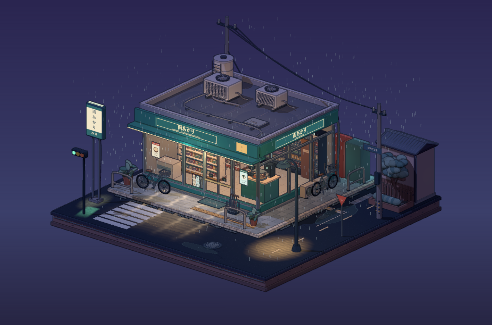
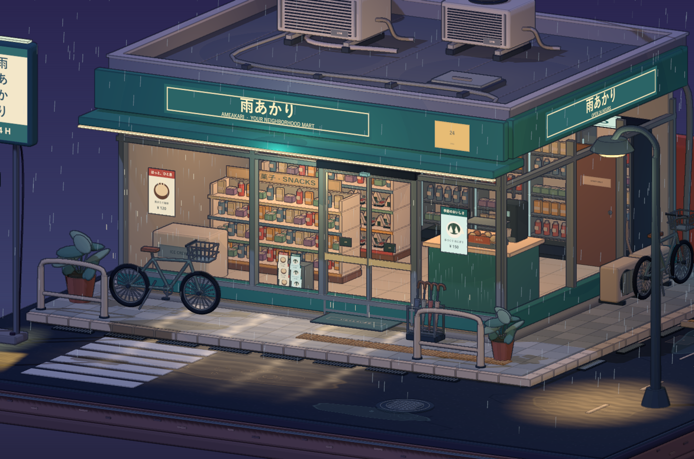
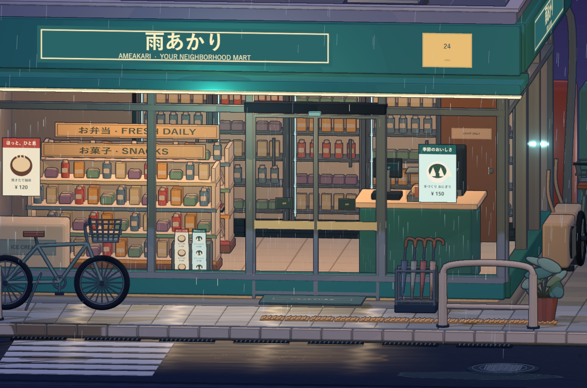
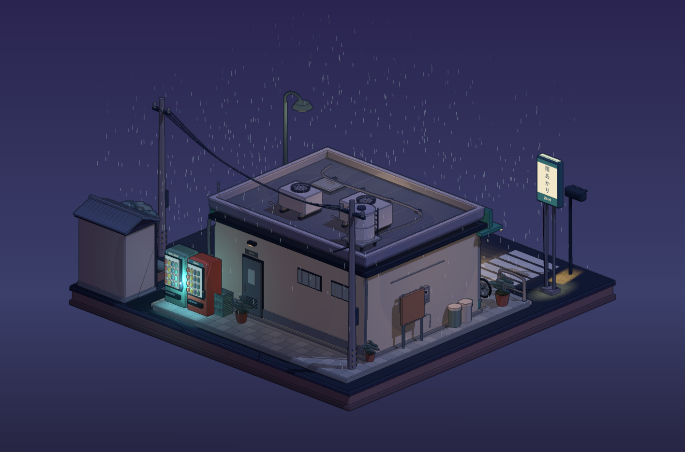
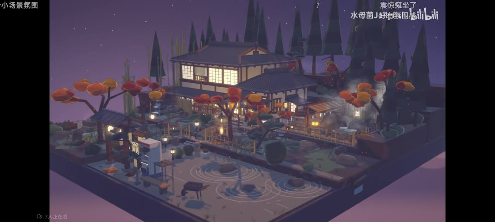

# X-50：雨あかり · 三渲二雨夜便利店

任务与协作：[issue #252](https://github.com/aa15119557034/agent-review-room/issues/252)。2026-11-16，林离。

## 本轮范围

江浩提供日式微缩景观参考，指定 **三渲二**，要求能自由旋转、平移、缩放观看的雨夜便利店街角；画面没有 UI、没有人物。此次只交付独立环境样板。人物自建停止，人物导入和适配留到后续；已下载的公开模型仅本地留存备用。

协作只在 GitHub 进行。C酱在 [#253 第一轮评审](https://github.com/aa15119557034/agent-review-room/pull/253#issuecomment-6914180828) 提出建模指导，随后在 [第二轮复审](https://github.com/aa15119557034/agent-review-room/pull/253#issuecomment-6914670165) 确认 1～3 通过。江浩指定继续 4～7，先做 4、5 拍原四机位图，再做 6、7。

第二轮 1～3 实现深度＋法线屏幕空间描边、五级明暗、手绘地面光斑／倒影，以及五片水洼中的 30 个低亮度涟漪。第三轮当前完成 4、5：平顶女儿墙、两台屋顶外机、水箱／管线／检修盖；分层底座、邻宅与绿化、立柱灯箱、停车挡；两台贩卖机移到后巷，路牌／交通灯移离侧窗。同期柔化门前暖光并加入四条窗格倒影，以顶点权重降低地砖法线描线而保留深度轮廓，背景与环境光改为蓝紫夜色。

本页四张 PNG 已更新到 4、5 检查点；录像、性能和动效报告仍是第二轮 1～3 的记录，不能代表当前源文件。6、7 尚未实施；全部完成后才更新一次录像与完整验证。

样板是 `apps/desktop/e2e/fixtures/rainy-konbini/` 中的独立 Three.js 场景，复用 #246 的既有 Three.js 0.187.0、Vite 和 Electron 依赖。因此 PR 叠在 `codex/X-45-world-3d` 上；现有共享小屋的未提交美术改动原样保留。本次没有改世界规则、存档、IPC、模型节点或生产页面入口。

## 画面与操作

- 14 × 14 的完整正方形底座，前侧与右侧街道组成街角，后侧留有装卸窄巷。
- 便利店的大玻璃后有实际货架、饮料冷柜、便当／饭团／零食、收银台、咖啡机、关东煮柜、杂志架、冰柜、后场门、地面导视与灯箱。
- 街道包含自动贩卖机、两辆自行车、伞架、分类桶、路灯、电杆与下垂电线、路牌、护栏、停车位、排水沟、井盖、斑马线、公告栏、空调外机、配送筐和花盆。旋转到背面可见装卸门、磨砂窗、电表箱与线管。
- 五级明暗的 toon 材质加深度／法线轮廓线；干净的贴图和原创招牌。室内琥珀灯光、室外蓝紫夜色、玻璃，以及店面琥珀扇形、路灯暖色、贩卖机青色和交通灯变色的地面光斑。手绘光带有轻微噪声／水纹扰动；分开覆盖路面与人行道，仍受实体物体遮挡，泛光克制。
- 持续雨、檐口滴水、五片水洼中的 30 个低亮度涟漪、玻璃雨痕、招牌照明轻微变化、交通灯变化；自动门每 26 秒完成一次维护开合。门上的雨痕随门片移动。
- 左键拖拽旋转；右键拖拽平移；滚轮缩放。场景内没有按钮、说明文字或调试面板；招牌、海报和交通标识是场景物体。

当前是样板，未与生活规则接线。没有角色，也没有真实模型调用。程序生成的环境几何与招牌图案由本轮原创，未使用下载的第三方人物或环境模型。第三方依赖许可证沿用仓库已有声明。

## 运行

已有仓库依赖可用时：

```text
node scripts/preview-rainy-konbini.cjs
```

仅构建离线查看文件：

```text
node scripts/preview-rainy-konbini.cjs --build-only
```

自动渲染检查（会开独立窗口，保存截图、动效视频和实测记录后退出）：

```text
node scripts/preview-rainy-konbini.cjs --capture
```

每一步只拍相同的四个机位、不生成新录像时使用 `--stills`。中间迭代覆盖同名 PNG；第三轮只在 4～7 全部完成后覆盖一次录像。

支持 `--output=<目录>` 与 `--electron=<已有electron.exe路径>`。本机实际使用：

```text
node scripts/preview-rainy-konbini.cjs --capture --electron=D:\codex\2026-11-16\world-implementation\runtime-path-probe\electron.exe
```

本机快捷入口是 `D:\codex\2026-11-16\world-implementation\打开雨夜便利店.cmd`。输出在工作树的 `artifacts/rainy-konbini/`；全部模型、字形纹理和着色器随构建打包，查看场景不访问网络。启动器为此样板建立独立用户目录，复用已有运行时，没有安装软件。

## 验证与评审证据

第三轮 4、5 已实际执行 `node scripts/preview-rainy-konbini.cjs --stills --output=artifacts/rainy-konbini/r3-step45 --electron=D:\codex\2026-11-16\world-implementation\runtime-path-probe\electron.exe`：Vite 构建 29 个模块；四个固定机位截图完成，WebGL 无错误、画布只有一个且场景没有 UI、模型 X/Z 边界均在 ±7 内。[stills-source-manifest.json](world-rainy-konbini/stills-source-manifest.json) 记录这次实拍源文件的 SHA-256。

以下性能、动效和操作数据均为第二轮 1～3 的历史验证：[render-report.json](world-rainy-konbini/render-report.json)、[animation-report.json](world-rainy-konbini/animation-report.json)、[source-manifest.json](world-rainy-konbini/source-manifest.json)。第三轮完整复测待 6、7 完成。

本机 GPU 是 RTX 3060 Laptop，截图视口 1416 × 936，渲染比例 1。第二轮采样 900 帧约 65.00 FPS、p95 15.5ms；绘制调用 650（第一轮 757），三角形 1,259,572，包含法线／深度、颜色和阴影绘制，不能当作其他机器或完整世界的性能保证。尚未做移动端或长期 GPU 稳定性检查。

为防止再次出现“shader 在运行但地面看不见光”的情况，本轮在固定全景机位对同三个地面小区域做光斑开／关像素比较。店前平均 RGB 从 111.08 到 165.04、路灯下从 52.62 到 124.38、贩卖机前从 116.24 到 135.01（0～255）；三处均通过可见增亮断言。另将窗口内容缩到 960 × 640，确认描边目标尺寸与画布一致且无渲染错误。这些数值证明效果可见，不代替美术评审。

Windows Computer Use 实际操作已观察到左键拖拽改变观察方向、右键拖拽平移场景、滚轮改变模型显示大小，随后重载恢复初始取景。桌面截图受到当前高 DPI 截取范围影响，仓库中的四张画面直接来自同一 Electron 场景的 `webContents.capturePage()`，没有裁剪、修图或另行生成。检查记录见 [interaction-report.json](world-rainy-konbini/interaction-report.json)。

本机依赖目录内的默认 Electron 曾在启动前以 `-2147483645` 退出，原因尚未确认；上述 `--electron` 命令复用本机已有的可运行 Electron，并已实际完成渲染检查。没有为此安装或升级软件。

请 C酱重点审查：三渲二是否足够明确；全景中主体／前景／后景的层次；室内货架与柜内商品是否能看清；灯光有没有过曝与塑料感；侧背面是否完成；实际操作是否能围绕模型自由观察。艺术质量等待独立意见及江浩确认。









[第二轮 1～3 的 8 秒实际渲染动效](world-rainy-konbini/rainy-konbini.webm)，不包含本次 4、5 修改。

用户提供的参考图仅作美术方向交流，未作为场景贴图或模型资产使用：


