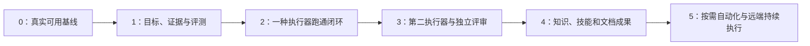

# Phase 2 候选任务：从讨论工作台到可交付目标

> 2026-11-05，X-38 / 林离。**候选路线图，尚未实现，负责人为建议分工，不表示已认领。** 设计见 [ADR-007](design/ADR-007-Super-Agent-工作台.md)，证据见 [生态研究](research/2026-11-05-agent-ecosystem.md)。不替换 Phase 1B 验收板，不把文档合并当成契约批准。

## 产品方向和功能排序

目标是让江浩少做转述、抄结果、盯状态、重复给上下文这些工作。三位秘书的聊天与人格连续性保留；新能力围绕成果增加，不要求用户先理解工作流图。

| 优先级 | 要解决的具体问题 | 功能形态 | 暂不扩展 |
|---|---|---|---|
| P0 | 桌面打不开、恢复后找不到资料、节点状态不可信 | 真机基线、故障与恢复入口、版本溯源 | 不用新框架掩盖现有故障 |
| P1 | 讨论很多，过两天不知道该做什么 | 从消息/方案创建目标；任务依赖、验收条件、继续/暂停 | 普通聊天不自动立长期目标 |
| P1 | Agent 说做完，用户还要自己核实 | 产物版本、实际执行回执、测试/检查证据、未完成项 | 不以模型自评或多数票标通过 |
| P1 | 换模型/换窗口后任务丢失 | 显式交接包、来源、已做/失败/下一步、输入版本 | 不把不同厂商 session 硬拼成同一份聊天 |
| P1 | 修改代码时无过程、权限和取消保证 | 第一种原生 runtime、隔离工作区、少打扰的范围授权 | 不同时接入十种 SDK |
| P2 | 反复手工做相同调研与评审 | 研究、代码修复、文档三类小模板 | 不先做通用拖拽工作流编辑器 |
| P2 | 查资料容易漏掉中文、旧结论或撤回内容 | 搜索基准、来源版本、可见性过滤；必要时 FTS/混合检索 | 不先部署多数据库记忆集群 |
| P2 | UI 的任务和成果入口分散 | 项目目标页、成果详情、待决定事项；诊断仍在设置 | 不整站重做外观 |
| P3 | 想定时运行、手机查看、跨设备接力 | 复用同一控制面；再评估独立服务和设备认证 | 不直接把 Electron IPC 暴露到公网 |

## 阶段依赖

阶段按可验收结果推进，不按新增模块数推进。一次只有一个阶段处于正式功能开发，后续阶段可做只读研究/独立 spike；每个阶段均有可回退路径。

## 阶段 0：保住当前可用性

| ID | 建议负责 | 内容 | 依赖 | 通过条件 |
|---|---|---|---|---|
| P2-X01 | 林离 + 对应目录所有者 | 以最新 main 复核 #193、#206 遗留项，分清已修、待修、未复现、仅建议 | — | 每项有文件/commit、复现或未运行原因，不把旧评审整体照搬 |
| P2-D01 | 汐；C酱审 | 定位 Electron 启动/安装及数据目录切换问题；处理必要的恢复提示 | P2-X01 | 安装包在目标 Windows 启动；恢复副本打开、关闭重启、目录缺失恢复、切回默认目录有记录；原资料 hash 不变 |
| P2-X02 | 林离；C酱审 | 固定真实节点、取消、断线、ASR/TTS/ComfyUI 的验收矩阵 | P2-X01 | 记录构建 SHA、设备、命令/界面结果；未运行项不填通过；GPU切换验证显存释放和后续任务实际成功 |
| P2-C01 | C酱；汐审 | 当前失败/等待原因和恢复入口的最小 UI 修补 | P2-D01 | 用户能知道是节点离线、配额未知、任务失败还是资料不可用；没有无限转圈 |

**退出门槛**：现有主要聊天/讨论/资料恢复流程能在目标机器演示；新执行器暂不开放写权限。已暂停的订阅画图不恢复。若启动问题是本机环境限制，记录可复现证据和可用验证环境，不能虚报为架构修复。

## 阶段 1：先让目标和验收成为真实数据

| ID | 建议负责 | 内容 | 依赖 | 通过条件 |
|---|---|---|---|---|
| P2-X03 | 林离；汐/C酱审 | 选取现有真实失败模式，建立评测任务定义与基线报告格式 | 阶段0 | 任务有固定输入/期望产物/失败判据；基线可复跑；没有模型调用时不生成质量成绩 |
| P2-C02 | C酱起草；江浩批准 | Goal/WorkItem/Attempt、来源与验收记录的契约，状态表及命令 | ADR-007、P2-X03 | 依赖无环、版本CAS、幂等创建、人工/机器证据分开；旧API兼容；纯契约PR |
| P2-D02 | 汐；C酱审 | 持久化与领域用例、旧资料关联；新增表/索引；不可变证据记录 | P2-C02合并 | 两次相同创建不重复；并发修改冲突明确；重启可读；升级真库副本旧数据digest不变 |
| P2-C03 | C酱；汐审 | 从聊天/方案建目标、目标详情、依赖与验收清单；先mock后接线 | P2-C02；接真依赖P2-D02 | 不操作外部工具也能从研究资料形成可追溯目标；未知/未验收清楚显示 |
| P2-X04 | 林离；C酱审 | 目标版本改变、来源撤回、伪造证据与重复事件的确定性e2e | P2-D02、P2-C03 | 过期验收不能完成新版本；跨项目ID、模型伪造成功记录、已撤回内容全部被拒/隐藏 |

**本阶段刻意不做**：通用插件注册器、递归Agent、自动Shell、向量库。研究与决策闭环先带来收益，避免一个月都在造调度基础设施。

## 阶段 2：第一条可交付执行闭环

默认先评估 Codex app-server，理由是现有 Codex CLI、Node 节点与订阅路径可复用；该选择必须通过兼容性 spike，不能仅凭上游文档宣称本机支持。

| ID | 建议负责 | 内容 | 依赖 | 通过条件 |
|---|---|---|---|---|
| P2-S01 | C酱；汐审 | 固定版本的只读 app-server spike：握手、线程/turn、事件、取消、恢复、能力报告 | 阶段0，可与阶段1研究并行 | 本机已有版本可用；记录协议与认证模式；没有审批能力不能冒充可执行；不自动升级软件 |
| P2-C04 | C酱起草；江浩批准 | 执行能力、ActionIntent/Receipt、权限中继、运行时映射、资源所有权契约 | P2-S01、P2-C02 | 旧v1严格请求仍可用；不支持时明确unsupported；动作与授权摘要绑定；纯契约PR |
| P2-D03 | 汐；C酱审 | 待派发意图、原子claim、有限重试、核对、取消、回执去重 | P2-C04合并 | 事务后崩溃可续派；响应丢失不双跑；不明外部结果保留unknown；一个资源无并行写者 |
| P2-S02 | C酱；汐审 | app-server执行适配器和节点权限中继，保留现有text profile | P2-C04合并 | 解决现有501；断线待批准请求可恢复/拒绝；取消不留活跃子进程；重复决定只生效一次 |
| P2-D04 | 汐；C酱审 | 独立工作区、输入commit、产物发布、测试执行记录、PR动作核对 | P2-D03、P2-S02 | 原checkout不变；patch绑定SHA；stale拒绝；失败保留现场；只有符合已有授权才推送 |
| P2-C05 | C酱；汐审 | 目标执行过程、具体待批准动作、暂停/取消、成果diff与证据 | P2-C04；接真依赖P2-D04 | 用户可中途改方向；取消状态区分已请求/已确认；产物可打开且版本明确 |
| P2-X05 | 林离；C酱审 | 故障注入与真实Windows链路验收 | P2-D04、P2-C05 | 下方关键矩阵全部通过；至少一个真实修复任务形成可评审PR；未改动主工作区 |

**退出门槛**：一个目标能够从输入到文件成果和真实验收走完，中途重启仍可继续；没有关键权限/数据恢复失败。不能因为模型输出漂亮或自动测试数量很多就进入下一阶段。

## 阶段 3：第二家运行时与有收益的多 Agent

| ID | 建议负责 | 内容 | 依赖 | 通过条件 |
|---|---|---|---|---|
| P2-S03 | C酱；汐审 | Claude Agent SDK接入spike与适配；TS优先，Python作为实现参考 | 阶段2 | 固定版本测试工具可见性、canUseTool/hooks、取消、session恢复；认证来源清楚，不能把allowed_tools误当工具白名单 |
| P2-S04 | C酱；汐审 | DeepSeek现有CLI能力清点与执行profile候选；必要时独立API引擎spike | 阶段2 | 工具事件、错误、取消能明确报告；不支持的能力保持缺失；API成本不混入订阅额度 |
| P2-C06 | C酱起草；江浩批准 | 委派/交接包、独立审查、聚合证据契约 | P2-X03、阶段2 | 父子任务权限交集；新session不继承错误的任务/验收状态；来源保留 |
| P2-D05 | 汐；C酱审 | 按资源分派、单层委派、结果归并与停滞检测 | P2-C06合并 | 不发生相互等待环；子任务失败能单独重试；不能将三人同意直接写verified |
| P2-X06 | 林离；汐审 | 单Agent、单Agent+独立审查、多Agent三组对照 | P2-S03、P2-D05 | 同一输入与工具，多次试验，公开失败例与误报；只有能说明收益的模式设默认 |

**默认交互**：一位负责人向用户交付结果；需要时展开每位的任务与证据。保留传统多人讨论页，用于有价值的分歧分析，而非每个简单任务都走会议流程。

## 阶段 4：知识、技能、文档成果

| ID | 建议负责 | 内容 | 依赖 | 通过条件 |
|---|---|---|---|---|
| P2-X07 | 林离；汐审 | 中文/代码搜索与长期知识的离线基准 | 阶段1 | 100条查询：中文短词、混合中英、符号、旧版、撤回、冲突事实；结果与耗时有基线 |
| P2-C07 | C酱起草；江浩批准 | 项目知识来源/有效性、Skill版本与工具需求、文档产物引用契约 | 阶段3、P2-X07 | 个人/项目/任务范围不串；代码/资料/权限语义不混用 |
| P2-D06 | 汐；C酱审 | 按基准选检索方案，失效/撤回传播，受限文档解析worker | P2-C07合并 | 中文召回提升且撤回内容零回流；取消、超时、大文件受限；重建索引不改原资料 |
| P2-S05 | C酱；汐审 | 受限MCP与固定版本Skill加载；先一个资料工具和一个成果工具 | P2-C07合并 | 上游版本变化能检测；脚本不自动安装；越权请求被节点拦截；旧任务保持原版本 |
| P2-C08 | C酱；汐审 | 项目成果区：文档/代码/图片预览、版本、来源、导出、继续修改 | P2-D06、P2-S05 | 一份研究报告或表格可编辑交付；引用可定位；不把执行脚本放进主renderer运行 |
| P2-X08 | 林离；C酱审 | 产物、知识与备份/恢复联动验收 | P2-C08 | 恢复后产物字节和来源一致；缺件明确报错；分享包不泄漏节点私人记忆 |

优先内建两个小技能模板：“研究并形成带来源的方案”“修复问题并交付可审查PR”。模板经过真实任务验证再分享；不以自动生成大量技能作为完成指标。

## 阶段 5：条件成熟后再立项

定时维护、Web/手机只读控制、长期远端执行单独做ADR。先回答控制面离线时任务在哪里跑、谁拥有数据库、凭据如何隔离、用户如何停止、睡眠/时钟变化怎么处理，再决定是否拆常驻服务。一个调度状态来源，不同时持久化任务数据库和第二份cron真相。

MCP、ACP、A2A按需求增加，不要求首版全部支持。低代码画布、广泛IM接入、团队多租户、自动修改自己的程序和商店分发均不默认纳入本项目。

## 确定性故障验收矩阵

| 编号 | 注入点 | 必须观察到的结果 |
|---|---|---|
| F01 | 创建意图事务提交后立即退出 | 重启沿用同一幂等键；允许重发派发请求，但节点最多启动一次；状态与事件可对应 |
| F02 | 节点接受后丢POST响应 | 同runId不启动第二进程 |
| F03 | 工具已执行、结果返回前断网 | 记录unknown/对账结果；不可自动重复外部写 |
| F04 | 两调度者同时claim | 单个赢家；失败者不调用节点 |
| F05 | 旧租约执行者迟到提交 | 不更新新attempt；原现场可检查 |
| F06 | 审批后参数、文件hash或目标rev改变 | stale拒绝，不执行旧批准 |
| F07 | 审批弹窗时取消/关窗/重连 | 请求关联不丢；无重复批准；取消后不开始新动作 |
| F08 | 暂停目标时仍有子任务/GPU任务 | 逐项进入可解释状态；不留下后台写者 |
| F09 | runtime退出0但没交付文件 | 不能记done；缺产物明确显示 |
| F10 | 模型伪造测试ID、工具receipt、来源ID | 不能标verified，不进入完成状态 |
| F11 | 工具输出或技能要求提升权限 | 权限不变；操作由程序拒绝 |
| F12 | 新目标revision替代旧版 | 已有成果保留；旧验收不满足新版 |
| F13 | 撤回来源、收紧可见范围 | 搜索、摘要、交接、导出及后续Prompt都不回流 |
| F14 | 另一个project的任务/产物ID | 拒绝跨项目读取/引用/审批 |
| F15 | worktree并发写同资源/Windows junction | 资源互斥；路径归属核对；原工作区不变 |
| F16 | 节点不支持工具事件或权限能力 | 执行用例unsupported；已有text聊天仍能用 |
| F17 | Langfuse/诊断出口不可用 | 工作仍可执行，导出失败有界，不吞业务错误 |
| F18 | 半份产物、磁盘满、备份缺件 | 不发布成功引用；保留可恢复信息 |
| F19 | 新runtime关闭后旧事件到达 | 历史可查看；没有新派发；终态不复活 |
| F20 | 机器休眠、系统时间跳变 | 截止/等待原因正确；不触发补跑风暴 |

故障测试应通过受控注入做到可重复；真实进程树终止、窗口交互、文件恢复和GPU释放需要真机记录，不能全部用fake替代。

## 评测设计与阶段判定

先选30个冻结任务：10个资料研究/来源核验、10个代码定位修复、10个项目交接/文档整理。每类含正常、失败、权限不足和输入变化。另保留至少10个不参与调参的留出任务。任务集只用可分享/合成资料，不把私人记忆上传做公共benchmark。

- 决定性状态与权限检查先跑；有关键数据损坏、越权或重复外部写入则该候选不进入默认路径。
- 模型相关任务每个候选至少3次试验；报告每次结果和范围，不拿一次好结果代替平均体验。允许先跑每类2个pilot核实环境，再跑全量。
- 衡量：实际完成率、误报完成率、来源可核验率、人工干预次数、恢复成功率、p50/p95时延、实际token/费用或unknown。不同订阅配额不强行折算。
- LLM评分只辅助；代码看实际测试和diff，文档看可打开和内容/视觉质量，来源看原文。人工抽查保持盲评，避免偏向某位秘书或模型品牌。
- “多Agent值得默认启用”的建议阈值：相对单Agent+独立审查至少多完成3/30个任务、关键失败不增加、人工干预不增加，并在留出集方向一致。样本很小，只是产品试用门槛，不声称统计显著；无收益则保留手动专家调用。
- 研究性能目标与安全不变量分开：性能可按真实基线调整；越权、伪造证据、已撤回内容回流没有可接受的默认容忍率。

## 开发和发布方式

每条契约单独PR，合并后消费者再接；实现PR附真实命令、输出与未验证范围。沿用现有目录所有权，UI可先对mock，不抢写别人的目录。P2-*只是候选任务标识，不代表工作已经开始。

新能力按执行profile/项目入口可关闭；发布前验证旧数据、旧节点和旧聊天回归。新任务的数据恢复和成果备份与功能同时做，不留到“后面再加”。优先交付一条完整闭环，每个阶段末用户都能实际看到可用变化。
