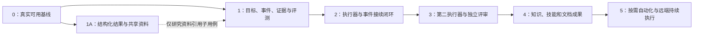

# Phase 2 候选任务：从讨论工作台到可交付目标

> 2026-11-05，X-38 / 林离。**候选路线图，尚未实现；除下述本轮指派外，负责人均为建议分工。** 设计见 [ADR-007](design/ADR-007-Super-Agent-工作台.md)，证据见 [生态研究](research/2026-11-05-agent-ecosystem.md)。不替换 Phase 1B 验收板，不把文档合并当成契约批准。

> 11 月 5 日补查：加入 [DeepSeek官方原案与站外研究](research/2026-11-05-web-supplement.md)，形成33项候选任务。11 月 16 日 X-38b 修订新增9项，共42项；原ID保留。新增依据见 [应用接口与Harness接入研究](research/2026-11-16-deepseek-integration.md)，不代表功能已经实现。

> 按 [#255 Fable 5.2 重审](https://github.com/aa15119557034/agent-review-room/pull/255#issuecomment-6919234138) 及本轮用户要求调整：林离修订本PR并核对 P2-X01；P2-X11、P2-C11、P2-D08 和 P2-X12 由林离负责、C酱评审。C11 的 schemas 起草与 D08 的 main/DB 是本计划明确列出的目录例外，后续 PR 必须注明；契约仍由江浩批准，D08 可交汐复核，不等待汐认领。P2-S07/P2-C12 和历史导入另排；其余分工仍是建议，世界特别分工不变。本PR只改方案，不开始契约或运行实现。

> 11 月 17 日进展：P2-C11 与首片 P2-X11 fixture 已随 [#256](https://github.com/aa15119557034/agent-review-room/pull/256) 合并；P2-D08 随 [#259](https://github.com/aa15119557034/agent-review-room/pull/259) 合并。按 [合并后分工](https://github.com/aa15119557034/agent-review-room/pull/259#issuecomment-6926178061)，P2-S07 首片和 P2-C12 首片由林离负责、C酱评审，分别允许 agent-server 和 renderer 目录例外；#258 暂缓，仍归 C酱。S07 [独立生产端](design/P2-S07-独立检索首片.md) 已做真实 API 与隔离原件存储/备份验证；桌面接线、C12 接真和 P2-X12 完整验收仍未完成。

> 同日后续：P2-S07 [#260](https://github.com/aa15119557034/agent-review-room/pull/260) 与 P2-C12 [#261](https://github.com/aa15119557034/agent-review-room/pull/261) 已合并。按 [#261 交接](https://github.com/aa15119557034/agent-review-room/pull/261#issuecomment-6932840416)，新增子任务 P2-C11b，由林离在独立契约 PR 中起草项目检索批准、原件先落库、取消/切库拒收及来源当前状态查询；允许 schemas 目录例外，C酱评审。上方计数是原候选任务数，本子任务单列。契约已随 [#262](https://github.com/aa15119557034/agent-review-room/pull/262) 批准合并；[P2-S07b 接线与 P2-X12 首片验收](design/P2-S07b-项目检索接线验收.md) 已实现并实测，待 C酱独立评审。聊天网页与上传授权仍不扩展。

## 产品方向和功能排序

目标是让江浩少做转述、抄结果、盯状态、重复给上下文这些工作。三位秘书的聊天与人格连续性保留；新能力围绕成果增加，不要求用户先理解工作流图。

| 优先级 | 要解决的具体问题 | 功能形态 | 暂不扩展 |
|---|---|---|---|
| P0 | 桌面打不开、恢复后找不到资料、节点状态不可信 | 真机基线、故障与恢复入口、版本溯源 | 不用新框架掩盖现有故障 |
| P1 | 新接口返回引用/工具信息但只剩正文；三位秘书资料不一致 | 结构化结果、来源版本、共享搜索材料；文档上传与历史导入独立分片 | 不先上通用插件市场；厂商签名不当共享原文 |
| P1 | 讨论很多，过两天不知道该做什么 | 从消息/方案创建目标；任务依赖、验收条件、继续/暂停 | 普通聊天不自动立长期目标 |
| P1 | Agent 说做完，用户还要自己核实 | 产物版本、实际执行回执、测试/检查证据、未完成项 | 不以模型自评或多数票标通过 |
| P1 | 换模型/换窗口后任务丢失 | 显式交接包、来源、已做/失败/下一步、输入版本 | 不把不同厂商 session 硬拼成同一份聊天 |
| P1 | 修改代码时无过程、权限和取消保证 | 第一种原生 runtime、隔离工作区、少打扰的范围授权 | 不同时接入十种 SDK |
| P2 | 反复手工做相同调研与评审 | 研究、代码修复、文档三类小模板 | 不先做通用拖拽工作流编辑器 |
| P2 | 查资料容易漏掉中文、旧结论或撤回内容 | 搜索基准、来源版本、可见性过滤；必要时 FTS/混合检索 | 不先部署多数据库记忆集群 |
| P2 | UI 的任务和成果入口分散 | 项目目标页、成果详情、待决定事项；诊断仍在设置 | 不整站重做外观 |
| P3 | 想定时运行、手机查看、跨设备接力 | 复用同一控制面；再评估独立服务和设备认证 | 不直接把 Electron IPC 暴露到公网 |

## 阶段依赖

阶段按可验收结果推进，不按新增模块数推进。一次只有一个阶段处于正式功能开发，契约起草、研究和具备所需授权的独立 spike 可并行；P2-X03/P2-C02 不等待阶段1A验收，只有 P2-C03 的新研究资料引用子用例依赖它。每个阶段均有可回退路径。

## 阶段 0：保住当前可用性

| ID | 建议负责 | 内容 | 依赖 | 通过条件 |
|---|---|---|---|---|
| P2-X01 | 林离 + 对应目录所有者 | 以最新main复核既有问题，并核对#208/#223及#244/#247契约和#242/#248—#251实现状态 | — | 分清已修、待修、未复现、仅建议；以具体commit和实测为准；契约已合并不等于取消/隔离运行能力已交付 |
| P2-D01 | 汐；C酱审 | 定位 Electron 启动/安装及数据目录切换问题；处理必要的恢复提示 | P2-X01 | 安装包在目标 Windows 启动；恢复副本打开、关闭重启、目录缺失恢复、切回默认目录有记录；原资料 hash 不变 |
| P2-X02 | 林离；C酱审 | 固定真实节点、取消、断线、ASR/TTS/ComfyUI 的验收矩阵 | P2-X01 | 记录构建 SHA、设备、命令/界面结果；未运行项不填通过；GPU切换验证显存释放和后续任务实际成功 |
| P2-C01 | C酱；汐审 | 当前失败/等待原因和恢复入口的最小 UI 修补 | P2-D01 | 用户能知道是节点离线、配额未知、任务失败还是资料不可用；没有无限转圈 |

**退出门槛**：现有主要聊天/讨论/资料恢复流程能在目标机器演示；新执行器暂不开放写权限。已暂停的订阅画图不恢复。若启动问题是本机环境限制，记录可复现证据和可用验证环境，不能虚报为架构修复。

## 阶段 1A：结构化结果与共享资料（新增）

先完成不要求通用Agent写权限的 Search/Fetch 资料链路。依赖现有聊天/资料能力，不等待 Goal、MCP、Harness、世界接线或通用资源协调。云端数据发送授权粒度仍待江浩决定；真实调用只能使用已明确授权的资料/服务范围。C11 与 X11 可并行起草/收集，fixture 是合并前核对，不是起草前提。

| ID | 建议负责 | 内容 | 依赖 | 通过条件 |
|---|---|---|---|---|
| P2-X11 | 林离；C酱审 | 固定API/上游版本，制作匿名事件/引用fixture与基线；后续按接入补签名、文件、历史ZIP | P2-X01 | 模拟协议与真实服务结果分开；不放密钥/私聊归档；首份契约只需其覆盖的fixture，不被尚未接入的签名/ZIP拖住 |
| P2-C11 | 林离起草；C酱审；江浩批准 | 仅能力声明与本次请求开关、可选展示事件、共享资料引用；纯契约PR | P2-X01 | 合并前核对P2-X11对应fixture；旧节点无新字段、旧客户端无新事件；未开启保持既有线协议与完整正文；unknown≠0。续聊/上传/Goal/语音/实现均不包含 |
| P2-D08 | 林离负责main/DB与Prompt；C酱审，可交汐复核 | 扩展既有事件/资料持久化、派生上下文视图、迁移、撤回传播及备份；不引入通用调度 | P2-C11合并 | 不建第二消息库/投影表；迁移号以合并时main为准；旧digest保持；撤回关联的X-35摘要标stale；资料入Prompt复用wrapChatUntrusted；取消/切库拒绝旧回包；原件可恢复 |
| P2-S07 | 林离负责agent-server首片；C酱审 | 独立Search/Fetch先限项目/讨论；聊天网页先另冻存储/读取契约；文档上传和内置搜索另拆 | P2-C11合并、P2-D08 | 搜索→可读材料→引用，原件落source_input；复用Run并发，费用/失败明示；桌面批准/接收的小契约冻结后接线。文档后续走认证节点独立上传端点、10MiB项目上限及1个上传/解析槽，不走图片StartRun或MediaJob |
| P2-C12 | 林离负责renderer首片；C酱审 | 首片引用与来源预览、缺件提示及资料分享；解析进度随上传分片接线；先mock | P2-C11；首片接真依赖P2-D08、P2-S07 | 标题/简述纯文本；旧批准来源失效走stale_snapshot并重建；同一授权原件供不同秘书使用；重启后仍定位同一来源版本 |
| P2-C11b | 林离起草；C酱审、江浩批准 | [项目检索接线契约](design/P2-C11b-项目检索接线契约.md)：批准绑定、原件/引用顺序、迟到拒收、当前状态/原文查询；#262 已批准合并 | #256、#259、#260、#261 已合并 | 纯契约不打开入口；S07b 按冻结契约接真并跑取消/切库/撤回/恢复验收 |
| P2-X12 | 林离；C酱审 | 首片结构化结果、共享资料的兼容、撤回、取消、恢复与费用验收 | P2-S07首片、P2-C12首片 | F29、F31的已接入资料路径、F34、F35通过；真实调用单列环境/日期/用量与授权范围；不以模拟结果冒充云端验证 |

**退出门槛**：一次带来源的研究讨论在目标机器可复跑，重启后资料与引用保持，旧聊天/节点仍可用。历史导入、文档上传/厂商续聊、云端语音和跨用途资源协调均单独验收：F30 与 F31 的厂商侧场景随对应模式接入；F32/F33 归历史导入；F38 归语音；F39 归阶段2，不阻塞1A。

### 独立分片：历史导入（不计入1A退出门槛）

| ID | 建议负责 | 内容 | 依赖 | 通过条件 |
|---|---|---|---|---|
| P2-D09 | 暂不分；另行排期 | DeepSeek历史预览、验证、暂存及幂等合并导入；单独验收 | P2-C11、P2-D08 | F32/F33；重复导入不增记录；坏ZIP/未知版本/磁盘满不损旧数据；保留外部作者身份与分支，不进本项目秘书的历史摘要/个人记忆；缺附件明示 |

## 阶段 1：先让目标和验收成为真实数据

| ID | 建议负责 | 内容 | 依赖 | 通过条件 |
|---|---|---|---|---|
| P2-X03 | 林离；汐/C酱审 | 选取现有真实失败模式，建立评测任务定义与基线报告格式 | P2-X01、P2-X02 | 任务有固定输入/期望产物/失败判据；基线可复跑；不依赖云端搜索/历史导入；没有模型调用时不生成质量成绩 |
| P2-C02 | C酱起草；江浩批准 | Goal/WorkItem/Attempt、来源与验收记录的契约，状态表及命令 | ADR-007、P2-X03 | 依赖无环、版本CAS、幂等创建、人工/机器证据分开；旧API兼容；纯契约PR |
| P2-D02 | 汐；C酱审 | 持久化与领域用例、旧资料关联；新增表/索引；不可变证据记录 | P2-C02合并 | 两次相同创建不重复；并发修改冲突明确；重启可读；升级真库副本旧数据digest不变 |
| P2-C03 | C酱；汐审 | 从聊天/方案建目标、目标详情、依赖与验收清单；先mock后接线 | P2-C02；接真依赖P2-D02；仅新研究资料引用子用例依赖P2-X12 | 普通聊天/既有方案建目标不等1A；新资料子用例等待来源链路；未知/未验收清楚显示 |
| P2-X04 | 林离；C酱审 | 目标版本改变、来源撤回、伪造证据与重复事件的确定性e2e | P2-D02、P2-C03 | 过期验收不能完成新版本；跨项目ID、模型伪造成功记录、已撤回内容全部被拒/隐藏 |
| P2-C09 | C酱起草；汐审、江浩批准 | 事件来源/身份、Thread、输入所有权、订阅、主动准入与通知契约；复用目标授权 | P2-C02合并 | source/eventId去重；订阅不授权；共用账号的GitHub评论只能observe/inbox，授权来自应用内操作；outbox标记与评论id可核对；纯契约PR |

**本阶段刻意不做**：通用插件注册器、递归Agent、自动Shell、向量库。研究与决策闭环先带来收益，避免一个月都在造调度基础设施。

## 阶段 2：第一条可交付执行闭环

默认候选仍为 Codex app-server；Harness通过P2-S04补齐同一份资格报告后可参与比较。先选一个满足权限、结果归属和确认停止条件的执行器，不把三个SDK全部接入作为阶段退出条件。两者都不合格时，保留阶段1A的研究资料能力。

| ID | 建议负责 | 内容 | 依赖 | 通过条件 |
|---|---|---|---|---|
| P2-S01 | C酱；汐审 | 固定版本的只读 app-server spike：握手、线程/turn、事件、取消、恢复、能力报告 | 阶段0，可与阶段1研究并行 | 本机已有版本可用；记录协议与认证模式；没有审批能力不能冒充可执行；不自动升级软件 |
| P2-S04 | 建议C酱；汐审，正式分工后定 | DeepSeek现有CLI能力清点 + 固定Harness SDK隔离资格试验，与P2-S01比较 | 阶段0，可与阶段1研究并行；安装及付费调用需单独批准 | 空工作目录/合成home/最小环境/按需Key；复用#232工程文档、记忆、hook哨兵；合成工具实测approval/归属/恢复/进程树停止，真实写权限阻断。强杀现场保留但不复用；未批准仅静态研究 |
| P2-C04 | C酱起草；江浩批准 | 执行能力、回执、权限、运行时映射和跨用途资源所有权契约；F39契约归属 | P2-C02；P2-S01/P2-S04至少一个资格报告 | 复核#244/#247及后续实现；不提前通用化世界屏障；旧v1兼容；纯契约PR，未支持就unsupported；不把世界profile扩成工具执行 |
| P2-D03 | 汐；C酱审 | 待派发意图、原子claim、有限重试、取消核对、回执去重；实现P2-C04资源准入 | P2-C04合并 | 事务后崩溃可续派；不双跑；unknown不盲重试；单资源无并行写者；资源释放及控制通道交P2-X05/F39验收，不是1A隐含模块 |
| P2-S02 | C酱；汐审 | 只实现选定的第一种执行适配器和节点权限中继，保留现有text profile | P2-C04合并 | 解决现有501；断线审批可恢复/拒绝；取消确认包含进程树；Harness候选须通过F36/F37，不能直接用finalResponse标成果 |
| P2-D04 | 汐；C酱审 | 独立工作区、输入commit、产物发布、测试执行记录、PR动作核对 | P2-D03、P2-S02 | 原checkout不变；patch绑定SHA；stale拒绝；失败保留现场；只有符合已有授权才推送 |
| P2-C05 | C酱；汐审 | 目标执行过程、具体待批准动作、暂停/取消、成果diff与证据 | P2-C04；接真依赖P2-D04 | 用户可中途改方向；取消状态区分已请求/已确认；产物可打开且版本明确 |
| P2-X05 | 林离；C酱审 | 故障注入、资源协调F39与真实Windows链路验收 | P2-D04、P2-C05、P2-X09 | F01—F28及所选能力通过；Harness用F36/F37。F39世界组合须#232/#248—#251合并验证后实跑，缺条件写未验证，不宣称完整统一调度；至少一条真实修复PR |
| P2-D07 | 汐；C酱审 | 控制面持久输入队列、订阅直通、退回路由、通知outbox、控制输入优先级与确定性健康检测 | P2-C09合并、P2-D03 | 处理崩溃/重放/乱序；停止与改方向不被工作资源耗尽阻塞；发送未知结果不盲重试 |
| P2-S06 | C酱；汐审 | 第一个GitHub Source：评论/CI去重、游标、任务上下文、带标记的消息发送与回执核对 | P2-C09合并、P2-D07 | F22/F24覆盖共用账号：评论不作为用户请求/授权；outbox标记+comment id判自发消息，丢回执按标记/目的Thread/正文核对，歧义unknown不重发；私库404不当删除；不含自动合并 |
| P2-C10 | C酱；汐审 | 待处理事项与目标接续UI；响应/工作日志分离；控制输入确认 | P2-C09；接真依赖P2-D07 | 状态无变化不弹通知；用户能看到真正待决定项；任务忙时仍可停止、追问与改方向 |
| P2-X09 | 林离；汐/C酱审 | 事件路由、身份/授权、异步回流、通知与Watchdog边界的故障验收 | P2-D07、P2-S06、P2-C10 | F21—F28全部确定性复现；审批等待期间结果不丢；已取消任务不复活 |

**退出门槛**：一个目标能够从输入到文件成果和真实验收走完，中途重启仍可继续；没有关键权限/数据恢复失败。不能因为模型输出漂亮或自动测试数量很多就进入下一阶段。

## 阶段 3：第二家运行时与有收益的多 Agent

| ID | 建议负责 | 内容 | 依赖 | 通过条件 |
|---|---|---|---|---|
| P2-S03 | C酱；汐审 | Claude Agent SDK接入spike与适配；TS优先，Python作为实现参考 | 阶段2 | 固定版本测试工具可见性、canUseTool/hooks、取消、session恢复；认证来源清楚，不能把allowed_tools误当工具白名单 |
| P2-C06 | C酱起草；江浩批准 | 委派/交接包、独立审查、聚合证据契约 | P2-X03、阶段2 | 父子任务权限交集；新session不继承错误的任务/验收状态；来源保留 |
| P2-D05 | 汐；C酱审 | 按资源分派、单层委派、结果归并与独立语义停滞诊断 | P2-C06合并 | 不发生相互等待环；子任务失败能单独重试；不能将三人同意直接写verified |
| P2-X06 | 林离；汐审 | 单Agent、单Agent+独立审查、多Agent三组对照 | P2-S03、P2-D05 | 同一输入与工具，多次试验，公开失败例与误报；只有能说明收益的模式设默认 |
| P2-X10 | 林离；汐审 | 交错事件流/注意力成本对照：全走Router、订阅直通、单会话基线；区分合成与真实任务 | P2-X09、P2-X06 | 报告漏提醒、重复提醒、有效通知比例、控制响应、人工接力及Router负载；不以模拟等待时间声称编码质量提升 |

**默认交互**：一位负责人向用户交付结果；需要时展开每位的任务与证据。保留传统多人讨论页，用于有价值的分歧分析，而非每个简单任务都走会议流程。

## 阶段 4：知识、技能、文档成果

| ID | 建议负责 | 内容 | 依赖 | 通过条件 |
|---|---|---|---|---|
| P2-X07 | 林离；汐审 | 中文/代码搜索与长期知识的离线基准 | 阶段1 | 100条查询：中文短词、混合中英、符号、旧版、撤回、冲突事实；结果与耗时有基线 |
| P2-C07 | C酱起草；江浩批准 | 项目知识来源/有效性、Skill版本与工具需求、文档产物引用契约 | 阶段3、P2-X07 | 个人/项目/任务范围不串；代码/资料/权限语义不混用 |
| P2-D06 | 汐；C酱审 | 按基准选检索方案，失效/撤回传播，受限文档解析worker | P2-C07合并 | 中文召回提升且撤回内容零回流；取消、超时、大文件受限；重建索引不改原资料 |
| P2-S05 | C酱；汐审 | 受限MCP与固定版本Skill加载；先一个资料工具和一个成果工具 | P2-C07合并 | 上游版本变化能检测；脚本不自动安装；越权请求被节点拦截；旧任务保持原版本 |
| P2-C08 | C酱；汐审 | 项目成果区：文档/代码/图片预览、版本、来源、导出、继续修改 | P2-D06、P2-S05 | 一份研究报告或表格可编辑交付；引用可定位；不把执行脚本放进主renderer运行 |
| P2-X08 | 林离；C酱审 | 产物、知识与备份/恢复联动验收 | P2-C08 | 恢复后产物字节和来源一致；缺件明确报错；分享包不泄漏节点私人记忆 |
| P2-C13 | C酱起草；江浩批准 | 可选云端ASR/TTS契约：上传选择、能力限制、费用与缓存身份 | P2-X12；安排在阶段4 | 不更改本地默认、不静默上传；表达不支持流式/语速/音色；纯契约PR |
| P2-D10 | 汐负责main；C酱负责设置；交叉审查，林离验收 | 在已有语音/媒体边界接入选定云端服务及设置接线，不新增调度系统 | P2-C13合并 | F38与P2-X12相关回归实跑；格式、120秒ASR限制、TTS截断失败、取消及缓存不串服务；真听测单列 |

优先内建两个小技能模板：“研究并形成带来源的方案”“修复问题并交付可审查PR”。模板经过真实任务验证再分享；不以自动生成大量技能作为完成指标。

## 阶段 5：条件成熟后再立项

定时维护、Web/手机只读控制、长期远端执行单独做ADR。阶段1—2已有的事件/订阅/通知契约不依赖24小时服务；阶段5只改变部署与可达性，不再造一套调度。先回答控制面离线时任务在哪里跑、谁拥有数据库、凭据如何隔离、用户如何停止、睡眠/时钟变化怎么处理，再决定是否拆常驻服务。一个调度状态来源，不同时持久化任务数据库和第二份cron真相。

MCP、ACP、A2A按需求增加，不要求首版全部支持。低代码画布、广泛IM接入、团队多租户、自动修改自己的程序和商店分发均不默认纳入本项目。

## 确定性故障验收矩阵

| 编号 | 注入点 | 必须观察到的结果 |
|---|---|---|
| F01 | 创建意图事务提交后立即退出 | 重启沿用同一幂等键；允许重发派发请求，但节点最多启动一次；状态与事件可对应 |
| F02 | 节点接受后丢POST响应 | 同runId不启动第二进程 |
| F03 | 工具已执行、结果返回前断网 | 记录unknown/对账结果；不可自动重复外部写 |
| F04 | 两调度者同时claim | 单个赢家；失败者不调用节点 |
| F05 | 旧租约执行者迟到提交 | 不更新新attempt；原现场可检查 |
| F06 | 审批后参数、文件hash或目标rev改变 | stale拒绝，不执行旧批准 |
| F07 | 审批弹窗时取消/关窗/重连 | 请求关联不丢；无重复批准；取消后不开始新动作 |
| F08 | 暂停目标时仍有子任务/GPU任务 | 逐项进入可解释状态；不留下后台写者 |
| F09 | runtime退出0但没交付文件 | 不能记done；缺产物明确显示 |
| F10 | 模型伪造测试ID、工具receipt、来源ID | 不能标verified，不进入完成状态 |
| F11 | 工具输出或技能要求提升权限 | 权限不变；操作由程序拒绝 |
| F12 | 新目标revision替代旧版 | 已有成果保留；旧验收不满足新版 |
| F13 | 撤回来源、收紧可见范围 | 搜索、摘要、交接、导出及后续Prompt都不回流 |
| F14 | 另一个project的任务/产物ID | 拒绝跨项目读取/引用/审批 |
| F15 | worktree并发写同资源/Windows junction | 资源互斥；路径归属核对；原工作区不变 |
| F16 | 节点不支持工具事件或权限能力 | 执行用例unsupported；已有text聊天仍能用 |
| F17 | Langfuse/诊断出口不可用 | 工作仍可执行，导出失败有界，不吞业务错误 |
| F18 | 半份产物、磁盘满、备份缺件 | 不发布成功引用；保留可恢复信息 |
| F19 | 新runtime关闭后旧事件到达 | 历史可查看；没有新派发；终态不复活 |
| F20 | 机器休眠、系统时间跳变 | 截止/等待原因正确；不触发补跑风暴 |
| F21 | 重复/乱序GitHub事件；游标推进前后崩溃 | 单次业务接纳；已持久输入不丢；不按到达先后覆盖目标修订 |
| F22 | 共用同一GitHub账号的江浩/Agent/bot在订阅Thread发命令或伪造署名 | 均只能observe或作为已有任务上下文，不构成用户明确请求，不扩权、停止或重开任务；授权仅来自应用内操作 |
| F23 | Worker繁忙、审批等待时新指令/结果到达 | 先持久化；停止优先；结果关联正确attempt且不重复投递 |
| F24 | 共用账号下自身/他人评论、发送成功后丢回执、标记复制/修改及通知重放 | 按本地effect意图的标记+comment id识别自发；丢回执核对目的Thread/标记/正文后补id；歧义或取不全保持unknown不重发；不按账号过滤江浩评论，无回声循环 |
| F25 | 活跃任务授权撤销、来源删除 | 下一动作边界拒绝；取消待发送通知；模型提示不能继续授权 |
| F26 | Worker退回超范围输入或多Worker同时认领 | 所有权可追踪；只重新路由一次；无静默丢弃或双写 |
| F27 | Watchdog重复建议重试、用户已暂停 | 诊断留痕但不能复活；有限重试；不更改验收标准 |
| F28 | observe模式收到GitHub推断/转述请求及应用内明确授权请求 | GitHub只记候选/上下文，不因此执行或外发；应用内请求按授权正常处理 |
| F29 | 新内容块/坏SSE/仅部分正文后断流 | 已接收内容可诊断；终止原因准确；未知执行语义拒绝，不把坏协议静默标成功 |
| F30 | 读链接签名缺失、换账号/provider，来源结果/消息/资料撤回或排除 | 状态随来源结果进出上下文；依赖撤回/排除来源的opaque不再交回并记原因；不猜prefixHash/整段历史要求；跨模型只得授权可读材料；恢复不带旧opaque |
| F31 | 资料撤回、解析换版/切库；厂商文件已上传/尚在上传，删除失败或不支持 | 旧引用不指向新内容；关联X-35摘要stale；旧回调不写新库；撤回后不再交回相关opaque/file_id。可删则记回执，未知待核对，不支持明示厂商侧无法保证删除；迟到ID只供清理，不重发上传 |
| F32 | 历史重复导入、伪装本项目助手发言、坏ZIP/未知版本/路径穿越/解压超限 | 幂等合并、原记录不变、越界附件不落盘；导入助手发言保持外部身份，不进秘书历史摘要/记忆，不执行归档指令 |
| F33 | 导入暂存/提交中断、原件缺失、备份恢复 | 恢复到完整提交边界；缺件有提示；不伪造附件或丢掉既有消息 |
| F34 | 旧节点/旧客户端遇到新能力，或新节点收到未开启结构化结果的请求 | 节点声明+请求显式开启才发新事件；旧节点无新字段、旧客户端无新事件；关闭时既有线协议逐字节不变（同一固定fixture），message_complete.text正文完整；未知执行语义拒绝 |
| F35 | 服务不返回用量、托管多步搜索超过一次模型请求 | 保留unknown；分别记录工具次数与token；单次max_tokens不被显示成任务硬金额上限 |
| F36 | Harness RPC超时/observer抛错/取消时子进程仍活着，原账本无法恢复 | 保留占用并核对停止；不盲重发。显式新ledger留操作者/时间/原因，旧绑定仍保留且不能证明旧Run已停；强杀工作区保留检查但新Attempt不得复用 |
| F37 | Harness排队输入、steering或子代理输出混入同一idle区间 | 按已接纳输入和事件谱系核对；末条正文不直接当指定任务成果；不能串Attempt |
| F38 | 本地语音失败、云端不支持语速/音色、音频中途截断 | 无授权不上传；不谎报能力；半份音频不进成功缓存；停止不冒充远端费用撤销 |
| F39 | 阶段2资源协调接入后，聊天/讨论/世界认知/媒体同时请求节点与GPU | P2-C04定义、P2-D03实现、P2-X05验收；按实际资源占用、停止可响应、过期世界不补跑，无第二领域状态。世界实现未合并/未验证时不宣称本组合通过，不阻塞1A |

故障测试应通过受控注入做到可重复；真实进程树终止、窗口交互、文件恢复和GPU释放需要真机记录，不能全部用fake替代。

## 评测设计与阶段判定

先选30个冻结任务：10个资料研究/来源核验、10个代码定位修复、10个项目交接/文档整理。每类含正常、失败、权限不足和输入变化。另保留至少10个不参与调参的留出任务。任务集只用可分享/合成资料，不把私人记忆上传做公共benchmark。

- 决定性状态与权限检查先跑；有关键数据损坏、越权或重复外部写入则该候选不进入默认路径。
- 模型相关任务每个候选至少3次试验；报告每次结果和范围，不拿一次好结果代替平均体验。允许先跑每类2个pilot核实环境，再跑全量。
- 衡量：实际完成率、误报完成率、来源可核验率、人工干预次数、恢复成功率、p50/p95时延、实际token/费用或unknown。不同订阅配额不强行折算。
- 新增交错事件集：改变方向、无关消息、CI失败与恢复、审批等待、来源撤回、停止及回声；合成调度数据与真实执行结果分表。
- 记忆评测分别测试使用/检索与生成/清理，使用匿名合成资料；错误记忆不能仅靠模型置信度写成已验证事实。
- LLM评分只辅助；代码看实际测试和diff，文档看可打开和内容/视觉质量，来源看原文。人工抽查保持盲评，避免偏向某位秘书或模型品牌。
- “多Agent值得默认启用”的建议阈值：相对单Agent+独立审查至少多完成3/30个任务、关键失败不增加、人工干预不增加，并在留出集方向一致。样本很小，只是产品试用门槛，不声称统计显著；无收益则保留手动专家调用。
- 研究性能目标与安全不变量分开：性能可按真实基线调整；越权、伪造证据、已撤回内容回流没有可接受的默认容忍率。

## 开发和发布方式

每条契约单独PR，合并后消费者再接；实现PR附真实命令、输出与未验证范围。除本页开头明确的 C11/D08 指派例外外，沿用现有目录所有权；UI可先对mock。P2-*是计划标识，分工不等于实现或验收完成。

新能力按执行profile/项目入口可关闭；发布前验证旧数据、旧节点和旧聊天回归。新任务的数据恢复和成果备份与功能同时做，不留到“后面再加”。优先交付一条完整闭环，每个阶段末用户都能实际看到可用变化。
