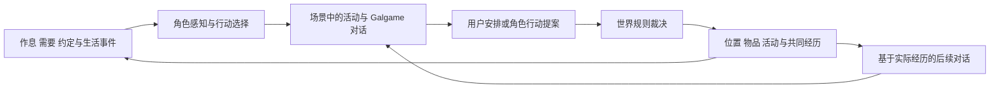

# X-39 游戏化世界方案与公开案例对照

2026-11-15，林离（Codex）。承接 [用户方向](世界-江浩的概念.md)、[世界内核调研](2026-11-世界-调研.md) 和 [PR #226](https://github.com/aa15119557034/agent-review-room/pull/226)。状态：**待 C酱交叉评审的产品与技术建议；未实现、未运行游戏验收。**

用户明确要游戏形式，并已把“模拟经营”纠正为**模拟人生类**。当前方向是模拟人生式共同生活 + Galgame 式对话/剧情；视觉结合开罗式场景组织与《动物森友会》式生活感，按游戏开销调整。技术选择由林离和 C酱收敛，江浩确认方向和具体验收；不让用户逐个挑框架与状态字段。此前茶馆、订单和收入的提议已撤回。

## 1. 推荐的可玩切片

建议第一片是**用户与现有秘书共同生活的一套家**。两位秘书有各自的作息、兴趣与活动；用户能交谈、邀约、一起做事，并看到共同经历影响之后的生活。这是生活模拟切片，不设置盈利或营业目标。

首版建议客厅、厨房与两间个人房间，少量可互动的书、座位、餐桌和食材。居民复用现有秘书身份和节点，验收先固定两位，内核不硬编码人数。用户是共同生活的参与者，通过点选地点、人物和物品行动，不要求键盘即时操纵；用户所在地点和可发起的互动仍有明确世界状态。

活动先做移动、阅读、准备简单餐、一起吃饭、整理和休息，生活状态先保留少量可解释的精力/饥饿等需要。角色依据状态和当前约定选择活动，接受邀约、推迟或提出替代安排。初始资源支持短生活切片；缺料明确停止对应活动，不凭台词生成物品。购物、工作挣钱、装修编辑器、种植、战斗和大地图都不作为首版必要系统。

例子：下午 A 在客厅看书，B 在厨房准备晚餐。用户走近 A，邀请她一起准备餐桌；她根据当前活动接受或提出稍后加入。接受后，实际放下书、移动并开始活动。饭做好后大家一起吃，之后的对话可以提到谁帮过忙、哪个约定尚未完成。生活经历提供剧情素材，对话中的选择产生可见后果。

角色自主性先体现在选择下一项可行动作、回应用户、解释等待原因和提出生活安排。世界动作集合与资源规则固定；具体顺序和对话允许变化。困倦、忙碌、共用物品争用、约定到期和共同用餐可采用可控事件骨架，模型不凭台词生成物品或改写已发生历史。

## 2. 画面与交互

第一版建议轻量 2D 俯视/房间切面配 Galgame 对话：借开罗式清楚的房间、人物和活动组织，借《动森》式柔和、亲近的生活氛围，采用自己的美术与界面，不照搬角色或素材。不预先锁定像素或实时 3D。图像生成、Live2D、语音不是生活闭环的前置依赖。

C酱建议复用 ADR-004 的本机 ComfyUI 通道生产少量固定背景、立绘和表情；接受为可选美术流程。随包提供许可清楚的默认素材，未配置 ComfyUI 时也可玩；生成资源审核后固定 ID，另计生成预算，不每轮对话重新画图。该流程尚未执行，不代表已有可用美术。

| 区域或操作 | 用户看到什么 | 对应事实 |
|---|---|---|
| 场景主体 | 房间、角色位置、可交互物品、活动进度 | 已提交世界状态；移动插值属于显示，不决定到达或完成。 |
| 点击角色 | 场景背景、角色立绘、姓名、台词、选项或文本输入 | 当前角色可知信息；不显示隐藏关系评分、系统提示词或完整内部推理。 |
| 生活信息 | 当前活动、约定、可见物品，以及疲劳/等待等原因 | 世界状态与角色可见生活状态；不把隐藏关系数值作为刷分目标。 |
| 邀约与请求 | 聊一会儿、一起看书、准备餐桌、吃饭、休息等 | 提交领域命令；接受、推迟和完成分别可见，不能只在台词里行动。 |
| 时间控制 | 清楚显示运行、暂停、恢复 | 打开对话不暗中切换世界模式，暂停始终可见；玩家可先暂停再阅读。 |
| 回看与生活回顾 | 重看已发生对话；查看当前约定和可追溯经历 | 回看只影响显示，不回滚物品、个人记忆或现实操作。 |

用户点击与模型提案经过同一个动作校验边界。过期选项必须明确失效或重新计算，重复点击不重复行动。模型只能产生受限展示数据和已登记资源引用，不直接输出可执行 WebGAL/Ren'Py 脚本、任意 HTML 或路径。

生活模拟时间与对话节奏需要在可玩切片里一起验证；若以后增加“对话时自动暂停”，必须明确它与用户全局暂停、主动认知、当前直接对话的区别，不靠隐藏状态切换实现。

开销分三项测量：场景渲染/模拟的 CPU、GPU、内存和帧耗时；资源包大小、载入时间和美术制作成本；模型推理与图片生成的用量。先测现有 Electron 基线，再测静态家、角色活动、对话并行和长时运行；记录窗口大小与硬件。若需缩减，先降低阴影/粒子/动态特效、资源分辨率与刷新频率，不牺牲世界状态正确性。首版不承诺未经测量的帧率或显存需求，也不把精简画面误当模型费用已经受控。

## 3. 渲染与剧情框架怎么选

以下是官方资料和公开源码静态核查，未安装、未执行兼容性测试。现有仓库使用 React 19/Electron，并通过 preload 的 `command/query/onEvent` 暴露控制面；`app-shell.ts` 当前阻止嵌入 webview，不为接游戏绕开外壳边界。[仓库依赖](../../apps/desktop/package.json)、[preload](../../apps/desktop/src/preload/index.ts)、[app-shell](../../apps/desktop/src/main/app-shell.ts)

| 路线 | 公开能力与证据 | 采用建议 |
|---|---|---|
| React + Phaser，后续备选 | Phaser 是 2D 游戏框架，官方 React–TS 模板已有组件与事件桥接。[G1] | 若房间移动、镜头与输入组织显著增加，可比较该路线；不复制整个模板构建配置。模板 README 与依赖版本存在漂移，需固定版本实测。 |
| **React DOM/CSS + 可选 PixiJS，当前推荐** | Pixi 提供场景树、精灵、输入和渲染；Pixi React 提供 JSX 集成。[G2]、[G3] | 对话、选项、生活信息先用现有 React；场景需要移动动画时引入单一轻量画布。与 C酱意见一致，不另建游戏运行时，也不叠装两套渲染器。 |
| WebGAL 有限演出适配 | 中文视觉小说引擎已有立绘、背景、对白、分支、演出、回看和存档。[G4]、[G5] | Galgame 交互参考价值高。其 React/Pixi 主版本与仓库不同，且存档会恢复场景栈、变量与 backlog；整包嵌入会引入第二套状态。先验证只播放受控演出，否则只参考交互。 |
| Ren'Py | 对话、选项、存档/回滚成熟；官方 Web 输出仍列 Beta，并有线程与常规网络库限制。[G6]、[G7] | 更适合独立脚本视觉小说。本轮引入另一套运行时、通信和存档不划算，暂不采用为应用内世界引擎。 |

Phaser/Pixi 引擎采用 MIT；WebGAL 是 MPL-2.0；Ren'Py 含多种依赖许可，不能一概视为全 MIT。引擎许可不自动覆盖立绘、音效、字体或 Live2D，WebGAL 官方也要求另行取得 Live2D 授权。[G8]、[G9]、[G10]、[G11]、[G19] 本轮只做技术研究，不复制第三方代码或美术素材。

与 C酱讨论后，推荐先用 **现有 React 对话/生活信息层 + 按需 Pixi 场景层**，引入前做固定版本的集成验证。Phaser 保留在空间交互需求变复杂后的备选；不把引入新框架作为首版前提。由双方据交互需要和验证结果收敛后写入 ADR-008。权威存档、资源和角色状态仍在世界领域层，渲染器只保存可丢弃的显示状态。呈现讨论见 [C酱回复](https://github.com/aa15119557034/agent-review-room/pull/226#issuecomment-6896752932)；其中早先的经营玩法已被 [生活模拟纠正](https://github.com/aa15119557034/agent-review-room/pull/226#issuecomment-6896859918) 覆盖。

## 4. 相似公开项目能借什么

| 案例 | 看得到的实现或作者主张 | 借鉴范围与限制 |
|---|---|---|
| AI Town | 公开 React/Pixi 界面有角色选择、地图点击与移动输入；后台世界与显示分离。[G12] 原始世界机制详见内核调研第 2 节。 | 借地图交互和 NPC 活动呈现；它的 React/Pixi/Convex 依赖不能整包复制，也没有替本项目解决持久生活状态和既有记忆边界。代码 MIT，第三方资源仍需逐项核许可。 |
| WebGAL | 公开源码确有成熟的视觉小说交互与存档逻辑。[G4]、[G5] | 借对话推进、立绘、分支与回看体验；对白回溯不能恢复旧物品和旧关系。 |
| 修仙世界模拟器 | 作者提供 Python/Vue/Pixi 源码，描述规则与 AI 共同驱动世界；固定源码的 tick payload 包含角色位置、事件和 world revision，后台循环另有实现。[G13]、[G14] | 借“世界变化在地图与角色经历中可见”的组织方式；不继承修仙体系或全员高频 LLM 预算。LICENSE 为 CC BY-NC-SA 4.0，属于带非商业限制的公开材料，不作为无条件可移植代码；素材有独立致谢/许可清单。[G15]、[G18] |

这些项目提供产品与代码参考，没有任何一个被本轮实际运行或证明可直接成为本项目底座。选择不以星数、宣传人口数或演示视频效果作为验收依据。

## 5. 世界模型应放在哪里

本项目需区分三类能力：

1. **权威模拟世界**：角色位置、物品、时间、活动、约定、观察和存档，由确定性规则与受控提交维护。这是首版必需。
2. **认知模型**：根据角色所知提出行动和表达，不直接提交世界真值。这是角色自然度与自主性的来源之一。
3. **生成式世界/场景模型**：生成空间资产、交互视频或未来状态预测，用于素材生产、探索和后续实验。是否能生成漂亮可走动场景，与是否能维护可追溯生活状态是不同问题。

Google 的 Genie 3 公布材料明确指出多主体复杂互动和长时间连续交互仍有限制；2026-01-29 的 Project Genie 产品公告将其称为研究原型，并列出该版本的生成时长、控制和物理一致性限制。[G16]、[G17] 这些是对应公开版本的说明，不据此断言未来版本上限。当前材料不能证明它提供本项目需要的持久物品、活动和角色记忆事务接口。

因此首版不把生成式世界模型放在生活状态的权威更新链上。后续若用来生成场景，可先生成、审核并固化成有资源 ID 的资产，再由世界规则控制；不能把视频中“似乎出现一本书”当作世界物品新增。中国企业与模型的具体证据在下一节比较。

## 6. 中国企业与世界模型对照

本节根据官方仓库、模型许可和产品公告补充；商业已展示/已测试的功能与可集成 SDK 分开记录。未对企业产品做实机体验、采购或效果复现。

| 案例 | 官方资料与开放程度 | 对本项目的取舍 |
|---|---|---|
| 腾讯 HY-World 2.0 | 固定版仓库提供三维生成/重建推理与权重，输出 mesh、3DGS；README 中 2.1 为产品公告，不能据此认为 2.1 代码已公开。采用自定义 Community License。[G20]、[G21] | 后期可作为离线场景资产生产候选；几何持久化不等于物品归属、共同经历或角色记忆。 |
| 腾讯 HY-WorldPlay / HY-World 1.5 | 有动作条件视频生成、训练/推理代码与模型路线；按输入和历史画面生成后续视频。采用自定义 Community License。[G22]、[G23] | 可研究动作与视觉反馈；视觉记忆不承担资源结算，实时演示不证明本机实时性能。 |
| 蚂蚁灵波 Robbyant LingBot-World 2.0 | 公开推理代码、权重和视频生成入口；README 的推理示例使用多 GPU，且说明不计划公开部署代码；许可为 CC BY-NC-SA 4.0。[G24]、[G25] | 作为动作视频、导演/驾驶角色分工的研究参考；不列入单机首版依赖，不将非商业许可写成无条件商用。 |
| 网易伏羲：家臣与 AI 队友 | 官方技术文章描述《新倩女幽魂》家臣薪资协商与《永劫无间》手游 AI 队友：意图、决策、游戏动作和对话需要一致。是商业应用介绍，本轮未找到可直接集成的完整开源 NPC SDK/权重。[G26] | 最贴近本项目的借鉴：角色可以协商和自主决策，但台词要反映规则允许的行动与实际结果；不复制商业内容或假定可调用其服务。 |
| 米哈游 / HoYoverse《星布谷地》Petit Planet | 官方测试公告与指南说明 AI NPC 在特定场景开放、仍在优化。支持测试期产品功能存在，不支持其内部长期记忆架构或已公开 SDK 的结论。[G27]、[G28] | 借鉴在完整游戏中先开放少量明确的 AI 互动场景；不把二次 AI 总结或演讲议程当源码证据。 |

结论：国内案例确实值得参考，但可直接借鉴的层次不同。网易/米哈游主要提供游戏内互动与产品边界参考；HY-World 主要提供三维资产路线；WorldPlay/LingBot 主要提供动作视频路线。腾讯自定义许可和 LingBot 非商业许可均需单独核对，当前没有引入任何权重或代码。

第一版继续采用可审计世界状态 + 角色认知 + 受控呈现。以后评估世界模型时，用“能否导出可复用资产、可控性、持续一致性、成本、硬件、许可”逐项验证，不以厂商宣传帧率或无限时长代替本机实验。

## 7. 江浩可以亲手验收什么

这些是**未来验收操作与通过标准，不是已经通过的测试**。目标是一段完整共同生活，能看见角色有自己的日常，用户能参与，参与会改变后续生活与对话。

| 操作 | 可见通过标准 |
|---|---|
| 进入家中，暂时不说话 | 两位秘书依据作息、需要和兴趣开展或切换活动；能看见位置与进度，不需用户逐项下命令，也不刷无意义独白。 |
| 走近正在活动的角色交谈，再返回总览 | 对话知道她正在做什么；位置、物品和活动进度一致，不凭一句话宣布活动完成。 |
| 邀请忙碌的角色一起看书或准备餐桌 | 她接受、推迟或说明不能参加；接受后实际移动并活动，推迟的约定有可观察的后续处理。 |
| 两位角色想使用同一本书或同一个座位 | 先后占用明确，后来者等待、协商或另选活动，不会同一物品重复归属。 |
| 饭没做好时询问，完成后一起吃饭 | 未完成时回答真实进度；完成才产生份数，用餐消耗对应份数，共同用餐影响之后的对话。 |
| A 在 B 不在场时移动书，再分别询问 | A 依据亲历回答；B 依据旧观察或表示不知道，获知后保留来源；检索不能提前泄漏。 |
| 活动/等待回应时暂停、退出重开，回看对白 | 恢复原状态，不重复生成食物或执行已撤销邀约；旧选项重验；回看仅重播表现。 |
| 进入下一段生活或次日 | 自己实际感知的经历和未完成约定能接续；未参与的角色不会自动拥有同一回忆；个人记忆晋升仍后置。 |

内部还需测试模型断线、预算耗尽、提交故障和可见性旁路，详见 [内核验收矩阵](2026-11-世界-调研.md)。用户不需要检查字段和日志来替代游戏体验；工程证据由我们准备，产品可玩性由实际操作判断。

## 8. 下一步如何协作

C酱与林离先围绕本方案收敛 ADR-008：共享家作为首版载体、生活模拟与 Galgame 同一因果链、按开销调整的呈现、世界时间/暂停、长期记忆边界与存档恢复。用户确认产品方向和上述验收是否符合预期，不反复被要求选择技术参数。

首个实现阶段内部可先做规则闭环与场景 mock；面向用户交付时必须有可点击场景、角色自己的活动、对话邀约、共同经历与恢复，不能只交后台日志或好看的静态概念图。大量美术、3D、视频世界模型和企业平台接入在这个闭环之后评估。

## 9. 本文一手来源

框架、相似项目和企业资料的链接直接支撑上文对应结论。能固定的模型/世界项目使用 commit 链接；在线产品说明记录为核查日公开材料，不将其阶段性限制推广为所有未来版本。

[G1]: https://github.com/phaserjs/template-react-ts
[G2]: https://pixijs.com/8.x/guides/getting-started/intro
[G3]: https://react.pixijs.io/getting-started/
[G4]: https://docs.openwebgal.com/
[G5]: https://github.com/OpenWebGAL/WebGAL/blob/main/packages/webgal/src/Core/controller/storage/loadGame.ts
[G6]: https://www.renpy.org/doc/html/quickstart.html
[G7]: https://www.renpy.org/doc/html/web.html
[G8]: https://phaser.io/community/terms-of-use
[G9]: https://github.com/pixijs/pixijs/blob/dev/LICENSE
[G10]: https://github.com/OpenWebGAL/WebGAL/blob/main/LICENSE
[G11]: https://www.renpy.org/doc/html/license.html
[G12]: https://github.com/a16z-infra/ai-town/blob/1b2f7d8b824c7bc679017a091d9d45ba3dc3029e/src/components/PixiGame.tsx
[G13]: https://github.com/4thfever/cultivation-world-simulator/blob/471fe745e7c3d582048d647257c74ae566cd235f/README.md
[G14]: https://github.com/4thfever/cultivation-world-simulator/blob/471fe745e7c3d582048d647257c74ae566cd235f/src/server/loop_runtime.py
[G15]: https://github.com/4thfever/cultivation-world-simulator/blob/471fe745e7c3d582048d647257c74ae566cd235f/LICENSE
[G16]: https://blog.google/innovation-and-ai/models-and-research/google-deepmind/project-genie/
[G17]: https://deepmind.google/blog/genie-3-a-new-frontier-for-world-models/
[G18]: https://github.com/4thfever/cultivation-world-simulator/blob/471fe745e7c3d582048d647257c74ae566cd235f/ASSETS_CREDITS.md
[G19]: https://docs.openwebgal.com/live2D.html
[G20]: https://github.com/Tencent-Hunyuan/HY-World-2.0/blob/df9988efb87bfc0f4947eb3889411cf957478b06/README.md
[G21]: https://github.com/Tencent-Hunyuan/HY-World-2.0/blob/df9988efb87bfc0f4947eb3889411cf957478b06/License.txt
[G22]: https://github.com/Tencent-Hunyuan/HY-WorldPlay/blob/1588e1336e842b03b0a7860c654ebd7c46bb065e/README.md
[G23]: https://github.com/Tencent-Hunyuan/HY-WorldPlay/blob/1588e1336e842b03b0a7860c654ebd7c46bb065e/License.txt
[G24]: https://github.com/robbyant/lingbot-world-v2/blob/1895d300d8ac936401689b26389f51cbd36530eb/README.md
[G25]: https://github.com/robbyant/lingbot-world-v2/blob/1895d300d8ac936401689b26389f51cbd36530eb/LICENSE.txt
[G26]: https://fuxi.netease.com/database/2711
[G27]: https://www.hoyolab.com/article/46757586
[G28]: https://planet.hoyoverse.com/en-us/news/detail/166165
